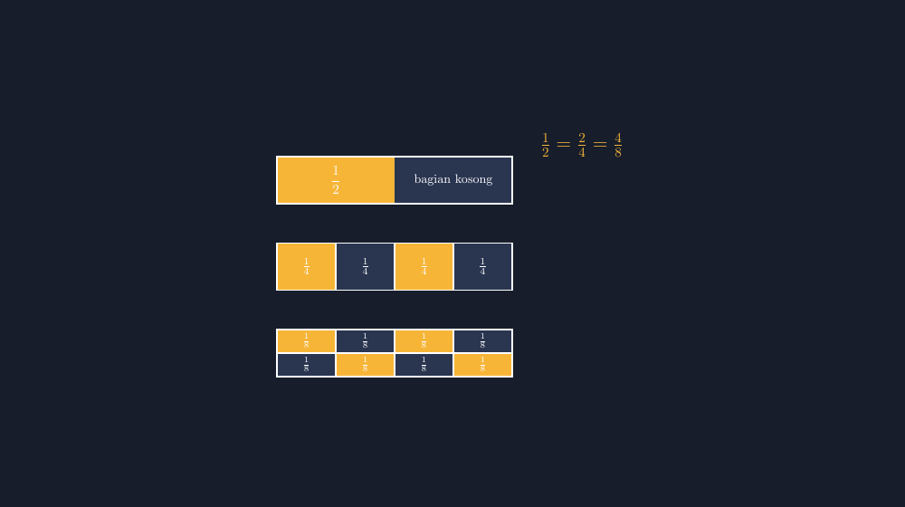
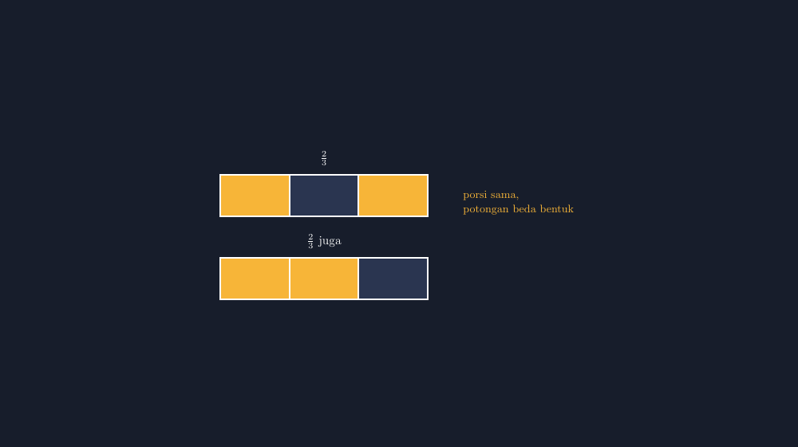

Kelas VII kemarin sedang bahas pecahan. Saya bawa satu batang cokelat murahan dari warung dekat sekolah — yang bentuknya kotak panjang, tersusun dari delapan potongan kecil. Cokelat itu bukan hadiah, tapi alat peraga yang saya beli empat ribu rupiah. Murah, tapi justru dari cokelat empat ribu rupiah itu muncul diskusi paling seru minggu ini.

Saya patahkan cokelatnya jadi dua sama panjang, lalu tunjuk setengahnya. "Berapa pecahan dari cokelat ini yang saya pegang?"

"Setengah, Pak," jawab mereka hampir serempak.

Lalu saya patahkan lagi bagian yang satu jadi dua. Sekarang tangankan memegang dua potongan kecil dari total empat. "Kalau sekarang?"

"Dua per empat."

"Jadi tadi saya pegang setengah, sekarang dua per empat. Berarti cokelatnya berubah banyak?"

Hening sebentar. Lalu ada yang bilang, "Nggak juga, Pak... yang dipegang kan tetap segitu."

Itulah momen yang saya tunggu. Angkanya berubah dari $\frac{1}{2}$ menjadi $\frac{2}{4}$, tapi porsinya tidak pindah sedikit pun. Pecahan senilai — dua angka berbeda untuk porsi yang sama — bukan sekadar aturan "kali atas kali bawah" yang harus dihafal. Ia pernyataan tentang kuantitas yang memang tidak berubah.

<!--more-->

## Masalah Muncul Saat Digambar

Setelah diskusi cokelat, tugas klasiknya: gambarlah $\frac{1}{2}$ dan $\frac{2}{4}$ pada bangun yang sama. Seperti biasa, saya minta mereka menggambar di buku. Dan seperti biasa, hasilnya kacau dengan cara yang selalu sama.

Ada yang menggambar persegi panjang panjang, membagi dua dengan garis di tengah — tapi garisnya miring. Ada yang membagi empat bagian dengan ukuran yang tidak sama: bagian pertama lebar, tiga sisanya menyempit. Ketika saya tanya, "yang diarsir ini seperempat nggak?", si pemilik gambar sendiri ragu menjawab. Kalau pembuat gambarnya saja ragu, bagaimana temannya yang melihat?

Di sinilah masalah inti pecahan senilai secara visual: untuk menunjukkan bahwa $\frac{1}{2} = \frac{2}{4} = \frac{4}{8}$, gambar kita **berutang tiga janji sekaligus** — bangunnya sama besar, pembagiannya sama lebar, dan arsirannya menutup porsi yang tepat. Gagal satu saja, kesimpulan "nilainya sama" tidak bisa ditarik dari gambar. Gambar yang tidak proporsional justru mengajarkan hal yang salah lebih meyakinkan daripada penjelasan saya di papan.

Karena itu saya sudah pindah ke TikZ untuk semua gambar pecahan di lembar soal. Mesin tidak bosan, tidak tergesa, dan tidak "asal kira-kira". Kalau saya tulis lebar bagian $1.5$, semuanya $1.5$ — tidak ada yang menyempit diam-diam.

## Menggambar Tiga Baris yang Saling Bicara

Gambar yang saya pakai di kelas sederhana saja: tiga batang persegi panjang sama panjang, satu di bawah yang lain. Baris pertama terbagi dua, baris kedua terbagi empat, baris ketiga terbagi delapan. Arsiran kuning di setiap baris menutup porsi yang sama persis secara lebar — itulah bukti visualnya.


*Persegi panjang yang sama, dibagi 2, 4, dan 8 — porsi kuningnya tidak bergeser.*

Inti kodenya hanya satu trik: ketiga baris memakai **lebar total yang sama persis**, lalu hanya jumlah pembaginya yang berubah.

```latex
\begin{tikzpicture}[scale=1.0]
% Baris 1: dibagi 2, setengah diarsir
\fill[aksen] (0,0) rectangle (3,1.2);
\draw[white] (0,0) rectangle (6,1.2);
\node at (1.5,0.6) {$\frac{1}{2}$};

% Baris 2: dibagi 4, dua bagian diarsir
\fill[aksen] (0,-2.2) rectangle (3,-1.0);
\fill[aksen] (3,-2.2) rectangle (4.5,-1.0);
\foreach \x in {1.5,3,4.5}
  \draw[white] (\x,-2.2) -- (\x,-1.0);
\draw[white] (0,-2.2) rectangle (6,-1.0);
```

Perhatikan angka-angkanya: batangnya selalu lebar $6$ satuan. Setengah dari $6$ adalah $3$; seperempat dari $6$ adalah $1.5$, dan dua bagian diarsir berarti lebar $3$ lagi; seperdelapan dari $6$ adalah $0.75$, dan empat bagian berarti tetap $3$. Ketiga blok kuning itu **memiliki lebar yang sama persis** — dan itulah satu-satunya alasan gambar itu boleh dipakai untuk mengklaim $\frac{1}{2} = \frac{2}{4} = \frac{4}{8}$.

Di kelas, gambar ini saya proyeksikan lalu saya tanya satu pertanyaan yang mengganggu: "Kalau baris paling bawah saya coret dua kotaknya lagi jadi enam belas bagian, berapa yang harus diarsir biar kuningnya tidak bertambah?"

Dari pertanyaan itu mereka sendiri yang menemukan polanya: penyebutnya dilipatgandakan, pembilangnya juga. Bukan karena buku bilang begitu, tapi karena kuningnya memang harus tetap selebar itu.

## Ketika Potongannya Beda Bentuk

Ada satu kesalahpahaman yang hampir selalu muncul dan layak digambar terpisah. Beberapa siswa percaya bahwa $\frac{2}{3}$ dan $\frac{4}{6}$ itu "sama" karena angkanya bisa disederhanakan — tapi ketika diminta membuktikannya di gambar, mereka bingung karena potongannya beda ukuran.


*Dua arsiran dengan porsi sama: satu dibagi kasar, satu dibagi halus.*

Dua batang di atas menunjukkan $\frac{2}{3}$ yang dibagi kasar dan $\frac{2}{3}$-an yang sama porsinya tapi dipotong lebih halus. Kuncinya bukan menghitung, tapi **menempelkan keduanya di batang yang sama panjang** dan melihat bahwa ujung arsirannya berhenti di tempat yang sama. Saya suka menyebut ini "ujian garis penggaris": tarik garis vertikal di ujung arsiran atas — kalau garis itu tidak jatuh pas di ujung arsiran bawah, gambar itu berbohong dan harus dibuang.

Dengan TikZ, ujian itu otomatis lulus, karena arsiran atas dan bawah digambar dari koordinat yang sama: blok kuning bawah selalu berakhir di $x = 4$ pada batang selebar $6$. Angka $4/6$ memang sederhananya $2/3$, tapi yang membuat gambar jujur bukan penyederhanaannya — melainkan dua koordinat $4$ itu.

## Belajar dari Yang Salah Sendiri

Jujur, dulunya saya juga menggambar pecahan asal. Saya pernah menyiapkan soal cerita dengan gambar kue yang dibagi enam, tapi karena saya menggambar manual dan tergesa, dua bagian terakhir lebih sempit. Seorang siswa justru menghitung dengan mengukur kertasnya — dia menemukan sendiri bahwa gambar soal saya tidak konsisten, dan bertanya, "Pak, kalau bagiannya beda-beda, ini masih seperenam nggak?" Saya tidak punya jawaban elegan selain mengakuinya. Sejak hari itu, gambar pecahan di lembar soal saya tidak lagi saya buat tangan.

TikZ tidak mengajarkan konsep pecahan senilai kepada siswa. Yang mengajarkan tetap diskusi, cokelat empat ribu rupiah, dan pertanyaan yang menggantung. Tapi TikZ menyingkirkan satu musuh yang selama ini bekerja diam-diam: gambar yang tidak proporsional yang diam-diam menanamkan keyakinan salah. Di topik yang halus seperti pecahan senilai — di mana kesimpulan utamanya justru "ini sama dengan itu" — konsistensi gambar bukan hiasan. Ia adalah argumennya sendiri.

Kalau Bapak/Ibu ingin mencoba, mulai saja dari satu batang dan satu aturan: tentukan lebar total dulu, baru bagi. Setiap titik pada gambar adalah angka yang bisa dipertanggungjawabkan — dan siswa yang terbiasa melihat gambar yang jujur akan ikut belajar menjadi jujur pada hitungannya sendiri.

> 📎 **Berkas TikZ lengkap:** [pecahan-senilai-utama.tex](tex/pecahan-senilai-utama.tex) — siap kompilasi (butuh paket `tikz` dan `amsmath`).
