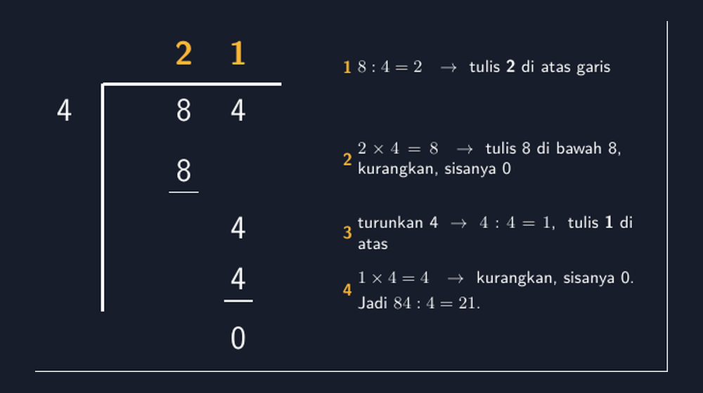
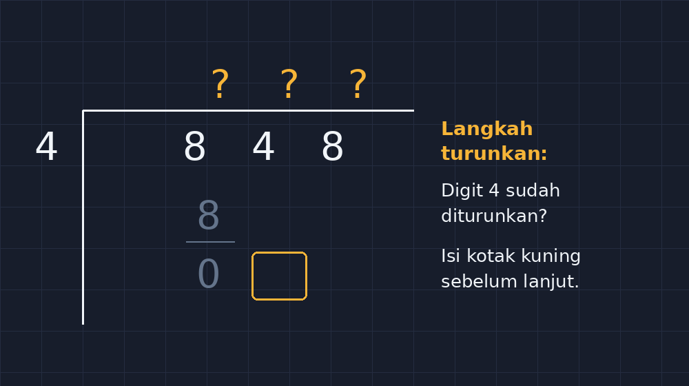

Bapak/Ibu mungkin pernah mengalami ini di kelas: siswa bisa membagi dengan lancar secara lisan, tapi begitu diminta menyelesaikan $848 : 4$ secara bersusun, hasilnya berantakan. Angka melayang entah di kolom mana, langkah "turunkan" terlewat, dan tiba-tiba jawabannya 22 alih-alih 212. Dulu saya mengira mereka tidak paham pembagiannya. Ternyata setelah saya duduk di samping mereka dan mengamati cara kerjanya satu per satu, masalahnya bukan di pembagian. Masalahnya di **peta langkah** yang tidak terlihat.

<!--more-->

## Diagnosis dari bangku samping

Kelas 4 di SD (atau kelas 7 yang sedang merapikan kembali hitungan dasarnya di SMP) punya pola kesalahan yang menarik dalam pembagian bersusun. Kalau saya suruh mereka membagi secara mental, $848 : 4 = 212$ hampir selalu keluar dengan benar. Mereka tahu bahwa 8 dibagi 4 adalah 2, mereka tahu urutan digitnya. Tapi begitu kerangka porogapit muncul di lembar kerja, tiga hal sering hilang di tengah jalan:

1. Angka hasil bagi ditulis di kolom yang tidak sejajar dengan digit yang sedang dibagi.
2. Langkah "turunkan digit berikutnya" terlewat, terutama kalau sisa pembagian sebelumnya adalah 0.
3. Pengurangan yang seharusnya tertulis di bawah tidak ditulis sama sekali, sehingga siswa kehilangan jejak dari mana angka berikutnya berasal.

Poin ketiga itulah yang paling sering saya temukan. Siswa menganggap porogapit sebagai tempat menulis jawaban, bukan sebagai **catatan proses**. Padahal justru kekuatan porogapit ada di jejaknya: setiap angka yang tertulis punya cerita tentang dirinya, dari mana ia datang dan kenapa ia ada di kolom itu.

Ketika saya membuat lembar kerja atau slide, masalah ini justru berlipat di tangan saya sendiri. Gambar pembagian bersusun yang saya buat pakai aplikasi pengolah kata sering tidak jujur pada posisi kolomnya: digit yang seharusnya sejajar malah sedikit bergeser, garis kurangannya miring, dan siswa yang melihatnya bingung membaca peta langkah yang malah menyesatkan itu.

## Porogapit di TikZ: setiap angka punya koordinat

Sejak saya mulai menggambar bahan ajar dengan TikZ, masalah posisi ini hilang dengan sendirinya. Di TikZ, setiap angka yang saya tulis punya koordinat yang saya tetapkan sendiri. Kalau saya ingin digit 4 di kolom kedua sejajar dengan digit 4 di bilangan yang dibagi, saya tinggal memberi mereka koordinat $x$ yang sama. Tidak ada fitur "auto-fit" yang memindahkan angka ke tempat yang saya tidak mau.

Berikut kerangka dasarnya untuk $84 : 4 = 21$. Saya pakai koordinat sentimeter biasa, dan setiap digit mendapat titik koordinatnya sendiri:

```latex
\begin{tikzpicture}[x=1cm,y=1cm,font=\sffamily]
  % hasil bagi
  \node[aksen,font=\Large\bfseries] at (2.55,1.20) {2};
  \node[aksen,font=\Large\bfseries] at (3.55,1.20) {1};
  % kurung siku
  \draw[white,line width=1.4pt] (1.05,0.65) -- (4.35,0.65);
  \draw[white,line width=1.4pt] (1.05,0.65) -- (1.05,-3.55);
  % pembagi
  \node[font=\Large] at (0.35,0.15) {4};
  % bilangan yang dibagi
  \node[font=\Large] at (2.55,0.15) {8};
  \node[font=\Large] at (3.55,0.15) {4};
  % langkah 1
  \node[font=\Large] at (2.55,-0.95) {8};
  \draw[white!55,line width=0.8pt] (2.28,-1.35) -- (2.82,-1.35);
  % langkah 2 : turunkan 4
  \node[font=\Large] at (3.55,-2.00) {4};
  \node[font=\Large] at (3.55,-2.95) {4};
  \draw[white!55,line width=0.8pt] (3.28,-3.35) -- (3.82,-3.35);
  \node[white!65,font=\Large] at (3.55,-4.05) {0};
\end{tikzpicture}
```

Perhatikan satu hal yang justru jadi alasan saya suka TikZ untuk materi ini: koordinat $x$ tiap digit dikunci, jadi `2.55` untuk kolom pertama dan `3.55` untuk kolom kedua. Semua angka di kolom pertama (digit 8 di 848, hasil bagi 2, hasil pengurangan 8) berbagi koordinat $x$ yang sama. Demikian pula kolom kedua. Karena itu hasilnya **jujur pada posisi kolom** — tidak ada digit yang bergeser sedikit ke samping, tidak ada garis pengurangan yang miring.

Hasil render lengkapnya, dengan keterangan langkah di sisi kanan, terlihat seperti ini:



## Empat langkah yang saya ajarkan siswa

Diagram di atas sengaja saya beri keterangan langkah, karena di kelas inilah yang saya minta siswa ucapkan dalam hati (atau keras-keras, kalau suasana kelas sedang ramai) setiap kali menyelesaikan satu siklus porogapit:

1. **Bagi**: $8 : 4 = 2$, tulis 2 di atas garis, sejajar dengan digit yang sedang dibagi.
2. **Kali**: $2 \times 4 = 8$, tulis di bawah digit 8, kurangkan, sisanya 0.
3. **Turunkan**: turunkan digit 4 berikutnya, tetap di kolomnya.
4. **Ulangi**: $4 : 4 = 1$, tulis di atas, kalikan, kurangkan, sisanya 0.

Sebenarnya hanya ada dua kata kunci yang harus hidup di kepala siswa: **bagi-kali-kurang-turunkan**, lalu ulangi sampai digit habis. Menariknya, di kelas saya justru langkah "turunkan" yang paling sering dilupakan, bukan "bagi". Mungkin karena bagi adalah operasi yang paling menarik perhatian, sementara menurunkan satu digit terasa seperti pekerjaan rumah tangga yang tidak penting.

Untuk mengatasi itu, saya mulai membiasakan satu kebiasaan kecil: setiap kali ada langkah turunkan, siswa **menulis digit turunannya secara eksplisit** di porogapit, bukan "langsung lompat" ke pembagian berikutnya. Di TikZ, saya menggambarkan digit turunan itu sedikit terpisah secara vertikal dari hasil pengurangan sebelumnya (lihat koordinat $y$ pada digit 4 di langkah 2 di atas), supaya siswa yang membaca lembar kerja bisa melihat bahwa ada **dua peristiwa berbeda**: pengurangan, lalu penurunan.

## Kenapa koordinat eksplisit itu penting untuk siswa

Ada satu hal yang saya sadari setelah berganti ke TikZ: dengan menggambar sendiri setiap angka pada koordinat eksplisit, saya jadi dipaksa berpikir seperti siswa yang belum paham. Saya tidak bisa asal menaruh angka dan berharap aplikasi menata ulang posisinya dengan baik. Setiap digit harus saya putuskan kolomnya, dan karena itu pula saya jadi sadar kolom mana yang sering salah dibaca siswa.

Sebagai contoh, angka 0 di bawah hasil pengurangan terakhir. Di banyak lembar kerja buatan aplikasi, angka 0 itu dihilangkan karena "tidak penting". Tapi justru di situ letak pembelajarannya: 0 sisa pembagian terakhir adalah **bukti** bahwa pembagian selesai dan tidak ada sisa. Kalau 0 itu hilang, siswa yang sedang ragu tidak punya jangkar untuk memastikan dirinya sudah selesai atau belum.

Saya juga mulai memanfaatkan diagram TikZ ini di lembar kerja yang saya sebar sebelum materi dijelaskan. Siswa diminta melengkapi porogapit yang sudah sebagian terisi, tapi digit yang harus mereka isi sengaja saya buat kosong pada langkah "turunkan". Pola kesalahan yang muncul dari lembar kerja itu sangat informatif: siswa yang melompati langkah turunkan akan meninggalkan digit kosong di posisi yang tepat sama, dan saya bisa langsung melihat polanya di atas kertas.



Siswa yang sudah paham mengisi digit turunan di kolom yang tepat. Siswa yang masih melompatinya akan langsung menulis hasil bagi tanpa digit turunan, dan dari sana saya bisa mengajaknya bicara: "Coba ceritakan, dari mana angka 4 di langkah kedua kamu dapat?" Pertanyaan itu hampir selalu membuat mereka menyadari sendiri langkah yang terlewat.

## Penutup: porogapit sebagai catatan proses, bukan tempat jawaban

Kalau Bapak/Ibu ingin mencoba, kerangka di atas cukup disalin dan diganti angkanya. Yang penting dipertahankan bukan angkanya, tapi **konsistensi koordinat kolom**: semua digit pada kolom yang sama berbagi koordinat $x$ yang sama. Dari konsistensi itulah gambar jadi jujur, dan dari gambar yang jujur itulah siswa belajar membaca porogapit sebagai catatan proses, bukan sekadar tempat menulis jawaban.

Pada akhirnya, yang saya ingin capai dari semua latihan porogapit ini sederhana: siswa tidak lagi melihat pembagian bersusun sebagai ritual misterius yang akhirnya menghasilkan angka, tapi sebagai **cerita langkah demi langkah** yang bisa mereka baca ulang, periksa ulang, dan jelaskan ulang kepada temannya. Kalau itu tercapai, saya rasa gambar porogapit yang saya buat di TikZ sudah tidak sia-sia.

> 📎 **Berkas TikZ lengkap:** [tikz-pembagian-bersusun.tex](tex/tikz-pembagian-bersusun.tex) — siap kompilasi (butuh paket `tikz`).
