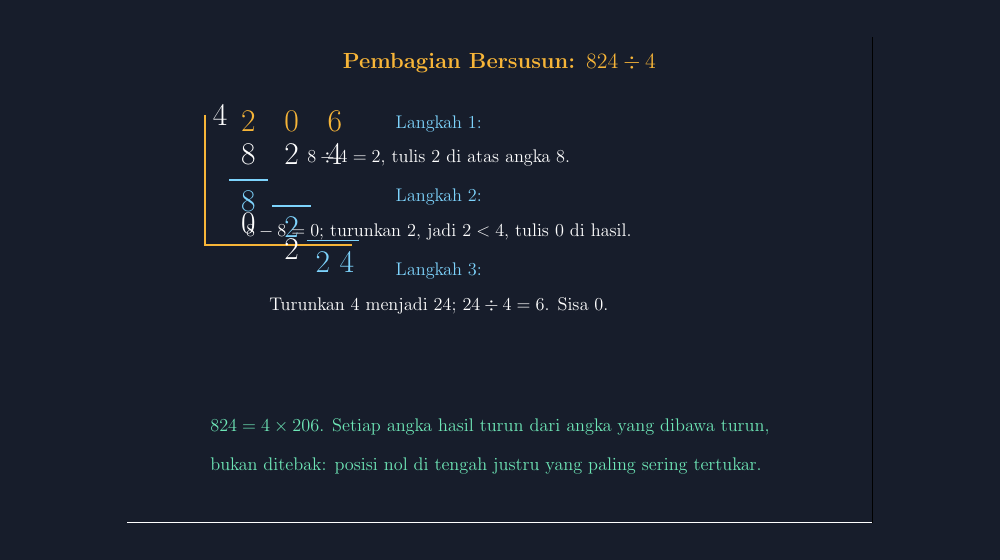

Minggu lalu saya mengajar pembagian bersusun di kelas VII. Materi yang terlihat sederhana, tapi begitu latihan dimulai, tangan-tangan di kelas langsung terbagi dua: ada yang lancar, ada yang diam sambil menatap buku. Bagas, salah satu anak yang biasanya aktif, akhirnya mengangkat tangan juga. "Pak, angkanya kok bisa hilang sendiri?" Ia benar-benar bingung karena di papan tulis, angka 2 pada hasil 206 tiba-tiba muncul begitu saja, tanpa kelihatan dari mana asalnya.

Keluhan Bagas itu bukan hal baru. Setiap tahun saya menemui pola yang sama ketika mengajarkan pembagian bersusun, dan akar masalahnya hampir selalu sama: langkah "menyimpan" dalam proses pembagian tidak terlihat.

## Masalahnya bukan angkanya, tapi yang tidak terlihat

Dalam pembagian bersusun, siswa diminta melakukan tiga hal yang saling bertumpuk: membagi, mengurangkan, dan menurunkan angka berikutnya. Yang tertulis di kertas hanya hasil akhir dari setiap operasi. Angka yang sudah dikurangkan hilang dari papan, angka yang "diturunkan" berpindah posisi seketika, dan sisa pembagian lupa dicatat. Semua proses itu terjadi di kepala, atau di garis-garis samar yang cepat terhapus.

Rara, murid saya yang teliti, pernah menulis hasil 26 untuk 824 : 4. Ia lupa menulis nol di tengah, karena saat menghitung 2 : 4 ia merasa "tidak ada hasilnya" lalu langsung melompat ke angka berikutnya. Nol itu bukan sekadar formalitas; tanpa nol, posisi angka 6 bergeser dan nilainya berubah total. Dari 206 menjadi 26. Justru nol di tengah itulah bagian yang paling sering hilang, dan hilangnya karena langkah di baliknya tidak pernah digambar.

Sebagai guru, saya jadi berpikir: kalau masalahnya adalah langkah yang tidak terlihat, kenapa tidak saya buat gambar yang benar-benar menampilkan setiap langkah itu, satu per satu, dengan warna yang berbeda? Di situlah TikZ masuk.



Gambar di atas adalah hasil akhirnya: porogapit 824 : 4 di panel kiri, dengan setiap angka yang ditulis, dikurangkan, dan diturunkan digambar secara eksplisit di posisinya. Panel kanan merangkum tiga langkahnya dalam kalimat pendek. Semua digambar dengan TikZ di LaTeX, latar gelap supaya angka berwarna lebih menonjol saat ditampilkan lewat proyektor.

## Menggambar pembagian bersusun dengan TikZ

Ide dasarnya sederhana: porogapit adalah kumpulan koordinat, dan setiap angka adalah sebuah node yang saya letakkan di koordinat tertentu. Karena TikZ menggambar berdasarkan posisi, saya tidak bisa "mencatat di pinggir" seperti saat menulis di papan — setiap angka harus punya tempat yang jelas. Justru keterbatasan ini yang memaksa proses berpikir siswa jadi eksplisit.

Inti dari gambar tersebut adalah potongan kode berikut:

```latex
\begin{tikzpicture}
  \fill[bg] (-0.8,-1.0) rectangle (18.8,9.0);

  % tanda pembagian
  \draw[aksen, line width=1.6pt] (0,5.2) -- (0,2.0) -- (2.6,2.0);
  \node[aksen, font=\huge] at (0.45,5.2) {4};

  % hasil di atas (aksen)
  \node[aksen, font=\huge] at (1.35,5.2) {2};
  \node[aksen, font=\huge] at (2.35,5.2) {0};
  \node[aksen, font=\huge] at (3.35,5.2) {6};

  % 824
  \node[teks, font=\huge] at (1.35,4.0) {8};
  \node[teks, font=\huge] at (2.35,4.0) {2};
  \node[teks, font=\huge] at (3.35,4.0) {4};

  % langkah 1: 8 - 8
  \node[biru, font=\huge] at (1.35,2.9) {8};
  \draw[biru, line width=1.2pt] (0.9,3.35) -- (1.8,3.35);
  \node[teks, font=\huge] at (1.35,2.2) {0};
\end{tikzpicture}
```

Mari saya bedah koordinatnya, karena di sinilah "rahasia" gambar ini berada:

- **Kolom vertikal** adalah posisi nilai tempat. Angka 8, 2, dan 4 dari 824 diletakkan di $x = 1.35$, $2.35$, dan $3.35$ — jarak satu satuan antar kolom. Hasil 2, 0, 6 menempati kolom yang sama persis, hanya di baris $y = 5.2$ di atasnya. Dengan cara ini, siswa bisa melihat bahwa angka 2 pada hasil memang berada "di atas angka 8", bukan di posisi acak.
- **Angka pembagi** 4 digambar di kiri atas, di ujung garis pembagian yang saya tarik dari $(0,5.2)$ turun ke $(0,2.0)$ lalu mendatar ke $(2.6,2.0)$. Garis ini digambar dengan warna aksen kuning supaya matanya langsung tertuju ke sana dulu.
- **Angka yang dihitung** (yang "disimpan") diberi warna biru muda dan diletakkan di bawah garis pembatas. Pada langkah pertama, angka 8 biru di $y = 2.9$ berarti "8 inilah yang dikurangkan", dan hasilnya 0 di $y = 2.2$ langsung berada di bawahnya. Garis horizontal biru di $y = 3.35$ adalah tanda bahwa di baris itu terjadi operasi pengurangan.
- **Angka yang diturunkan** cukup ditempatkan di kolom berikutnya pada baris yang sesuai. Pada langkah kedua, angka 2 biru di $(2.35, 2.0)$ memperlihatkan bahwa 2 itu memang "turun" ke bawah, bukan muncul dari nontonan.

Warna juga bukan hiasan. Putih untuk angka asli 824 dan hasil antara, kuning untuk pembagi dan hasil akhir, biru untuk angka yang sedang dioperasikan, hijau untuk catatan penutup. Ketika saya menampilkan gambar ini di kelas dan bertanya, "angka mana yang barusan dikurangkan?" — semua tangan menunjuk ke yang biru. Tidak ada lagi mitos angka yang hilang sendiri.


Panel per langkah seperti di atas saya buat juga, supaya saya bisa menampilkan satu langkah saja pada satu slide, tanpa membebani siswa dengan gambar utuh yang belum selesai.

## Cara saya memakainya di kelas

Sekarang urutan mengajarnya berubah. Dulu saya menulis di papan sambil berbicara, dan siswa menyalin hasil akhir tiap langkah. Sekarang saya tampilkan gambar langkah pertama saja: 8 dibagi 4, hasilnya 2, tulis di atas angka 8. Siswa menebak dulu apa yang akan muncul berikutnya, baru saya lanjut ke langkah kedua. Tepat saat 8 biru dan garis pengurangnya muncul, biasanya ada suara "ohhh" dari belakang kelas. Suara kecil itu yang saya kejar setiap mengajar.

Danu, yang sebelumnya selalu tertukar antara "turunkan" dan "kurangkan", akhirnya bisa menjelaskan ulang langkah ketiga dengan kalimatnya sendiri: "Turunkan 4 jadi 24, 24 dibagi 4 sama dengan 6, tulisnya paling kanan, sisanya nol." Kalau seorang siswa bisa mengucapkan ulang proses itu lengkap dengan posisinya, saya yakin gambar ini bekerja.

Satu hal yang saya tekankan pada siswa: nol di hasil bukan berarti "tidak ada apa-apa". $2 : 4$ tetap menghasilkan 0 yang wajib ditulis, karena yang sedang kita bagi adalah digit, bukan nilainya. Setelah gambar ini dipakai, kesalahan lupa-nol di kelas saya nyaris tidak muncul lagi di ulangan berikutnya.

## Kompilasi dan penyesuaian

Untuk menggambar versi sendiri, Bapak/Ibu cukup mengganti angka-angka di dalam node dan menyesuaikan koordinatnya. Beberapa catatan praktis dari pengalaman saya:

- Gunakan `standalone` sebagai document class supaya hasil PDF-nya pas ukuran gambar, mudah dipangkas jadi PNG.
- Definisikan warna sekali di preamble (`\definecolor{aksen}{HTML}{F7B538}` misalnya) supaya konsisten di semua gambar materi.
- Jarak antar kolom satu satuan memudahkan penambahan digit: kalau mau mengganti 824 dengan 1548, tinggal geser kolom dan tambah satu node.
- Untuk contoh dengan sisa, catatan sisa cukup dijadikan node kecil di bawah, seperti tulisan "sisa 0" pada gambar saya.

Pembagian bersusun memang materi lama, tapi cara membuatnya terlihat bisa baru. TikZ memaksa kita, sang guru, untuk menuliskan proses berpikir dalam bentuk koordinat — dan koordinat tidak membiarkan ada langkah yang menghilang. Bagas tidak lagi bertanya dari mana angkanya datang; sekarang ia yang menunjuk ke layar dan menjelaskan ke teman sebangkunya.

> 📎 **Berkas TikZ lengkap:** [pembagian-bersusun.tex](tex/pembagian-bersusun.tex) — siap kompilasi (butuh paket `tikz`).
