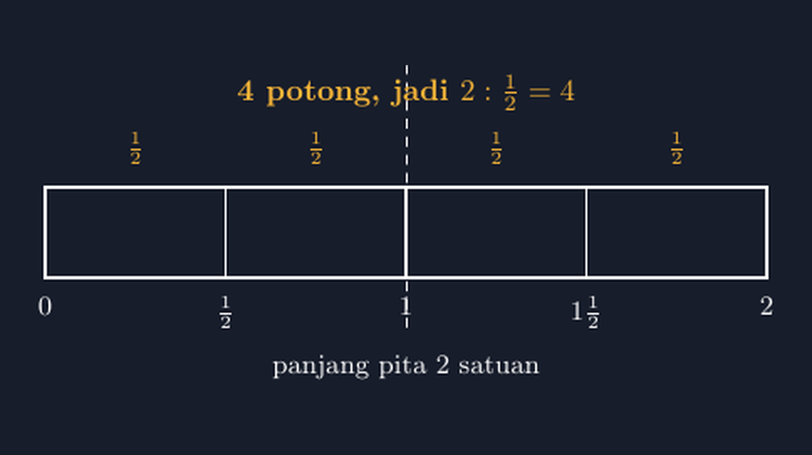
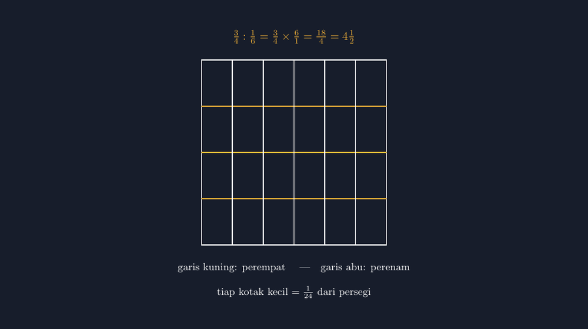

Ada satu soal yang setiap tahun selalu membuat kelas saya hening: $2 : \frac{1}{2}$. Tahun lalu saya melemparnya begitu saja di kelas VIII, sebagai pemanasan sebelum masuk materi. Jawaban pertama yang muncul, hampir serempak, adalah "1, Pak". Logikanya terdengar masuk akal untuk anak yang masih berbunga-bunga dengan perkalian: dua dibagi setengah, ya jadi setengah, dong. Angka duanya memang di sana, tinggal dibagi.

Saya tidak mengoreksi. Saya hanya mengambil spidol dan menggambar satu garis panjang di papan. "Begini," kata saya, "ini pita sepanjang dua meter. Ibu Oca di kantor butuh potongan masing-masing setengah meter untuk hiasan kelas. Berapa potong yang bisa saya berikan?"

Hening lagi, kali ini hening yang berbeda — hening sebelum jawaban, bukan sesudah kebingungan. Lalu dari pojok kanan, seorang murid berkata pelan: "Empat, Pak. Setengah, satu, satu setengah, dua." Ia menghitung sambil tangannya mengetuk-ngetuk papan. Empat potong. Jadi $2 : \frac{1}{2} = 4$.

Dari situ saya sadar: pembagian pecahan bukan gagal karena siswa tidak bisa menghitung, tapi karena maknanya tidak pernah kelihatan. Aturan "balikkan lalu kalikan" diajarkan terlalu cepat, sebelum ada gambar di kepala. Artikel ini adalah catatan saya tentang dua gambar yang sejak itu selalu saya pakai — dan bagaimana saya menggambarnya dengan TikZ supaya bisa masuk lembar kerja tanpa kehilangan kejujurannya.

<!--more-->

## Pertanyaan yang Harus Dijawab Gambar Dulu

Sebelum bicara algoritma, ada satu pertanyaan yang menurut saya wajib dijawab dulu: apa artinya membagi dengan pecahan? Ada dua makna, dan keduanya penting.

Makna pertama: *berapa banyak yang muat*. $2 : \frac{1}{2}$ berarti "ada berapa potong setengah di dalam dua". Ini yang saya modelkan dengan pita. Makna kedua: *berapa besar satu bagian*. $3 : \frac{1}{2}$ bisa berarti "tiga dibagi untuk setengah kelompok anak — berapa untuk satu kelompok penuh?" Dua makna ini menghasilkan jawaban sama, tapi jalannya beda, dan murid yang hanya hafal satu makna akan tersesat saat soal berganti konteks.

Masalahnya, makna pertama sulit digambar asal-asalan. Kalau saya sketsa cepat di papan, pita yang "dua meter" dan potongan yang "setengah meter" sering tidak proporsional, dan justru itu yang tertinggal di kepala murid: gambar yang tidak jujur. Di sinilah TikZ memberi saya ketenangan — koordinatnya bisa saya hitung, jadi panjang pita dan panjang potongan pasti setia pada angka yang saya maksud.

## Gambar Pertama: Pita yang Dipotong

Model pita untuk $2 : \frac{1}{2}$ saya gambar sebagai persegi panjang sepanjang 8 satuan, dibagi empat — jadi tiap potong tepat 2 satuan gambar untuk setengah "meter" pita. Angka 0, $\frac{1}{2}$, 1, $1\frac{1}{2}$, dan 2 saya letakkan di bawah, dan tiap potong diberi label $\frac{1}{2}$ di atasnya.


*Gambar 1. Pita sepanjang 2 satuan yang dipotong tiap $\frac{1}{2}$: ada empat potong, jadi $2 : \frac{1}{2} = 4$.*

Yang saya suka dari gambar ini: murid bisa *menghitung* jawabannya, bukan menebak. Mereka melihat empat potong $\frac{1}{2}$ mengisi penuh pita dua satuan. Lalu pertanyaan lanjutan datang sendiri — biasanya dari murid yang paling diam. "Pak, kalau potongannya $\frac{1}{4}$, jadi berapa?" Delapan. Mereka menemukan sendiri pola bahwa pembaginya makin kecil, hasilnya makin besar — sesuatu yang terasa salah kalau hanya dibayangkan dengan "dibagi berarti jadi kecil".

Justru di titik ini aturan "balikkan dan kalikan" mendapat tempatnya. $2 : \frac{1}{2} = 2 \times \frac{2}{1} = 4$. Murid yang sudah melihat gambar akan membaca aturan itu bukan sebagai sulap, tapi sebagai ringkasan: membagi dengan $\frac{1}{2}$ sama artinya dengan menanyakan berapa banyak $\frac{1}{2}$ muat — dan banyaknya muat adalah dua kali lipat panjangnya.

## Gambar Kedua: Ketika Pembaginya Juga Pecahan

Model pita nyaman selama pembilangnya mudah. Tapi begitu soal berubah menjadi $\frac{3}{4} : \frac{1}{6}$, pita mulai ramai — dan di sinilah kelas saya biasanya mulai menebak-nebak. Untuk soal seperti ini saya pindah ke model persegi.


*Gambar 2. Model persegi untuk $\frac{3}{4} : \frac{1}{6}$: garis kuning membagi perempat, garis abu membagi perenam; keduanya bertemu di kotak kecil $\frac{1}{24}$.*

Satu persegi besar. Garis-garis kuning mendatar membaginya menjadi empat baris sama tinggi — itulah perempat. Garis-garis abu tegak membaginya menjadi enam kolom sama lebar — itulah perenam. Kedua kelompok garis berpotongan dan membentuk kisi-kisi kecil: $4 \times 6 = 24$ kotak, tiap kotak bernilai $\frac{1}{24}$ dari persegi.

Sekarang pertanyaan pembagiannya jadi bisa dihitung dengan mata. $\frac{3}{4}$ itu tiga baris kuning — ada $3 \times 6 = 18$ kotak kecil. $\frac{1}{6}$ itu satu kolom abu — ada $1 \times 4 = 4$ kotak kecil. Berapa banyak perenam muat di dalam tiga perempat? $\frac{18}{4} = 4\frac{1}{2}$ kali. Dan kalau murid menuliskan langkahnya,

$$\frac{3}{4} : \frac{1}{6} = \frac{3}{4} \times \frac{6}{1} = \frac{18}{4} = 4\frac{1}{2},$$

angka 18 dan 4 di hasil itu bukan lagi hasil sulapan — 18 pernah mereka hitung sebagai kotak kecil, 4 pernah mereka hitung sebagai kotak dalam satu kolom. Aturan "balikkan dan kalikan" tumbuh dari gambar, bukan mendahuluinya.

## TikZ yang Menjaga Kejujuran Gambar

Kode untuk kedua gambar ini sengaja saya buat sesederhana mungkin. Untuk pita, kuncinya cuma pembagian koordinat yang rapi:

```latex
\draw[thick] (0,0) rectangle (8,1);
\foreach \x in {2,4,6} \draw[thick] (\x,0) -- (\x,1);
\foreach \x in {1,3,5,7} \node[above=4pt] at (\x,1) {$\frac{1}{2}$};
\foreach \x/\t in {0/$0$,2/$\frac{1}{2}$,4/$1$,6/$1\frac{1}{2}$,8/$2$}
  \node[below=3pt] at (\x,0) {\t};
```

Empat potong, tiap potong dua satuan gambar. Kalau besok saya butuh versi dengan pembagi $\frac{1}{4}$, tinggal mengganti daftar koordinat — dan proporsi tidak mungkin melenceng, karena yang menentukan adalah angka, bukan taksiran tangan.

Untuk model persegi, kuncinya adalah membiarkan dua kelompok garis berpotongan tanpa mencoba menggambar kotak kecilnya satu per satu:

```latex
\draw[thick] (0,0) rectangle (6,6);
\foreach \y in {1.5,3,4.5} \draw[thick, yellow!80!orange] (0,\y) -- (6,\y);
\foreach \x in {1,2,3,4,5} \draw[thick, gray!60] (\x,0) -- (\x,6);
```

Tiga garis kuning, lima garis abu, dan TikZ yang menyusun potongannya. Warna kuning dan abu saya pilih supaya murid bisa menutup satu warna dengan jarinya dan "melihat" pecahan yang satu tanpa diganggu yang lain — trik kecil yang ternyata sering dipakai murid sendiri saat mengerjakan lembar kerja.

> 📎 **Berkas TikZ lengkap:** [pembagian-pecahan.tex](tex/pembagian-pecahan.tex) — siap kompilasi (butuh paket `tikz` dan `amsmath`).

## Refleksi: Algoritma Datang Terakhir

Kalau ada satu hal yang saya pegang setelah bertahun-tahun menghadapi soal ini, itu urutan: gambar dulu, hitung kemudian, algoritma paling akhir. Murid yang langsung diberi aturan "balikkan dan kalikan" akan bisa mengerjakan sepuluh soal latihan dan tetap menjawab "1" saat bertemu $2 : \frac{1}{2}$ di konteks baru. Murid yang dulu pernah memotong pita di papan — meski hanya lewat gambar saya — akan mengingat empat potong itu bertahun-tahun kemudian.

Tahun ini, ketika soal $\frac{3}{4} : \frac{1}{6}$ muncul di ulangan, seorang murid menulis di pinggir lembaranya: "18 kotak, 4 kotak, jadi $4\frac{1}{2}$". Ia tidak menulis aturannya sama sekali. Saya memberi tanda centang besar, dan merasa gambar-gambar itu sudah membayar dirinya sendiri.
