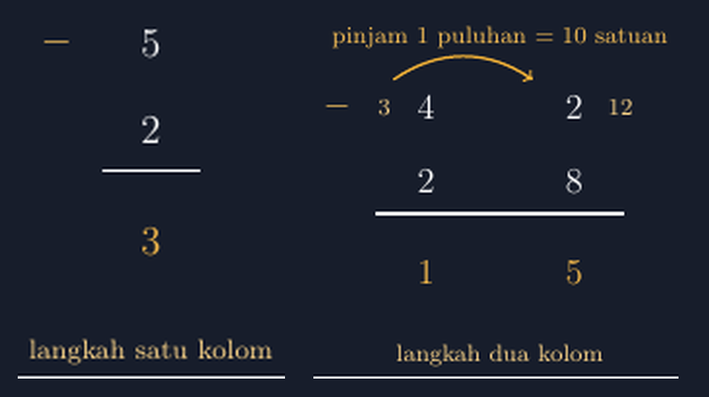

Malam koreksi pekerjaan rumah kelas IV (saya sempat menggantikan rekan yang sedang cuti di kelas tersebut), saya menemukan sesuatu yang membuat saya berhenti cukup lama di satu lembar jawaban. Soalnya sederhana: $43 - 28$. Siswa itu menulis $25$. Bukan $25$ yang berasal dari salah hitung — dia menulisnya dengan percaya diri, tulisannya rapi, bahkan dia menuliskan langkah bersusunnya dulu di kertas buram sebelum menyalin ke buku. Yang dia tulis di langkah bersusun itu: kolom satuan dia "menyerang" $8$ dari $3$, tidak bisa, lalu dia membalik urutan dan menghitung $8 - 3 = 5$. Di kolom puluhan, $4 - 2$, jadi $2$. Hasilnya $25$, dan dia merasa sudah bekerja dengan benar.

<!--more-->

## Masalah yang tidak hilang begitu siswa naik kelas

Kesalahan seperti itu biasanya kita anggap "masalah kelas rendah". Tapi coba perhatikan pekerjaan siswa SMP di kelas VII saat mereka bertemu pengurangan bilangan bulat. Siswa yang dulu membalik urutan pengurangan kolom satuan itu, sekarang menghadapi soal seperti $-8 + 3$ atau mencari selisih suhu $-5^{\circ}\text{C}$ dan $2^{\circ}\text{C}$. Anak yang dulu tidak pernah benar-benar memahami *kenapa* $3$ tidak bisa dikurangi $8$ langsung, sekarang bingung dengan alasan yang lebih dalam: dia tidak punya gambaran utuh tentang apa yang terjadi pada angka-angka saat kita "meminjam".

Ada benang merahnya: langkah meminjam itu sendiri. Di buku dan papan tulis, langkah itu sering tampil sebagai coretan kecil — angka $4$ dicoret jadi $3$, angka $3$ ditulis kecil jadi $13$, dan semuanya terjadi dalam sepersekian detik tulisan tangan guru. Siswa melihat hasilnya, tapi proses yang menghubungkan satu coretan ke coretan berikutnya itu, bukan sesuatu yang bisa dia amati pelan-pelan.

## Mulai dari yang tidak butuh pinjam

Saya mencoba menyelesaikannya dengan cara yang sudah saya yakini belakangan ini: kalau suatu proses tidak bisa diamati dengan pelan, buat dia diamati. Tulis ulang langkah-langkahnya dengan TikZ, sehingga setiap tahap punya gambar tersendiri yang bisa saya tampilkan satu per satu di kelas.

Kami mulai dari kasus yang tidak butuh pinjam sama sekali: $5 - 2$.


*Dua langkah yang kami jalani: pengurangan satu kolom tanpa pinjaman, lalu pengurangan dua kolom yang membutuhkan satu pinjaman puluhan. Angka kecil berwarna kuning menunjukkan perubahan yang terjadi pada tiap kolom.*

Sebelum menampilkan gambar, saya tanya dulu: "Kalau $5$ dikurangi $2$, dari mana angkanya datang?" Jawaban mereka beragam, tapi kebanyakan menjawab insting: "$3$ dong, Pak." Ya, memang $3$. Tapi ketika saya minta mereka menjelaskan *prosesnya*, jawaban itu jadi lebih pelan. Di sinilah gambar pertama itu masuk: ia memperlihatkan baris $5$, baris $2$, garis, lalu hasilnya $3$ — dan tidak ada yang lain. Tidak ada pinjaman, tidak ada coretan. Pengurangan satu kolom adalah kasus yang paling jujur: angka di atas dikurangi angka di bawah, selesai.

Tujuan saya bukan mengajarkan $5-2$ ke siswa SMP atau kelas IV. Tujuannya adalah membuat mereka menyadari bahwa pengurangan bersusun punya "kasus dasar" yang bersih, dan segala kerumitan yang datang kemudian adalah tambahan atas kasus dasar itu, bukan penggantinya.

## Kolom kedua: saat $3$ tidak cukup untuk $8$

Kasus dua kolom saya ajak mereka lewat pertanyaan yang sama, tapi kali ini di tengah jalan mereka tersandung: $43 - 28$. Di kolom satuan, $3$ harus dikurangi $8$, dan itu tidak bisa (dalam bilangan cacah). Di sinilah diskusi jadi hidup. Siswa bertanya: "Kalau tidak bisa, gimana, Pak?" Sebagian menjawab "dibalik aja", dan di titik itulah saya menunjukkan bahwa membalik adalah jalan keluar yang tidak jujur — dia mengubah soalnya, bukan menyelesaikannya.

Kami bahas bersama: ada "stok" di kolom sebelah kiri. Satu puluhan itu nilainya sama dengan sepuluh satuan. Jadi kalau $3$ tidak cukup, kami pinjam satu puluhan dari kolom puluhan — dan itu bukan trik, itu konversi satuan yang sah: satu puluhan $= 10$ satuan.

Gambar kedua di atas memperlihatkan langkah itu secara eksplisit. Panah dari kolom puluhan ke kolom satuan menyatakan pinjaman. Angka $4$ yang asli tidak hilang begitu saja — dia menjadi $3$, dan angka kecil $3$ di sebelahnya mencatat perubahan itu. Di kolom satuan, $3$ menjadi $13$, dan angka kecil $13$ mencatatnya juga. Sekarang pengurangan di kolom satuan menjadi sah dalam bilangan cacah: $13 - 8 = 5$. Di kolom puluhan, $3 - 2 = 1$. Hasilnya $15$, dan setiap angka di hasil itu punya asal-usul yang bisa ditunjuk.

## Kenapa TikZ, bukan sekadar gambaran tangan

Saya bisa saja menggambar ini di papan tulis. Kenapa saya pilih TikZ? Beberapa alasan yang saya rasakan langsung:

Pertama, konsistensi. Gambar papan tulis saya berubah tiap kelas, dan sering kali tidak seimbang — kolomnya miring, jarak antar angka tidak konsisten. Dengan TikZ, posisi angka di tiap kolom saya tetapkan sekali, dan semua kelas mendapat gambar yang sama rapi. Kuncinya di koordinat: kolom puluhan saya letakkan di $x = 0$, kolom satuan di $x = 1.6$, sehingga tiap angka punya alamat yang tidak berubah.

Kedua, warna sebagai penanda proses. Di gambar saya, hasil akhir ditandai warna kuning, sementara angka asli ditandai putih. Coretan perubahan (angka kecil $3$ dan $13$) diberi warna yang lebih redup. Siswa bisa membedakan dalam sekali pandang: mana yang awal, mana yang berubah, mana yang hasil. Di papan tulis, semua tinta itu sama warnanya.

Ketiga, dan ini yang paling penting untuk saya pribadi: memaksa saya berpikir urut. Saat menulis kode TikZ untuk proses ini, saya tidak bisa asal coret. Saya harus memutuskan lebih dulu: tahap mana yang digambar, di koordinat mana, dengan label apa. Kalau urutan langkahnya saya tidak paham, kodenya tidak akan jadi. Jadi membuat gambar ini juga memaksa saya, gurunya, untuk mengurutkan pemahaman saya sendiri.

Potongan kode untuk panel kedua kira-kira seperti ini:

```latex
\begin{tikzpicture}[scale=1.1]
  \def\colX{0} \def\colY{1.6}
  \node[anchor=east, color=aksen!80] at (-0.7,3.6) {\large $-$};
  \node at (\colX,3.6) {\large 4};   \node at (\colY,3.6) {\large 2};
  \node at (\colX,2.8) {\large 2};   \node at (\colY,2.8) {\large 8};
  \draw[thick] (-0.55,2.45) -- (2.15,2.45);
  \node[color=aksen!90] at (\colX,1.8) {\large 1};
  \node[color=aksen!90] at (\colY,1.8) {\large 5};
  \draw[->, thick, aksen] (\colX-0.35,3.9) to[bend left=35] (\colY-0.45,3.9);
  \node[color=aksen!85, font=\footnotesize] at (0.8,4.35)
       {pinjam 1 puluhan $=10$ satuan};
  \node[color=aksen!60, font=\footnotesize] at (\colX-0.45,3.6) {3};
  \node[color=aksen!60, font=\footnotesize] at (\colY+0.5,3.6) {12};
\end{tikzpicture}
```

Perhatikan bahwa kode ini tidak menggambar "coretan" — dia menggambar *hasil dari* coretan: angka kecil di samping angka asli, bukan menggantikannya. Itu keputusan penting, karena siswa sering bingung ketika coretan tampil seolah menghapus angka sebelumnya. Dengan menampilkan keduanya berdampingan, siswa melihat bahwa angka $4$ tidak hilang; dia berubah jadi $3$ karena satu puluhannya dipinjam.

## Perubahan kecil yang saya lihat

Tahun ini, saat saya beri soal serupa di ulangan harian, kesalahan membalik urutan pengurangan kolom satuan turun cukup jauh dibanding tahun lalu. Bukan nol — masih ada yang tertukar, masih ada yang lupa mengurangi angka pinjaman di kolom puluhan — tapi mereka tidak lagi melakukannya dengan percaya diri yang keliru. Beberapa siswa bahkan menggambar sendiri panah pinjam kecil di kertas buram mereka sebelum menghitung, persis seperti di gambar yang kami bahas bersama.

Itu bukan kemenangan besar. Tapi bagi saya, itu tanda bahwa sesuatu yang tadinya hanya "urusan menghafal langkah" perlahan berubah menjadi sesuatu yang mereka *lihat*. Dan ketika mereka sudah bisa melihatnya, saya bisa mulai bertanya hal yang lebih penting: bukan "berapa hasil $43 - 28$", tapi "kenapa $4$ berubah jadi $3$". Pertanyaan kedua itu jauh lebih berat, tapi juga jauh lebih layak untuk diajukan.

> 📎 **Berkas TikZ lengkap:** [panel-cosong.tex](tex/panel-cosong.tex) dan [panel-dua-kolom.tex](tex/panel-dua-kolom.tex) — siap kompilasi (butuh paket `tikz`).
