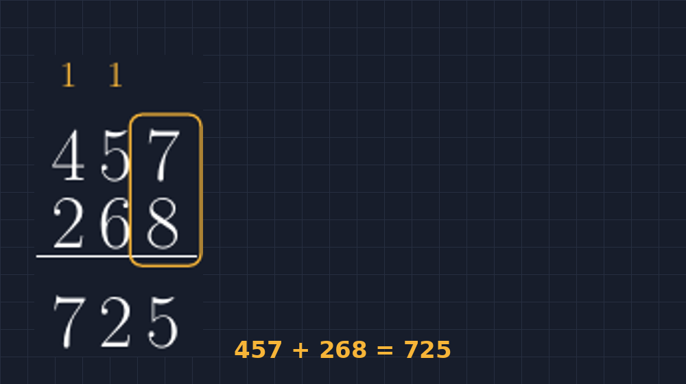
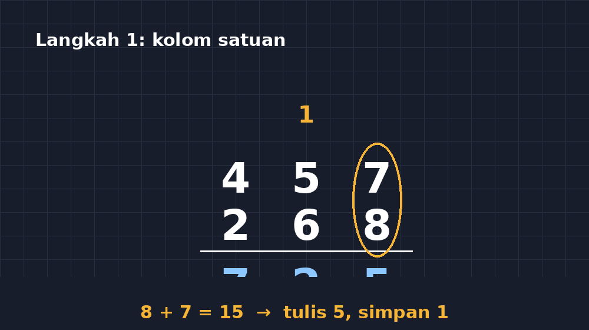

Ada satu momen yang saya temui hampir setiap tahun di kelas VII, terutama di awal semester ketika kita membersihkan kembali fondasi hitungan. Saya tulis di papan: $457 + 268$. Hampir semua anak angkat pena, dan hampir semua jawaban muncul cepat. Tapi kalau saya tanya, "Delapan tambah tujuh berapa?", jawabannya "Lima belas." Lalu saya tanya lagi, "Lalu limanya ditulis di mana?" Di situ mulai terlihat: sebagian anak menulis 5 di satuan, sebagian menulis 15 di satuan, dan sebagian lagi -- yang paling menarik buat saya -- menulis angka kecil "1" di atas kolom puluhan dengan ukuran setengah huruf normal, seolah-olah malu ikut ke jawaban.

<!--more-->

Angka kecil itu, si "1" yang malu, justru jantung dari seluruh materi ini. Di lembar soal yang saya buat dengan LaTeX, saya lama sekali tidak puas kalau penyimpanan itu hanya tinggal sebagaimana adanya. Karena sebenarnya inilah yang ingin saya tunjukkan ke siswa: bahwa algoritma bersusun bukan sihir, melainkan catatan kecil yang jujur tentang sesuatu yang tidak muat di kolomnya.

## Kenapa perlu digambar, bukan cuma ditulis

Ketika saya membuat bahan ajar atau lembar latihan, saya sering menampilkan bukan hanya soalnya, tapi juga contoh pengerjaannya dengan langkah yang terbaca. Di papan tulis, mudah: saya garis bawah, saya lingkari, saya beri panah. Tapi di dokumen cetak, kalau saya hanya mengetik

$$457 + 268 = 725$$

maka semua proses itu hilang. Anak yang masih bingung melihat dua angka dan satu hasil, tanpa tahu apa yang terjadi di tengahnya. Sementara itu, kalau saya menulis langkah demi langkah secara miring (horizontal), anak justru sering kehilangan jejak posisi nilai tempat.

Makanya saya akhirnya rajin menggambar versi bersusunnya dengan TikZ. Gambar ini memberi saya tiga hal yang tidak bisa diberikan teks biasa: posisi kolom yang presisi, angka simpanan yang jelas berbeda ukurannya dari angka utama, dan garis bantu yang bisa saya warnai untuk menunjukkan kolom mana sedang "bekerja".

## Sketsa paling sederhana: tabel kolom yang jujur

Cara paling sederhana adalah menganggap perhitungan bersusun sebagai kisi-kisi kecil. Setiap angka duduk di selnya, dan angka simpanan duduk di atasnya dengan ukuran kecil dan warna berbeda. Beginilah inti idenya:

```latex
\begin{tikzpicture}[x=1cm, y=1cm]
  % angka simpanan (kecil, kuning)
  \node[smallnum] at (1.0, 1.4) {1};
  \node[smallnum] at (0.5, 1.4) {1};
  % angka utama
  \node[bignum] at (0.5, 0.7) {4};
  \node[bignum] at (1.0, 0.7) {5};
  \node[bignum] at (1.5, 0.7) {7};
  \node[bignum] at (0.5, 0.0) {2};
  \node[bignum] at (1.0, 0.0) {6};
  \node[bignum] at (1.5, 0.0) {8};
  \node[bignum] at (0.5, -0.7) {8};
  \node[bignum] at (1.0, -0.7) {3};
  \node[bignum] at (1.5, -0.7) {5};
  % garis pemisah
  \draw[thick] (0.2, -0.35) -- (1.8, -0.35);
\end{tikzpicture}
```

Gaya `smallnum` dan `bignum` saya definisikan sekali di preamble, jadi seluruh dokumen konsisten. `smallnum` saya buat lebih kecil dan berwarna aksen; `bignum` hitam pekat. Dengan begitu, saat siswa melihat lembar kerja, mata mereka langsung bisa membedakan mana catatan kecil dan mana angka yang benar-benar dihitung.


*Perhitungan $457 + 268$ versi bersusun: angka simpanan (kuning kecil) duduk di atas, angka utama rapi di kolomnya.*

Perhatikan bahwa angka simpanan saya letakkan di atas kolom yang *menerimanya*, bukan kolom yang *menghasilkannya*. Ini detail kecil yang sering saya perbaiki di lembar lama: tadinya saya menaruh "1" di atas kolom satuan, karena di situlah $8+7$ terjadi. Padahal yang lebih bermakna bagi siswa adalah: "angka kecil ini menunggu untuk ditambahkan di kolom puluhan." Setelah saya pindahkan, pertanyaan siswa soal "angka 1 ini darimana?" berkurang drastis.

## Menambahkan arah berpikir dengan panah

Tahap kedua yang menurut saya paling berdampak adalah memberi panah atau sorot pada kolom yang sedang dihitung. Saat saya menjelaskan di depan kelas, saya suka menunjuk kolom satu per satu. Dalam TikZ, saya bisa menggantikan jari saya dengan lingkaran berwarna:

```latex
\draw[highlight, thick, rounded corners]
  (1.2, 0.35) rectangle (1.85, 1.05);
```

Empat garis koordinat itu menghasilkan kotak halus di sekitar kolom satuan. Ketika saya membuat lembar kerja bertahap, saya membuat beberapa versi gambar: satu tanpa sorotan, satu dengan sorot di kolom satuan, satu dengan sorot di puluhan, dan seterusnya. Gambar-gambar ini saya tampilkan berurutan, dan siswa bisa "menonton" perhitungan bergerak dari kanan ke kiri.


*Versi dengan sorotan: lingkaran kuning menunjukkan kolom yang sedang dihitung, dan angka simpanannya.*

Di kelas, gambar berurutan seperti ini menolong anak yang biasanya pasif. Mereka bisa menunjuk gambar dan bilang, "Bu, yang ini kolomnya belum, ya?" -- hal yang jarang mereka lakukan ketika saya hanya menulis angka di papan.

## Pinjam di pengurangan: cerita yang serupa tapi beda rasa

Kalau di penjumlahan kita punya "menyimpan", maka di pengurangan kita punya "meminjam", dan di sinilah miskonsepsi jauh lebih sering muncul. Waktu itu saya memberi soal $523 - 187$. Anak-anak hafal prosedurnya, tapi ketika saya tanya "tiga dikurangi tujuh tidak bisa, lalu apa yang kita lakukan?", jawaban yang sering muncul adalah "dibalik, tujuh dikurangi tiga." Prosedurnya benar secara mekanik, tapi maknanya hilang.

Dengan TikZ, saya menggambar versi pengurangan bersusun di mana proses meminjam ditampilkan secara eksplisit: angka 5 di ratusan saya coret halus dan saya ganti dengan 4 di sebelahnya, angka 2 di puluhan saya coret dan ganti dengan 12. Coretan itu, yang di papan tulis biasanya jadi tembok tebal yang menyulitkan dibaca, di TikZ bisa saya buat halus, tipis, dengan warna abu, sehingga angka lama dan baru tetap terbaca berdampingan.

```latex
\node[oldnum] (a) at (0.5, 0.7) {5};
\node[newnum] at (0.8, 0.95) {4};
\draw[strike] (a.south west) -- (a.north east);
```

Empat baris ini menghasilkan angka lama yang dicoret tipis dan angka baru yang lebih kecil di pojok kanan atasnya. Pada lembar kerja, bentuk visual ini jauh lebih ramah daripada coretan spidol yang tebal.

## Ukuran font dan jarak antar kolom: detail yang menentukan

Satu pelajaran teknis yang saya pelajari cara susah: jangan pernah menggambar perhitungan bersusun dengan jarak antar kolom yang terlalu rapat. Ketika saya pertama kali membuatnya, saya pakai `x=0.5cm`, dan hasilnya angka simpanan bertabrakan dengan angka utama di baris atasnya. Siswa bertanya, "Bu, ini angka satu atau garis kecil?" Sejak itu saya selalu pakai jarak minimal `x=1cm` dan menaikkan baris simpanan cukup jauh, sekitar 0.7 unit dari baris angka utama.

Konsistensi juga penting. Kalau di satu halaman simpanan kuning dan di halaman lain simpanan merah, siswa akan menghabiskan energi kognitif untuk hal yang tidak penting. Sekarang saya definisikan warna simpanan, warna sorotan, dan warna coretan sekali saja di preamble, lalu semua gambar di seluruh dokumen mengikuti aturan yang sama.

## Menutup: gambar sebagai bentuk kejujuran

Pada akhirnya, menggambar perhitungan bersusun dengan TikZ bagi saya bukan soal estetika semata. Ini tentang kejujuran menunjukkan proses. Algoritma bersusun adalah salah satu hal yang paling sering dipelajari siswa secara buta -- langkahnya hafal, maknanya hilang. Ketika saya menyajikan gambar yang menunjukkan angka kecil yang menyimpan, angka yang dicoretdan diganti, kolom yang disorot satu per satu, siswa mendapat kesempatan melihat bahwa setiap langkah punya alasan.

Dan jujur saja, ada rasa puas tersendiri ketika lembar kerja yang saya cetak terlihat rapi tapi tetap "bernapas" -- masih menampakkan jejak proses berpikir, bukan hanya hasil akhir yang bersih. TikZ memberi saya kendali untuk mencapai keseimbangan itu, satu kolom demi satu kolom.

> 📎 **Berkas TikZ lengkap:** [tex/tikz-penjumlahan-bersusun.tex](tex/tikz-penjumlahan-bersusun.tex) — siap kompilasi (butuh paket `tikz`).
