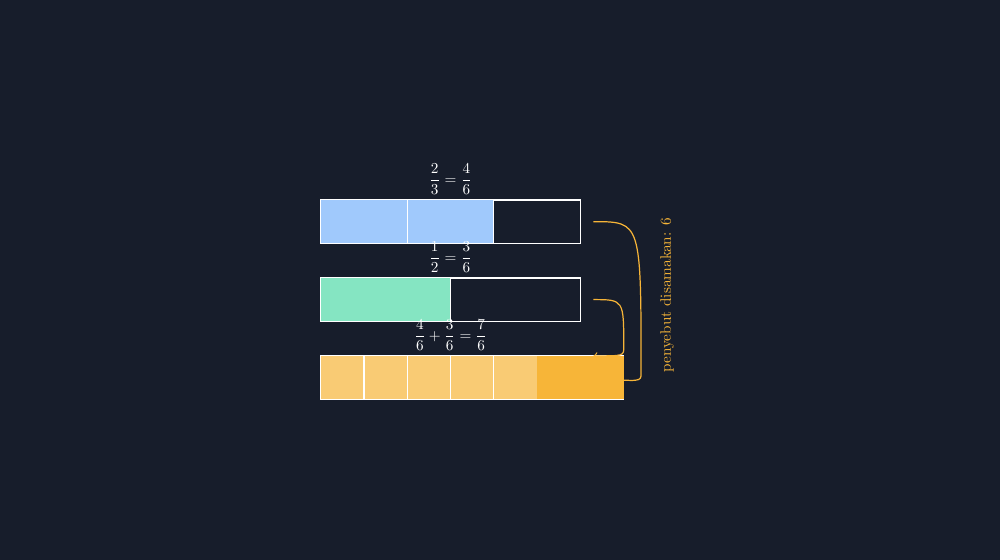

Kemarin saya membagikan lembar latihan penjumlahan pecahan ke kelas VII. Soal pertamanya sederhana: $\frac{2}{3} + \frac{1}{2}$. Tiga menit kemudian, ada yang berteriak dari pojok kelas, "Pak, jawabannya lima per enam, kan? Dua tambah satu sama dengan tiga, tiga tambah dua sama dengan lima."

Saya tidak buru-buru menjawab benar atau salah. Saya hanya bertanya balik, "Coba gambar dulu di bukumu. Gambar dua per tiga sebagai bagian dari satu batang cokelat, lalu gambar satu per dua juga." Anak itu menggambar. Sebentar kemudian dia diam. Diam-diam yang panjang. Lalu dia berkata pelan, "Lima per enam kok jadi penuh ya, Pak. Padahal dua per tiga saja belum satu."

Nah, di titik diam itulah pembelajaran sesungguhnya dimulai. Kekeliruan $\frac{2}{3} + \frac{1}{2} = \frac{5}{6}$ bukan kekeliruan sembarangan. Itu kekeliruan yang lahir dari satu asumsi yang tidak pernah diucapkan tapi terus bekerja di kepala siswa: bahwa pecahan bisa dijumlahkan langsung, asal bentuknya mirip. Padahal pecahan itu seperti satuan. Kita tidak bisa menjumlah dua meter dengan tiga sentimeter begitu saja tanpa menyamakan satuan terlebih dahulu. Begitu juga dengan pecahan: sebelum dijumlahkan, keduanya harus berbicara dalam "bahasa potongan" yang sama.

<!--more-->

## Masalahnya Bukan Lupa KPK, Tapi Tidak Melihat

Kalau ditanya apa kesulitan utama siswa dalam penjumlahan pecahan beda penyebut, jawaban yang paling sering muncul adalah "siswa lupa mencari KPK". Setelah bertahun-tahun mengoreksi pekerjaan siswa, saya melihat sesuatu yang lebih mendasar. Siswa tidak lupa KPK. Mereka bahkan lancar menghitung KPK dua dan tiga sama dengan enam. Yang mereka tidak punya adalah *alasan* kenapa harus ke enam.

Prosedur menyamakan penyebut, kalau diajarkan tanpa gambar, terasa seperti ritual. Lakukan begini, dapat nilai begini. Siswa yang patuh akan menyalin langkahnya. Siswa yang kritis akan bertanya, "Kenapa harus dikali dua? Kenapa bukan dikali yang lain?" Dan jujur saja, pertanyaan itu bagus. Kalau jawaban kita hanya "supaya penyebutnya sama", kita baru menjelaskan *bagaimana*, belum *kenapa*.

Karena itu saya mulai membawa gambar. Bukan gambar asal-asalan di papan, tapi gambar yang proporsional — bar pecahan yang potongannya benar-benar sama besar, sehingga perbandingan antar pecahan bisa dipercaya mata. Di papan tulis, kejujuran proporsional itu sulit dijaga; potongan yang saya gambar buru-buru sering tidak sama besar, dan siswa yang jeli langsung protes. Di sinilah TikZ membantu saya: gambar yang saya buat sekali, saya rapikan sampai benar, dan dia tidak pernah lelah digambar ulang dengan presisi yang sama.

## Menggambar Dua Pecahan yang Belum Bisa Dijumlah

Ide gambarnya sederhana. Saya gambar tiga batang horizontal yang panjangnya sama — sama panjang itu penting, karena ketiganya mewakili satu utuh yang sama. Batang pertama terbagi tiga, dua potongan terisi: itu $\frac{2}{3}$. Batang kedua terbagi dua, satu potongan terisi: itu $\frac{1}{2}$. Batang ketiga terbagi enam dan seluruhnya terisi tujuh potongan — ini hasil penjumlahannya, $\frac{7}{6}$, yang sengaja saya gambar melebihi satu utuh supaya siswa melihat bahwa hasilnya lebih dari satu.

Kode TikZ untuk dua batang pertama kira-kira seperti ini:

```latex
\begin{tikzpicture}
  % batang 2/3 : enam bagian setelah dijomok
  \draw[white,thick] (0,3) rectangle (6,4);
  \fill[biru!60] (0,3) rectangle (4,4); % 4 dari 6 bagian
  \foreach \i in {2,4} \draw[white,thick] (\i,3) -- (\i,4);
  % batang 1/2
  \draw[white,thick] (0,1.2) rectangle (6,2.2);
  \fill[hijau!60] (0,1.2) rectangle (3,2.2); % 3 dari 6 bagian
  \draw[white,thick] (3,1.2) -- (3,2.2);
\end{tikzpicture}
```

Perhatikan satu detail yang menurut saya krusial: kedua batang di gambar *sudah* dibagi enam, bukan dibagi tiga dan dua lalu diubah. Saya sengaja menampilkan versi "setelah dijomok" dengan garis potongan tambahan yang halus, supaya siswa bisa menelusuri: potongan pertama pada batang biru ternyata sama lebar dengan dua potongan kecil pada batang perenam. Dua per tiga *adalah* empat per enam — bukan karena buku bilang begitu, tapi karena matanya melihat potongan yang sama lebar.

Gambar lengkapnya seperti ini:



Dari gambar itu, pertanyaan "kenapa penyebutnya enam" berhenti menjadi misteri. Enam adalah bilangan potongan terkecil yang bisa mengukur *kedua* batang itu tanpa sisa. Kalau kita coba bagi tiga — potongan pada batang kedua tidak habis terbagi. Kalau kita coba bagi empat — potongan pada batang pertama yang tidak pas. Enam, karena dia temuan, bukan perintah.

## Saat Hasil Melebihi Satu Utuh

Ada satu momen lain yang saya suka dari contoh $\frac{2}{3} + \frac{1}{2}$: hasilnya $\frac{7}{6}$, pecahan tak sejati yang lebih dari satu. Siswa sering bingung melihat jawaban yang pembilangnya lebih besar dari penyebut. Ada yang menyerah, ada yang mencoret jawabannya sendiri karena "yang benar harus pecahan biasa".

Di gambar, kebingungan itu larut dengan sendirinya. Batang ketiga berisi tujuh potongan perenam, dan karena satu utuh hanya muat enam potongan, potongan ketujuh meluber ke "utuh berikutnya". Saya biasanya menambahkan satu batang kosong di sebelahnya dan menggambar tanda bahwa $\frac{7}{6} = 1\frac{1}{6}$ — satu utuh penuh, plus satu perenam. Siswa yang kemarin takut pada $\frac{7}{6}$ justru tertawa kecil melihatnya: "Oh, cuma kelebihan satu potongan doang."

Dari gambar yang sama, penyederhanaan pun jadi wajar. Siswa bisa melihat sendiri bahwa tujuh dan enam tidak punya potongan yang bisa dipasangkan lebih rapi — jadi $\frac{7}{6}$ memang sudah bentuk paling sederhananya. Bandingkan dengan kasus $\frac{2}{6} + \frac{3}{6} = \frac{5}{6}$ versus $\frac{1}{6} + \frac{3}{6} = \frac{4}{6} = \frac{2}{3}$: pada kasus kedua, siswa yang terbiasa dengan gambar akan langsung melihat dua potongan perenam itu "menempel jadi satu potongan sepertiga". Visual membuat penyederhanaan terasa seperti merapikan, bukan seperti langkah wajib yang dihafal.

## Potongan yang Sama Besar adalah Perjanjian

Kalau saya boleh menarik satu benang merah dari semua artikel TikZ yang pernah saya tulis, mungkin ini dia: gambar matematika yang baik itu perjanjian. Begitu kita menggambar bar pecahan dengan potongan yang tidak sama besar, kita sudah melanggar perjanjian dengan siswa — dan siswa, sadar atau tidak, berhenti mempercayai gambar. Setelah itu setiap penjelasan kita harus dibayar lebih mahal, karena mereka harus menebak mana bagian yang boleh dibenarkan dan mana yang hanya kelemahan menggambar.

TikZ menolong saya menjaga perjanjian itu. Koordinat $(0,3)$ sampai $(6,4)$ itu bukan sekadar angka; itu janji bahwa keenam potongan pada batang pertama sama lebar, satu per satu. Garis $\foreach \i in {1,...,6}$ memastikan tidak ada potongan yang melompat atau menyusut. Ketika siswa mengukur potongan dengan jari di layar atau di cetakan, semua potongan tahan uji.

Dan mungkin itu inti dari mengajar pecahan beda penyebut ini: kita tidak sedang mengajari siswa mencari KPK. Kita sedang mengajari mereka bahwa menjumlah itu hanya bisa dilakukan pada benda yang sejenis — dan bahwa menyamakan jenis bukan ritual, tapi keputusan yang punya alasan yang bisa dilihat. Dua per tiga dan satu per dua tidak bisa langsung dijumlah, sampai keduanya setuju berbicara dalam perenam. Setelah mereka berbicara bahasa yang sama, penjumlahannya menjadi hal yang paling alami di dunia: potongan ditambah potongan.

Soal itu, di lembar berikutnya, saya tulis $\frac{3}{4} + \frac{5}{6}$. Anak yang kemarin berteriak lima per enam kini menggambar dulu, diam sebentar, lalu menulis dengan mantap: dua puluh per dua puluh empat. Dari dua puluh empat potongan, dia melihat delapan potongan yang bisa dirapikan jadi sepertiga — dan menulis $\frac{19}{12}$ setelah menyeret sisanya. Jalannya panjang, tapi setiap langkahnya kelihatan. Itu sudah lebih dari cukup untuk satu pertemuan.

> 📎 **Berkas TikZ lengkap:** [tikz-penjumlahan-pecahan-beda-penyebut.tex](tex/tikz-penjumlahan-pecahan-beda-penyebut.tex) — siap kompilasi (butuh paket `tikz`).
