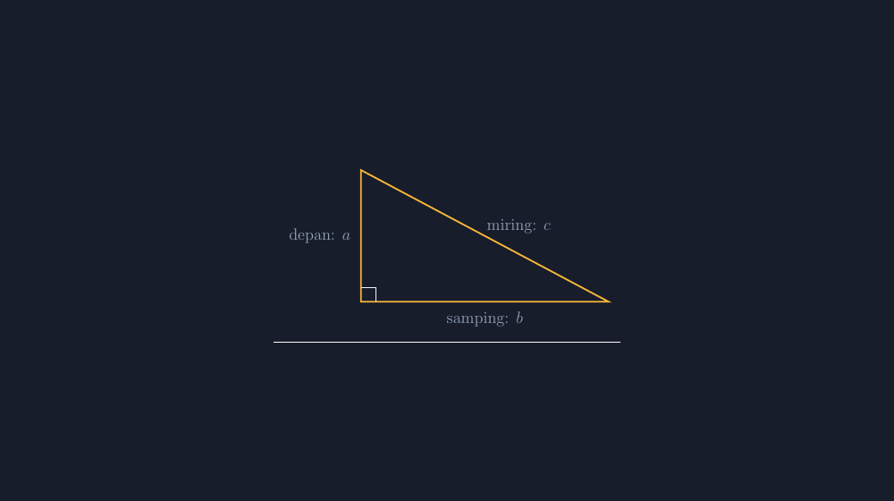

Trigonometri adalah salah satu materi yang paling sering saya dengar dikeluhkan oleh rekan guru. Bukan karena sulit diterangkan — definisinya cuma dua kalimat — tapi karena hasilnya. Kita terangkan dengan baik, siswa mengangguk dengan baik, lalu di ulangan setengah kelas menukar posisi depan dan samping seolah keduanya kembar yang boleh saling menggantikan. Tahun-tahun awal mengajar, tanggapan saya terhadap kegagalan itu adalah latihan lebih banyak. Puluhan soal, sembilan puluhan soal. Yang terjadi hanya satu: siswa makin cepat salah dengan cara yang sama.

<!--more-->

Tahun ini saya mencoba memperlambat semuanya, dan — seperti biasanya belakangan — alat bantunya adalah gambar yang jujur. Kali ini banyak gambar, bukan satu.

## Perbandingan yang Tidak Ingin Berubah

Materi trigonometri siku-siku di kelas VIII sebenarnya berdiri di atas satu fakta yang indah: dalam segitiga siku-siku, perbandingan dua sisi tertentu **tidak bergantung pada ukuran segitiga**. Kalau sudut $\alpha$-nya sama, maka

$$\sin\alpha = \frac{\text{depan}}{\text{miring}}, \qquad \cos\alpha = \frac{\text{samping}}{\text{miring}}, \qquad \tan\alpha = \frac{\text{depan}}{\text{samping}}$$

akan selalu menghasilkan angka yang sama, di segitiga sebesar apa pun. Masalahnya, fakta ini hampir tidak pernah *terlihat* di kelas. Papan tulis cuma muat satu segitiga. Jadi siswa menerima tiga rumus sebagai hukum yang diturunkan dari langit, dan rumus yang datang dari langit memang pantas tertukar-tukar — toh tidak ada yang pernah memeriksanya di depan mata.

Nah, di sinilah TikZ berguna bukan sebagai penghias, tapi sebagai alat pembuktian. Ide sederhananya: gambar satu segitiga siku-siku, beri label pada sisinya, lalu gambar ulang segitiga yang *sama* dengan ukuran berbeda — dua kali lebih besar, setengahnya, digeser, diputar — dan tunjukkan bahwa perbandingan depan/miring tidak bergeser sedikit pun.

## Segitiga yang Digambar dengan Jujur

Gambar dasar yang saya pakai begini:

```latex
\begin{tikzpicture}[>=stealth, font=\large]
  \coordinate (C) at (0,0);
  \coordinate (A) at (0,3.4);
  \coordinate (B) at (6.4,0);
  \draw[very thick, ak] (A) -- (B) -- (C) -- cycle;
  \draw (0,0.38) -- (0.38,0.38) -- (0.38,0);   % tanda siku-siku
  \node[left=4pt] at (0,1.7) {depan: $a$};
  \node[below=4pt] at (3.2,0) {samping: $b$};
  \node[above right=-2pt] at (3.2,1.7) {miring: $c$};
\end{tikzpicture}
```

Hasilnya seperti di bawah ini — segitiga siku-siku dengan sudut $\alpha$ di kanan bawah, dan nama peran setiap sisi ditulis langsung pada gambar, bukan disebut lisan lalu dilupakan:


*Segitiga siku-siku dengan tiga sisi yang sudah punya nama peran: depan, samping, miring — relatif terhadap sudut $\alpha$.*

Ada satu keputusan kecil di sini yang penting: labelnya saya tulis *depan*, *samping*, *miring* — bukan *tinggi* dan *alas*. Pasalnya, kesalahan paling sering di kelas saya bukan soal aritmetika, tapi soal sudut pandang. Sisi yang tadi pagi disebut "depan" berubah jadi "samping" begitu sudut yang ditinjau pindah ke ujung lain, dan siswa yang menghafal "yang tinggi itu depan" langsung kandas. Dengan menuliskan peran sisi pada gambar, gambar ikut mengingatkan bahwa depan dan samping itu *relatif* — mereka terikat pada sudut yang kita pilih.

## Segitiga yang Dibesarkan, Angka yang Diam

Setelah satu segitiga beres, langkah kedua adalah yang jadi inti pelajaran: menggandakan segitiganya. Di TikZ ini cuma soal mengubah koordinat — tapi justru karena mengubah koordinat itu mudah, siswa bisa melihat banyak segitiga dalam satu halaman LKS atau slide:

```latex
% segitiga yang sama, dua kali ukurannya
\coordinate (A) at (0,6.8);
\coordinate (B) at (12.8,0);
```


*Segitiga yang sama tanpa sudut ditandai — versi yang saya bagikan saat siswa diminta mengukur sisi sendiri lalu menghitung perbandingannya.*

Di kelas, latihannya sederhana dan berbau kertas: setiap kelompok mengukur ketiga sisi segitiga yang saya cetak (ukurannya sengaja saya beda-beda antar kelompok), lalu menghitung $\frac{\text{depan}}{\text{miring}}$ dengan pembagian biasa. Kelompok yang segitiganya kecil mendapat sekitar $0{,}47$. Kelompok yang segitiganya dua kali lebih besar mendapat... $0{,}47$ juga. Di titik ini biasanya ada satu suara dari pojok kelas, setengah percaya: "Bu, kok sama?"

Pertanyaan itu adalah momen yang selama ini tidak pernah saya dapatkan dari satu gambar di papan tulis. Angka yang sama dari segitiga yang berbeda ukuran jauh lebih meyakinkan daripada kalimat "perbandingannya tidak tergantung ukuran" yang saya tulis tebal-tebal. Dan dari titik itu, tiga nama — sinus, cosinus, tangen — tinggal jadi *label* untuk tiga perbandingan yang sudah mereka buktikan sendiri, bukan tiga rumus baru yang harus dihafal.

## Ketika Segitiganya Tidak Rapi

Bagian yang paling sering saya lewatkan dulu — dan tahun ini saya sadari justru paling penting — adalah soal orientasi. Soal di buku paket biasanya menampilkan segitiga siku-siku yang rapi: siku di kiri bawah, miring naik ke kanan. Tapi soal ulangan tidak selalu sebaik itu. Siku bisa di kanan atas, sisi miring bisa menghadap kiri, dan segelintir siswa langsung kehilangan arah: mana depannya sekarang?

Karena TikZ menggambar dari koordinat, memutar situasi itu gratis. Segitiga yang siku di kanan atas tinggal soal menukar posisi titik-titiknya:

```latex
\coordinate (C) at (0,0);
\coordinate (A) at (6.4,3.4);   % siku pindah, miring menghadap lain arah
\coordinate (B) at (6.4,0);
```

Saya buat tiga-empat variasi seperti ini, cetak dalam satu lembar, dan tugas siswa hanya satu: *warnai* sisi yang jadi depan, samping, dan miring terhadap sudut $\alpha$ yang saya tandai. Belum ada hitungan sama sekali. Keduanya — mewarnai peran sisi di berbagai orientasi, lalu menghitung perbandingan — ternyata dua keterampilan yang berbeda, dan dulu saya menggabungkannya dalam satu latihan sehingga siswa yang gagal sulit didiagnosis: dia tidak bisa hitung, atau dia tidak bisa melihat?

Dengan lembar orientasi terpisah, jawabannya kelihatan jelas. Dan hampir selalu, yang bermasalah bukan hitungannya.

## Catatan Teknis untuk Rekan Guru yang Ingin Mencoba

Beberapa hal kecil yang saya pelajari sambil menyusun gambar-gambar ini. Pertama, sudut pada arc TikZ perlu dihitung dari geometri segitiganya sendiri — untuk segitiga di atas, sudut $\alpha$ di titik $B$ menghadap ke arah $160{,}06°$, dan angka itu yang saya tulis di `arc[start angle=...]`. Kalau segitiganya diubah ukurannya tanpa mengubah *bentuk*, sudutnya tidak berubah, jadi angka itu aman dipakai ulang. Kedua, kalau perbandingan trigonometri ditulis sebagai pecahan di dalam gambar (bukan di badan teks), pastikan paket `amsmath` ikut dimuat — pelajaran mahal dari salah satu gambar saya yang menolak dikompilasi hanya karena satu `\tfrac`.

Ketiga, dan ini yang paling saya suka: karena gambar dibuat dari koordinat yang sama, saya bisa yakin gambar kedua benar-benar segitiga yang sama, bukan "mirip seperti". Tidak ada lagi risiko gambar pendukung yang diam-diam membantah apa yang saya ceritakan di depan kelas — risiko yang dulu nyata terjadi ketika saya menggambar segitiga siku-siku dengan tangan bebas dan hasilnya lancip.

## Yang Tertinggal dan Yang Tersisa

Saya tidak mau melebih-lebihkan. Satu jam mengukur dan membandingkan tidak menghapus kebingungan siswa tentang kapan memakai sinus dan kapan memakai tangen — itu butuh banyak soal kontekstual, dan itu pekerjaan minggu-minggu berikutnya. Yang berubah tahun ini lebih kecil dan lebih dasar: siswa tidak lagi menukar depan dan samping dengan yakin. Mereka ragu dulu, melirik gambarnya, memastikan sudut mana yang ditinjau. Keraguan kecil itu, bagi saya, adalah tanda bahwa konsepnya akhirnya tinggal di kepala mereka — bukan cuma di contoh soal.

Dan seperti biasa, yang paling terbantu sebenarnya saya sendiri. Menyusun gambar dengan TikZ memaksa saya menjelaskan pada komputer — secara eksak, koordinat demi koordinat — hal-hal yang selama ini saya jelaskan pada siswa secara kasar. Kalau ada bagian yang tidak jelas di kepala saya, gambar itu gagal jujur, dan saya tahu sebelum tiba di kelas.

> 📎 **Berkas TikZ lengkap:** [trig-segitiga.tex](tex/trig-segitiga.tex) — siap kompilasi (butuh paket `tikz`). Versi tanpa penanda sudut $\alpha$: [trig-segitiga-polos.tex](tex/trig-segitiga-polos.tex).
