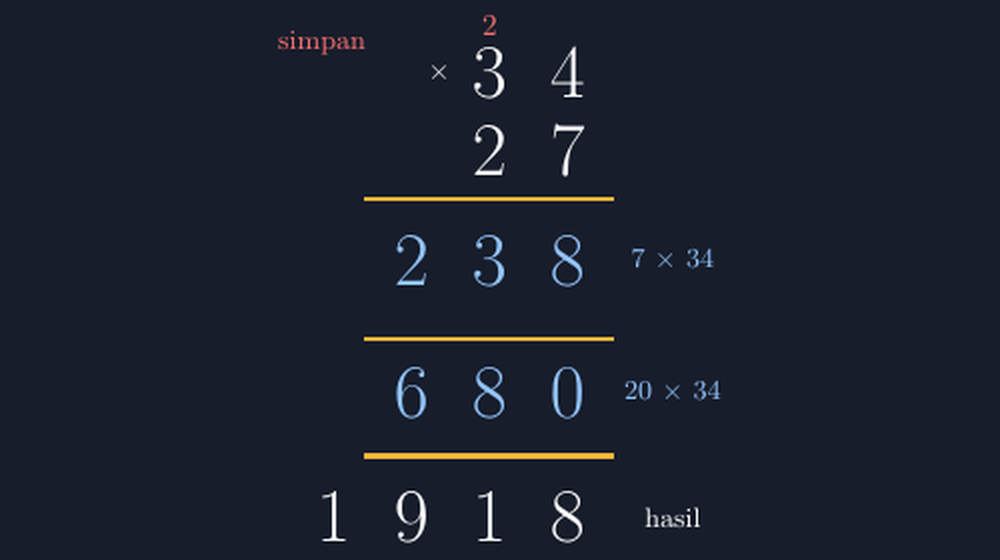

Kemarin saya mengoreksi lembar kerja kelas V dan menemukan pola yang sama di hampir separuh lembar: anak-anak itu *bisa* mengali. 7 × 4 mereka jawab 28 tanpa ragu. 2 × 3 juga lancar. Tapi begitu soalnya ditulis vertikal — 34 dikali 27 — banyak jawaban yang meleset di tempat yang bukan perkaliannya. Ada yang menjumlahkan hasil kedua baris parsial tanpa menggeser posisi. Ada yang menulis 8 dari 28 di bawah kolom puluhan. Angkanya benar, tempatnya salah.

Saya duduk agak lama di depan tumpukan lembar itu. Sebenarnya ini bukan soal mengali. Ini soal *kolom*. Perkalian bersusun adalah satu-satunya operasi dasar yang menuntut siswa mengelola tiga hal sekaligus: hasil perkalian, angka simpan, dan pergeseran nilai tempat di antara baris-baris parsial. Penjumlahan bersusun hanya punya satu baris kerja; pembagian bersusun pun punya ritmenya sendiri. Perkalian? Di sini barisnya bertumpuk dan setiap baris punya "harga" yang berbeda.

Kalau saya hanya mengoreksi di pinggir kertas dengan tulisan "perhatikan nilai tempat", rasanya tidak cukup. Anak-anak memang perhatikan — hanya saja mereka tidak *melihat* struktur yang diminta untuk diperhatikan. Maka malam itu saya membuka kembali editor LaTeX dan menggambar ulang prosedur itu dengan TikZ, satu contoh saja, tapi benar-benar jujur pada setiap kolomnya.

## Mulai dari contoh yang tidak mengejutkan

Saya sengaja memilih 34 × 27. Bukan terlalu kecil sampai struktur baris parsialnya terasa berlebihan, bukan juga terlalu besar sampai gambar penuh angka simpan. Dua kali dua digit, cukup.



*Baris parsial diberi warna dan label asalnya: 238 dari 7 × 34, 680 dari 20 × 34. Angka simpan 2 ditandai merah.*

Yang saya cari dari gambar ini bukan kecantikan, tapi kejujuran posisi. Kolom satuan, puluhan, ratusan, ribuan harus benar-benar sejajar vertikal — persis seperti yang saya harapkan siswa tulis di kertasnya. Baris parsial pertama (238) dan kedua (680) sengaja diberi warna berbeda, dengan label kecil di kanan yang menyebut dari mana asalnya. Di papan tulis ini tidak mungkin saya lakukan: kapur kuning dan putih di papan gelap tidak bisa "menempel" pada baris tertentu sampai lima menit kemudian.

Ada satu hal yang menurut saya paling sering hilang di pembelajaran perkalian bersusun: anak-anak dihadapkan pada hasil akhir yang *sudah* rapi. Merekak tidak pernah melihat versi kotor-nya — di mana angka simpan muncul, di mana baris parsial kedua sebenarnya adalah 680 dan bukan 68, di mana tanda kosong di kolom satuan baris kedua itu bukan "tidak ada" tapi "nol". Gambar yang saya buat mempertahankan 0 itu. Kalau di kertas siswa menulisnya kosong, saya tidak marah — tapi gambar saya harus menunjukkan yang sebenarnya.

## Mengapa TikZ, bukan sekadar gambar di Word

Sebelum pakai TikZ, saya pernah mencoba membuat gambar perkalian bersusun di aplikasi pengolah kata. Hasilnya selalu sama frustasinya: begitu saya menggeser satu angka, angka lain ikut kacau, karena semuanya kotak bebas yang tidak saling tahu posisinya. TikZ memberi saya yang saya butuhkan: **koordinat**. Saya bisa menyatakan "digit satuan berada di $x=2$, digit puluhan di $x=1$, ratusan di $x=0$" dan setiap angka lain mengikuti aturan itu. Perubahan satu kolom otomatis menjaga semua kolom lain sejajar.

Bagian inti dari kode saya hanya sesederhana ini:

```latex
\node[digit] at (2,2.5) {4};   % satuan
\node[digit] at (1,2.5) {3};   % puluhan
\node[digit] at (2,1.5) {7};
\node[digit] at (1,1.5) {2};
\draw[garis] (-0.6,0.9) -- (2.6,0.9);
\node[partial] at (2,0.1) {8};
\node[partial] at (1,0.1) {3};
\node[partial] at (0,0.1) {2};
```

Setiap baris parsial diletakkan pada koordinat $y$ yang sama, satu garis pemisah di antaranya, dan hasil akhir di baris terbawah. Angka simpan 2 (dari $7 \times 4 = 28$) saya taruh merah kecil di atas, dengan kata "simpan" — karena pengalaman saya, justru kata itu yang perlu terlihat, bukan hanya angkanya. Kalau angka simpan hanya muncul sebagai coretan kecil, siswa akan menganggapnya langkah opsional.

## Waktu kelas: bukan mengganti latihan, tapi memperjelas sebelum latihan

Ketika saya menampilkan gambar ini di kelas, ada satu momen yang menurut saya penting. Saya menunjuk baris kedua dan bertanya, "680 ini dari mana?" Beberapa anak menjawab "2 kali 34". Saya tahan diri untuk tidak langsung bilang benar — saya minta mereka menunjuk angka 2 yang mana. Mereka menunjuk digit 2 di bilangan 27. Lalu saya bertanya lagi, "2 di bilangan 27 nilainya 2 atau 20?" Di titik itu barulah label "20 × 34" di samping baris parsial terasa berguna: ia tidak menjelaskan apa-apa kalau siswa belum bertanya, tapi ia menjawab tepat ketika pertanyaannya muncul.

Ini pola yang saya semakin yakin: gambar yang baik dalam pembelajaran matematika bukan gambar yang *menjawab lebih dulu*, tapi gambar yang *menyimpan jawaban di tempat yang bisa ditemukan*. Anak yang penasaran menemukan penjelasannya di dalam gambar itu sendiri, bukan menunggu saya menjelaskan ulang.

Setelah itu, latihan tetap berjalan seperti biasa — di kertas, dengan pensil, dengan angka simpan yang coret-coretan. Saya tidak mengganti latihan dengan gambar. Tapi lembar koreksi saya hari itu berubah: kesalahan yang tersisa bukan lagi "angka salah tempat", melainkan kesalahan perkalian murni, yang jauh lebih mudah ditangani karena itu masalah hafalan fakta dasar, bukan masalah struktur.

## Satu catatan kecil tentang jujur pada nol

Ada satu keputusan kecil dalam gambar ini yang saya ambil sengaja: baris parsial kedua saya tulis 680, bukan 68 yang digeser. Di kertas nyata, hampir semua siswa menulis 68 dan menyisakan kolom satuan kosong — dan itu, sejujurnya, cara yang efisien. Tapi karena gambar ini saya buat sebagai *penjelasan* dan bukan contoh kerja, saya pilih versi eksplisit dengan 0-nya. Gambar penjelasan harus memperlihatkan apa yang tersembunyi di balik kebiasaan; gambar contoh kerja boleh mengikuti kebiasaan yang efisien. Dua tujuan, dua gaya, dan TikZ memudahkan saya membedakan keduanya karena tinggal mengubah satu node.

Kalau Bapak/Ibu ingin menyesuaikan gambar ini untuk materi sendiri, mengganti angkanya hanya berarti mengganti isi node dan menambah atau mengurangi kolom. Struktur koordinatnya tetap.

> 📎 **Berkas TikZ lengkap:** [tikz-perkalian-bersusun.tex](tex/tikz-perkalian-bersusun.tex) — siap kompilasi (butuh paket `tikz`).

Terakhir, refleksi pribadi saya: selama bertahun-tahun saya menganggap perkalian bersusun sebagai "materi kelas rendah yang seharusnya sudah bisa". Saya salah. Ini materi yang menuntut koordinasi tiga hal sekaligus, dan banyak anak menabraknya persis di tempat yang tidak terlihat oleh koreksi merah di pinggir kertas. Kadang yang anak-anak butuhkan bukan latihan tambahan, tapi satu gambar yang menunjukkan bahwa kolom-kolom itu punya makna — dan bahwa angka yang tampak berpindah tempat sebenarnya tidak pernah kehilangan harganya.
