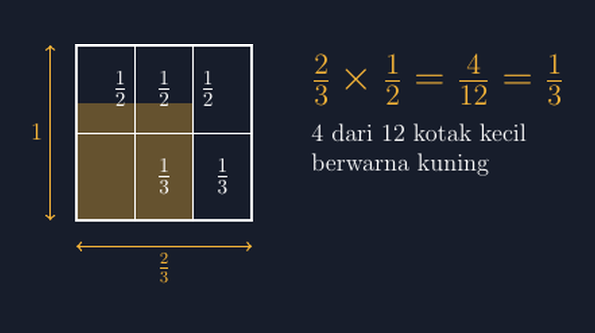

Ada satu momen setiap tahun yang saya tunggu-tunggu, dan sekaligus takut kehilangan: momen ketika siswa kelas VII menyadari bahwa jawaban perkalian pecahan bisa lebih kecil daripada kedua bilangannya. "Bu/Pak, kok dikali malah jadi kecil?" Itu pertanyaan yang bagus. Sayangnya, kalau kita buru-buru menjawab dengan aturan "kalikan atas, kalikan bawah", pertanyaan bagus itu mati di tempat. Anak itu dapat prosedurnya, tapi kehilangan maknanya.

Tahun lalu saya mengalaminya langsung. Di satu kelas, hampir separuh anak menjawab $\frac{2}{3} \times \frac{1}{2} = \frac{2}{5}$. Bukan karena mereka tidak bisa menghitung — mereka menghitung dengan sangat konsisten: dua kali satu di atas, tiga kali dua di bawah. Prosedurnya benar, tetapi pembilang dan penyebut mereka perlakukan sama padahal tidak. Ketika saya tanya "pecahan itu bagian dari apa?", jawabannya lirih: "bagian dari... yang atas?"

<!--more-->

## Masalahnya bukan di hitungan, tapi di gambar yang tidak pernah ada

Aturan silang itu benar secara aritmetika, tetapi dia tidak menjelaskan apa pun tentang makna pecahan. Pecahan punya dua wajah: pembilang yang menghitung *berapa banyak bagian*, dan penyebut yang menentukan *bagian sebesar apa*. Dalam perkalian pecahan, keduanya bekerja di "arah" yang berbeda — dan itu tidak pernah terlihat kalau kita hanya menggulik angka.

Solusi yang sudah lama dianjurkan banyak buku dan pelatihan adalah model luas. Kita menggambar persegi (atau persegi panjang) yang luasnya mewakili satu utuh. Panjangnya kita bagi menurut penyebut pecahan pertama, lebarnya menurut penyebut pecahan kedua. Irisan kedua pembagian itu — daerah yang bisa diwarnai — adalah jawabannya. Tidak ada sulap. Jawaban muncul karena daerahnya terlihat.

Masalahnya di kelas nyata: gambar model luas yang digambar tangan di papan tulis sering tidak proporsional. Garis pembagi tiga tidak sama lebar, bagian yang diwarnai tidak persis dua per tiga, dan siswa yang jeli langsung menangkap keraguan itu. Mereka tidak berani mencocokkan hasil warna dengan hasil hitungan, karena gambarnya sendiri meragukan. Di sinilah saya mulai serius menggambar model luas dengan TikZ: supaya gambar yang saya tunjukkan jujur pada ukurannya.

## Membagi ke dua arah sekaligus

Mari kerjakan contoh yang tadi gagal di kelas: $\frac{2}{3} \times \frac{1}{2}$.

Ide model luas: satu persegi utuh, sisi horizontal dibagi tiga sama panjang (untuk $\frac{2}{3}$), sisi vertikal dibagi dua sama tinggi (untuk $\frac{1}{2}$). Daerah irisan dua kolom pertama dan baris bawah itulah $\frac{2}{3}$ dari $\frac{1}{2}$.



Perhatikan apa yang terjadi pada angka. Persegi kita bagi menjadi $3 \times 2 = 12$ kotak kecil yang sama luas — itu artinya setiap kotak kecil bernilai $\frac{1}{12}$. Bagian yang diwarnai berisi $2 \times 1 = 4$ kotak. Jadi jawabannya $\frac{4}{12}$, yang sederhananya $\frac{1}{3}$. Sekarang aturan "kalikan atas, kalikan bawah" tidak lagi jadi sulap: pembilang dikalikan karena *banyak kotak yang dihitung ikut berlipat dua arah*, penyebut dikalikan karena *kotak kecilnya ikut mengecil dua arah*.

Dan pertanyaan "kok dikali malah kecil?" dapat jawabannya secara visual: mengambil $\frac{1}{2}$ dari sesuatu artinya mengambil setengahnya — hasilnya pasti tidak lebih dari setengah benda itu. Anak yang tadinya menulis $\frac{2}{5}$ karena mengikuti pola, setelah melihat daerah warna bisa memeriksa dirinya sendiri: hasil itu tidak mungkin $\frac{2}{5}$, karena daerah warnanya jelas kurang dari satu per tiga persegi.

## Kode TikZ-nya

Bagi yang ingin menggambar versi yang sama, inti kodenya sederhana. Persegi satu satuan sisi, dua garis vertikal di $\frac{1}{3}$ dan $\frac{2}{3}$, satu garis horizontal di $\frac{1}{2}$, lalu irisan yang diwarnai:

```latex
\begin{tikzpicture}[scale=2]
  % persegi utuh 1 x 1
  \draw[thick] (0,0) rectangle (3,3);
  % pembagian vertikal: sepertiga
  \foreach \x in {1,2} \draw (\x,0) -- (\x,3);
  % pembagian horizontal: seperdua
  \draw (0,1.5) -- (3,1.5);
  % irisan 2/3 x 1/2 diwarnai
  \fill[orange!60, opacity=0.7] (0,0) rectangle (2,1.5);
\end{tikzpicture}
```

Satu catatan teknis yang saya pelajari dengan cara yang agak menyakitkan: koordinat dalam kode itu harus setia pada nilai pecahannya. Kalau saya menggambar persegi sisi tiga lalu membagi kolomnya dengan jarak yang tidak sama, gambar terlihat rapi tetapi berbohong. Siswa bisa mengukur dengan penggaris kalau mereka mau, dan sesekali mereka benar-benar mau. Lebih baik koordinatnya dihitung benar sejak awal: sepertiga dari tiga berarti garis di $x=1$ dan $x=2$, seperdua berarti garis di $y=1{,}5$. Tidak ada jalan pintas.

> 📎 **Berkas TikZ lengkap:** [tikz-perkalian-pecahan-model-luas.tex](tex/tikz-perkalian-pecahan-model-luas.tex) — siap kompilasi (butuh paket `tikz`).

## Dari gambar ke soal

Setelah konsepnya kelihatan, latihannya tinggal membalik arahnya. Saya biasa memberi tiga tahap kecil.

Tahap pertama: gambar sudah ada, siswa membacanya. "Daerah yang diwarnai itu berapa kotak kecil dari berapa kotak seluruhnya? Berarti $\frac{3}{4} \times \frac{1}{2}$ sama dengan berapa?" Di tahap ini anak belajar menerjemahkan warna menjadi pecahan.

Tahap kedua: hitungannya sudah ada, siswa menggambarnya. "Tunjukkan dengan model luas kenapa $\frac{2}{5} \times \frac{1}{2} = \frac{2}{10}$." Di tahap ini anak belajar menerjemahkan pecahan menjadi daerah — dan biasanya di sinilah miskonsepsi tersembunyi jadi kelihatan. Anak yang membagi persegi menjadi lima kolom dan *dua* baris untuk $\frac{1}{2}$ sebenarnya sedang memberi tahu saya bahwa dia masih menukar pembilang dan penyebut.

Tahap ketiga, yang paling saya sukai: siswa membuat ceritanya sendiri. "Buat satu cerita yang jawabannya $\frac{1}{2} \times \frac{3}{4}$." Jawaban yang keluar biasanya lucu dan personal — sepertiga botol sirup diminum setengah kelas, atau tanah di haluskan seperempatnya ditanami bunga. Cerita itu bukan pelengkap; cerita itulah bukti bahwa model luas sudah pindah dari papan tulis ke kepala mereka.

## Kenapa ini penting untuk saya sebagai guru

Jujur, ada godaan untuk melewati semua ini. Aturan silang itu selesai dalam tiga menit, latihannya bisa dua puluh soal, nilainya naik. Tetapi nilai yang naik karena prosedur yang dihafal adalah pinjaman yang harus dibayar saat materi berikutnya datang — saat pecahan bertemu pecahan lagi dalam bentuk yang sedikit berbeda, atau saat perkalian pecahan berubah menjadi "dari" dalam soal cerita. Anak yang hanya punya prosedur akan kehilangan pegangan; anak yang pernah melihat daerah warna itu punya sesuatu untuk kembali.

Model luas juga mengajarkan saya satu hal tentang membuat bahan ajar: gambar yang jujur itu bukan hiasan, dia adalah penjelasnya. Selama gambar di papan tulis bisa jadi tidak proporsional, saya senang punya TikZ sebagai alat supaya yang saya tunjukkan dan yang saya maksud itu benar-benar sama. Dan setiap kali ada anak bertanya "kok dikali malah kecil?", saya tidak lagi panik mencari kata-kata. Saya tinggal menggambar persegi, membaginya dua arah, dan mewarnai — lalu membiarkan daerah itu yang menjawab.
