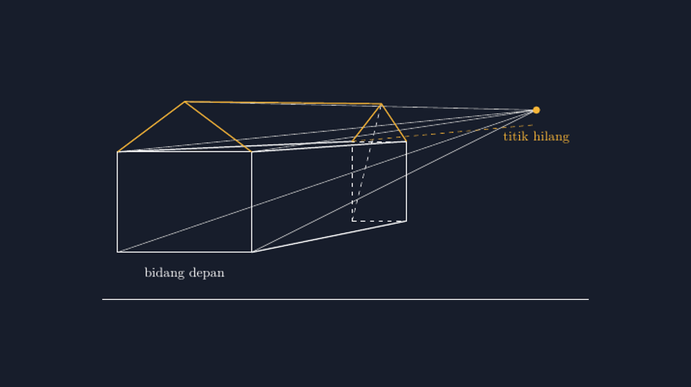
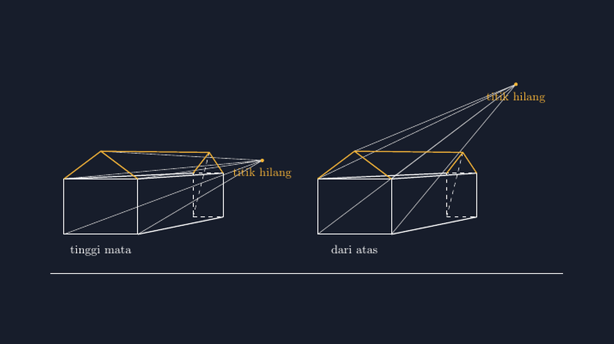

Malam itu saya sedang menyiapkan soal volume balok untuk kelas VIII. Gambar baloknya saya buat seperti biasa: paralelogram di atas, paralelogram di bawah, empat garis menghubungkan. Saat dicetak, saya sendiri yang sempat bingung. Balok itu terlihat seperti kotak yang diremas dari samping. Siswa yang duduk di bangku belakang bahkan bertanya, "Bu, ini yang mana depannya?"

Pertanyaan sederhana itu menyadarkan saya bahwa menggambar bangun ruang bukan sekadar "nggambar kubus". Ada konvensi visual yang membuat mata kita percaya bahwa gambar dua dimensi itu mewakili benda tiga dimensi. Konvensi itu namanya perspektif. Dan seperti topik-topik TikZ lain yang saya tulis di blog ini, saya ingin gambar di lembar soal jujur: jarak dan sudut yang digambar sesuai dengan yang bisa dipertanggungjawabkan, bukan asal terlihat seperti kotak.

<!--more-->

## Dua Mata Itu Melihat dengan Aturan

Perspektif pada dasarnya memperjanjikan satu hal: garis-garis yang di dunia nyata sejajar akan tampak bertemu di satu titik, yang kita sebut titik hilang (*vanishing point*). Kalau Bapak/Ibu berdiri di tengah jalan lurus yang panjang, kedua tepi jalan tampak menyempit dan bertemu jauh di depan. Itulah perspektif satu titik hilang yang paling mudah dijumpai di kelas.

Untuk soal-soal SMP, saya biasanya cukup memakai perspektif satu titik hilang. Kubus dan balok di buku pelajaran umumnya digambar dengan proyeksi sesil (isometrik semacam itu), di mana garis-garis sejajar tetap digambar sejajar. Keduanya sah. Tetapi ketika saya ingin siswa *merasakan* kedalaman — misalnya soal tentang menara, gedung sekolah, atau kotak yang diletakkan di ujung meja — perspektif memberi rasa ruang yang jauh lebih hidup.

Kali ini saya menggambar sebuah rumah sederhana: satu balok sebagai badan rumah, satu prisma segitiga sebagai atapnya, semuanya menuju satu titik hilang di kejauhan.

## Kode TikZ-nya

Inti dari menggambar perspektif di TikZ hanyalah koordinat. Kita tentukan titik hilangnya dulu, lalu semua garis "ke arah belakang" digambar menuju titik itu. Bagian depan rumah digambar lurus-lurus saja, karena bidang depan sejajar dengan layar kita.

```latex
\begin{tikzpicture}[scale=1]
  % titik hilang
  \\coordinate (VP) at (9,2);
  \\node[below] at (VP) {titik hilang};

  % bidang depan rumah
  \\coordinate (A) at (0,0);  \\coordinate (B) at (3,0);
  \\coordinate (C) at (3,2);  \\coordinate (D) at (0,2);

  % bidang belakang (lebih kecil, menuju titik hilang)
  \\coordinate (A2) at (6,0.7);
  \\coordinate (B2) at (6.8,0.7);
  \\coordinate (C2) at (6.8,2.1);
  \\coordinate (D2) at (6,2.1);

  % rusuk depan
  \\draw[thick] (A) -- (B) -- (C) -- (D) -- cycle;
  % rusuk belakang
  \\draw[thick] (A2) -- (B2) -- (C2) -- (D2) -- cycle;
  % rusuk penyambung, semuanya menuju arah titik hilang
  \\draw[thick] (A) -- (A2) (B) -- (B2) (C) -- (C2) (D) -- (D2);
\\end{tikzpicture}
```

Perhatikan bahwa bidang belakang saya pilih lebih kecil dan lebih rendah (tengahnya sedikit di bawah tengah bidang depan) — karena titik hilang saya letakkan di ketinggian y = 2, mata pengamat sejajar dengan bagian atas rumah. Kalau titik hilang dinaikkan, bagian bawah rumah akan "dilihat dari atas"; kalau diturunkan, kita seperti melihat rumah dari bawah. Posisi titik hilang sebenarnya adalah posisi mata. Ini poin yang menurut saya paling berharga untuk didiskusikan dengan siswa: menggambar perspektif adalah menggambar *dari suatu tempat*.

Gambar lengkap dengan atapnya berikut titik hilangnya menghasilkan ilustrasi seperti di bawah ini.


*Gambar: rumah balok beratap, digambar menuju satu titik hilang. Rusuk-rusuk yang di dunia nyata sejajar tampak bertemu di titik yang sama.*

## Tiga Hal yang Saya Perhatikan

Pertama, **garis yang tampak dan yang tersembunyi**. Rusuk belakang yang tertutup badan rumah sebaiknya digambar putus-putus, seperti konvensi gambar teknik. Saya memberi opsi `dashed` pada rusuk-rusuk tersembunyi, dan anehnya siswa langsung paham bahwa garis putus itu artinya "ada tapi tidak terlihat". Konvensi kecil ini sering tidak dibahas, padahal miskonsepsi tentang rusuk balok sering berawal dari gambar yang tidak jelas mana yang di depan.

Kedua, **tinggi titik hilang itu bermakna**. Sekali siswa melihat dua gambar rumah yang sama persis kecuali titik hilangnya berbeda tinggi, mereka langsung menangkap bahwa gambar pertama terlihat "dari mata orang berdiri" dan yang kedua "dari atas". Ini pintu masuk yang bagus untuk membicarakan mengapa drone melihat rumah berbeda dengan kita yang berdiri di jalan.

Ketiga, **skala di bidang belakang**. Kalau bidang belakang digambar terlalu besar, rumahnya terlihat pendek seperti kardus pipih; terlalu kecil, terlihat seperti rangkaian kereta panjang. Jarak ke titik hilang menentukan "panjang" benda yang tampak. Saya biasanya mengajak siswa menebak dulu sebelum saya geser koordinatnya, lalu kita lihat bersama hasilnya.


*Gambar: bangun yang sama, titik hilang yang berbeda. Gambar kiri tampak seperti dilihat sejajar atap, gambar kanan seperti dilihat dari atas.*

## Kalau Dipakai di Kelas

Untuk siswa SMP, saya tidak bermaksud mengajarkan proyeksi sebagai materi resmi. Yang saya tuju lebih sederhana: mereka membiasakan membaca gambar ruang dengan kritis. Ketika bertemu soal volume limas yang gambarnya buruk, mereka berani protes: "Bu, ini titik puncaknya di mana?" Kemampuan menanyakan itu jauh lebih berharga daripada hafal gambar.

Bapak/Ibu yang ingin mencoba, silakan ambil kode lengkapnya di bawah, ubah koordinat titik hilangnya, dan lihat apa yang terjadi. TikZ membuat eksperimen semacam ini jadi murah: satu angka bergeser, wajah rumah pun berubah.

> 📎 **Berkas TikZ lengkap:** [tikz-perspektif-bangun-ruang.tex](tex/tikz-perspektif-bangun-ruang.tex) — siap kompilasi (butuh paket `tikz`).

Menggambar jujur ternyata juga mengajarkan melihat dengan jujur. Dan itu, menurut saya, tugas matematika yang paling sederhana sekaligus paling sulit di kelas.
