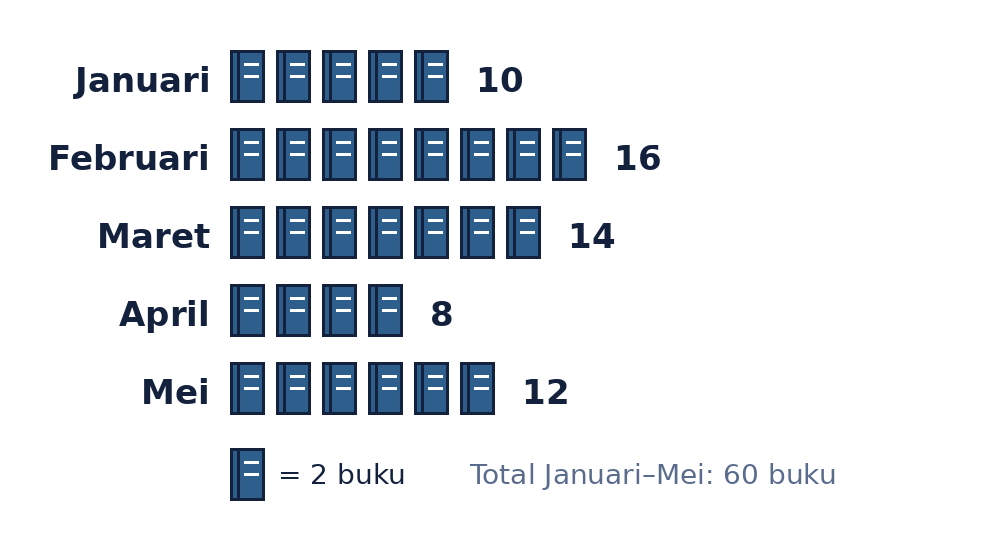

Awal semester ini saya menantang kelas VIII.A membaca sepuluh buku. Setiap Senin pagi selalu muncul pertanyaan yang sama: "Pak, kelas kita sudah baca berapa buku?" Saya bisa saja menuliskan angka di papan — Januari 10, Februari 16, Maret 14, April 8, Mei 12 — tetapi angka hanya dibaca, lalu dilupakan.

Lalu saya mencoba cara lain: satu buku kecil di papan untuk setiap dua buku yang sudah dibaca kelas. Januari mendapat lima buku, Februari delapan, Maret tujuh, April empat, Mei enam. Seketika papan berubah: baris Februari paling panjang, April paling pendek, dan seorang murid di bangku belakang langsung berkata, "Februari paling rajin, Pak!" Tanpa satu pun penjumlahan, seluruh kelas sudah membaca datanya. Itulah piktogram — diagram gambar — dan hari itu saya memutuskan menggambarnya dengan TikZ.


*Gambar 1. Piktogram buku yang dibaca kelas VIII.A — satu gambar buku berarti dua buku.*

<!--more-->

## Piktogram: Data yang Bisa Dilihat Sekilas

Piktogram adalah penyajian data dengan gambar. Setiap gambar mewakili sejumlah nilai yang sama, dan banyaknya gambar menunjukkan besarnya data. Bedanya dengan diagram batang: piktogram punya bentuk yang bisa dihitung satu per satu. Karena itu piktogram cocok untuk data cacah yang tidak terlalu besar, dan untuk murid yang baru pertama kali belajar membaca data.

Ada satu aturan yang tidak boleh dilanggar: semua gambar harus berukuran sama. Kalau gambar Februari lebih besar dari gambar Januari, mata akan membaca selisih yang tidak ada di data. Inilah jebakan yang paling sering saya lihat: ikon yang digambar tangan bebas, besar-kecil seenaknya, sehingga diagramnya berbohong tanpa disadari. TikZ menyelamatkan kita dari jebakan ini: satu gambar yang didefinisikan sekali tercetak sama persis di mana pun dipakai.

## Satu Buku Berarti Dua Buku

Sebelum menggambar, saya selalu menetapkan dulu nilai satu gambar. Saya menyebutnya legenda, dan saya menuliskannya di bawah diagram: satu gambar buku sama dengan dua buku. Kalau satu gambar berarti satu buku, baris Februari butuh enam belas gambar — terlalu panjang. Kalau satu gambar berarti lima buku, Januari tinggal dua gambar — terlalu kasar, selisih kecil tidak terlihat. Dua buku per gambar adalah jalan tengah yang pas.

Dari legenda itu hitungannya mudah. Januari 10 buku berarti $10 \div 2 = 5$ gambar. Februari 16 buku berarti 8 gambar. Maret 14 buku berarti 7 gambar, April 8 buku berarti 4 gambar, dan Mei 12 buku berarti 6 gambar. Totalnya 60 buku dalam lima bulan, atau rata-rata 12 buku per bulan. Saya meminta murid menghitung sendiri pembagian ini sebelum menggambar — di sinilah mereka sadar piktogram adalah pembagian yang digambar.

## Menggambarnya dengan TikZ: \pic dan \foreach

Di TikZ, triknya adalah mendefinisikan gambar buku sekali saja sebagai `\pic`, lalu memanggilnya berulang kali dengan `\foreach`. Satu buku saya gambar sebagai persegi panjang tegak dengan garis punggung di sisi kiri dan dua garis tipis sebagai baris teks.

```latex
\tikzset{
  pics/buku/.style={
    code={
      \draw[fill=bukubiru, draw=navy, thick]
        (0,0) rectangle (0.8,1);
      \draw[navy, thick] (0.18,0) -- (0.18,1);
      \draw[white, thick] (0.32,0.72) -- (0.66,0.72);
      \draw[white, thick] (0.32,0.45) -- (0.66,0.45);
    }
  }
}
```

Setelah gambar buku didefinisikan, seluruh piktogram tinggal satu putaran `\foreach`. Untuk setiap bulan saya menuliskan berapa gambar yang harus digambar, dan TikZ meletakkannya satu demi satu dengan jarak yang sama.

```latex
\foreach \bulan/\jumlah/\total/\y in
  {Januari/5/10/5, Februari/8/16/4, Maret/7/14/3,
   April/4/8/2, Mei/6/12/1} {
  \node[anchor=east, font=\large\bfseries, navy]
    at (-0.3,\y) {\bulan};
  \foreach \i in {1,...,\jumlah} {
    \pic at ({(\i-1)*0.95}, \y-0.5) {buku};
  }
  \node[anchor=west, font=\large, navy]
    at ({\jumlah*0.95+0.25}, \y) {\total};
}
```

Jumlah gambar dan total buku saya tulis berdampingan di daftar yang sama — 5 gambar untuk total 10, 8 gambar untuk total 16 — sehingga saya tidak perlu menghitung ulang saat mengetik. Kalau datanya berubah, saya tidak menggambar ulang apa pun; saya hanya mengubah satu angka di daftar. Inilah alasan saya lebih suka `\pic` dan `\foreach` daripada menggambar tiap buku satu per satu: diagramnya rapi, dan mengubah data tidak berarti menggambar ulang.

## Setengah Gambar untuk Bilangan Ganjil

Lalu bagaimana dengan bulan Juni yang 15 buku? Lima belas dibagi dua adalah tujuh setengah, dan setengah gambar tidak bisa ditulis sebagai angka bulat di `\foreach`. Di sinilah trik `clip` bekerja: saya menggambar satu buku penuh, tetapi menutup setengah kanannya, sehingga yang tampak hanya separuh buku. Setengah buku itu tetap berarti satu buku sungguhan, dan murid langsung paham bahwa setengah gambar berarti setengah nilai legenda.

```latex
% Setengah buku ke-8 untuk Juni (15 buku)
\begin{scope}
  \clip ({7*0.95},0.5) rectangle ({7*0.95+0.4},1.5);
  \pic at ({7*0.95}, 0.5) {buku};
\end{scope}
\draw[navy, dashed, thick]
  ({7*0.95},0.5) rectangle ({7*0.95+0.8},1.5);
```

Garis putus-putus di sekeliling kotak itu saya tambahkan supaya pembaca tahu setengah yang hilang memang disengaja, bukan gambar yang terpotong karena salah. Murid sering mengira setengah gambar adalah kesalahan gambar. Padahal justru sebaliknya: setengah gambar adalah bukti bahwa pembuat diagram memahami skalanya. Kalau datanya 15 dan gambarnya tujuh penuh tanpa setengah, diagram itu kehilangan satu buku — dan itu berarti berbohong kepada pembaca.

## Tiga Kesalahan yang Sering Saya Lihat

Pertama, legenda tidak ditulis. Diagramnya bagus, gambarnya rapi, tetapi tidak ada yang tahu satu gambar berarti berapa. Tanpa legenda, piktogram hanya hiasan — saya selalu menulisnya di bawah diagram, sebesar tulisan biasa.

Kedua, gambar tidak sama besar. Ini paling sering terjadi saat murid menggambar di kertas: buku pertama digambar besar karena semangat, buku kelima mengecil karena kehabisan tempat. Hasilnya baris yang panjang belum tentu datanya besar. Di TikZ masalah ini hilang dengan sendirinya, tetapi di papan tulis saya selalu mengingatkan: pakai satu ukuran yang disepakati.

Ketiga, setengah gambar digambar asal-asalan — tidak persis setengah, sehingga pembaca tidak bisa menebak nilainya. Karena itu saya memakai `clip` dengan ukuran yang dihitung, bukan dikira-kira, dan menambahkan garis putus-putus sebagai penanda.

Piktogram mungkin diagram paling sederhana di bab statistika, tetapi justru di situlah pelajarannya: menyajikan data dengan jujur butuh aturan — satu ukuran gambar, satu legenda yang jelas, dan satu cara yang konsisten untuk bilangan ganjil. Kalau tiga aturan itu dipegang, satu gambar kecil di papan bisa bercerita lebih cepat daripada satu kolom angka. Dan kalau diagramnya dibuat dengan TikZ, cerita itu bisa dipakai lagi semester depan, tinggal ganti angkanya.

> 📎 **Berkas TikZ lengkap:** [piktogram-diagram-gambar.tex](tex/piktogram-diagram-gambar.tex) — dokumen siap kompilasi (butuh paket `tikz`). Silakan ganti angka-angkanya untuk dokumen Anda sendiri.
