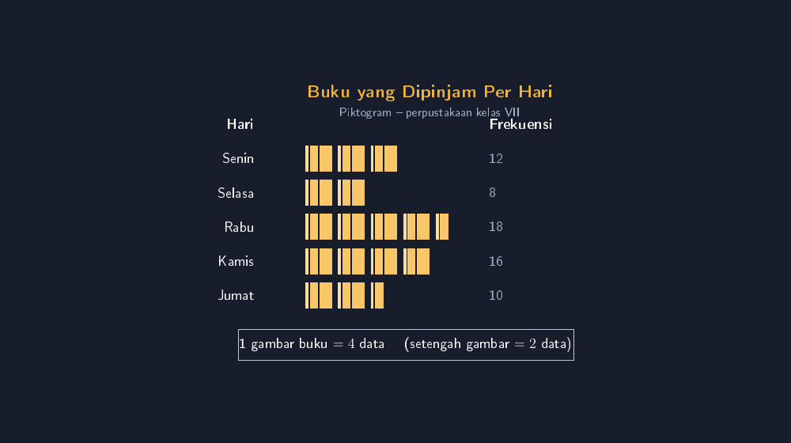

Beberapa tahun terakhir saya sadar ada satu diagram yang hampir tidak pernah saya buat serius di kelas: piktogram. Diagram batang sudah sering, diagram garis sudah, boxplot sudah pernah saya bahas di tulisan lain. Tapi piktogram — diagram data yang memakai gambar kecil untuk mewakili frekuensi — sering saya lewatkan dengan alasan "itu kan materi SD". Ternyata setelah mencobanya di kelas VII tahun ini, saya menemukan bahwa piktogram justru menyimpan satu konsep yang tidak sederhana sama sekali: *satu simbol mewakili lebih dari satu data*.

<!--more-->

## Kapan Gambar Jadi Masalah

Ceritanya dimulai dari lembar kerja bawaan buku. Ada piktogram tentang jumlah kendaraan yang lewat depan sekolah: satu gambar sepeda mewakili 2 sepeda, satu gambar motor mewakili 5 motor, dan sebagainya. Ada satu baris yang datanya 12, dan gambar motornya digambar setengah — setengah motor yang katanya mewakili 5, jadi 2,5 motor.

Sebagian besar siswa tidak keberatan. Tapi satu anak di kelas VII-B, sebut saja Rizky, mengangkat tangan dan bertanya, "Pak, kalau setengah motor, motornya yang mana yang dipotong?"

Saya tertawa, dan kelas ikut. Tapi pertanyaan itu sebenarnya bukan lelucon. Rizky sedang menunjukkan bahwa ia *membaca* diagram dengan logika, bukan sekadar menghitung. Setengah motor itu bukan motor yang dipotong — itu perjanjian bahwa gambar tersebut mewakili $5 \times 0{,}5 = 2{,}5$ data. Kalau siswa tidak dipandang memahami perjanjian itu, piktogram hanyalah tebak-tebakan gambar.

Di situ saya memutuskan: piktogram layak didapat satu sesi sendiri, dan seperti biasa, saya buat gambarnya dengan TikZ supaya yang saya tampilkan di layar persis seperti yang saya maksud.

## Perjanjian yang Harus Ditulis Terang

Kunci piktogram ada di satu baris yang sering diabaikan siswa: *keterangan skala* — "1 gambar = ... data". Tanpa itu, piktogram tidak bisa dibaca. Dalam pembahasan kelas, saya selalu menaruhnya di bawah tabel seperti ini:

$$1 \; \text{gambar buku} = 4 \; \text{data}$$

Lalu setiap baris digambar dengan jumlah gambar yang sesuai. Kalau datanya 18 dan satu gambar mewakili 4, kita butuh $18 \div 4 = 4{,}5$ gambar — empat gambar utuh dan satu gambar setengah. Di sinilah TikZ membantu: saya bisa menggambar "setengah buku" dengan memotong gambar secara vertikal, sehingga siswa melihat dengan jelas bahwa yang dipotong adalah *simbolnya*, bukan barangnya.

Gambar berikut saya pakai di kelas — satu piktogram data buku yang dipinjam per hari di perpusteka kelas:


*Piktogram pinjaman buku per hari. Satu gambar buku mewakili 4 data; baris Rabu memakai setengah gambar untuk 2 data. Gambar dibuat dari kode TikZ yang saya kompilasi sendiri.*

## Kode TikZ yang Saya Pakai

Inti kodenya sederhana: satu gambar buku saya definisikan sebagai *picture* kecil, lalu diulang sepanjang baris sesuai frekuensi. Untuk setengah gambar, saya pakai `\begin{scope}` dengan pemotongan klip.

```latex
\newcommand{\buku}{%
  \tikz{\draw[thick,fill=F7B538!70,draw=white]
    (-0.35,-0.45) rectangle (0.35,0.45);
    \draw[white,thick] (0,-0.45) -- (0,0.45);}}
```

Lalu setiap baris diisi:

```latex
\foreach \hari/\n/\jml in {Senin/12/3, Selasa/8/2, Rabu/18/4.5,
  Kamis/16/4, Jumat/10/2.5} { ... }
```

Bagian yang butuh ketelitian justru di Rabu: $4{,}5$ gambar berarti empat buku utuh ditambah satu buku yang hanya digambar setengah lebar (bagian kiri). Saya klip dengan `\clip (-0.5,-0.6) rectangle (0,0.6);` supaya hanya separuh simbol yang tampil. Kalau saya malas dan hanya "mengarang" gambar seadanya, siswa seperti Rizky akan langsung menangkap ketidakjujuran itu.

Kode lengkapnya bisa diunduh di akhir tulisan ini — sudah saya cek kompilasinya utuh dari `\documentclass` sampai `\end{document}`.

## Apa yang Berubah di Kelas

Tiga hal yang saya rasakan setelah satu sesi piktogram:

Pertama, siswa jadi terbiasa dengan ide *skala non-satuan*. Satu gambar = 4, setengah gambar = 2 — ini latihan alami untuk perkalian pecahan tanpa perlu menyebutnya begitu.

Kedua, muncul diskusi yang tidak pernah saya rencanakan: kalau datanya 19 dan satu gambar mewakili 4, apakah boleh memakai gambar yang mewakili 5 supaya lebih mudah? Jawabannya: boleh, asal keterangannya diganti. Piktogram mengajarkan bahwa representasi adalah *pilihan yang bisa dipertimbangkan*, bukan aturan baku.

Ketiga, saya jadi punya alat bantu yang bisa dipakai ulang. Karena gambar saya buat di TikZ, tahun depan saya tinggal mengganti data di baris `\foreach`, dan diagram langsung jujur pada data baru. Tidak ada lagi risiko saya salah menghitung gambar saat menggambar di papan tulis lima menit sebelum bel.

## Penutup: Diagram Sederhana, Konsep yang Tidak Sederhana

Saya mengakui sempat meremehkan piktogram. Ternyata diagram paling sederhana sekalipun menyimpan perjanjian matematis yang layak dipahami siswa: simbol, skala, dan apa artinya memotong simbol. Dan seperti biasa di kelas saya, TikZ adalah cara saya menjaga kejujuran itu — karena gambar yang saya tampilkan dibangun dari angka yang sama dengan yang saya hitung.

Kalau Bapak/Ibu ingin mencoba, mulailah dari data yang dekat dengan siswa: buku yang dipinjam, kehadiran, atau buah yang dibawa ke kantin. Yang penting bukan datanya, tapi perjanjiannya — dan keberanian menampilkan setengah gambar lalu menjawab pertanyaan Rizky dengan jujur: yang dipotong bukan motornya, tapi cerita tentang motornya.

> 📎 **Berkas TikZ lengkap:** [tikz-piktogram.tex](tex/tikz-piktogram.tex) — siap kompilasi (butuh paket `tikz`).
