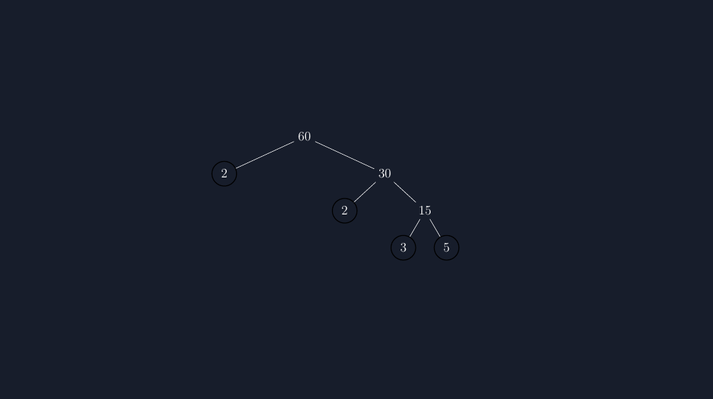
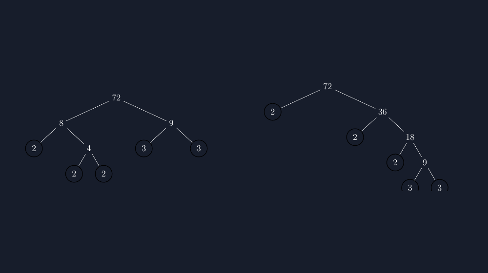

Di kelas tujuh, materi faktorisasi prima biasanya saya ajarkan lewat pohon faktor. Konsepnya sederhana: ambil satu bilangan, pecah menjadi dua faktor, ulangi sampai semua cabang berakhir di bilangan prima. Tapi ketika saya minta siswa menggambarnya di buku, hasilnya aneka ragam. Ada pohon yang miring ke kiri karena cabang kiri selalu lebih panjang. Ada yang cabangnya bertabrakan dengan tulisan sebelahnya. Ada juga yang angka 2 dan 3 di ujung cabang ditulis mepet sekali, sampai tidak jelas itu angka milik cabang mana.

Pada mulanya saya menganggap ini cuma soal kerapian. Tapi lama-lama saya sadar kerapian itu bukan kosmetik. Pohon faktor yang berantakan menyulitkan siswa melihat struktur bilangan yang justru menjadi inti pelajaran: bahwa 60 itu "terdiri dari" $2^2 \times 3 \times 5$, dan susunan itu sama saja, entah kamu memecahnya lewat $6 \times 10$ atau $2 \times 30$. Kalau gambarnya kacau, kesamaan struktur itu tidak terlihat.

<!--more-->

## Masalah yang sering muncul di papan tulis

Pernah satu kelas, dua siswa memfaktorkan bilangan yang sama, 72, dan mendapat "pohon" yang bentuknya berbeda sama sekali. Yang satu mulai dari $8 \times 9$, yang lain dari $2 \times 36$. Di papan tulis, hasil akhirnya sama: $2^3 \times 3^2$. Tapi sebagian siswa justru jadi bingung — kok bentuknya beda tapi jawabannya sama? Pertanyaan itu sebenarnya pertanyaan bagus, dan di situlah letak nilai ajar dari pohon faktor: dia memperlihatkan bahwa faktorisasi prima itu unik, sekalipun jalannya berbeda-beda. Tapi kalau gambar di papan tulis saya sendiri tidak rapi, perbandingan antar "pohon" itu jadi sulit diikuti.

Masalah klasik lain: saat saya menggambar pohon faktor di papan tulis dengan tangan, jarak antar cabang tidak pernah konsisten. Cabang bawah sering tumpang tindih dengan tulisan keterangan di sampingnya. Ketika saya buat soal latihan, kondisinya lebih parah lagi, karena soal yang diketik di komputer dengan gambar yang di-asal-tempel akan terlihat tidak profesional dan membingungkan.

## Menggambar pohon faktor dengan TikZ

Karena sudah terbiasa memakai TikZ untuk berbagai gambar soal lainnya, saya kemudian mencoba menggambar pohon faktor secara programatik. Hasilnya, sekalipun awalnya butuh sedikit penyesuaian, sekarang pohon faktor di soal-soal saya selalu rapi dan konsisten. Inilah bentuk dasar yang saya pakai untuk pohon faktor dari 60:

```latex
\begin{tikzpicture}[
  level distance=12mm,
  level 1/.style={sibling distance=52mm},
  level 2/.style={sibling distance=26mm},
  every node/.style={font=\large},
  prime/.style={circle, draw=#1, thick, minimum size=8mm},
]
\node {60}
  child { node[prime=white] {2} edge from parent }
  child { node {30}
    child { node[prime=white] {2} }
    child { node {15}
      child { node[prime=white] {3} }
      child { node[prime=white] {5} }
    }
  };
\end{tikzpicture}
```

Beberapa hal yang saya perhatikan ketika membuat gambar ini:

Pertama, pengaturan `level distance` dan `sibling distance` itulah yang membuat semua pohon faktor saya punya "bentuk baku". Cabang-cabang selalu terpisah sama jauh, sehingga siswa tidak lagi mengira bahwa cabang yang berdekatan itu ada hubungannya satu sama lain.

Kedua, saya selalu menandai bilangan prima di ujung cabang dengan lingkaran. Ini bukan hiasan. Ketika siswa membaca pohon, lingkaran itu berkata: "berhenti di sini, cabang ini sudah selesai." Tanpa penanda, siswa kadang masih bertanya, "Pak, yang 2 ini masih dipecah lagi nggak?"

Ketiga, penamaan `prime` sebagai style membuat saya bisa mengubah seluruh tampilan lingkaran prima di satu tempat saja. Kalau nanti saya ingin mengganti warna atau ukuran, saya tidak perlu menyentuh gambar satu per satu.


*Pohon faktor 60 yang dihasilkan TikZ. Semua bilangan prima di ujung cabang diberi lingkaran, sehingga siswa langsung melihat di mana faktorisasi "berhenti".*

## Pohon yang berbeda jalur, sama hasilnya

Gambar yang paling saya suka adalah perbandingan dua pohon faktor dari bilangan yang sama. Ini yang dulu membuat siswa bingung di papan tulis — dan justru di layar, dengan dua pohon yang digambar rapi berdampingan, perbandingan itu jadi jelas:


*Faktorisasi 72 lewat dua jalur berbeda. Keduanya berakhir di $2^3 \times 3^2$ — kesempatan bagus untuk menyinggung keunikan faktorisasi prima (teorema dasar aritmetika).*

Dengan dua gambar yang rapi dan ukurannya konsisten, siswa bisa membandingkan cabang demi cabang. Mereka melihat sendiri bahwa 72 yang dipecah lewat $8 \times 9$ atau lewat $2 \times 36$ berakhir di kumpulan prima yang sama. Tidak perlu saya ceramah panjang; gambarnya yang bicara.

## Menyusun soal dengan gambar yang bisa dipercaya

Setelah template ini jadi, membuat paket soal jadi lebih cepat. Saya tinggal mengganti bilangan yang difaktorkan, mengubah sedikit `sibling distance` kalau pohonnya lebih dalam, dan gambar langsung siap. Pohon faktor untuk 84, untuk 100, untuk 144 — semuanya dengan gaya yang sama persis.

Ada satu keuntungan lain yang tidak saya duga: karena gambar saya konsisten, siswa juga mulai menggambar pohon faktor mereka dengan lebih rapi. Mereka meniru bentuk yang mereka lihat di soal. Lingkaran di bilangan prima ikut ditiru. Jadi gambar yang baik di lembar soal ternyata diam-diam ikut membentuk cara siswa mencatat.

## Catatan teknis singkat

Kalau Bapak/Ibu ingin mencoba, hal yang perlu diperhatikan:

- Paket yang dibutuhkan hanya `tikz`; style `prime` saya definisikan dengan parameter warna supaya mudah disesuaikan dengan tampilan lembar soal (terang atau gelap).
- `sibling distance` perlu disesuaikan dengan kedalaman pohon. Pohon dari 64 (yang hanya berisi angka 2 berkali-kali) sebaiknya jangan memakai `sibling distance` besar, karena akan melebar tidak perlu.
- Untuk pohon yang sangat dalam, saya biasanya mengubah `level distance` menjadi lebih kecil supaya gambar tetap muat di halaman.
- Kalau ingin pohon dua bilangan berdampingan untuk perbandingan, cukup bungkus dua `tikzpicture` dalam satu baris atau pakai lingkungan `center` dengan pemisah `\qquad` — itulah yang saya lakukan untuk gambar 72 di atas.

Kode lengkap yang siap kompilasi saya sertakan di tautan di bawah. Isinya dua gambar di artikel ini sekaligus: pohon faktor 60 dan perbandingan dua jalur untuk 72.

## Penutup

Pohon faktor bukan materi yang sulit. Tapi justru materi-materi "sederhana" seperti inilah yang paling sering saya sampaikan dengan gambar asal jadi. Sejak menggambar pohon faktor dengan TikZ, saya merasa ada satu hal kecil yang berubah: waktu kelas yang tadinya habis untuk menjelaskan "yang mana cabangnya yang mana", sekarang bisa dipakai untuk hal yang lebih berharga — mendengarkan alur pikir siswa ketika mereka memecah sebuah bilangan, dan membiarkan mereka menemukan sendiri bahwa bilangan itu punya struktur yang rapi, sekalipun jalan menuju struktur itu bisa berbeda-beda.

> 📎 **Berkas TikZ lengkap:** [tikz-pohon-faktor-faktorisasi-prima.tex](tex/tikz-pohon-faktor-faktorisasi-prima.tex) — siap kompilasi (butuh paket `tikz`).
