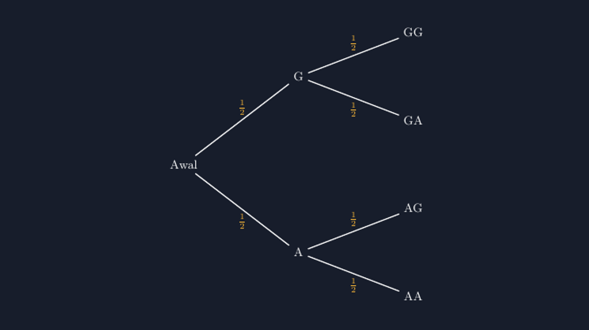

Ada satu momen yang hampir selalu terulang setiap kali saya mengajar bab peluang di kelas VIII. Saya tanyakan soal sederhana: "Sebuah koin dilempar dua kali. Berapa peluang muncul satu gambar dan satu angka?" Hampir pasti, sebagian kelas menjawab sepertiga.

Alasannya bisa ditebak: "Kan cuma ada tiga kemungkinan, Pak. Dua gambar, campuran, dua angka." Jawaban itu terdengar sangat masuk akal — dan justru karena terdengar masuk akal, miskonsepsi ini susah diluruskan dengan sekadar berkata "salah". Tiga kejadian itu memang ada, tapi mereka tidak sama ringannya. Sejak saya punya cara menggambarkan hal ini dengan jujur — lewat pohon peluang yang saya gambar rapi dengan TikZ — momen koreksi di kelas saya berubah menjadi lebih tenang.




*Empat jalur dari dua lemparan koin — "campuran" ternyata menampung dua jalur sekaligus.*

<!--more-->

## Tiga Kemungkinan yang Tidak Setara

Masalahnya bukan pada daftar kemungkinan itu. Dua gambar, campuran, dua angka — daftar itu benar sebagai daftar *hasil* (outcome). Yang salah adalah anggapan bahwa ketiganya sama peluangnya. Kalau saya tanya balik, "coba tuliskan semua urutan lemparan yang mungkin," siswa mulai meragukan dirinya sendiri. GG, GA, AG, AA. Empat urutan. Dan "campuran" ternyata menampung dua urutan sekaligus: GA dan AG.

Di sinilah pohon peluang masuk. Masalah inti peluang banyak kejadian bukan soal menghitung — menghitungnya mudah, tinggal dikali. Masalahnya adalah siswa tidak *melihat* struktur percabangannya. Mereka memperlakukan "dua kali lemparan" sebagai satu kejadian utuh, padahal itu dua kejadian yang saling menempel. Pohon peluang memaksa struktur itu terlihat: satu batang untuk lemparan pertama, lalu setiap cabang bercabang lagi untuk lemparan kedua.

Karena saya rutin menyiapkan bahan ajar dari LaTeX, saya ingin pohon ini digambar dengan jujur juga: setiap cabang sama panjang, setiap label probabilitas tidak menimpa, dan hasil akhir tersusun rapi di kolom paling kanan. Gambar asal-asalan di papan tulis sering justru menambah kebingungan — cabang miring tak karuan membuat siswa sulit melacak jalur mana milik siapa.

## Menggambar Pohon Peluang dengan TikZ

Berikut inti kode yang saya pakai. Pendekatannya sederhana: setiap simpul adalah titik, dan setiap cabang digambar dari titik induk ke titik anak dengan koordinat yang sengaja saya hitung agar semua level berjarak sama.

```latex
\begin{tikzpicture}[
  level distance = 28mm,
  level 1/.style = {sibling distance = 42mm},
  level 2/.style = {sibling distance = 21mm},
  every node/.style = {font = \small},
  grow = right
]
  \node {Awal}
    child { node {A}
      child { node {AA} edge from parent node[below] {$\tfrac12$} }
      child { node {AG} edge from parent node[above] {$\tfrac12$} }
      edge from parent node[below] {$\tfrac12$}
    }
    child { node {G}
      child { node {GA} edge from parent node[below] {$\tfrac12$} }
      child { node {GG} edge from parent node[above] {$\tfrac12$} }
      edge from parent node[above] {$\tfrac12$}
    };
\end{tikzpicture}
```

Beberapa keputusan kecil di kode ini penting menurut saya. Pertama, `grow = right` membuat pohon tumbuh ke kanan, sehingga urutan membacanya cocok dengan urutan kejadian: dari kiri (lemparan pertama) ke kanan (lemparan kedua). Kedua, `level distance` yang sama untuk semua level menjaga jujur pada waktu: lemparan pertama dan kedua saya posisikan sama jauh, karena keduanya sama-sama satu lemparan penuh. Ketiga, label $\tfrac{1}{2}$ saya letakkan dengan `node[above]` atau `node[below]` pada garis cabang, bukan ditebak posisinya — kalau asal diletakkan, label dari dua cabang yang berdekatan akan saling menimpa dan gambar jadi tidak terbaca.

Untuk mengerjakan soal koin dua lemparan, tinggal kita lanjutkan: peluang "campuran" adalah jumlah peluang jalur GA dan jalur AG:

$$P(\text{campuran}) = \frac{1}{2}\cdot\frac{1}{2} + \frac{1}{2}\cdot\frac{1}{2} = \frac{1}{4} + \frac{1}{4} = \frac{1}{2}$$

Bukan sepertiga, tapi setengah. Dan kalau semua empat jalur dijumlahkan, hasilnya satu — pohon ini dengan sendirinya "menjaga kejujuran" total probabilitas. Sifat self-checking semacam ini yang membuat saya semakin yakin gambar yang baik bukan hiasan, tapi alat berpikir.

Saya juga biasa menambahkan kolom hasil di paling kanan dengan hasil perkalian di tiap jalur — dengan TikZ, cukup menaruh node tambahan dan menggambarkan kurung kurawal jika perlu. Tapi untuk pengenalan di kelas, versi minimal seperti di atas justru lebih bersih.

## Dari Koin ke Kasus yang Lebih Ramai

Setelah kelas nyaman dengan koin dua lemparan, saya naikkan tantangannya pelan-pelan. Koin tiga kali? Pohonnya tinggal bercabang satu level lagi — dan siswa bisa memperkirakan sendiri bahwa jumlah ujungnya jadi delapan, tanpa saya beritahu. Ini momen favorit saya: ketika mereka *memperkirakan* struktur sebelum menghitung.

Kasus berikutnya yang saya suka adalah kantong berisi kelereng: misalnya 3 merah dan 2 biru, diambil dua kali tanpa pengembalian. Di sini pohon peluang menunjukkan kekuatan yang tidak bisa digantikan daftar biasa, karena peluang cabang kedua *berubah* tergantung jalur pertama. Cabang "merah lalu merah" punya peluang $\tfrac{3}{5}\cdot\tfrac{2}{4}$, sedangkan "merah lalu biru" $\tfrac{3}{5}\cdot\tfrac{2}{4}$ — tapi "biru lalu merah" $\tfrac{2}{5}\cdot\tfrac{3}{4}$. Angka-angka yang berbeda di setiap cabang tidak mungkin ditangkap daftar kemungkinan biasa; hanya pohon yang menampilkannya apa adanya.

Pelajaran pedagogisnya menurut saya begini: miskonsepsi "tiga kemungkinan sama peluangnya" tidak mati karena diceramahi, tapi karena siswa diberi alat untuk melihat sendiri ketidaksetaraan itu. Pohon peluang yang digambar jujur — cabang sejajar, label terbaca, jarak antar level konsisten — adalah alat koreksi yang paling sabar yang saya punya. Ia tidak pernah kecewa meski harus dijelaskan berkali-kali.

## Catatan Praktis di Kelas

Beberapa hal kecil yang saya pelajari dari perulangan mengajar bab ini. Pertama, minta siswa menggambar pohonnya sendiri sebelum menunjukkan versi rapi saya. Pohon buatan mereka pasti berantakan — dan justru dari keberantakan itu mereka merasakan kenapa kerapian penting: label yang menimpa membuat mereka sendiri salah membaca jalur.

Kedua, jangan buru-buru menuliskan aturan perkalian. Aturan $P(A \text{ lalu } B) = P(A)\cdot P(B)$ akan terasa *ditemukan*, bukan dihafal, kalau siswa sudah dulu mengalikan pecahan sepanjang jalur pohon beberapa kali. Rumus yang ditemukan bertahan lebih lama daripada rumus yang diberikan.

Ketiga, pohon peluang ternyata menyambung mulus ke materi lain. Di kelas IX, pohon yang sama membantu menjelaskan kejadian saling bebas dan tidak bebas; di statistika, cara berpikirnya muncul lagi saat membahas pohon keputusan sederhana. Satu gambar, banyak pintu.

Dan seperti tulisan-tulisan saya sebelumnya tentang menggambar bahan ajar dengan TikZ, nilai terbesarnya bagaikan bukan pada hasil jadinya yang terlihat cantik, tapi pada proses saya memikirkan ulang materi saat menggambarnya. Untuk menggambar pohon peluang, saya terpaksa memutuskan: kejadian mana level pertama, mana level kedua, cabang mana yang peluangnya berubah. Pertanyaan-pertanyaan itu membuat saya lebih siap menjawab "tapi kenapa, Pak?" dari bangku kelas. Gambar yang baik, sebelum mengajar siswa, selalu mengajar saya dulu.

> 📎 **Berkas TikZ lengkap:** [tikz-pohon-peluang.tex](tex/tikz-pohon-peluang.tex) — siap kompilasi (butuh paket `tikz`).
