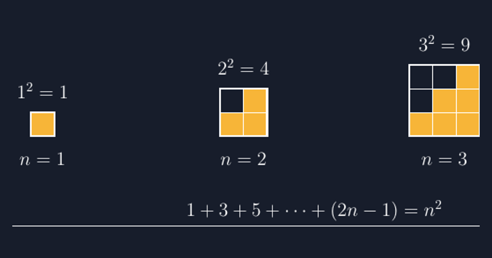

Minggu lalu, di kelas VIII, saya menulis satu baris angka di papan:

$$1 + 3 + 5 + 7 + 9 + 11 = ?$$

Jawaban pertama yang muncul adalah suara serempak: "Tiga puluh satu, Bu!" Lalu saya tulis di bawahnya $6^2 = 36$, dan kelas jadi hening sejenak. Ada yang mengangkat tangan, "Bu, kok tadi salah ya?" Ternyata tidak ada yang salah — dua-duanya benar, dan justru di situ letak kejutannya. Jumlah enam bilangan ganjil pertama itu sama dengan $6^2$. Sepuluh detik kemudian ada yang menyahut dari pojok kelas, "Kebetulan mungkin, Bu?"

Nah, kata "kebetulan" itu yang menurut saya paling berharga. Kalau dibiarkan, siswa akan mencatat identitas ini di buku sebagai fakta yang tinggal dihafal: jumlah $n$ bilangan ganjil pertama sama dengan $n^2$. Tapi kalau "kebetulan" itu diberi tempat, dia bisa berubah menjadi pemahaman yang menetap. Dan cara paling jujur yang saya temukan untuk memberi tempat pada kebetulan adalah menggambar.

## Kebetulan yang Kedua, dan Kebetulan yang Ketiga

Saya tidak langsung lompat ke generalisasi. Pertandingan pertama saya sengaja kalah: saya minta mereka cek pola berikutnya.

$$1 + 3 + 5 + 7 = 16 = 4^2$$

$$1 + 3 + 5 + 7 + 9 = 25 = 5^2$$

Di kelas itu ada Nadia — bukan nama sebenarnya — yang biasanya paling cepat curiga kalau saya menyiapkan jebakan. Dia bilang, "Kalau kebetulan dua kali, itu bukan kebetulan lagi, Bu." Kalimat itu saya tulis di papan, di dalam kotak. Saya suka sekali kalimat semacam itu, karena kalimat seperti itu yang justru jarang muncul di kisi-kisi, tapi paling menentukan cara pandang anak terhadap matematika.

Tapi percaya saja pada pola lima langkah itu juga belum ilmiah. Matematika menuntut alasan: *kenapa* jumlah bilangan ganjil itu selalu kuadrat? Di titik inilah gambar bekerja lebih cepat dari aljabar.

## Menggambar Kebiasaan Ganjil Menjadi Persegi

Idenya sederhana. Bilangan ganjil, kalau dibaca sebagai banyaknya kotak, selalu berbentuk huruf L — pola yang saya sebut "gnomon" saja kalau mau serius, tapi di kelas saya menyebutnya "kaki kursi". Satu kotak pertama. Tiga kotak berikutnya menempel di kanan dan atas kotak itu, jadi bentuk L dengan kaki tiga. Lima kotak berikutnya lagi, jadi L yang lebih besar. Kalau semua L itu ditempel satu sama lain, mereka saling melengkapi persis, dan hasilnya adalah persegi.



*Gambar 1 — Tiga persegi pertama. Setiap persegi $n \times n$ tersusun dari L-L ganjil yang ditempel mulai dari kecil.*

Kalimat yang saya ucapkan di kelas ketika gambar ini ditampilkan begini: "Perhatikan kotak yang gelap. Itu tempat L berikutnya akan duduk." Di gambar, untuk $n = 2$ ada satu kotak gelap yang belum terisi; L dengan tiga kotak persis mengisinya. Untuk $n = 3$ ada empat kotak gelap, dan L dengan lima kotak mengisinya. Karena persegi yang baru selalu lebih besar satu kotak ke kanan dan satu kotak ke atas daripada persegi sebelumnya, banyaknya kotak yang perlu diisi selalu $n + n + 1 = 2n + 1$ — dan itu memang definisi bilangan ganjil ke-$n+1$. Tidak ada lubang. Tidak ada kebetulan.

Inilah yang tidak bisa diberikan oleh barisan angka di papan: bukti bahwa pengisian itu *selalu* bisa dilakukan, untuk $n$ sebesar apa pun. Angka bisa mencapai lima langkah dan berhenti; gambar menunjukkan mekanisme yang berjalan terus.

## Menuliskannya di TikZ, dan Apa yang Saya Perbaiki di Tengah Jalan

Gambar di atas saya buat dengan TikZ, dan proses pembuatannya sendiri ternyata mengajari saya satu hal tentang menulis soal. Sketsa pertama yang saya buat memakai perulangan biasa: gambar persegi $n \times n$, selesai. Tapi kalau cuma begitu, L-nya tidak terlihat — siswa hanya melihat tiga persegi sama besar dengan warna berbeda, dan identitasnya tidak muncul. Jadi saya ubah pendekatannya: setiap persegi diisi per kolom, di mana kolom ke-$k$ berisi $k$ kotak yang terang (bagian L yang sudah menempel) dan sisanya gelap (bagian yang belum terisi).

Dalam TikZ, itu jadi perulangan dua tingkat yang lumayan elegan:

```latex
\foreach \n/\ofs in {1/0, 2/8, 3/16} {
  \foreach \k in {1,...,\n} {   % kolom ke-k
    \fill[aksen, opacity=0.45] (\ofs+\k-1,0) rectangle ++(1,1); % dasar kolom
    \foreach \j in {1,...,\k}  % bagian L yang terisi
      \fill[aksen] (\ofs+\k-1,\j-1) rectangle ++(1,1);
  }
  \draw[white] (\ofs,0) rectangle ++(\n,\n);
}
```

Satu detail kecil yang hampir lolos: jarak antar-persegi. Awalnya saya beri jarak satu kotak saja, dan hasilnya tiga persegi tampak seperti satu bangun yang retak. Setelah diberi jarak cukup (saya pakai ofset 8 unit untuk persegi yang lebarnya 1, 2, dan 3), ketiganya langsung terbaca sebagai tiga "tangkapan layar" dari proses yang sama. Ada juga keputusan kecil yang menurut saya penting: label di bawah persegi saya tulis $n = 1$, $n = 2$, $n = 3$ — bukan $1$, $4$, $9$ — supaya yang dibaca siswa adalah *tahapannya*, bukan langsung hasilnya. Nilai $1^2$, $2^2$, $3^2$ saya letakkan di atas, sebagai judul tiap tahap.

Pengalaman kecil seperti ini selalu mengingatkan saya pada hal yang sama: menggambar ulang gambar untuk mengajar itu bukan pekerjaan kosmetik. Setiap keputusan — jarak, warna, urutan label — adalah keputusan pedagogis. Gambar yang asal jadi bisa menunjukkan hal yang salah, dan siswa tidak akan protes; mereka cuma diam-diam menyimpulkan yang keliru.

## Dari Gambar ke Argumen

Setelah gambar dibahas, barulah saya tarik ke penulisan. Yang saya minta dari siswa bukan "tulis rumusnya", tapi "tulis kenapa gambar itu meyakinkan". Jawaban yang saya harapkan (dan di kelas itu akhirnya muncul, meski lewat dua tawaran berbeda) kira-kira begini:

Persegi ke-$n$ dibentuk dari persegi ke-$(n-1)$, lalu ditambah satu kolom di kanan ($n$ kotak) dan satu baris di atas ($n$ kotak), tapi kotak pojok kanan-atas dihitung dua kali kalau begitu — jadi yang benar ditambah $n + n - 1 = 2n - 1$ kotak. Berarti:

$$n^2 = (n-1)^2 + (2n-1)$$

Dari sini, kalau kita buka berturut-turut dari $n$ sampai $1$, semua suku $(n-1)^2$, $(n-2)^2$ dan seterusnya saling muncul-hilang, dan tersisa:

$$1 + 3 + 5 + \dots + (2n-1) = n^2$$

Perhatikan apa yang terjadi di sini: rumus itu tidak diturunkan dengan "aljabar yang cunning" semata, tapi dengan cerita dari gambar — kolom kanan, baris atas, pojok yang dihitung dua kali. Siswa yang saat itu mengangkat "kebetulan mungkin, Bu" bisa melihat sendiri bahwa tidak ada satu kotak pun yang datang dari kebetulan.

## Yang Saya Catat di Jurnal Hari Itu

Di jurnal mengajar digital saya, malam itu saya tulis dua hal. Pertama, kelas ini jauh lebih lama dari rencana: tujuh puluh menit, tidak cukup tiga puluh. Tapi kedua, esoknya saat saya melempar soal berbeda — jumlah bilangan genap dari 2 sampai 20 — beberapa siswa langsung menggambar sebelum menghitung. Mereka mencoba membentuk persegi panjang dari pasangan-pasangan, dan menemukan sendiri bahwa pasangan genap itu mengisi persegi panjang $10 \times 11$. Tidak ada yang saya ajari itu hari itu. Gambar L kemarin yang mengajari.

Itu poin yang ingin saya tinggalkan dari tulisan ini. Identitas $1 + 3 + 5 + \dots + (2n-1) = n^2$ hanyalah satu baris di buku, tapi dia adalah pintu masuk yang sangat baik untuk membiasakan satu kebiasaan: sebelum percaya pada pola, minta gambar yang menjelaskan mekanismenya. Dan TikZ — seperti yang sudah berkali-kali saya tulis di blog ini — membantu saya membuat gambar itu presisi, bisa dipakai ulang tahun depan, dan jujur pada geometrinya sendiri.

Kalau Bapak/Ibu ingin mencoba, jangan mulai dari kode. Mulai dari kertas dan kotak-kotak yang diwarna. Setelah urutannya jelas di tangan siswa, kode di bawah ini tinggal mencatat apa yang sudah mereka pahami.

> 📎 **Berkas TikZ lengkap:** [tikz-pola-bilangan-ganjil-kuadrat.tex](tex/tikz-pola-bilangan-ganjil-kuadrat.tex) — siap kompilasi (butuh paket `tikz`).
