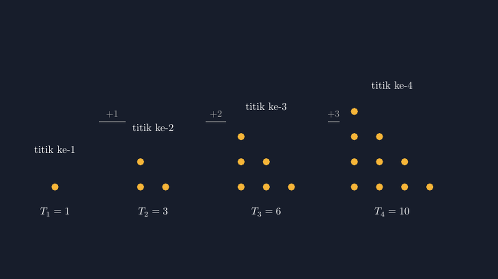

Bab pola bilangan biasanya saya mulai dengan pertanyaan yang kelihatannya sepele: "berapa titik kalau susunannya dilanjutkan sampai baris kesepuluh?" Tapi percaya atau tidak, pertanyaan itulah yang dulu bikin saya geleng-geleng sendiri. Bukan karena siswa tidak bisa menjawab — tapi karena saya menyadari bahwa cara saya menggambarnya di papan tulis selama ini berantakan.

<!--more-->

## Titik yang Lari dari Garisnya

Dulu, kalau saya menggambar pola titik segitiga di papan tulis, hasilnya selalu miring. Titik baris kedua tidak tepat di bawah titik baris pertama, baris ketiga melebar ke arah yang tidak seharusnya, dan yang paling parah: jarak antartitik dalam satu baris beda-beda. Anak-anak yang diminta "lanjutkan polanya" malah bingung — pola yang mereka lihat memang tidak teratur, jadi mana mungkin mereka menemukan keteraturan dari situ?

Ironis. Bab yang intinya adalah **keteraturan** justru saya tunjukkan lewat gambar yang tidak teratur. Sejak itu saya putuskan: pola bilangan tidak boleh saya ajarkan tanpa gambar yang jujur. Dan seperti tulisan-tulisan saya sebelumnya, TikZ menjadi jawabannya.

## Empat Segitiga yang Tumbuh

Berikut inti gambar yang sekarang saya pakai — empat susunan titik pertama, digambar berdampingan supaya "pertumbuhannya" terlihat:

```latex
\begin{tikzpicture}[x=0.85cm, y=0.85cm]
\foreach \n/\x0 in {1/0.5, 2/3.9, 3/7.9, 4/12.4} {
  \foreach \r in {1,...,\n} {
    \foreach \c in {1,...,\r}
      \fill[acc] (\x0+\c-1, \n-\r) circle (0.14);
  }
  \node[below] at (\x0+\n/2-0.5, -0.1)
    {$T_{\n}=\pgfmathtruncatemacro{\s}{\n*(\n+1)/2}\s$};
}
\end{tikzpicture}
```

Hasil rendernya:



*Barisan bilangan segitiga: baris ke-$r$ selalu berisi $r$ titik, dan jumlahnya tumbuh 1, 3, 6, 10, ...*

Struktur kodenya sengaja sederhana. Tiga `foreach` bersarang: yang terluar menyusuri nomor segitiga $n$, yang tengah menyusuri baris $r$ dari 1 sampai $n$, dan yang terdalam menggambar $r$ titik di baris itu. Tidak ada koordinat yang diketik manual satu per satu — semuanya lahir dari aturan. Dan ini justru pesan matematisnya: baris ke-$r$ berisi $r$ titik, **karena begitulah definisi polanya**, bukan karena kebetulan gambar saya rapi.

## Dari Menunjuk ke Menghitung

Dengan gambar ini di LKPD, pertanyaan klasik "berapa jumlah titik pada baris kesepuluh?" berubah karakter. Siswa tidak lagi menebak dengan pola "tambah terus" yang setengah yakin. Mereka bisa menunjuk: segitiga keempat itu segitiga ketiga **ditambah satu baris berisi empat titik**. Jadi $T_4 = 6 + 4 = 10$. Dari sini selisihnya kelihatan jelas: $+1$, $+2$, $+3$, dan seterusnya.

Lalu pertanyaan berikutnya yang selalu saya lempar: "kalau begitu $T_{100}$? Mau menghitung satu per satu?" Di sinilah kelas biasanya hening dulu — hening yang bagus, karena mereka sedang mencari jalan pintas sendiri. Ada yang mencoba menjumlahkan $1+2+3+\cdots+100$ dan menyerah di tengah. Ada yang menemukan trik klasik: tulis jumlahan yang sama tapi terbalik, lalu jumlahkan sejajar:

$$T_{100} = 1 + 2 + \cdots + 100$$
$$T_{100} = 100 + 99 + \cdots + 1$$

Ditambah, tiap pasangan kolom bernilai 101, dan ada 100 kolom. Jadi dua kali $T_{100}$ sama dengan $100 \times 101$, sehingga:

$$T_n = \frac{n(n+1)}{2}$$

Yang saya sukai dari urutan ini: rumus itu **ditemukan**, bukan dibagikan. Dan gambar TikZ-nya berperan sebagai bukti visual sebelum aljabar bekerja. Anak yang pernah melihat segitiga keempat "tumbuh" dari yang ketiga tidak akan menganggap $T_n = \frac{n(n+1)}{2}$ sebagai simbol aneh yang turun dari langit.

## Jejak Segitiga di Bab Lain

Bonus yang paling saya nikmati: pola ini muncul lagi nanti di bab-bab lain, dan siswa yang terbiasa dengan gambarnya langsung mengenali wajah lamanya. Ketika kita menghitung banyak sisi pada semua diagonal sebuah poligon, muncul bilangan segitiga. Ketika anak-anak belajar menangani banyak pertemuan dua orang dalam satu kelas — kombinasi dua dari $n$ — jawabannya ternyata $\frac{n(n-1)}{2}$, saudara kandung rumus yang sama. Bulan lalu ada siswa yang berkata spontan di kelas: "Pak, ini pola titik segitiga yang dulu itu, ya?" Momen seperti itu yang membuat saya percaya bahwa gambar yang jujur punya daya tahan lebih lama daripada hafalan rumus.

Saya juga sempat menguji dua kelas dengan pendekatan berbeda. Satu kelas saya kasih rumus dulu, baru gambar sebagai penjelas. Kelas lain saya kasih gambar dulu, rumus muncul belakangan dari temuan mereka. Di kuis menyusulnya, perbedaannya kecil untuk soal hitungan langsung — tapi untuk soal "jelaskan kenapa rumusnya begini", kelas gambar-dulu jauh lebih banyak menjawab dengan alasan yang masuk akal, bukan sekadar menyalin rumus. Bukan riset kelas yang ketat, tapi cukup untuk saya.

## Tantangan Teknis Kecil

Untuk rekan guru yang ingin mencoba, ada dua hal kecil yang saya alami. Pertama, hasil perhitungan `\pgfmathparse` bisa muncul dengan desimal yang mengganggu; gunakan `\pgfmathtruncatemacro` supaya label $T_n$ tampil bulat. Kedua, jarak antar segitiga di kanvas harus cukup longgar — kalau terlalu rapat, label $T_3$ dan $T_4$ yang panjangnya beda bisa saling mendekat dan terasa sempit. Saya mengukur posisinya manual dulu di kertas buram sebelum menetapkan nilai `x0`.

> 📎 **Berkas TikZ lengkap:** [tikz-pola-bilangan-segitiga.tex](tex/tikz-pola-bilangan-segitiga.tex) — siap kompilasi (butuh paket `tikz`).

## Ketika Siswa Jadi Penanya Pola

Ada satu perubahan kecil di kelas yang tidak saya rencanakan. Setelah beberapa pertemuan bermain dengan susunan titik, ada siswa yang bertanya: "Pak, kalau titiknya disusun persegi bisa juga?" Pertanyaan sederhana itu membuka pintu yang tidak saya bayangkan. Pekan berikutnya kami mencoba bersama: susunan persegi berarti tiap baris sama banyak titiknya, jadi jumlahnya $1, 4, 9, 16, \ldots$ — dan beberapa anak yang sudah akrab dengan kuadrat langsung teriak bahwa itu kuadrat sempurna. Koneksi yang tidak akan muncul kalau pola hanya saya ceramahkan.

Lalu muncul pertanyaan yang lebih menantang: "kalau segitiganya dibalik dan ditempel ke segitiga lain, jadi apa?" Nah, ini dia. Dua segitiga yang sama ditempel menjadi persegi panjang — dan di situlah letak intuisi geometris dari rumus $T_n$: segitiga ke-$n$ adalah setengah dari persegi panjang $n \times (n+1)$. Alasan kenapa pembilangnya selalu $n(n+1)$ dan dibagi dua itu terlihat matahari-matahari di gambar: karena segitiga itu memang setengah persegi panjang. Saya sendiri baru benar-benar "melihat" argumen ini setelah menggambarnya dengan TikZ — padahal rumusnya sudah saya ajarkan puluhan kali dari buku.

## Penutup: Keteraturan Harus Terlihat

Mengajarkan pola bilangan dengan gambar yang tidak rapi itu seperti mengajarkan kejujuran dengan contoh yang bohong. Anak-anak tidak butuh banyak kata; mereka butuh melihat titik-titik yang tumbuh beraturan, menghitung sendiri selisihnya, dan menemukan bahwa di balik deret angka sederhana itu tersimpan rumus yang elegan.

Tugas kita mungkin sederhana: memastikan pola yang mereka lihat memang beraturan, supaya keteraturan yang kita ajarkan tidak jadi omongan kosong. Sekali lagi, TikZ membantu saya jujur di depan kelas.
