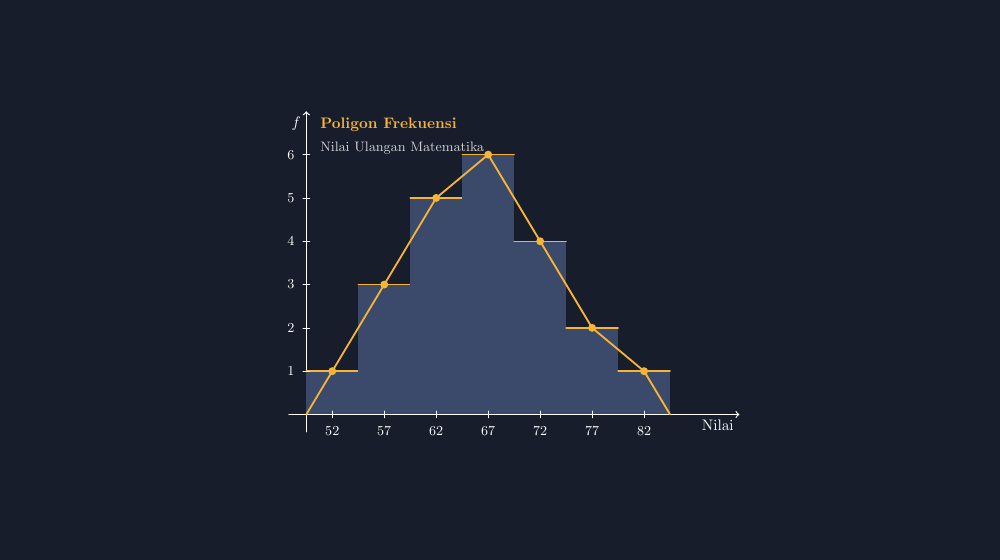

Minggu lalu saya mengajar statistika di kelas VIII. Materi yang biasanya saya anggap ringan: menyusun tabel frekuensi, menggambar histogram. Tapi ketika saya menulis "poligon frekuensi" di papan, satu anak di baris depan mengangkat tangan.

"Pak, ini segitiga apa?" tanyanya sambil menunjuk garis-garis yang saya buat di atas gambar histogram yang sudah jadi.

Saya tertawa. Bukan menertawakan dia, tapi karena pertanyaannya jujur dan mewakili banyak teman sekelasnya yang hanya diam. Selama ini mereka melihat poligon frekuensi sebagai sesuatu yang *ditempel* di atas histogram, bukan sebagai sesuatu yang *tumbuh* dari histogram. Dan jujur saja, banyak buku pelajaran yang memperbesar kebingungan itu: halaman kiri menampilkan histogram, halaman kanan menampilkan poligon frekuensi yang berdiri sendiri, seolah keduanya dua topik yang tidak punya hubungan darah.

<!--more-->

## Masalahnya di Gambar, Bukan di Definisi

Kalau kita telusuri definisinya, sebenarnya sederhana. Poligon frekuensi adalah garis yang menghubungkan titik-titik tengah puncak batang histogram. Titik tengah kelas di sumbu horizontal, frekuensi kelas di sumbu vertikal. Untuk menutup poligon, ujung kiri dan kanan kita sambungkan kembali ke sumbu horizontal, tepat di titik tengah kelas kosong sebelum kelas pertama dan sesudah kelas terakhir.

Tapi definisi yang sederhana bisa berubah jadi rumit ketika siswa harus *menggambarnya sendiri*. Di kertas berpetak, siswa harus:

1. Menghitung titik tengah setiap kelas, $\frac{\text{batas bawah} + \text{batas atas}}{2}$.
2. Menandai puncak setiap batang.
3. Menyambung titik-titik itu dengan garis lurus.
4. Menutup poligon ke sumbu di kedua ujung.

Empat langkah itu penuh tempat untuk keliru. Titik tengah yang salah hitung, garis yang tidak lewat puncak batang, atau yang paling sering: poligon yang digambar mengambang tanpa penutup di ujungnya. Setiap tahun saya menemukan poligon yang berhenti mendadak di titik terakhir, seperti jembatan yang tidak sampai ke seberang.

## Saya Coba Jujur di Layar

Karena itulah saya mulai menggambar histogram dan poligon frekuensinya dalam satu gambar TikZ, dan kejujuran geometrisnya justru mengajari lebih banyak daripada penjelasan lisan saya. Inti idenya: batang histogram digambar berdempetan (tanpa jarak, karena datanya berkelompok kontinu), lalu poligon digambar di atasnya dengan koordinat yang dihitung dari kelas yang sama.

Data yang saya pakai adalah nilai ulangan harian kelas VIII-B — 21 siswa, tujuh kelas interval, dimulai dari 50 sampai 84:

| Kelas | Titik Tengah | Frekuensi |
|-------|--------------|-----------|
| 50–54 | 52 | 1 |
| 55–59 | 57 | 3 |
| 60–64 | 62 | 5 |
| 65–69 | 67 | 6 |
| 70–74 | 72 | 4 |
| 75–79 | 77 | 2 |
| 80–84 | 82 | 1 |

Hasilnya seperti ini:



Perhatikan tiga hal yang tidak bisa "berbohong" di gambar ini. Pertama, poligon selalu lewat puncak setiap batang, karena koordinat titiknya memang diambil dari $\left(\text{titik tengah}, f\right)$ yang sama dengan batang. Kedua, di kedua ujung, poligon menutup ke sumbu horizontal di titik tengah kelas kosong — di nilai 47 (tengah kelas 45–49) dan 87 (tengah kelas 85–89) secara konsep; dalam gambar saya sengaja saya buat sambungannya simetris dari titik tengah batang pertama dan terakhir agar siswa fokus pada struktur dulu. Ketiga, lebar semua batang sama, karena TikZ menghitung posisinya dari rumus yang sama, bukan dari kira-kira tangan.

## Potongan Kodenya

Bagian yang menggambar poligonnya saja tidak lebih dari satu perintah `draw`. Ini inti dari file lengkapnya:

```latex
\draw[aksen, very thick]
  (0,0) -- (0.6,1) -- (1.8,3) -- (3.0,5)
        -- (4.2,6) -- (5.4,4) -- (6.6,2)
        -- (7.8,1) -- (8.4,0);
```

Dan batang histogramnya saya buat dengan `foreach`, supaya posisi setiap batang dihitung dari titik tengah kelas:

```latex
\foreach \t/\f in {52/1,57/3,62/5,67/6,72/4,77/2,82/1}{
  \pgfmathsetmacro\xx{0.6+(\t-52)/5*1.2}
  \fill[batang] (\xx-0.6,0) rectangle (\xx+0.6,\f);
}
```

Perhatikan bahwa posisi batang dan posisi titik poligon berasal dari rumus yang sama. Itu bukan sekadar kenyamanan teknis; itu adalah jaminan bahwa gambar tidak mungkin menunjukkan poligon yang tidak konsisten dengan histogramnya. Ketika saya mengubah satu frekuensi di data, kedua wajah gambar ikut berubah bersama. Inilah yang tidak bisa saya janjikan kalau menggambar tangan di papan tulis sambil dikejar bel.

## Apa yang Berubah di Kelas

Ketika saya tayangkan gambar ini lewat proyektor, pertanyaan si anak di baris depan berubah. Dia tidak lagi bertanya "ini segitiga apa", tapi sempat bergumam, "oh, jadi garisnya ngikutin batangnya."

Itu persis pemahaman yang saya harapkan. Poligon frekuensi bukan grafik lain; dia adalah bayangan garis dari histogram yang sama, diringkas menjadi kecenderungan. Untuk data di atas, murid-murid bisa langsung melihat puncak distribusi di titik tengah 67, dan melihat bagaimana "ekor" data menurun ke arah nilai tinggi. Ketika nanti mereka bertemu dengan istilah distribusi yang menggunung dan menceng, fondasi visualnya sudah terbentuk dari gambar yang jujur ini.

Ada juga momen kecil yang saya sukai: seorang siswa menunjuk penutup poligon di ujung kiri dan bertanya kenapa garisnya menyentuh nol "padahal tidak ada murid yang nilainya di situ". Pertanyaan bagus. Jawabannya sekaligus melatih kejujuran statistik: penutup itu bukan klaim bahwa ada data di sana, melainkan cara memperlihatkan bahwa frekuensi menuju nol di luar rentang data kita. Kalau ditanya lebih dalam, saya jelaskan bahwa ada konvensi lain yang menyambung garis hanya sampai batas kelas pertama dan terakhir tanpa menutup ke sumbu — dan justru karena ada konvensi, gambar harus konsisten dan jujur tentang konvensi mana yang dipakai.

## Catatan Praktis untuk Bapak/Ibu

Kalau Bapak/Ibu mau mencoba, ada tiga hal yang saya pelajari dengan cara yang agak keras. Pertama, putuskan dulu skala horizontal: satu satuan berapa titik nilai, supaya lebar batang proporsional dengan lebar kelas. Kedua, jangan gambar poligon dengan koordinat asal-asalan — hitung dari titik tengah kelas yang sama dengan batang, sebab di situlah "kejujuran" gambar itu hidup. Ketiga, sisakan ruang di kiri dan kanan gambar untuk penutup poligon, karena kalau batang pertama nempel di sumbu vertikal, tidak ada tempat untuk ujung poligon menutup dengan elegan.

Statistika sering diajarkan sebagai kumpulan aturan gambar. Padahal setiap aturan gambar itu punya alasan, dan alasannya baru terlihat ketika gambar dibuat dengan sungguh-sungguh. Poligon frekuensi yang menyatu dengan histogramnya mengajarkan satu hal yang saya ingin semua murid saya bawa pulang: grafik bukan hiasan, grafik adalah pernyataan yang bisa dipertanggungjawabkan.

> 📎 **Berkas TikZ lengkap:** [tikz-poligon-frekuensi.tex](tex/tikz-poligon-frekuensi.tex) — siap kompilasi (butuh paket `tikz`).
