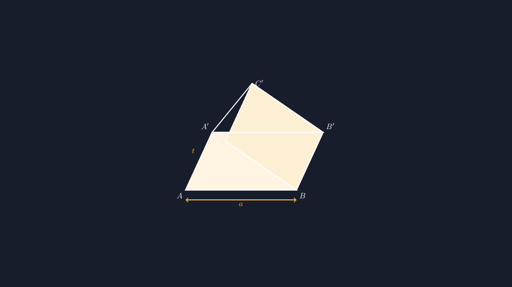
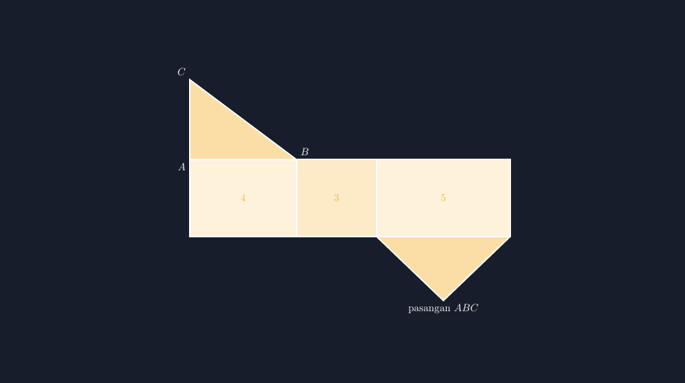

Minggu lalu saya mengadakan kuis kecil di kelas VIII: sebutkan rumus volume prisma, hitung volumenya kalau alasnya segitiga siku-siku dengan sisi 3, 4, dan 5 cm serta tingginya 10 cm. Hasilnya ramai yang benar. $V = L_{alas} \times t$, luas segitiga $\frac{1}{2} \times 4 \times 3 = 6$, dikali 10, jadi 60 cm kubik. Rapi, cepat, yakin.

Lalu saya memberi tugas lanjutan yang terdengar sepele: **"Sekarang gambar bentuk prisma yang kalian hitung tadi."**

<!--more-->

Di meja Bima, yang hitungannya paling cepat tadi, muncul gambar yang membuat saya menahan senyum: dua segitiga yang ukurannya tidak sama, dihubungkan tiga garis yang mencuat ke arah yang berbeda-beda. Satu garis miring ke kiri, dua ke kanan. Ketika saya tanya, "mana tinggi prismamu?", dia menunjuk garis yang miring itu. "Ini kan, Pak, tingginya."

Bima bukan anak yang lemah hitung. Dia tahu rumusnya di luar kepala. Tetapi ketika diminta mewujudkan rumus itu menjadi bentuk, hubungan antara angka dan gambar itu patah. Dan ini bukan kasus satu anak. Dari tiga puluh dua lembar, lebih dari separuh menggambar prisma yang sisi-sisi tegaknya runcing atau timpang.

## Sisi tegak itu "kaki" prisma

Karena itu, di pertemuan berikutnya saya membuka pelajaran dengan satu kalimat yang akhirnya jadi pegangan kelas: **sisi tegak prisma itu kakinya.** Semua kaki harus sama panjang dan berdiri sejajar. Kalau salah satu kaki bengkok, prisma itu roboh — bukan lagi prisma.

Analogi kaki ini ternyata kuat. Ketika Bima menggambar lagi, dia memeriksa kakinya satu per satu, seperti orang memeriksa meja yang goyang. Perhatian yang tidak muncul ketika dia hanya menghitung rumus.

Dan di sinilah TikZ masuk. Kalau saya menggambar prisma di papan tulis dengan tangan, kaki-kaki itu juga rawan timpang — dan siswa akan meniru ketidakrataan saya. Dengan TikZ, sisi tegak digambar sebagai vektor yang *sama persis* untuk ketiga rusuk, sehingga gambar di lembar kerja jadi patokan yang bisa dipercaya.

## Bentuk dasar: dua segitiga yang dibawa satu vektor

Ide TikZ untuk prisma sebenarnya sangat sederhana, dan justru kesederhanaan itulah yang ingin saya tunjukkan ke siswa. Kita punya segitiga alas $ABC$, lalu satu vektor pergeseran — sebutlah vektor tinggi — yang mengangkat setiap titik ke atas:

$$A \rightarrow A', \quad B \rightarrow B', \quad C \rightarrow C'.$$

Setiap rusuk tegak adalah gambar dari vektor yang sama. Di TikZ, ini berarti saya cukup menuliskan pergeseran itu sekali, dan ketiga rusuk atas otomatis pasti sejajar dan sama panjang. Tidak mungkin timpang, karena secara matematis memang satu vektor.

Berikut inti kode yang saya pakai (versi lengkap ada di berkas di bawah):

```latex
\coordinate (A) at (0,0);
\coordinate (B) at (5,0);
\coordinate (C) at (1.8,2.2);
% vektor tinggi yang sama untuk semua titik
\coordinate (A2) at ($(A)+(1.2,2.6)$);
\coordinate (B2) at ($(B)+(1.2,2.6)$);
\coordinate (C2) at ($(C)+(1.2,2.6)$);
```

Perhatikan: $A'$, $B'$, dan $C'$ semuanya digeser dengan penjumlahan yang sama, $(1.2, 2.6)$. Kalau saya mengubah tinggi prisma, saya cukup mengubah satu angka, dan seluruh rusuk tegak mengikuti bersama-sama. Inilah pelajaran tersembunyi yang ingin siswa lihat: **konsistensi gambar datang dari konsistensi perhitungan**, bukan dari kehati-hatian tangan.


*Prisma segitiga: ketiga rusuk tegak adalah gambar dari satu vektor pergeseran yang sama — karena itu kaki-kakinya mustahil timpang.*

Ada satu detail penting yang juga saya tekankan: garis yang tidak terlihat. Rusuk $AC$ dan $CC'$ berada di "belakang" badan prisma, jadi digambar putus-putus. Siswa sering tanya kenapa harus repot-repot. Jawaban saya: gambar yang jujur memberi tahu mata di mana letak sisi depan dan sisi belakang, dan dari situlah kesan tiga dimensi muncul. Gambar datar dengan semua garis penuh akan terasa "kempes".

## Jaring-jaring: membongkar prisma untuk memahaminya

Bagian favorit saya justru setelahnya: membongkar prisma itu menjadi jaring-jaring. Di kelas, saya menunjukkan jaring-jaringnya, lalu siswa diminta melipatnya di bayangan — "persegi panjang yang mana yang jadi sisi depan?"


*Jaring-jaring prisma segitiga siku-siku: strip tiga persegi panjang (4, 3, 5) ditutup dua segitiga kongruen.*

Jaring-jaring versi buku (strip tiga persegi panjang berdampingan) punya keunggulan diskusi: lebar setiap persegi panjang harus sama dengan panjang rusuk yang ditempelinya. Kalau alas segitiganya sisi-sisinya 4, 3, dan 5, maka stripnya harus punya tiga persegi panjang selebar 4, 3, dan 5 — persis berurutan. Dari sini siswa bisa *melihat* mengapa luas permukaan prisma adalah

$$L = 2L_{alas} + K_{alas} \times t,$$

di mana $K_{alas}$ adalah keliling alas. Rumus yang tadinya dihafal ("dua kali luas alas plus keliling alas kali tinggi") kini punya bayangan visual: dua segitiga, ditambah tiga "kaki" yang dibentangkan.

## Dari gambar guru ke gambar siswa

Ada juga sisi kecil yang saya pelajari dari kejadian ini: soal hitung dan soal gambar ternyata menguji pemahaman yang berbeda. Nilai kuis tadi pagi membuat saya senang, tetapi lembar gambar siang itu membuat saya sadar ada jarak antara "bisa menghitung" dan "mengerti bentuknya". Karena itu sekarang di setiap materi bangun ruang, saya menyisipkan minimal satu soal gambar — bukan untuk menghukum, tetapi sebagai cermin: kalau gambarnya kacau, berarti konsepnya belum utuh, dan itu layak kita bongkar bersama di kelas.

Seperti biasa, saya tidak berhenti di demonstrasi. Tugas lanjutannya bergantian: sebagian siswa mendapat prisma dengan alas segitiga sama sisi, sebagian alas segitiga tumpul, dan mereka diminta menghitung lalu menggambar (kertas berpetak pun cukup, yang penting kakinya sejajar). Saya yang menyusun gambar-gambar soalnya dengan TikZ di rumah — dan berterima kasih karena tidak ada lagi soal yang gambarnya bertentangan dengan hitungannya sendiri.

Pekan ini, waktu saya mengumpulkan tugas, Bima memberi catatan kecil di pojok kertasnya: "Pak, prisma itu kayak meja bertiga kaki, kalau kakinya ga sama, jebol." Saya tempel di dinding kelas. Kadang pemahaman yang paling bertahan justru dirumuskan siswa dengan bahasa mereka sendiri — tugas saya hanya memastikan gambar yang mereka lihat layak dipercaya.

> 📎 **Berkas TikZ lengkap:** [prisma-segitiga.tex](tex/prisma-segitiga.tex) dan [jaring-jaring.tex](tex/jaring-jaring.tex) — siap kompilasi (butuh paket `tikz`).
