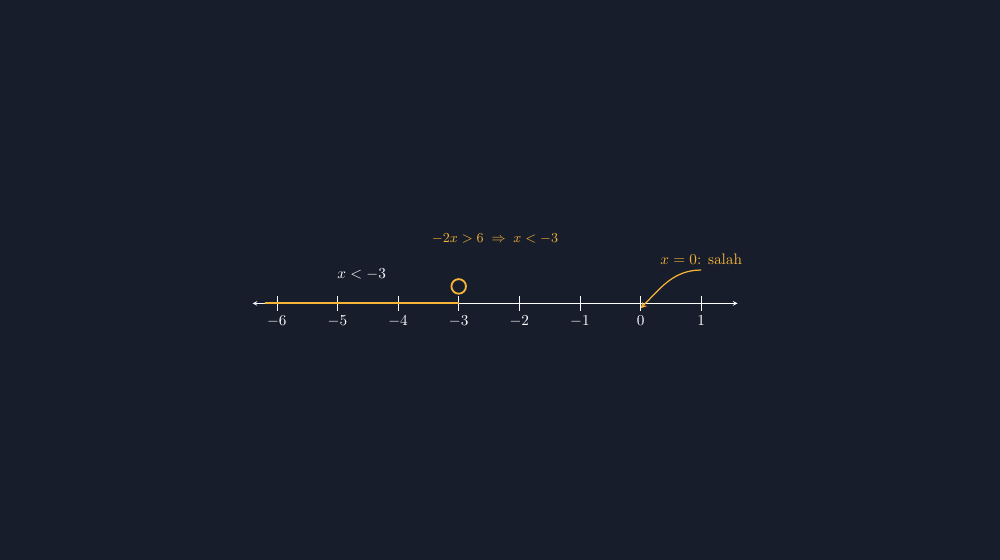

Ada satu materi yang tahun demi tahun selalu terlihat mudah, dan tahun demi tahun selalu saja gagal di ulangan: pertidaksamaan linear satu variabel. Siswa sudah hafal bahwa kalau kedua ruas dikali bilangan negatif, tandanya berbalik. Mereka mengucapkannya dengan lantang, seperti hafalan yang tidak bisa salah. Lalu di lembar jawaban, $-2x > 6$ mereka jawab $x > -3$, dengan tulisan yang rapi dan percaya diri.

Semester lalu saya mencoba cara lain. Daripada langsung menghitung, saya minta mereka menggambar dulu di garis bilangan. "Sebelum kalian selesaikan, tunjukkan dulu kira-kira angka berapa saja yang masuk." Kelas jadi riuh, dan barulah ketidaksesuaian itu terlihat: anak yang menjawab $x > -3$ menggambar daerah penyelesaiannya di sebelah *kanan* dari $-3$, padahal angka $0$ — yang ia sendiri tulis di kertas sebagai contoh — jelas tidak memenuhi $-2(0) > 6$. Jawaban dan gambarnya saling menampar.


*Garis bilangan untuk $-2x > 6$: titik uji $x = -4$ dan $x = 0$ dihitung, bukan ditebak. Daerah penyelesaian justru di kiri dari $-3$.*

<!--more-->

## Dua kejujuran kecil pada garis bilangan

Menggambar penyelesaian pertidaksamaan linear satu variabel di garis bilangan sebenarnya cuma menuntut dua kejujuran. Pertama, soal titik batasnya: terbuka atau tertutup. Untuk $x > -3$, titik $-3$ itu sendiri tidak memenuhi pertidaksamaan, jadi lingkarannya harus terbuka — garis bilangan yang menggambar lingkaran penuh di sana adalah gambar yang berbohong. Kedua, soal arah: daerah yang diarsir harus benar-benar berisi angka-angka yang memenuhi, bukan sekadar "ke arah sana kira-kira".

Kedua hal ini yang paling sering bocor di gambar-gambar yang saya buat pakai aplikasi gambar biasa. Lingkaran terbuka susah digambar presisi dengan mouse, dan arah arsiran sering saya taruh karena ingatan: "kanan atau kiri, ya?" Di kelas, siswa meniru kekira-kiraan itu. Mereka belajar bahwa gambar matematika boleh asal mirip — dan nanti mereka menerapkan hal yang sama pada pembuktian yang lebih serius.

TikZ memaksa saya berhenti menebak. Saya menyebut koordinat, dan koordinat tidak menerima jawaban "kira-kira". Untuk $-2x > 6$, saya hitung dulu dengan tenang: kedua ruas dibagi $-2$, tanda berbalik, jadi $x < -3$. Titik batasnya $-3$, terbuka, daerah penyelesaiannya di kiri. Lalu saya uji dua titik — kebiasaan yang dulu saya paksa ke siswa dan sekarang saya paksa ke diri sendiri:

$$x = -4 \;\Rightarrow\; -2(-4) = 8 > 6 \quad \text{(benar, masuk daerah)}$$

$$x = 0 \;\Rightarrow\; -2(0) = 0 > 6 \quad \text{(salah, tidak masuk)}$$

Titik $-4$ berada di kiri dari $-3$ dan benar; titik $0$ berada di kanan dan salah. Gambar dan hitungan akhirnya bercerita sama — dan justru pertidaksamaan dengan perkalian minus inilah contoh terbaik untuk menunjukkan bahwa arah penyelesaian bisa "menipu" kalau kita tidak menghitung.

## Potongan kode yang menahan diri

Kode TikZ-nya sengaja saya buat sederhana, karena garis bilangan memang sederhana — yang penting presisi:

```latex
\begin{tikzpicture}[>=stealth, scale=1.4]
  \draw[<->] (-6.4,0) -- (1.6,0);
  \foreach \x in {-6,-5,...,1}
    \draw (\x,0.12) -- (\x,-0.12) node[below] {$\x$};
  \draw[very thick, yellow!70!orange] (-6.2,0) -- (-3,0);
  \draw[very thick, yellow!70!orange] (-3,0.28) circle (0.12);
  \node[above] at (-4.6,0.3) {$x < -3$};
  \draw[->, yellow!70!orange, thick]
    (1.0,0.55) node[above] {$x = 0$: salah}
    to[out=180,in=45] (0,-0.08);
\end{tikzpicture}
```

Yang ingin saya tekankan dari potongan ini adalah lingkaran terbuka: `circle (0.12)` yang digambar terpisah dari garis tebal penyelesaian. Garis penyelesaian saya berhenti *sebelum* mencapai $-3$, dan lingkarannya dibiarkan kosong. Di aplikasi gambar, detail sekecil ini yang paling sering jadi korban buru-buru. Di TikZ, dia cuma dua baris yang tidak mungkin salah tempat.

Titik ujinya juga bukan asal: garis bilangan saya buat dari $-6$ sampai $1$, cukup untuk memuat titik batas $-3$ dan sedikit konteks di kedua sisinya. Sumbunya saya beri `scale=1.4` supaya angka-angkanya terbaca dari bangku belakang — pengalaman mengajari saya bahwa gambar yang bagus di laptop sering kecil sekali di proyektor.

## Yang berbalik bukan cuma tandanya

Materi ini sebenarnya mengajarkan dua hal sekaligus, dan keduanya sering tumpang tindih jadi satu kebingungan. Yang pertama teknis: membagi kedua ruas dengan bilangan negatif membalik tanda pertidaksamaan. Yang kedua — dan ini yang lebih dalam — bahwa penyelesaian pertidaksamaan itu **himpunan angka**, bukan satu angka. Persamaan $2x = -6$ penyelesaiannya satu titik; pertidaksamaan $-2x > 6$ penyelesaiannya seluruh perjalanan di kiri dari $-3$, tak terhingga banyaknya.

Anak-anak yang menghafal "kali minus, tanda berbalik" tanpa pernah menggambarnya akan berhenti di hafalan. Anak-anak yang terbiasa menggambar garis bilangan akan punya alat memeriksa diri: selesaikan dulu, lalu cek satu angka di daerah jawabannya — kalau tidak memenuhi, sesuatu pasti salah, dan mereka bisa menemukan sendiri di mana. Kemandirian memeriksa seperti itu tidak lahir dari rumus, tapi dari kebiasaan membandingkan gambar dengan hitungan.

Dan di sinilah TikZ buat saya bukan sekadar alat gambar. Setiap kali saya menulis koordinat di kode, saya dipaksa menghitung dulu. Gambar yang jujur lahir dari penulis yang jujur — dan siswa yang membacanya, tanpa mereka sadari, ikut belajar bahwa matematika tidak mentolerir "asal mirip".

## Catatan penutup

Musim ini saya mulai berani menyerahkan garis bilangan itu ke tangan siswa: mereka yang menggambar di kertas kotak-kotak, mereka yang memilih titik ujinya, mereka yang mengejek gambar temannya kalau lingkaran batasnya tertutup padahal seharusnya terbuka. Yang berani menunjuk kesalahan dengan alasan matematika, menurut saya, sedang belajar lebih banyak daripada yang diam-diam menyalin gambar saya yang sudah jadi.

TikZ tetap jadi alat saya untuk versi yang dicetak dan dibagikan — karena cetakan itu akan hidup lebih lama dari jam pelajaran, dan gambar yang salah di lembar latihan akan terus mengajar dengan cara yang salah sampai bertahun-tahun kemudian.

> 📎 **Berkas TikZ lengkap:** [tikz-ptlsv-garis-bilangan.tex](tex/tikz-ptlsv-garis-bilangan.tex) — siap kompilasi (butuh paket `tikz`).
