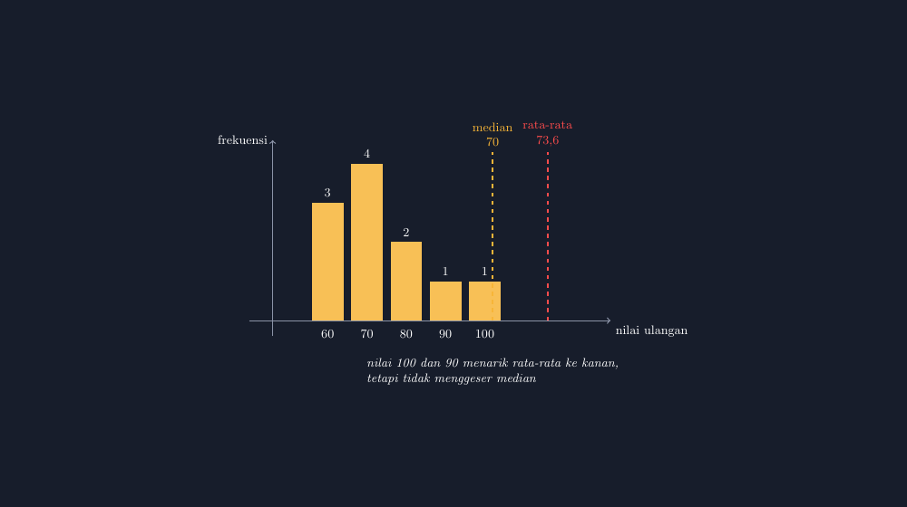

Percakapan yang mengubah rencana mengajar saya terjadi tahun lalu, tepat setelah pembagian hasil ulangan statistika dasar. Seorang murid—sebut saja Rani—mengangkat tangan dan bertanya dengan nada curiga, "Pak, kok rata-rata kelas kami 73, padahal saya lihat nilai terbanyak cuma 70? Lalu kenapa ada yang bilang rata-ratanya 76?"

Awalnya saya kira dia salah melihat. Ternyata tidak. Dia melihat dua angka dari dua sumber yang berbeda, dan keduanya benar. Satu adalah rata-rata, satu lagi median. Di kelas itu, dua angka itu tidak berjarak dua poin seperti di banyak contoh soal—mereka berjarak cukup jauh, dan selisih itu justru menjadi pintu masuk terbaik yang pernah saya dapat untuk membahas data miring.

<!--more-->

## Masalah yang Tidak Muncul di Contoh Buku

Di buku paket, contoh rata-rata dan median biasanya hadir dengan data yang "ramah": 5, 6, 7, 8, 9. Rata-ratanya 7, mediannya 7, semua angka berjabat tangan. Murid menghafal dua rumus, menghitung dua jawaban yang sama, dan pulang dengan kesimpulan samar bahwa keduanya itu-tapi-itu.

Kelas nyata tidak sebasah itu. Ulangan yang saya ambil waktu itu menghasilkan data seperti ini (sebelas murid):

$$60, 60, 60, 70, 70, 70, 70, 80, 80, 90, 100$$

Rata-ratanya $\bar{x} = \frac{810}{11} \approx 73{,}6$. Mediannya 70. Selisihnya lebih dari tiga poin, dan penyebabnya cuma satu: dua nilai di ujung kanan—90 dan 100—yang menarik rata-rata ke atas tanpa sama sekali menggerakkan median. Ini yang oleh buku statistika disebut distribusi menceng kanan, dan ini persis yang membuat Rani curiga.

Yang menarik, kecurigaan Rani itu adalah intuisi statistik yang sah. Dia merasa ada yang tidak konsisten antara "nilai terbanyak" dan "rata-rata", dan perasaan tidak konsisten itu adalah bahan mengajar yang paling mahal harganya. Masalahnya, kalau saya hanya menulis dua angka di papan, perbedaan itu tetap abstrak. Yang murid butuhkan adalah melihat data sebagai bentuk.

## Menggambar Supaya Miring Itu Terlihat

Maka saya membawa masalah itu ke TikZ. Gambar yang saya buat sederhana—histogram kecil dari data ulangan tadi, dengan dua garis putus-putus vertikal: satu untuk rata-rata, satu untuk median.


*Dua garis yang terpisah: rata-rata tertarik ke kanan oleh nilai ekstrem, median bertahan di kumpulan data terbanyak.*

Saat gambar ini saya tampilkan, terjadi hal yang jarang terjadi di kelas statistika: hening, lalu murid-murid mengerti sebelum saya selesai menjelaskan. Tampak jelas di mata bahwa batang-batang "menumpuk" di kiri (di 60 dan 70), lalu menyurut ke kanan, dan garis merah rata-rata seperti tertarik oleh dua batang kecil di ujung—sementara garis kuning median tetap berdiri di tempat di mana murid terbanyak berada.

Inti konsepnya bisa dirumuskan dalam satu kalimat yang murid saya catat hampir kata per kata: *rata-rata memperhitungkan nilainya semua, median hanya peduli urutannya*. Nilai 100 mengubah jumlah total, jadi dia mengubah rata-rata. Tapi nilai 100 tidak mengubah posisi murid ke-6 dari kiri, jadi dia tidak mengubah median.

Potongan kode TikZ untuk dua garis itu sendiri sebenarnya sangat pendek:

```latex
\draw[red!70,very thick,dashed] (7.0,0) -- (7.0,4.3)
  node[above,red!70,font=\small,align=center] {rata-rata\\$73{,}6$};
\draw[acc,very thick,dashed] (5.6,0) -- (5.6,4.3)
  node[above,acc,font=\small,align=center] {median\\$70$};
```

Yang butuh ketelitian bukan perintah menggarnya, melainkan menghitung di koordinat mana garis itu harus berdiri. Di histogram ini, kelas nilai 60 menempati $x = 1$ sampai $1{,}8$, kelas 70 dari $2$ sampai $2{,}8$, dan seterusnya—satu kelas lebar 1 satuan dengan celah 0,2. Nilai 70 adalah kelas kedua, dan di sanalah median berdiri. Rata-rata 73,6 saya letakkan di sebelah kanannya, di $x = 7$, dengan jarak visual yang sengaja dibuat terasa: makin jauh dua garis terpisah, makin miring datanya. Jarak antar garis bukan hiasan; dia adalah ukuran kemencengan.

## Siswa Menguji Batas Konsep

Begitu konsepnya terlihat, kelas saya langsung menguji batasnya—dan justru di situlah pembelajaran sejati terjadi.

"Kalau nilai 100-nya dihapus Pak, jadi berapa?" Kami hitung bersama: rata-rata turun ke 71, median tetap 70. 

"Kalau yang naik yang 60 semua jadi 65?" Rata-rata naik, dan—ini bagian yang membuat beberapa murid terkejut—median ikut naik juga, karena posisi murid ke-6 berubah. Dari sini mereka menemukan sendiri kapan median ikut bergerak: kalau perubahan terjadi di tengah data, bukan di ujung.

Lalu satu pertanyaan yang membuat saya tersenyum lebar: "Pak, kalau kepala sekolah tanya nilai kelas kami bagus atau tidak, kita pakai yang mana?"

Ini pertanyaan yang tidak ada kunci jawabannya di buku, dan jujur saja, pertanyaan itu menyentuh hal yang saya sendiri perjuangkan setiap mengisi rapor. Jawaban yang kami bangun bersama: tergantung cerita yang mau diceritakan. Kalau kelas punya dua murid jenius yang menarik rata-rata ke atas, rata-rata bisa terdengar sombong dan tidak mewakili mayoritas. Kalau kelas punya satu murid yang sedang berjuang dengan nilai sangat rendah, median bisa menyembunyikan dia. Tidak ada angka tunggal yang jujur sepenuhnya—dan murid SMP kelas delapan yang sadar akan itu sudah berpikir statistik lebih dalam dari banyak orang dewasa.

## Kenapa Saya Tetap Repot Menggambar

Bisa saja saya menyuruh murid membayangkan histogramnya. Tapi pengalaman saya berulang kali menunjukkan: konsep yang bergantung pada *bentuk*—miring, menumpuk, tersebar—hampir selalu butuh gambar yang benar-benar dilihat, bukan dibayangkan. Dan gambar yang saya buat sendiri dengan TikZ punya satu keunggulan yang tidak dimiliki gambar dari internet: saya tahu setiap koordinatnya, jadi kalau ada murid bertanya "kenapa garis median-nya di situ?", saya bisa menjawab dengan angka, bukan dengan "ya kira-kira di situ".

Ada juga manfaat yang lebih personal. Menulis kode TikZ memaksa saya menghitung dulu rata-rata dan median secara teliti sebelum menggambar. Dua kali sebelumnya saya hampir menggambar garis rata-rata di posisi yang keliru karena menghitung sambil menggambar—dan justru karena harus memverifikasi angka sebelum kode dikompilasi, saya menemukan kesalahan saya sendiri sebelum murid yang menemukannya. Gambar yang jujur dimulai dari guru yang jujur menghitung.

Sekarang, setiap kali ada murid baru yang bertanya kenapa rata-rata dan median bisa berbeda, saya tidak lagi menjelaskan dengan kalimat. Saya buka gambar itu, tarik garisnya sedikit-sedikit di depan kelas (mengubah satu angka di kode, kompilasi ulang, tampilkan), dan biarkan dua garis yang berpisah itu bercerita.

Karena pada akhirnya, statistika bukan soal menghitung angka—tapi soal memutuskan angka mana yang layak dipercaya untuk bercerita. Dan mengajari murid untuk curiga secara sehat pada satu angka tunggal, seperti yang dilakukan Rani tahun lalu, mungkin salah satu hadiah terbaik yang bisa saya bawa pulang dari kelas.

> 📎 **Berkas TikZ lengkap:** [tikz-rata-rata-median-data-miring.tex](tex/tikz-rata-rata-median-data-miring.tex) — siap kompilasi (butuh paket `tikz`).
