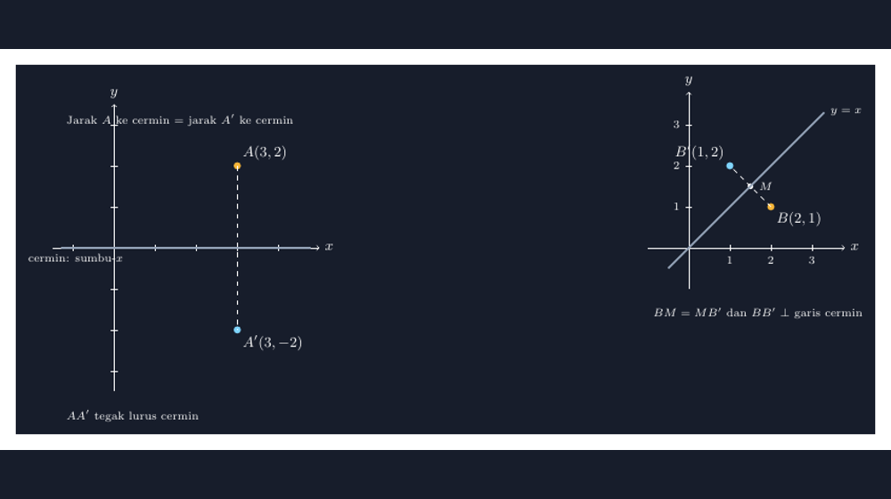

Kalau ditanya transformasi mana yang paling gampang diajarkan, saya pasti menjawab refleksi. Semua orang tahu cermin. Anak-anak melihat bayangannya sendiri setiap pagi sebelum ke sekolah, dan ide bahwa bayangan itu "terbalik tapi sama besar" langsung masuk tanpa perlu definisi formal. Di kelas VII dulu, saya cukup mengajak mereka berdiri di depan jendela kaca ruang guru, dan dalam sepuluh detik konsepnya sudah siap. Mudah, kan?

Ternyata mudah di *pengertian*, tidak mudah di *gambar*. Setiap kali saya menggambar refleksi di papan tulis dengan tangan, hampir selalu ada satu hal yang tidak beres: jarak titik asal ke garis cermin tidak sama dengan jarak garis cermin ke titik bayangannya. Kadang garis cerminnya yang miring sedikit tanpa sengaja, sehingga bayangan yang seharusnya di satu tempat jadi "rasanya" di tempat lain. Dan karena menggambar di papan tidak bisa di-undo, saya biasanya pura-pura itu memang maksudnya begitu. Siswa-siswa menyalin gambar yang tidak jujur itu ke buku mereka. Itu bagian yang paling mengganggu saya: kesalahan kecil saya jadi tetap dalam tulisan tangan empat puluh anak.

<!--more-->

## Cermin di kertas itu kejam

Di papan tulis, ketidakakuratan sedikit masih bisa dimaafkan karena skala besarnya. Tapi di LKS atau di lembar soal, gambar refleksi dicetak kecil. Kalau jarak titik $A$ ke garis cermin hanya beda dua milimeter dengan jarak $A'$ ke garis cermin, siswa tidak bisa tahu itu salah — mereka mengukur, dapat hasil yang hampir sama, dan mengira memang begitu cara kerja refleksi. Gambar yang kurang jujur justru berbahaya justru karena tidak terlihat salah.

Situasi yang membuat saya serius soal ini terjadi waktu mengoreksi ulangan harian bab transformasi. Ada soal sederhana: refleksikan titik $B(2, 1)$ terhadap garis $y = x$. Cukup banyak siswa yang menjawab $B'(1, 2)$ — itu benar. Tapi ada juga yang menjawab $B'(-2, -1)$, jawaban untuk refleksi terhadap titik asal. Waktu saya telusuri gambar kerja mereka, polanya kelihatan: mereka menggambar garis $y = x$ sebagai garis miring yang "kira-kira" 45 derajat, lalu memantulkan titiknya "kira-kira" ke seberang. Di gambar tangan mereka, kedua jawaban itu sama-sama kelihatan masuk akal. Kesalahan itu bukan kesalahan konsep refleksi — itu kesalahan gambar yang melahirkan kesalahan konsep. Kalau garis cerminnya digambar dengan benar sejak awal, jawaban yang salah itu tidak akan terasa benar.

Sejak saat itu saya berjanji: soal refleksi yang saya buat sendiri, gambarnya harus dari TikZ. Bukan karena TikZ canggih, tapi karena TikZ tidak punya mata yang berkedip.

## Refleksi terhadap sumbu: kasus paling jujur untuk dipelajari dulu

Mari mulai dari kasus yang tidak memberi ruang tebak-tebakan: refleksi terhadap sumbu-$x$. Titik $A(3, 2)$ dipantulkan ke $A'(3, -2)$. Yang harus jujur di gambar hanya satu hal: jarak vertikal dari $A$ ke sumbu sama persis dengan jarak vertikal dari $A'$ ke sumbu, dan garis penghubung $AA'$ harus tegak lurus cerminnya.

Kode TikZ-nya seperti ini:

```latex
\begin{tikzpicture}[scale=0.8]
  % sumbu koordinat
  \draw[->] (-1.5,0) -- (5,0) node[right] {$x$};
  \draw[->] (0,-3.5) -- (0,3.5) node[above] {$y$};
  \foreach \i in {-1,...,4}
    \draw (\i,0.08) -- (\i,-0.08) node[below, font=\scriptsize] {\i};
  \foreach \j in {-3,...,3}
    \draw (0.08,\j) -- (-0.08,\j) node[left, font=\scriptsize] {\j};

  % titik asal dan bayangan
  \fill[aksen] (3,2) circle (2.5pt) node[above right] {$A(3,2)$};
  \fill[aksen] (3,-2) circle (2.5pt) node[below right] {$A'(3,-2)$};

  % garis penghubung: HARUS tegak lurus cermin
  \draw[dashed] (3,2) -- (3,-2);

  % garis cermin = sumbu-x, digambar tebal agar jelas perannya
  \draw[very thick] (-1.3,0) -- (4.8,0);
\end{tikzpicture}
```

Perhatikan satu hal yang mungkin terasa sepele: garis penghubung $AA'$ saya gambar *putus-putus* dan tegak lurus penuh terhadap cermin. Di banyak gambar buku pelajaran, garis penghubung ini malah tidak ada, dan siswa tinggal menebak posisi bayangan "di seberang, kira-kira sama jauhnya". Padahal garis tegak lurus itulah yang menyimpan definisi refleksi: bayangan titik selalu berada pada garis yang tegak lurus cermin, di jarak yang sama di sisi lain. Kalau dua sifat itu kelihatan di gambar, siswa tidak perlu dihafalkan — mereka bisa *membaca* hasil refleksi dari gambarnya.

Dalam koordinat, fakta ini menjadi rumus yang biasa dihafal siswa: refleksi terhadap sumbu-$x$ mengubah $(x, y)$ menjadi $(x, -y)$. Tanda $y$ berubah karena titik melompat ke seberang garis horizontal; nilai $x$ tidak berubah karena titik tetap di "kolom" vertikal yang sama. Dari gambar, rumus itu terlihat sebagai pengamatan, bukan dalil.

## Cermin yang miring: di sinilah tebakan mulai kalah

Kasus yang membuat saya dulu selalu salah gambar adalah cermin diagonal, misalnya garis $y = x$. Secara verbal semuanya enak: "pantulkan titiknya terhadap garis miring itu." Secara gambar tangan, semuanya berantakan. Jarak ke garis miring harus diukur *tegak lurus terhadap garis miring itu sendiri* — dan menggambar segmen tegak lurus terhadap garis 45 derajat, dengan tangan, di papan, sambil diawasi tiga puluh orang, bukan keahlian saya.

TikZ menyelesaikannya dengan cara yang sebenarnya mengajari saya sesuatu. Alih-alih menghitung posisi $B'$ secara manual, saya membiarkan geometrinya bekerja:

```latex
\begin{tikzpicture}[scale=0.8]
  % titik asal
  \coordinate (B) at (2,1);

  % titik bayangan: proyeksi ke garis, lalu cermin dari proyeksinya
  \coordinate (M) at ($(B)!(2,1)!(1,1)$); % kaki tegak lurus di garis y=x
  \coordinate (Bp) at ($2*(M)-(B)$);      % B' = 2M - B

  \fill[aksen] (B) circle (2.5pt) node[above left] {$B(2,1)$};
  \fill[aksen2] (Bp) circle (2.5pt) node[below left] {$B'(1,2)$};
  \fill[putih] (M) circle (2pt) node[above right, font=\scriptsize] {$M$};

  \draw[dashed] (B) -- (Bp);
  \draw[very thick] (-0.5,-0.5) -- (3.2,3.2) node[right] {$y=x$};
\end{tikzpicture}
```

Dua baris koordinat itu — proyeksi tegak lurus $(B)!(...)!(...)$ lalu $B' = 2M - B$ — adalah refleksi persis seperti didefinisikan dalam matematika: kaki garis tegak lurus $M$ adalah titik tengah antara titik dan bayangannya. TikZ tidak menebak; ia menghitung proyeksi, menggandakannya, menguranginya. Hasilnya, titik $B(2,1)$ dan $B'(1,2)$ berada persis sama jauh dari garis $y = x$, dan segmen $BB'$ persis tegak lurus terhadap garis itu. Gambar yang dihasilkan tidak hanya benar — ia memperlihatkan *mengapa* benar.

Dari gambar seperti ini, siswa bisa menemukan sendiri pola refleksi terhadap $y = x$: posisi $x$ dan $y$ bertukar tempat. $(2,1)$ menjadi $(1,2)$. $(4,3)$ menjadi $(3,4)$. Dan lebih penting lagi, mereka bisa memeriksa pola itu pada gambar: tukar kolom dan baris, dan titik mendarat tepat di seberang cermin. Rumus $(x, y) \to (y, x)$ berhenti menjadi hafalan dan mulai menjadi kesimpulan.


*Gambar: Refleksi terhadap sumbu-$x$ dan terhadap garis $y = x$ — hasil kompilasi TikZ dari kode di atas.*

## Bayangan yang tidak berbohong soal arah

Satu hal lagi yang saya suka dari refleksi dibanding rotasi atau dilatasi: refleksi punya "jiwa" yang mudah diceritakan ke siswa. Rotasi butuh arah putar dan besar sudut. Dilatasi butuh pusat dan faktor skala. Refleksi cuma butuh satu pertanyaan: *di seberang mana, sejauh mana?* Dan jawabannya selalu: sejauh jarakmu sendiri ke cermin, tegak lurus.

Anak-anak saya menangkap itu lewat lelucon kecil di kelas. Ada yang bertanya, "Pak Gun, kalau saya cermin, kiri jadi kanan, tapi atas tetap atas. Kenapa tidak kepala jadi kaki?" Pertanyaan bagus itu sebenarnya menyentuh fakta bahwa cermin memantulkan terhadap garis (di kertas: dimensi satu), bukan memutar objek. Bayangan kita tidak dibalik atas-bawah karena arah tegak lurus cermin hanya satu. Saya tidak punya jawaban sempurna saat itu, tapi gambar TikZ refleksi pada garis vertikal, horizontal, dan diagonal yang saya tampilkan berurutan membuat pertanyaan itu bisa didiskusikan dengan bahan: lihat, arah mana yang "melintasi" cermin, arah itulah yang terbalik.

## Penutup: gambar yang bisa dipercaya, siswa yang bisa memeriksa

Yang saya ambil dari urusan menggambar refleksi ini sederhana: saat konsepnya sesederhana "jarak yang sama, tegak lurus", gambar yang tidak memenuhi dua syarat itu adalah penghianatan kecil terhadap konsepnya sendiri. Siswa tidak akan pernah tahu gambar saya dulu tidak akurat; mereka cuma akan membawa pulang perasaan samar bahwa matematika itu "kurang lebih begitulah". Padahal justru pada materi sesederhana ini, kecocokan sempurna antara definisi dan gambar paling mudah dicapai — dan paling sayang jika dilewatkan.

Sekarang, setiap soal refleksi yang saya buat, gambarnya keluar dari TikZ dengan jarak dan ketegaklurusan yang dihitung, bukan dikira. Kalau ada siswa yang mengukur gambar di soal saya dengan penggaris, dia akan menemukan bahwa jaraknya benar-benar sama. Saya ingin gambar soal saya setidaknya bisa menahan penggaris itu. Itu standar yang rendah untuk sebuah gambar, tapi ternyata jarang dipenuhi — dan murid-murid saya, yang setiap hari menghadapi cermin sungguhan di rumah, berhak mendapatkan cermin di atas kertas yang sama jujurnya.

> 📎 **Berkas TikZ lengkap:** [tikz-refleksi-garis-cermin.tex](tex/tikz-refleksi-garis-cermin.tex) — siap kompilasi (butuh paket `tikz` dan `amsmath`).
