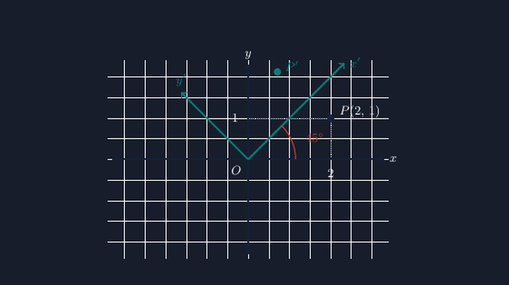
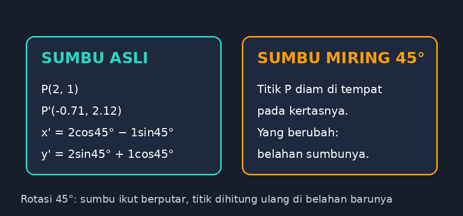
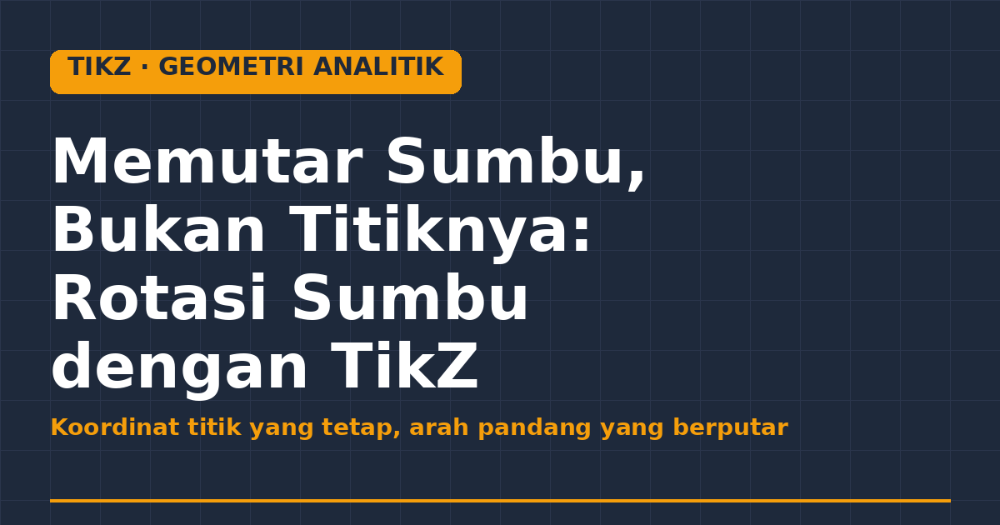

Di kelas VIII, rotasi biasanya berhenti di titik dan bangun datar. Segitiga ABC diputar $90^\circ$ terhadap titik O, gambar sebelum dan sesudahnya digambar berdampingan, selesai. Tahun lalu, justru saat saya menyiapkan soal pengayaan untuk beberapa murid yang sudah cepat selesai, saya terjebak di pertanyaan yang tidak saya rencanakan. Salah satu murid itu, Kirana, bertanya pelan sambil menunjuk bukunya, "Pak, kalau yang diputar sumbunya, titiknya ikut muter nggak?"

Pertanyaan itu saya simpan, dan jujur saja, saya sempat bingung menjawabnya dengan gambar. Menggambar sumbu koordinat yang miring $45^\circ$ di papan tulis sambil menjaga proporsinya adalah pekerjaan yang melelahkan: garis miring yang saya tarik spidol hampir selalu lebih curam dari $45^\circ$ yang seharusnya, dan murid yang menatap dari sisi lain papan melihat sudut yang berbeda lagi. Akhirnya saya buat gambarnya di TikZ, dan sejak itu pertanyaan Kirana punya jawaban yang bisa diletakkan di meja, bukan hanya dijelaskan sambil tangan menggambar ulang.


*Gambar 1. Sumbu $x$-$y$ asli dan sumbu $x'$-$y'$ hasil rotasi $45^\circ$ terhadap titik asal O. Titik P(2, 1) diam di tempat, tetapi koordinatnya di belahan sumbu yang baru berubah.*

<!--more-->

## Titiknya Diam, Belahannya yang Berputar

Ini bagian yang paling sering membuat murid tersandung, dan jujur, membuat saya juga pernah tersandung. Kalau titik P diputar $45^\circ$ terhadap titik asal, P berpindah tempat secara fisik di bidang itu. Kalau yang diputar adalah *sumbunya*, bidang dan semua titik di atasnya diam — yang berubah hanyalah "penggaris" yang kita pakai untuk membaca posisi. Titik yang tadinya kita sebut P(2, 1) masih ada di tempat yang sama, tetapi jika kita mengukurnya dari sumbu miring yang baru, jaraknya ke sumbu $x'$ dan sumbu $y'$ bukan lagi 2 dan 1.

Di sinilah TikZ memberi keuntungan yang papan tulis tidak bisa berikan: perintah `rotate` di dalam scope membuat sumbu yang benar-benar miring $45^\circ$, proporsional, dengan panah dan label di ujungnya. Murid bisa membandingkan kedua belahan sumbu dalam satu gambar yang jujur, dan busur $45^\circ$ di dekat titik asal tidak lagi "kira-kira" seperti gambar spidol saya.

## Dari Where ke Belahan yang Baru

Untuk titik $P(2, 1)$ yang dibaca dari sumbu yang diputar sebesar $\alpha$ terhadap titik asal, koordinat barunya:

$$x' = x\cos\alpha - y\sin\alpha$$
$$y' = x\sin\alpha + y\cos\alpha$$

Untuk kasus Kirana, $\alpha = 45^\circ$ sehingga $\cos 45^\circ = \sin 45^\circ = \tfrac{1}{2}\sqrt{2}$:

$$x' = 2\cdot\tfrac{1}{2}\sqrt{2} - 1\cdot\tfrac{1}{2}\sqrt{2} = \tfrac{1}{2}\sqrt{2} \approx 0{,}71$$
$$y' = 2\cdot\tfrac{1}{2}\sqrt{2} + 1\cdot\tfrac{1}{2}\sqrt{2} = \tfrac{3}{2}\sqrt{2} \approx 2{,}12$$


*Gambar 2. Titik yang sama, dua alamat: P(2, 1) di sumbu asli menjadi P'(-0.71, 2.12) — atau dihitung dengan $x'$-$y'$ dari sumbu yang miring.*

Perhatikan satu hal yang sering jadi sumber salah: $P'$ di sini bukan bayangan P oleh rotasi terhadap titik asal. Bayangan itu (yang dibahas di artikel saya sebelumnya tentang rotasi titik) adalah $(2\cos 45^\circ - 1\sin 45^\circ,\ 2\sin 45^\circ + 1\cos 45^\circ)$ — kebetulan rumusnya mirip, dan justru kebetulan itulah yang membuat murid campur aduk. Kalau P diputar, P berpindah. Kalau sumbunya yang diputar, P diam tetapi alamatnya di belahan baru berbeda. Angka-angkanya bisa sama bentuk rumusnya, maknanya tidak sama.

## Di TikZ, Sumbu yang Miring Hanya Satu Opsi

Bagian yang saya paling suka dari menggambar ini: memiringkan sumbu di TikZ tidak perlu menghitung ulang koordinat ujung panah secara manual. Cukup melingkupi perintah sumbu dengan `rotate`:

```latex
\begin{scope}[rotate=45]
  \draw[teal, very thick, ->] (0,0) -- (3.3,0)
    node[anchor=west] {$x'$};
  \draw[teal, very thick, ->] (0,0) -- (0,2.3)
    node[anchor=south] {$y'$};
\end{scope}
```

Titik asalnya tetap $(0,0)$, dan seluruh sistem koordinat lokal di dalam scope itu ikut berputar. Ini persis pengalaman yang saya ingin murid pegang: sumbu bukan sesuatu yang melekat pada bidang, sumbu adalah *perjanjian* — dan perjanjian boleh diganti, asalkan kita mencatat bagaimana caranya.



Tantangan kecilnya justru di luar scope: label "45°" harus digambar sebagai busur di koordinat yang tidak ikut berputar, dan posisi teks $P(2,1)$ serta $P'$ harus dipilih supaya tidak bertumpuk dengan sumbu miring yang melintas di dekatnya. Di sini saya memang menggeser label $P'$ sedikit ke kanan-atas karena sumbu $x'$ yang miring tepat lewat di bawah titik itu. Detail kecil, tetapi kalau dibiarkan, gambar yang "bisa dipercaya" langsung turun kelasnya jadi gambar yang mengelabui.

## Apa yang Berubah di Kelas

Sekarang, saat topik transformasi sampai, saya membawa gambar ini sebagai soal diskusi, bukan sebagai materi. Pertanyaannya sengaja sama dengan pertanyaan Kirana dulu: "Kalau sumbunya yang dimiringkan $45^\circ$, di mana posisi P? Hitung koordinatnya." Yang saya cari bukan jawaban benar dalam lima detik, melainkan murid yang sadar bahwa ada dua keputusan yang harus diambil sebelum menghitung: *siapa yang berputar, dan dari sistem mana kita membaca.*

Murid yang menjawab "(0.71, 2.12) karena P diputar 45 derajat" dan murid yang menjawab angka yang sama "karena sumbunya yang diputar" memberi saya dua hasil diagnosis yang berbeda padahal tulisannya identik. Yang pertama keliru memahami prosesnya, yang kedua paham prosesnya tetapi belum menuliskan maknanya. Di lembar jawaban pilihan ganda, keduanya sama-sama dapat poin yang sama. Di papan tulis dengan gambar sumbu miring ini, keduanya terlihat berbeda dalam waktu yang tidak sampai satu menit.

Saya juga jadi sadar satu hal soal diri saya sendiri. Bertahun-tahun saya menggambar sumbu miring di papan dengan asal-asalan yang saya pertanggungjawabkan secara sosial — "ya, kira-kira 45 derajat" — tanpa pernah merasa berbohong. TikZ memaksa saya mengakui bahwa kira-kira itu memang tidak jujur. Sudut $45^\circ$ yang digambar $50^\circ$ menghasilkan koordinat yang berbeda, dan murid yang menghitung dengan teliti akan mendapat angka yang tidak cocok dengan gambar saya. Dari semua pelajaran menggambar soal dengan TikZ, mungkin yang paling penting bukan tentang perangkat lunaknya: gambar yang kita taruh di depan murid adalah klaim, dan klaim sebaiknya kita buktikan sendiri sebelum minta dipercaya.

Kalau Bapak/Ibu ingin mencoba, berkas lengkapnya saya sertakan di bawah — tinggal kompilasi, lalu coba ganti `rotate=45` menjadi `rotate=-30` dan lihat bagaimana P dan $P'$ berpindah alamatnya. Pertanyaan Kirana bisa jadi bahan diskusi lima menit di kelas Bapak/Ibu juga.

> 📎 **Berkas TikZ lengkap:** [rotasi-sumbu.tex](tex/rotasi-sumbu.tex) — siap kompilasi (butuh paket `tikz`).
