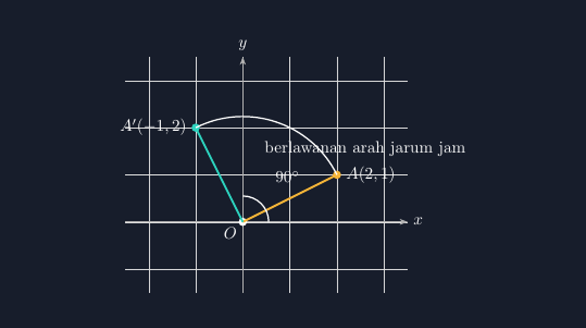

Di antara semua materi transformasi, rotasi adalah yang paling sering saya gambarkan bohong. Pergeseran mudah — panahnya kelihatan, jaraknya bisa diperiksa. Pencerminan juga masih bisa diselamatkan dengan penggaris. Tapi rotasi? Setiap kali saya menggambarnya dengan tangan di papan tulis, ada saja yang tidak beres: jari-jari dari pusat ke titik asalnya tidak sama panjang dengan jari-jari ke titik bayangannya, sudut putarnya entah berapa derajat karena memang tidak pernah saya ukur, dan titik bayangan saya taruh di tempat yang "rasanya" benar. Rasanya. Kata itu seharusnya tidak boleh ada di pelajaran matematika, tapi di gambar rotasi buatan tangan saya, dia punya tempat duduk yang tetap.

<!--more-->

## Titik yang berputar tapi tidak sadar diri

Ada satu kebingungan siswa tentang rotasi yang tahun ini saya perhatikan lagi di kelas VIII. Ketika saya mengatakan "titik $A$ dirotasi $90^{\circ}$ di sekitar titik $O$", sebagian murid mendengarnya seperti perintah gerak: titiknya berjalan sejauh $90^{\circ}$. Padahal titik itu tidak berjalan ke mana-mana sepanjang lintasannya — ia hanya punya dua alamat, alamat awal dan alamat akhir, dan keduanya terikat oleh satu syarat sederhana: jarak ke pusat rotasi tidak pernah berubah.

Syarat itulah yang paling sering dilanggar oleh gambar buatan tangan. Ketika jari-jari yang saya gambar ke titik asal berbeda sepuluh persen dengan jari-jari ke titik bayangan, murid yang teliti akan kebingungan, dan murid yang tidak teliti akan menyerap pesan terselubung bahwa gambar rotasi boleh asal mirip. Saya pernah menemukan di lembar kerja seorang siswa sebuah rotasi yang titik bayangannya lebih dekat ke pusat daripada titik asalnya — lalu di sebelahnya dia menulis benar rumus rotasinya. Dia tahu rumusnya; gambarnya saja yang mengajarkan hal lain.

## Satu contoh yang bisa diperiksa

Mari ambil contoh yang paling sederhana dan paling sering keluar di soal: rotasi $90^{\circ}$ berlawanan arah jarum jam di sekitar titik asal $O(0,0)$. Ambil titik $A(2,1)$. Rumus rotasinya mengatakan $(x, y) \mapsto (-y, x)$, sehingga bayangannya adalah $A'(-1, 2)$. Kalau kita periksa jaraknya ke pusat:

$$OA = \sqrt{2^2 + 1^2} = \sqrt{5}, \qquad OA' = \sqrt{(-1)^2 + 2^2} = \sqrt{5}.$$

Sama. Dan itulah janji utama rotasi: jari-jari tidak tumbuh, tidak menyusut, tidak berpindah pusat. Hanya arahnya yang berputar.



*Gambar: rotasi $A(2,1) \mapsto A'(-1,2)$ di sekitar $O(0,0)$ — dua jari-jari emas dan tosca sama panjang ($\sqrt{5}$), dengan busur putar yang membentang tepat $90^{\circ}$.*

Gambar di atas saya buat dengan TikZ, dan yang membuat saya tenang memakainya di kelas bukan kecantikannya, melainkan fakta bahwa setiap angka di dalamnya dihitung, bukan ditebak. Jari-jari memang sama panjang karena kedua ruas garisnya digambar dari koordinat yang benar — $(2,1)$ dan $(-1,2)$ — dan bukan karena tangan saya sedang bagus hari itu. Busur putarnya membentang tepat dari $26{,}565^{\circ}$ ke $116{,}565^{\circ}$, dua sudut yang arahnya persis sesuai sudut jari-jari terhadap sumbu-$x$, sehingga busurnya memotong kedua jari-jari persis di ujungnya.

## Kode TikZ-nya: bayangan dari rumus, bukan dari mata

Bagian kode yang paling penting sebenarnya cuma beberapa baris. Titik bayangan tidak saya taruh manual di $(-1,2)$ dan berdoa; saya bisa menghitungnya di dalam TikZ sendiri:

```latex
\begin{tikzpicture}[>=Stealth]
  \draw[help lines, color=gray!25] (-2.5,-1.5) grid (3.5,3.5);
  \draw[->,gray!60] (-2.5,0) -- (3.5,0) node[right] {$x$};
  \draw[->,gray!60] (0,-1.5) -- (0,3.5) node[above] {$y$};
  % titik asal dan pusat rotasi
  \fill (0,0) circle (2.5pt) node[below left] {$O$};
  \fill[acc] (2,1) circle (2.5pt) node[right] {$A(2,1)$};
  % bayangan: (x,y) -> (-y,x) untuk rotasi +90 derajat
  \fill[tealc] (-1,2) circle (2.5pt) node[left] {$A'(-1,2)$};
  % dua jari-jari yang harusnya sama panjang
  \draw[acc, very thick]  (0,0) -- (2,1);
  \draw[tealc, very thick] (0,0) -- (-1,2);
  % busur putar dan tanda sudut
  \draw (2,1) arc[start angle=26.565, end angle=116.565, radius=2.236];
  \draw (0.55,0) arc[start angle=0, end angle=90, radius=0.55];
  \node at (0.95,0.95) {$90^{\circ}$};
\end{tikzpicture}
```

Dua angka di baris busur itu bukan sulap. $|OA| = \sqrt{5} \approx 2{,}236$, dan arah $OA$ terhadap sumbu-$x$ adalah $\arctan(1/2) \approx 26{,}565^{\circ}$. Karena putarnya $90^{\circ}$, ujung busur jatuh di $26{,}565 + 90 = 116{,}565^{\circ}$. Kalau besok saya mengganti titiknya menjadi $A(3,1)$, saya tinggal mengganti radius busur menjadi $\sqrt{10} \approx 3{,}162$ dan sudut awalnya menjadi $\arctan(1/3) \approx 18{,}435^{\circ}$ — dan seluruh gambar menyesuaikan diri tanpa satu pun bagian yang harus saya tebak ulang.

Ada satu detail kecil yang saya jaga sejak awal: busur putar digambar dengan jari-jari yang sama dengan jarak $OA$. Kalau busurnya lebih kecil, ia terlihat seperti lingkaran lain yang kebetulan lewat, dan siswa yang jeli bertanya, "Pak, lintasannya bukan lingkaran ini ya?" Pertanyaan seperti itu sebenarnya pertanyaan bagus — tapi jauh lebih enak kalau muncul karena kita sedang membahas lintasan, bukan karena gambar kita yang memancing keraguan.

## Di kelas: dari gambar ke aturan

Cara saya memakai gambar ini di kelas sederhana. Saya tampilkan dulu gambar tanpa label $A'$, cuma titik asal, pusat, dan busurnya. Lalu saya minta siswa menentukan sendiri ke mana $A'$ harus jatuh, dengan satu syarat yang boleh mereka periksa sendiri: jaraknya ke $O$ harus sama dengan jarak $A$ ke $O$. Anak-anak yang biasanya menunggu rumus justru mulai mengukur dengan penggaris, membandingkan, dan menemukan bahwa hanya ada satu titik di busur itu yang memenuhi syarat sudut $90^{\circ}$.

Setelah itu barulah rumus $(x, y) \mapsto (-y, x)$ saya tuliskan. Dan anehnya, rumus itu terasa berbeda ketika datang setelah gambar: ia tidak lagi terdengar seperti perintah hafalan, melainkan seperti ringkasan dari sesuatu yang baru saja mereka buktikan sendiri dengan penggaris dan busur di atas gambar yang jujur. Beberapa siswa bahkan langsung mencoba menebak bentuk rumusnya untuk rotasi $180^{\circ}$ — dan ketika menebakan $(x,y) \mapsto (-x,-y)$ ternyata benar, wajah mereka memerah senang.

## Penutup: rotasi yang bisa dipercaya

Rotasi itu materi yang baik untuk mengajarkan satu hal yang lebih besar dari geometrinya: bahwa setiap objek dalam matematika punya syarat yang harus dipenuhi, dan syarat itu bisa diperiksa. Titik bayangan rotasi bukan tempat sembarang di seberang pusat; ia satu-satunya titik di lingkaran jari-jari yang membentuk sudut yang diminta. Ketika gambarnya memenuhi syarat itu — jari-jari sama panjang, busur selurus sudutnya — siswa belajar lebih banyak dari yang tertulis di kompetensi dasar: mereka belajar bahwa gambar yang benar itu bisa dibedakan dari gambar yang mirip.

TikZ, untuk saya, adalah alat untuk memastikan bahwa gambar yang saya tampilkan di depan kelas selalu termasuk yang pertama, bukan yang kedua.

> 📎 **Berkas TikZ lengkap:** [rotasi-titik-pusat.tex](tex/rotasi-titik-pusat.tex) — siap kompilasi (butuh paket `tikz`). Silakan ubah titik $A$ dan sudut rotasinya untuk dokumen Anda sendiri.
