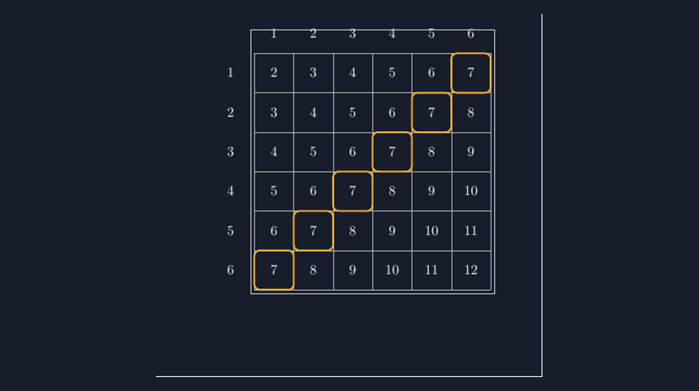

Ada satu bab yang selalu saya tunggu setiap tahun ajaran: peluang. Mungkin karena bab ini yang paling sering bikin kelas ramai. Anak-anak memang menyukai permainan — dan peluang adalah satu-satunya bab matematika SMP yang secara jujur lahir dari permainan. Judi kuno, kartu, dadu. Kalau saya bawa dua dadu ke kelas, suasananya langsung berbeda.

Tapi justru di bab yang terasa "menghibur" ini, saya menemukan salah satu miskonsepsi paling bandel di kelas saya.

<!--more-->

## Kebetulan yang Terlalu Percaya Diri

Tahun lalu, ketika saya bertanya "kalau dua dadu dilempar, mana yang lebih mungkin: dapat jumlah tujuh atau jumlah dua belas?", jawaban serempak kelas saya adalah "sama saja, Pak, dua-duanya satu". Ketika saya gali alasan mereka, jawabannya sederhana: karena tiap jumlah itu "satu kejadian". Tujuh itu satu bilangan, dua belas juga satu bilangan. Jadi harusnya sama.

Di titik ini banyak guru tergoda langsung memberi rumus: jumlah dua dadu itu ada $6 \times 6 = 36$ hasil. Tapi saya belajar bahwa angka 36 itu tidak berarti banyak bagi anak yang belum melihatnya. Mereka tahu dadu punya enam muka, tapi tidak melihat kenapa dua dadu menghasilkan tiga puluh enam kemungkinan — dan lebih penting lagi, mereka tidak melihat kenapa "tujuh" ternyata bukan satu kejadian, melainkan enam kejadian berbeda yang kebetulan punya jumlah sama.

## Ruang Sampel yang Bisa Dilihat

Solusi yang akhirnya saya pakai: satu tabel besar di papan tulis. Baris untuk mata dadu pertama, kolom untuk dadu kedua, dan di setiap sel tertulis jumlahnya. Tabel $6 \times 6$ itu adalah ruang sampel dalam wujud paling jujurnya.

Masalahnya, menggambar tabel 6 kali 6 berisi 36 angka di papan tulis lima menit sebelum bel berbunyi... bukan pekerjaan yang indah. Bel tahun lalu tabel saya jadi tidak sejajar dan angka tengahnya malah tertimpa garis. Sejak itu saya beralih ke TikZ, dan hasilnya jadi aset kelas yang saya pakai terus, termasuk untuk LKPD.

Ini inti gambar yang saya pakai:

```latex
\begin{tikzpicture}[x=1.1cm, y=1.1cm]
  \foreach \i in {1,...,6} {
    \node at (\i+0.5, 7.3) {\i};          % label dadu kedua (atas)
    \node at (0.5-0.8, 7.5-\i) {\i};      % label dadu pertama (kiri)
  }
  \foreach \i in {1,...,6}
    \foreach \j in {1,...,6}
      \node at (\i+0.5, 7.5-\j) {\pgfmathparse{\i+\j}\pgfmathresult};
  \draw[step=1.1, gray!60] (1.1,1.1) grid (7.7,7.7);
  % kotak jumlah 7
  \foreach \i in {1,...,6} {
    \pgfmathsetmacro{\j}{7-\i}
    \draw[orange, very thick, rounded corners]
      (\i+1.1, 7.5-\j+1.1-1.1) rectangle (\i+2.2, 7.5-\j+1.1);
  }
\end{tikzpicture}
```

Hasil rendernya seperti ini:



*Ruang sampel dua dadu: setiap sel adalah satu hasil lemparan, bukan sekadar "jumlahnya".*

Kuncinya ada dua. Pertama, setiap sel adalah **satu hasil**, dengan makna "dadu pertama dapat $\i$ dan dadu kedua dapat $\j$" — dua kejadian berbeda bisa punya angka jumlah sama. Kedua, dengan mewarnai seluruh sel berjumlah tujuh, siswa melihat langsung bahwa "tujuh" menempati sebuah diagonal panjang: enam sel. Sementara "dua belas" hanya satu sel di pojok. Sekarang ketika saya ulangi pertanyaannya, tidak ada lagi jawaban "sama saja". Yang muncul malah perdebatan tentang berapa banyak sel yang berjumlah delapan — dan itu perdebatan yang indah.

## Dari Gambar ke Perhitungan

Setelah gambar ini tertempel di LKPD, soal-soal klasik berubah karakter. Peluang munculnya jumlah tujuh tinggal dihitung dari menghitung sel:

$$P(\text{jumlah } 7) = \frac{6}{36} = \frac{1}{6}$$

Yang saya sukai dari pendekatan visual ini: tidak ada rumus baru yang harus dihafal. Siswa yang tadinya bingung "kenapa pembilangnya enam?" bisa menunjuk enam sel itu satu per satu. Menunjuk adalah bukti yang mereka yakini lebih dulu daripada simbol.

Saya juga sering melanjutkan ke pertanyaan pancingan: "kalau main dua dadu, angka mana yang sebaiknya kalian pertaruhkan?" Dari tabel yang sama, mereka menemukan sendiri bahwa peluang menggumpal di tengah (angka 6, 7, 8) dan menipis di ujung (2 dan 12). Bentuknya seperti gunung, dan itu penemuan mereka sendiri — bukan keterangan dari buku.

## Tantangan Teknis yang Saya Alami

Kalau rekan guru ingin mencoba, ada dua jebakan kecil yang saya alami. Pertama, `$\pgfmathparse{...}$` perlu diingat bahwa hasilnya kadang muncul dengan desimal; cukup tambahkan `\pgfmathtruncatemacro` jika ingin hasil bulat yang bersih. Kedua, menggambar garis grid dengan `step` harus konsisten dengan jarak node, kalau tidak, angka akan bergeser setengah kotak dari selnya — kesalahan yang persis seperti tabel papan tulis saya yang dahulu.

> 📎 **Berkas TikZ lengkap:** [tikz-ruang-sampel-dadu.tex](tex/tikz-ruang-sampel-dadu.tex) — siap kompilasi (butuh paket `tikz`).

## Ketika Gambar Dipakai Justru untuk Menghitung

Setelah dua pertemuan memakai tabel ini, saya mencoba variasi lain. Saya tutup bagian tabel — hanya baris dadu pertama dan kolom dadu kedua yang terlihat — lalu siswa mengisi sel-selnya sendiri di LKPD. Ternyata tahap "mengisi sendiri" itu penting. Ada siswa yang mengisi kolom dengan pola naik satu-satu dan berhenti karena "kepalanya sudah penuh", dan di situlah diskusi tentang pola muncul: baris yang isinya $k+1, k+2, \ldots$ itu memang harus naik teratur, karena dadu kedua ditambah satu berarti jumlahnya ikut bertambah satu.

Pola itu kemudian menjawab pertanyaan yang tadinya mengganjal saya sendiri: kenapa jumlah hasil dua dadu selalu tersusun seperti tangga diagonal? Karena di sepanjang diagonal, dadu pertama naik satu sementara dadu kedua turun satu — totalnya tetap. Diagonal berjumlah $s$ pun panjangnya naik dulu sampai $s=7$, lalu turun. Gunung kecil di grafik frekuensi itu bukan keajaiban; ia adalah konsekuensi aritmetika yang bisa ditunjuk siswa langsung di tabel.

Saya pernah juga menguji satu kelas tanpa tabel — cukup cerita lisan dan rumus $\frac{6}{36}$. Hasil kuis menyusulnya jomplang: kelas dengan tabel mengingat jauh lebih lama, bahkan dua minggu kemudian ketika bab peluang lanjut ke frekuensi harapan, banyak yang masih menulis "36 sel" di sudut kertasnya sebagai pijakan. Kelas tanpa tabel lebih banyak menjawab dengan rumus yang setengah teringat. Bukan eksperimen ilmiah memang, hanya dua kelas, tapi cukup buat saya tidak mau mengulang cara lama.

## Penutup: Kepastian Sebelum Kebetulan

Saya makin yakin bahwa peluang seharusnya diajarkan mulai dari yang pasti. Hitung dulu semua kemungkinan, lihat semuanya berbaris rapi, baru bicara soal mana yang "beruntung". Anak yang pernah mewarnai enam sel berjumlah tujuh tidak akan mudah percaya bahwa dua kejadian itu "sama saja".

Dua dadu kecil di atas meja itu sebenarnya sedang bercerita tentang sesuatu yang besar: bahwa kebetulan punya struktur, dan struktur itu bisa digambar. Tugas kita cuma memastikan siswa sempat melihat gambarnya sebelum mereka menghafal rumusnya.
