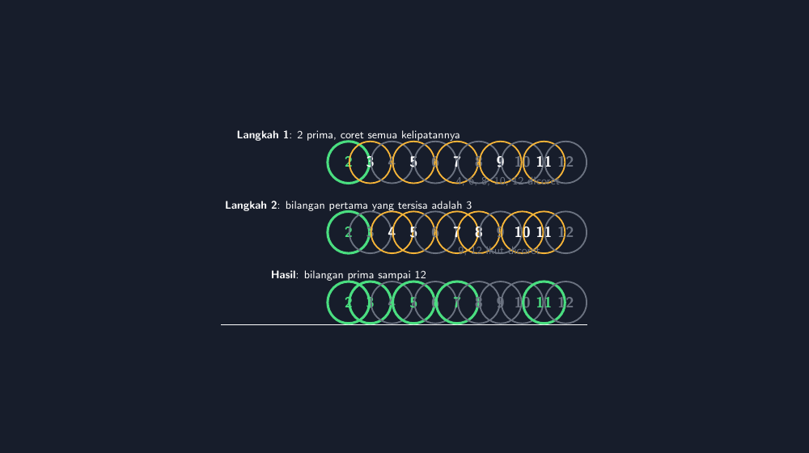

Topik bilangan prima itu terlihat sederhana kalau kita membacanya di buku: bilangan yang hanya punya dua faktor, yaitu satu dan dirinya sendiri. Tetapi setiap kali saya mengajarkannya di kelas tujuh, saya selalu disadarkan bahwa "sederhana" itu cuma di atas kertas. Di benak anak-anak, prima itu masih kabur. Ada yang menganggap 1 prima. Ada yang yakin 51 pasti prima "karena kelihatannya ganjil dan tidak bisa dibagi apa-apa". Saking percayanya, waktu saya tanya lima kali tujuh berapa pun dijawab dengan mantap, lalu 57 langsung dicoret sebagai komposit tanpa berpikir panjang.

Makanya untuk materi ini saya hampir selalu memakai satu aktivitas klasik: saringan Eratosthenes. Nama Eratosthenes sendiri sudah menjadi bahan bercanda di kelas — salah satu anak saya di VII-A, Bagas, sempat berseru "Era-Toast-Thenes, Pak!" dan sampai sekarang di kelas itu ia dikenal sebagai penemu roti bakar matematika. Tapi di balik candaan itu, aktivitas coret-mencoret ini justru salah satu yang paling melekat di ingatan siswa, jauh lebih melekat daripada definisi yang mereka salin dari papan tulis.

## Aktivitas coret di kelas: kertas, pensil, dan kegaduhan sehat

Persiapannya sederhana. Saya cetak lembar kerja berisi tabel bilangan 1 sampai 100, satu lembar per siswa. Kadang saya juga buat versi besar untuk ditempel di papan, supaya coretan bisa dikerjakan bersama. Alurnya begini: 1 dicoret karena hanya punya satu faktor. Lalu 2 dibiarkan (atau dilingkari) sebagai prima, dan semua kelipatan 2 dicoret. Bilangan berikutnya yang belum dicoret adalah 3, lingkari, coret semua kelipatannya. Begitu seterusnya sampai bilangan yang belum dicoret sudah melewati 10, sebab $\\sqrt{100} = 10$; sisanya pasti prima.

Yang saya sukai dari aktivitas ini adalah kegaduhannya. Kelas yang biasanya diam jadi ramai: "Pak, 2 dicoret juga nggak?" "Pak, 50 udah kecoret waktu kelipatan 2, sekarang kecoret lagi waktu kelipatan 5, salah nggak?" Pertanyaan-pertanyaan seperti itu adalah emas. Justru dari situ mereka sadar bahwa satu bilangan bisa punya lebih dari satu faktor, dan bahwa dicoret dua kali tidak mengubah statusnya sebagai komposit.

Tetapi di situ pula masalahnya mulai terlihat.

## Kenapa hasil coretan lembar kerja sering berantakan

Setelah bertahun-tahun mengumpulkan lembar kerja, pola kesalahannya nyaris selalu sama. Pertama, siswa mencoret tidak sistematis: coretnya melompat, ada kelipatan yang kelewat, dan ketika saya tanya kenapa 26 masih bersih, jawabannya "lupa, Pak". Kedua, karena mencoret pakai pensil lalu ditebalkan lagi, tabelnya jadi abu-abu gelap dan bilangan yang seharusnya prima ikut terlihat "tercoret". Ketiga, dan paling sering: siswa berhenti terlalu dini atau justru melanjutkan coretan sampai kelipatan 90-an, padahal begitu lewat 10 semua yang tersisa sudah pasti prima.

Ada juga masalah yang lebih halus. Ketika hasil coretan mau saya scan atau fotokopi untuk dijadikan bahan ajar, hasilnya tidak enak dibaca. Coretan pensil tidak kontras, lingkaran merah saya di papan tidak tertangkap kamera HP dengan baik. Saya sempat mencoba membuat tabel rapi di aplikasi pengolah kata, tapi mencoret satu per satu di sana murni kerja manual, dan kalau ada satu kesalahan, semuanya harus digeser ulang.

Sebagai guru yang mencatat hampir semua bahan ajar dan refleksi mengajar saya di aplikasi web teach.gezytech.web.id — saya jujur tidak lagi memakai buku catatan tangan sejak lama — saya butuh bahan yang bisa direproduksi, disimpan, dan diperbaiki. Dari kebutuhan itulah saya akhirnya membawa saringan Eratosthenes ini ke LaTeX dengan TikZ.

## Menggambar saringan dengan TikZ: tabel, lingkaran, dan coretan yang sistematis

Ide dasarnya: setiap bilangan 1 sampai 100 adalah satu node lingkaran dalam grid 10×10. Status setiap bilangan ditentukan oleh satu logika saringan, bukan digambar manual satu per satu. Prima dilingkari dengan aksen kuning pada latar gelap, komposit dicoret dengan warna abu-abu redup, dan angkanya ikut mengikuti statusnya.

Berikut potongan inti dari berkas TikZ yang saya pakai — versi bertahap yang menampilkan langkah demi langkah saringan:

```latex
\\definecolor{bg}{HTML}{171D2B}
\\definecolor{aksen}{HTML}{F7B538}
\\definecolor{coret}{HTML}{6B7280}
\\definecolor{hijau}{HTML}{4ADE80}

ktr/.style={circle, draw=aksen, line width=1.2pt, text=teks, minimum size=34pt},
pr/.style={circle, draw=hijau, line width=2pt, text=hijau, minimum size=34pt},

% ===== Panel 1: saringan setelah kelipatan 2 dicoret =====
\\foreach \\n in {2,...,12}{
  \\pgfmathtruncatemacro{\\r}{mod(\\n,2)}
  \\ifnum\\n=2
    \\node[pr] at ({(\\n-2)*1.35-7.0},1.6) {\\n};
  \\else
    \\ifnum\\r=0
      \\node[ktr, text=coret, draw=coret] at ({(\\n-2)*1.35-7.0},1.6) {\\n};
    \\else
      \\node[ktr] at ({(\\n-2)*1.35-7.0},1.6) {\\n};
    \\fi
  \\fi
}
```

Logika `foreach`-nya inilah bagian yang paling saya sukai. Perintah `\\foreach \\n in {2,...,12}` membuat TikZ menjalankan blok yang sama untuk setiap bilangan, jadi saya tidak pernah menggambar 11 lingkaran secara manual. Di dalamnya, `\\pgfmathtruncatemacro{\\r}{mod(\\n,2)}` menghitung sisa bagi \\n dengan 2 — persis logika "kelipatan 2" yang kita ajarkan di papan tulis, hanya saja sekarang komputer yang mengerjakannya. Kalau \\n sama dengan 2, gambar dengan gaya `pr` (prima, lingkaran hijau tebal). Kalau sisa baginya nol, berarti kelipatan 2, gambar dengan gaya tercoret. Sisanya tetap netral, menunggu giliran disaring.

Untuk langkah kedua, blok yang sama tinggal diganti modulusnya menjadi `mod(\\n,3)`. Panel terakhir memakai daftar eksplisit:

```latex
\\foreach \\n/\\done in {2/1,3/1,4/0,5/1,6/0,7/1,8/0,9/0,10/0,11/1,12/0}{
  \\ifnum\\done=1
    \\node[pr] at ({(\\n-2)*1.35-7.0},-2.75) {\\n};
  \\else
    \\node[ktr, text=coret, draw=coret] at ({(\\n-2)*1.35-7.0},-2.75) {\\n};
  \\fi
}
```

Di sini `\\n/\\done` memasangkan bilangan dengan statusnya, dan satu `\\ifnum` memilih gaya gambar. Untuk tabel 1–100 yang utama, polanya sama: posisi dihitung dari baris dan kolom (misalnya kolom = sisa bagi dengan 10), status prima disimpan dalam satu daftar, dan seluruh tabel digambar dalam satu putaran `foreach`. Keuntungannya besar kalau saya ingin mengubah warna tema atau memperbesar tabel sampai 200: cukup ubah definisi dan rentang, tidak perlu menyentuh ratusan baris gambar.

Ini hasilnya — tabel saringan 1 sampai 100 dengan prima beraksen kuning dan komposit tercoret, yang sekarang saya tempel di papan dan bagikan ke siswa:


*Tabel saringan Eratosthenes 1–100: bilangan prima dilingkari aksen kuning, komposit dicoret abu-abu, digambar dengan TikZ.*

Ada satu efek samping yang tidak saya duga: mengajarkan TikZ ini diam-diam mengajarkan saya hal baru tentang materi sendiri. Untuk bisa menyuruh komputer mencoret kelipatan, saya harus memikirkan ulang saringan itu sebagai algoritma yang benar-benar eksak — kapan berhenti (di $\\sqrt{100}$), bilangan mana yang dilindungi (prima, jangan dicoret sendiri), bagaimana menandai "1 itu spesial". Ketelitian yang diminta komputer ternyata membuat guru ikut lebih teliti.

## Dari saringan ke FPB dan KPK

Yang membuat saya betah dengan saringan Eratosthenes adalah umur pakainya. Dia tidak berhenti di bab bilangan prima. Ketika masuk ke faktorisasi prima, siswa yang hafal tabel saringannya bisa langsung menguji 60 dengan 2, 3, 5 — dan tahu tidak perlu menguji 7 ke atas untuk bilangan kecil karena sudah pernah "melihat" 60 tercoret oleh 2 dan 3.

Untuk FPB dan KPK, pohon faktor jadi jauh lebih ringan kalau siswa sudah lancar mengenali prima. Dan di kelas sembilan, ketika muncul soal cerita tentang lampu yang berkedip setiap 6 detik dan 8 detik, siswa yang terbiasa dengan struktur faktor ini lebih cepat menyadari bahwa KPK 6 dan 8 bukan sekadar "dikali jadi 48", melainkan 24. Satu murid saya, Rara, bahkan membuktikan sendiri di buku tulisnya bahwa 48 salah dengan menyebut kelipatan bersama yang lebih kecil. Momen seperti itu tidak bisa saya rencanakan; yang bisa saya rencanakan hanyalah fondasinya, dan saringan ini bagian dari fondasi itu.

Kalau Bapak/Ibu rekan guru ingin mencoba, saya sarankan mulai dari versi kertas dulu — kegaduhan coret-mencoret itu tidak boleh dilewatkan. Baru setelahnya tampilkan versi TikZ yang rapi sebagai "kunci jawaban visual", atau jadikan bahan absensi materi di pertemuan berikutnya. Berkas TikZ lengkapnya saya sertakan di bawah, dan silakan ubah warnanya sesuai selera kelas masing-masing.

> 📎 **Berkas TikZ lengkap:** [tikz-saringan-eratosthenes.tex](tex/tikz-saringan-eratosthenes.tex) — siap kompilasi (butuh paket `tikz`).
