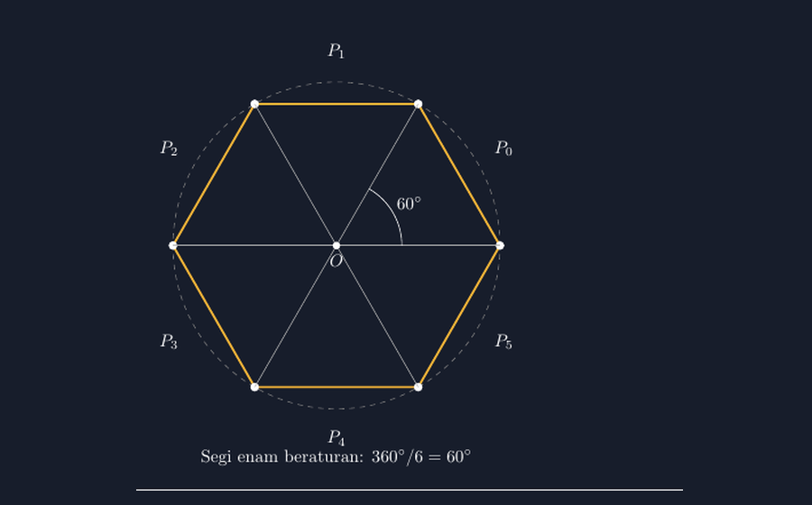
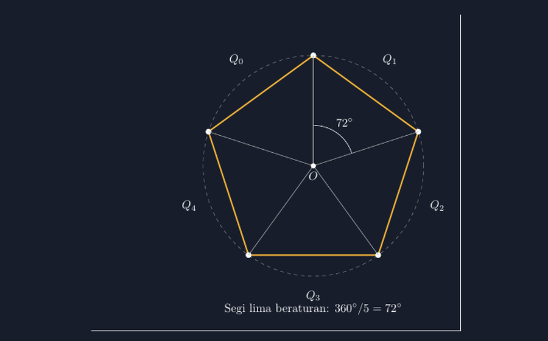

Materi segi banyak beraturan di kelas VII biasanya saya tutup dengan tugas menggambar: "Buatlah segi lima beraturan dan segi enam beraturan!" Pekan lalu, saat saya berkeliling memeriksa pekerjaan di meja, saya berhenti di bangku Rani. Segi enam yang dia gambar tampak rapi, tinta rata, garis tebal percaya diri. Tetapi ketika saya letakkan kertas di bawah penggaris dan ukur sisinya satu per satu, ada sisi sepanjang 2,8 cm ada pula yang hanya 2,3 cm. "Bukankah ini segi enam beraturan, Pak?" tanyanya. Dia benar-benar yakin. Dan jujur saja, kalau tidak diukur, gambar itu memang terlihat benar.

<!--more-->

## Beraturan berarti sama, bukan sekadar mirip

Di situlah letak kesalahpahamannya. Banyak siswa memahami "beraturan" sebagai *terlihat simetris*. Padahal definisinya tegas: sebuah segi banyak beraturan harus punya semua sisi sama panjang **dan** semua sudutnya sama besar. Kedua syarat itu bukan hiasan; keduanya harus terpenuhi sekaligus. Segi enam yang sisinya timpang sekecil apa pun selisihnya, bukan lagi segi enam beraturan — dia hanya segi enam biasa yang berpura-pura.

Masalahnya, menggambar dengan jangka dan penggaris memang rawan. Tangan bergetar, titik tengah sisi ditaksir, sudut ditimbang dengan kira-kira. Di kelas, saya menemukan cara lain yang justru mengubah segi banyak beraturan dari "bentuk yang dihafal" menjadi "konstruksi yang dipahami": gambar dulu lingkarannya, lalu bagi lingkaran itu sama rata.

## Lingkaran sebagai jangkar segi banyak beraturan

Konsep kuncinya sederhana tapi indah. Setiap segi banyak beraturan punya lingkaran luar — lingkaran yang menyinggung semua titik sudutnya. Titik pusat segi banyak itu juga pusat lingkarannya, dan semua titik sudut berjarak sama dari pusat. Berarti, kalau saya punya lingkaran berjari-jari $r$ dan saya menandai titik-titik pada kelilingnya dengan jarak busur yang sama, menyambung titik-titik itu akan menghasilkan segi banyak beraturan secara otomatis. Tidak ada lagi sisi 2,8 cm dan 2,3 cm, karena jarak antartitik di keliling lingkaran tidak mungkin timpang kalau pembagiannya sama.

Untuk segi enam, konstruksinya bahkan punya keajaiban tersendiri: jari-jari lingkaran sama persis dengan sisi segi enam beraturan. Saya bisa mulai dari satu titik di lingkaran, lalu "berjalan" memakai jangka dengan bukaan sejauh $r$ — enam langkah, dan langkah keenam mendarat tepat di titik awal. Anak-anak biasanya melirik tidak percaya saat langkah keenam itu tutup sempurna.

Berapa derajat antartitik? Lingkaran penuh $360^\circ$, dibagi enam berarti tiap langkah $60^\circ$. Untuk segi lima, $360^\circ / 5 = 72^\circ$. Untuk segi delapan, $45^\circ$. Rumusnya satu baris:

$$\theta = \frac{360^\circ}{n}$$

dengan $n$ banyaknya sisi. Dari situ pula muncul sudut pusat tiap segitiga kecil yang terbentuk dari dua titik sudut berurutan dan pusat lingkaran — dan mengapa sisi segi enam beraturan sama dengan jari-jari, sebab segitiga yang terbentuk sama sisi (sudut puncak $60^\circ$ dan dua sisi sama dengan $r$).

## Menerjemahkan konstruksi itu ke TikZ

Ketika saya menunjukkan versi TikZ-nya, murid-murid yang ikut klub digital sekolah langsung menangkap polanya: lingkaran bantu itu tetap ada di kode, karena memang dia jangkarnya. Ini potongan intinya:

```latex
\begin{tikzpicture}[scale=1.2]
  \draw[gray, dashed] (0,0) circle (3);
  % enam titik, tiap 60 derajat
  \foreach \i in {0,1,...,5} {
    \coordinate (P\i) at ({60*\i}:3);
  }
  \draw[thick] (P0) -- (P1) -- (P2) -- (P3) -- (P4) -- (P5) -- cycle;
  \foreach \i in {0,1,...,5} {
    \fill (P\i) circle (2pt);
    \draw[gray] (0,0) -- (P\i);
  }
\end{tikzpicture}
```

Yang saya suka dari kode ini: konsepnya tidak tersamar. Ada `circle (3)` sebagai lingkaran bantu, ada pembagian $60^\circ$ yang eksplisit, dan ada enam jari-jari putus-putus yang menunjukkan dari mana bentuk itu "dilahirkan". Kalau murid mengganti `60` dengan `72`, dia mendapat segi lima — dan bisa melihat sendiri bahwa bentuknya otomatis jadi beraturan tanpa dia menyetel panjang sisi satu per satu.

Gambar berikut adalah hasil kompilasi kode di atas, dengan lingkaran bantu dan jari-jarinya tetap ditampilkan:



Saya sengaja tidak menghapus lingkaran putus-putus itu di gambar final. Justru dia yang jadi alat bicara di kelas: "Coba lihat, enam segitiga kecil di dalam lingkaran itu sama semua. Nah, segi enam beraturan itu cuma pinggirannya."

## Dari segi enam ke segi banyak lainnya

Satu perubahan kecil, satu bangun baru. Dengan `\foreach \i in {0,1,...,4}` dan sudut $72^\circ$, murid mendapat segi lima. Dengan delapan langkah $45^\circ$, segi delapan. Di salah satu sesi, saya memberi tantangan terbuka: "Buat segi banyak beraturan dengan banyak sisi bebas, tapi harus bisa saya ukur dan semua sisinya sama panjang." Ada yang berhenti di segi dua belas, dan saat saya menempelkan gambar-gambar mereka di dinding kelas, segi dua belas itu hampir tak bisa dibedakan dari lingkaran. Justru dari situ muncul diskusi bagus: kalau $n$ makin besar, segi banyak beraturan makin "mendekati" lingkaran. Ide yang kelak akan mereka temui lagi jauh di atas, saat bertemu limit — tapi untuk sekarang, mereka sudah menyentuhnya dengan mata.



Gambar kedua di atas memperlihatkan segi lima dengan lingkaran bantu yang sama. Perhatikan bahwa sudut antarjari-jarinya $72^\circ$, dan lima jari-jari itu membagi lingkaran lima bagian sama besar. Kode lengkap yang bisa dikompilasi — mencakup kedua bangun ini beserta labelnya — saya sertakan di tautan bawah.

## Apa yang berubah di kelas

Yang paling saya hargai dari pendekatan ini bukan gambar yang jadi rapi. Tapi perubahan status "beraturan" di kepala murid: dari kata sifat yang diklaim, menjadi kondisi yang *dijamin oleh konstruksi*. Rani, si penggambar yang percaya diri itu, akhirnya berkata sendiri di akhir sesi, "Kalau dari lingkaran, ya tidak mungkin timpang, ya Pak." Itu kalimat yang tidak akan muncul kalau saya hanya memberi definisi di papan.

Dan bagi saya pribadi, TikZ mengingatkan pada sesuatu: alat gambar yang baik bukan yang membuat gambar terlihat indah, tapi yang membuat gambar itu *tidak bisa berbohong*. Lingkaran bantu yang dibagi sama rata tidak peduli tangan kita gemetar atau tidak — dia membagi sama rata, titik. Sisanya, tinggal kita percaya pada konstruksinya.

Kalau Bapak/Ibu ingin mencoba di kelas, mulailah dari segi enam. Enam langkah jangka, langkah keenam kembali ke awal — momen kecil yang biasanya membuat kelas bergumam. Setelah itu, barulah tunjukkan bahwa satu baris perubahan sudut di TikZ membuka semua segi banyak beraturan lainnya.

> 📎 **Berkas TikZ lengkap:** [tikz-segi-banyak-beraturan.tex](tex/tikz-segi-banyak-beraturan.tex) — siap kompilasi (butuh paket `tikz`).
