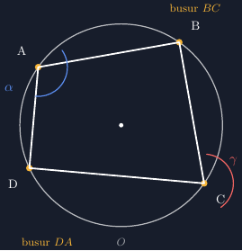

## Dari papan tulis yang "hampir benar"

Minggu lalu saya mengajar materi lingkaran di kelas VIII. Poin yang ingin saya tekankan adalah sifat segiempat tali busur: jumlah sudut-sudut yang berhadapan selalu 180°. Masalahnya muncul sebelum masuk ke sifat itu sendiri — saat saya menggambar lingkaran di papan tulis, memastikan empat titik tepat di keliling lingkaran, lalu menghubungkannya, hasilnya... jujur saja, kurang meyakinkan.

Titik A dan C saya tempatkan "kira-kira seberangan", dan ketika siswa mengukur sudutnya dengan busur mereka, angkanya tidak pas 180°. Danu bahkan mengangkat tangan dan bertanya, "Pak, ini lingkaran Bapak yang tidak bulat, atau rumusnya yang salah?" Semua kelas tertawa, tapi pertanyaan itu sebenarnya sah. Ketika gambar tidak akurat, sifat matematis yang paling elegan pun tampak seperti kebetulan.

Rara yang lebih teliti mengukur $\angle A$ dan $\angle C$ dari gambar saya dan mendapatkan 128° dan 144°. Bagas langsung menyimpulkan sifatnya bocor. Nah, di sinilah saya sadar: untuk materi yang bergantung pada gambar, akurasi bukan kemewahan, melainkan syarat agar siswa bisa menemukan sifatnya sendiri. Solusi jangka panjang yang saya pilih: menggambar bahan ajar dengan TikZ, lalu mencetaknya atau menampilkan proyeksinya.

## Sifat yang ingin digali: sudut berhadapan bersuplemen

Segiempat tali busur adalah segiempat yang keempat titik sudutnya terletak pada satu keliling lingkaran. Sifat kuncinya:

$$\angle A + \angle C = 180^\circ, \qquad \angle B + \angle D = 180^\circ$$

Sudut yang berhadapan saling melengkapi (bersuplemen). Ini konsekuensi langsung dari hubungan sudut pusat dan sudut keliling: busur besar di depan sudut A bersesuaian dengan sudut pusat $2\angle A$, dan busur yang sama dilihat dari sudut C melalui busur sisanya.

Inilah alasan gambar asal-asalan berbahaya. Kalau titik-titik tidak benar-benar berada di keliling lingkaran yang sama, hubungan suplemen itu hilang, dan siswa menghafal rumus tanpa pernah "melihatnya". Dengan TikZ, saya bisa meletakkan titik persis di lingkaran menggunakan koordinat sudut, sehingga sifat itu otomatis terpenuhi — berapa pun posisi titiknya.

## Letakkan titik dengan koordinat sudut, bukan perkiraan

Kunci tekniknya sederhana: titik tidak ditulis sebagai pasangan `(x, y)`, melainkan sebagai `(sudut:jari-jari)` dalam lingkup lingkaran. Misalnya `(30:3)` berarti titik pada arah 30° dengan jarak 3 cm dari pusat. Empat titik pada lingkaran yang sama, dan voilà — segiempatnya tali busur by construction.

Potongan inti dari gambar di artikel ini:

```latex
\begin{tikzpicture}[scale=1]
  % lingkaran pusat O berjari-jari 3
  \draw (0,0) circle (3);
  \filldraw (0,0) circle (1.5pt) node[below] {$O$};

  % empat titik pada keliling lingkaran
  \coordinate (A) at (330:3);
  \coordinate (B) at (210:3);
  \coordinate (C) at (150:3);
  \coordinate (D) at (30:3);

  \draw[thick] (A) -- (B) -- (C) -- (D) -- cycle;

  \foreach \p/\t/\pos in {A/A/0, B/B/0, C/C/180, D/D/180}{
    \fill (\p) circle (2pt) node[\pos:0.35cm] {$\t$};
  }

  % label besar sudut (opsional, untuk latihan)
  \draw (330:2.6) arc (330:390:2.6);
\end{tikzpicture}
```

Penjelasan koordinatnya:

- `A = (330:3)` — titik A di arah 330° (kanan-bawah), tepat pada lingkaran berjari-jari 3.
- `B = (210:3)` dan `C = (150:3)` — sisi kiri-bawah dan kiri-atas.
- `D = (30:3)` — kanan-atas. Perhatikan pasangan A–D dan B–C simetris terhadap sumbu horizontal, sehingga segiempatnya trapesium sama kaki; kalau ingin bentuk yang lebih "umum", cukup ubah sudutnya, misalnya `C = (140:3)`, dan sifat suplemen tetap berlaku.
- Perintah `\draw (A) -- (B) -- (C) -- (D) -- cycle;` menghubungkan keempat titik membentuk tali busur.
- Bagian `\foreach` menaruh label A, B, C, D di luar lingkaran sesuai arah titiknya.

Hasilnya seperti gambar di bawah ini — empat titik pada lingkaran dihubungkan oleh tali-tali busur:


*Gambar 1. Segiempat tali busur ABCD: keempat titik terletak pada lingkaran yang sama dan dihubungkan oleh tali busur.*

Kalau Bapak/Ibu ingin menambahkan tanda busur sudut di A dan C, caranya dengan `arc` seperti potongan terakhir di kode, atau gunakan paket `tkz-euclide` yang menyediakan penanda sudut secara otomatis. Untuk kebutuhan kelas saya, tanda busur sederhana sudah cukup untuk membuat Rara dan teman-temannya bisa mengukur dan membandingkan.

## Dari gambar ke penemuan siswa

Dengan gambar yang akurat, papan tulis (atau slide) berubah fungsi: bukan lagi tempat saya mendemonstrasikan rumus, melainkan tempat siswa menemukannya. Alur yang saya pakai cukup sederhana:

1. Tunjukkan gambar segiempat tali busur, minta siswa mengukur keempat sudutnya.
2. Kumpulkan hasil pengukuran per kelompok di papan.
3. Biarkan mereka mencari pola: jumlah sudut berhadapan selalu mendekati 180°.
4. Baru setelah itu perkuat dengan alasan sudut pusat–sudut keliling.

Pengalaman kelas kemarin: ketika angka pengukuran Bagas dan Danu sama-sama menghasilkan sekitar 180°, kelasnya jauh lebih percaya daripada saat saya menulis sifatnya langsung. Rara bahkan mencoba memutar titik-titiknya secara manual di kertasnya untuk mengecek apakah sifatnya tetap berlaku — persis eksperimen yang mudah dilakukan juga di TikZ dengan mengubah angka sudut di koordinat.

## Soal latihan singkat

1. Pada segiempat tali busur ABCD diketahui $\angle A = 112^\circ$. Berapakah $\angle C$? (Jawab: $68^\circ$, karena $\angle A + \angle C = 180^\circ$.)
2. Titik-titik P, Q, R, S terletak pada lingkaran. Jika $\angle P = 75^\circ$ dan $\angle Q = 95^\circ$, tentukan $\angle R$ dan $\angle S$.
3. Dengan mengikuti potongan kode di atas, ubah koordinat menjadi `A = (20:3)`, `B = (140:3)`, `C = (250:3)`, `D = (310:3)`. Kompilasi, ukur sudutnya, dan periksa apakah pasangan sudut berhadapan masih bersuplemen.
4. (Tantangan) Tunjukkan mengapa segiempat yang semua sudutnya $90^\circ$ selalu dapat dilalui sebuah lingkaran melalui keempat titik sudutnya.

Soal nomor 3 adalah jembatan yang saya suka: siswa tidak hanya membaca geometrinya, tetapi juga menyunting koordinat dan melihat sendiri bahwa sifatnya "kebal" terhadap perubahan posisi titik — karena memang dijamin oleh konstruksinya.

## Penutup: gambar yang bisa dipercaya

Bagi saya, TikZ di kelas matematika bukan sekadar soal estetika. Gambar yang presisi menjaga kepercayaan siswa pada sifat yang sedang dipelajari, dan soal seperti pertanyaan Danu minggu lalu bisa dicegah hanya dengan meletakkan empat titik pada koordinat sudut yang benar. Kalau Bapak/Ibu berminat mencoba, berkas TikZ lengkapnya bisa diunduh di bawah — tinggal kompilasi dan sesuaikan sudutnya sesuai kebutuhan kelas masing-masing.

> 📎 **Berkas TikZ lengkap:** [fig-segiempat-tali-busur.tex](tex/fig-segiempat-tali-busur.tex) — siap kompilasi (butuh paket `tikz`).
