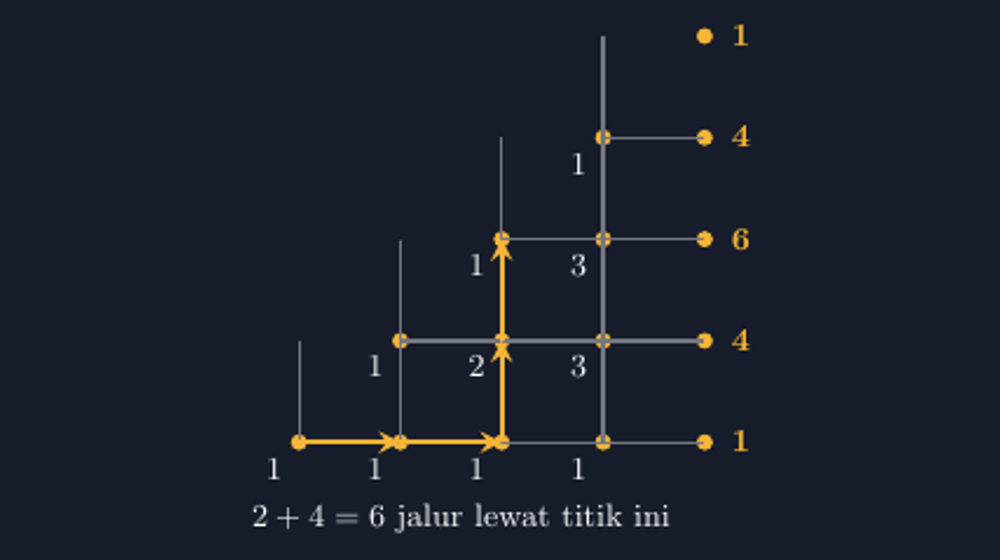

Ada satu soal yang setiap tahun selalu berhasil membuat kelas saya ramai: soal jalur. Bunyinya sederhana. "Dari titik A ke titik B hanya boleh berjalan ke kanan atau ke atas. Ada berapa banyak cara berbeda untuk sampai?" Saya gambar peta kecil di papan tulis, empat kali empat persimpangan, lalu saya tunjuk satu persimpangan di pojok kanan atas dan bertanya, "Ada berapa jalan menuju sini?"

Jawaban pertama yang muncul biasanya nebak. "Sepuluh, Pak." "Duapuluh!" Lalu saya minta mereka buktikan. Nah, di sinilah kelas mulai terbelah. Ada yang mulai menggambar jalur satu per satu dan mencoret setiap kali menemukan rute baru — sampai lupa mana yang sudah dicoret. Ada yang diam lama lalu bilang, "Pak, kalau petanya lebih besar, cari satu-satu nggak akan selesai."

Pertanyaan seperti itu adalah pertanyaan yang saya tunggu. Karena jawabannya adalah jembatan menuju salah satu benda paling terkenal di matematika: Segitiga Pascal.

<!--more-->

## Mulai dari satu persimpangan kecil

Sebelum membahas rumus, saya ajak kelas menyepakati satu hal kecil. Ambil satu persimpangan saja, katakanlah persimpangan yang letaknya dua langkah ke kanan dan dua langkah ke atas dari titik mulai. Berapa cara menuju sana?

Kita hitung dengan jujur: jalurnya bisa digambar, ada enam. EEN, ENE, NEE, NNE, NEN,ENN — ke kanan dua kali dan naik dua kali, disusun dalam segala urutan. Enam.

Lalu pertanyaan lanjutan: persimpangan di sebelah kirinya? Empat. Persimpangan di atasnya? Empat juga. Dan di sini terjadi momen yang saya nantikan setiap mengajar topik ini. Salah satu siswa — tahun lalu adalah Rifa — mengangkat tangan dan berkata, "Pak, enam itu kok persis empat tambah empat ya?"

Ya. Dan itu bukan kebetulan.

## Angka di tiap titik adalah jumlah jalur ke titik itu

Ini inti segala sesuatunya. Untuk sampai ke satu persimpangan, langkah terakhir pasti datang dari kiri atau dari bawah. Tidak ada pintu masuk ketiga. Jadi jumlah cara menuju sebuah persimpangan adalah jumlah cara menuju persimpangan kirinya ditambah jumlah cara menuju persimpangan bawahnya. Angka di satu titik selalu lahir dari dua angka tetangganya.

Titik paling kiri dan paling bawah? Hanya ada satu cara menuju ke sana: terus lurus. Semua angka di tepi adalah satu.

Kalau susunan titik-titik ini kita rotasikan empat puluh lima derajat, siswa yang pernah melihat Segitiga Pascal akan langsung berteriak, "Itu kan, Pak, segitiga Pascal!" Dan memang benar. Barisnya: satu; satu satu; satu dua satu; satu tiga tiga satu; satu empat enam empat satu. Setiap angka adalah jumlah jalur menuju titik itu.



Gambar di atas adalah versi TikZ dari papan tulis saya. Titik-titiknya persimpangan, garis abunya jalan, dan panah kuning menunjukkan satu jalur contoh yang melewati titik dengan angka 6 — angka yang memang lahir dari 2 ditambah 4 di bawahnya. Kalau siswa menambahkan sendiri angka-angka di kolom, mereka tidak menghafal segitiga Pascal; mereka menemukannya.

## Menggambarnya dengan TikZ tanpa mengarang

Seperti biasa di blog ini, gambar soal harus jujur pada matematikanya. Kebetulan TikZ sangat cocok untuk lattice ini, karena titik-titiknya hidup di koordinat bulat.

Potongan inti kodenya sederhana:

```latex
\foreach \i in {0,...,4}
  \foreach \j in {0,...,\i}
    \node[dot] at (\i,\j) {};
```

Satu hal yang saya pelajari dari eksperimen pertama saya: jangan meletakkan angka jalur *di tengah* titik atau di atas garis. Pada versi pertama, angka-angka saya menimpa garis jalan dan hasilnya seperti label kereta yang tertulis di relnya. Solusinya, setiap angka diberi jangkar (`anchor=north east`) supaya duduk rapi di pojok kiri-bawah titiknya:

```latex
\foreach \i/\j/\t in {0/0/1, 1/0/1, 1/1/1, 2/0/1, 2/1/2, 2/2/1, 3/0/1, 3/1/3, 3/2/3, 3/3/1} {
  \node[white, font=\small, anchor=north east] at (\i-0.12,\j-0.12) {\t};
}
```

Angka di kolom paling kanan saya beri warna aksen kuning dan huruf tebal, karena baris itu — 1, 4, 6, 4, 1 — adalah baris yang akan kita bahas bersama di kelas.

Berkas lengkapnya bisa langsung dikompilasi; strukturnya persis seperti gambar di artikel ini.

## Dari jalur ke peluang, tanpa ganti topik

Kenapa topik ini menurut saya wajib masuk kelas SMP, padahal secara resmi segitiga Pascal tidak punya "jam pelajaran" sendiri di SMP? Karena tiga hal yang sering kita ajarkan terpisah ternyata tinggal di satu gambar yang sama.

Pertama, kombinasi. Angka 6 di titik (2,2) itu adalah $\binom{4}{2}$: memilih dua langkah "naik" di antara empat langkah total. Saya tidak perlu menyebut kata "kombinasi" dulu; cukup tanyakan, "dari empat langkah, dua naik, sisanya kanan — ada berapa susunan?" Konsepnya sudah lahir sebelum simbolnya.

Kedua, koefisien binomial untuk $(a+b)^n$. Baris keempat, 1-4-6-4-1, adalah koefisien koefisien $(a+b)^4$. Ketika siswa nanti bertemu penjumlahan ini di aljabar lanjutan, mereka sudah pernah *menghitung* angka-angka itu dengan kaki mereka sendiri, di peta persimpangan. Rasa asingnya hilang.

Ketiga, peluang. Kalau sebuah kelereng berjalan di peta ini dan setiap percabangan dipilih dengan lempar koin — kanan atau atas, peluang sama — berapa peluang kelereng melewati titik tertentu? Jalur yang banyak di satu sisi berarti kelereng lebih sering lewat sana. Ide pelewatan jalur ini nanti tumbuh menjadi pemahaman bahwa distribusi peluang punya bentuk. Dan bentuknya, entah bagaimana, menyerupai segitiga yang sama.

## Yang saya ingat dari kelas itu

Tahun lalu, setelah sesi jalur ini, ada siswa yang diam-diam menggambar peta jalur di halaman belakang bukunya — versi yang jauh lebih besar, sampai baris kelima dan keenam — dan datang keesokan harinya untuk menunjukkan baris yang paling tengah: 1, 5, 10, 10, 5, 1. "Pak, sepuluh itu buanyak sekali jalurnya."

Dia tidak menyebut baris keempat Segitiga Pascal. Dia menyebut sepuluh jalur. Bagi saya itu penemuan yang lebih murni, dan penemuan seperti itu hanya terjadi kalau angka di segitiga itu diberi makna fisik dulu — jumlah cara untuk sampai — sebelum diberi nama.

Kalau Bapak/Ibu ingin mencoba, saya sarankan mulai dari peta kecil empat kali empat dan biarkan siswa mengisi angkanya sendiri di papan tulis, satu persimpangan satu orang. Ketika seluruh peta terisi dan membentuk segitiga yang mereka kenali, itu salah satu momen "oh!" paling indah yang bisa saya hadiahkan dari satu jam pelajaran.

> 📎 **Berkas TikZ lengkap:** [segitiga-pascal-jalur.tex](tex/segitiga-pascal-jalur.tex) — siap kompilasi (butuh paket `tikz`).
