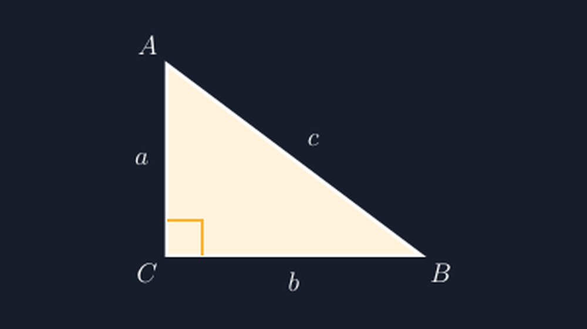

Pekan lalu saya membuat lembar latihan tentang Pythagoras untuk kelas VIII. Soal pertamanya begini: sebuah segitiga siku-siku dengan sisi tegak $3$ cm dan sisi datar $4$ cm, carilah sisi miringnya. Soal klasik, tiga-empat-lima, sudah puluhan tahun dipakai di buku-buku.

Masalahnya bukan di soalnya. Masalahnya di gambar yang saya tempel di samping soal. Karena terburu-buru, saya menggambar segitiganya asal: sisi tegaknya terlihat lebih panjang daripada sisi datarnya, padahal angka di soal bilang sebaliknya. Sisi miringnya saya buat agak melengkung karena garisnya kurang lurus saat digambar tangan di Word. Dan yang paling memalukan: sudut yang seharusnya siku-siku justru terlihat lancip, kira-kira delapan puluh derajat. Seorang murid di kelas, yang biasanya paling pendiam, mengangkat tangan dan bertanya, "Pak, ini kok segitiganya nggak siku-siku?" Ya, ditangkap basah oleh murid sendiri.

<!--more-->

## Gambarnya Bekerja Lebih Keras daripada Soalnya

Peristiwa itu membuat saya berpikir ulang. Dalam soal geometri, gambar bukan hiasan. Gambar adalah bagian dari data soal. Murid membaca gambar lebih dulu sebelum membaca kalimat. Kalau gambar berbohong — sudut yang siku-siku digambar lancip, sisi yang seharusnya pendek justru panjang — maka sebagian murid akan bingung, dan sebagian lagi malah belajar kebiasaan buruk: tidak percaya pada gambar, padahal mengandalkan gambar justru keterampilan yang ingin kita latih di geometri.

Ada dua pendapat yang sering bertabrakan di rapat MGMP. Yang pertama bilang: gambar soal memang boleh tidak proporsional, asal ada keterangan "gambar tidak sesuai skala". Yang kedua bilang: untuk materi tertentu, terutama Pythagoras dan perbandingan trigonometri, proporsi justru bagian dari penalaran. Saya pribadi berdiri di tengah, tapi dengan satu syarat tegas: kalau sudut disebut siku-siku, gambarlah benar-benar siku-siku. Itu garis bawah yang tidak bisa ditawar.

## Kenapa Tangan Saja Tidak Cukup

Menggambar segitiga siku-siku dengan sudut benar-benar 90° di pengolah kata itu mengejutkan sulitnya. Kita menyeret garis dengan tetikus, merasa "kira-kira sudah tegak lurus", lalu mencetak. Tapi "kira-kira" di layar bisa berarti 87° atau 94°, dan mata murid yang duduk paling depan akan melihatnya.

Di sinilah saya akhirnya berhijrah ke TikZ. Kelebihan yang paling saya rasakan bukanlah kecantikan outputnya, melainkan sesuatu yang lebih sederhana: koordinat. Kalau saya menulis titik-titiknya secara eksplisit, sudut siku tidak lagi hasil perkiraan tangan, melainkan konsekuensi dari angka yang saya ketik. Segitiga siku-siku 3-4-5 di TikZ bisa sesederhana ini:

```latex
\begin{tikzpicture}[scale=1.2]
  \draw[thick] (0,3) -- (0,0) -- (4,0) -- cycle;
  \draw (0.5,0) -- (0.5,0.5) -- (0,0.5); % penanda siku
\end{tikzpicture}
```

Perhatikan koordinatnya: $(0,3)$, $(0,0)$, $(4,0)$. Titik sudut $C$ di titik asal, sisi tegak naik sepanjang sumbu $y$, sisi datar menyusuri sumbu $x$. Sudut di $C$ adalah sudut antara sumbu $x$ dan sumbu $y$ — yang secara konstruksi pasti 90°, bukan karena tangan saya hari itu stabil. Gambar hasilnya persis seperti ini:



Garis kecil di pojok $C$ itupun bukan goresan asal. Penanda siku adalah kotak kecil yang dibentuk dari dua segmen garis sepanjang $0{,}5$ satuan yang dipotong dari kedua sisi. Karena kedua sisinya mengikuti arah sumbu, kotak kecil itu otomatis lurus terhadap kedua sisi — tidak mungkin miring kecuali saya memang sengaja memiringkannya.

## Label yang Ikut Jujur

Setelah sudutnya benar, urusan berikutnya adalah label. Dan di sinilah saya sering melihat gambar-gambar soal yang "hampir benar": segitiganya bagus, tapi label sisinya menyesatkan. Sisi miring diberi label $c$, sisi tegak $a$, sisi datar $b$ — tidak ada yang salah dengan hurufnya, tapi posisinya asal nempel ke garis, sehingga murid ragu huruf itu maksudnya sisi yang mana.

Di TikZ posisi label adalah argument eksplisit: `above`, `below`, `left`, `right`, atau kombinasi seperti `above right`. Artinya saya dipaksa memutuskan, sisi $a$ itu diletakkan di kiri garisnya atau di kanan. Untuk soal Pythagoras, kebiasaan yang saya ikuti sederhana dan konsisten di semua lembar kerja: sisi miring selalu berlawanan dengan sudut siku dan dilabeli $c$, sedangkan dua sisi lainnya $a$ dan $b$. Konsistensi lintas soal ini ternyata lebih berharga daripada yang saya duga. Murid yang sudah terbiasa dengan konvensi itu bisa membaca gambar lebih cepat, dan beban kognitifnya tersisa untuk hal yang sebenarnya: penalaran tentang hubungan antar sisi.

Untuk menyelesaikan gambar di atas, kode lengkapnya kira-kira begini:

```latex
\coordinate (C) at (0,0);
\coordinate (A) at (0,3);
\coordinate (B) at (4,0);
\draw[fill=yellow!15] (C) -- (A) -- (B) -- cycle;
\draw[thick] (0.55,0) -- (0.55,0.55) -- (0,0.55);
\node[above left]  at (A) {$A$};
\node[below right] at (B) {$B$};
\node[below left]  at (C) {$C$};
\node[left=4pt]  at (0,1.5) {$a$};
\node[below=4pt] at (2,0)   {$b$};
\node[above right] at (2,1.5) {$c$};
```

Yang saya suka dari potongan ini: setiap baris adalah satu keputusan yang bisa saya pertanggungjawabkan. Tidak ada elemen yang "kebetulan ada di situ". Kalau murid menanya, "Pak, kok label $c$-nya di luar segitiga?", saya bisa jawab karena memang saya yang menaruhnya di situ, dengan alasan agar tidak menimpa garis sisi miring.

## Skala, dan Jebakan Kecil yang Menyertainya

Satu hal lagi yang saya pelajari dengan cara salah dulu. TikZ punya opsi `scale`, dan awalnya saya pikir mengubah `scale=0.5` akan memperkecil semua koordinat. Ternyata tidak persis begitu: skala hanya berlaku pada koordinat, tidak otomatis pada teks label, ketebalan garis, dan panjang penanda siku yang ditulis manual seperti `0.55`. Jadi kalau segitiganya dikecilkan tapi penanda siku tetap $0{,}5$ satuan, kotak kecil itu bisa jadi terlalu gemuk dibanding segitiganya.

Karena itu sekarang saya menetapkan skala di awal dan menulis panjang-panjang kecil relatif terhadap skala itu, lalu mencetak draf satu halaman untuk dilihat mata sebelum dipakai. Lima menit memeriksa draf jauh lebih murah daripada tiga puluh lembar soal yang sudah dibagikan ke murid.

## Dari Segitiga Sederhana ke Soal yang Lebih Rumit

Mungkin ada rekan guru yang berpikir, "Repot sekali, untuk segitiga saja pakai bahasa pemrograman." Saya memahami perasaan itu, karena saya juga begitu di bulan-bulan pertama. Tapi manfaatnya baru terasa ketika soalnya bertambah rumit. Segitiga siku-siku hari ini; minggu depan segitiga dengan tinggi dari sudut siku, atau dua segitiga siku-siku yang berbagi satu sisi untuk soal kesebangunan, atau lingkaran yang menyinggung ketiga sisinya. Semua bangun itu dibangun dari titik-titik yang saling terhubung, dan kalau kita sudah terbiasa berpikir dalam koordinat, menambah satu titik berarti menambah dua angka, bukan menggambar ulang dari nol.

Yang paling penting sebenarnya bukan TikZ-nya. Yang paling penting adalah komitmen kecil yang sekarang saya pegang: gambar di soal tidak boleh mengarang. Sudut yang disebut siku-siku harus benar-benar siku-siku, sisi yang disebut lebih panjang harus terlihat lebih panjang. Karena pada akhirnya kita mengajar murid untuk percaya bahwa gambar geometri bercerita dengan jujur — dan murid cuma bisa belajar kejujuran itu dari gambar yang memang jujur.

Segitiga 3-4-5 yang dulu saya gambar asal itu sudah saya ganti. Versi TikZ-nya sekarang tinggal dipanggil ulang di setiap lembar latihan Pythagoras. Dan sejak itu, tidak ada lagi murid pendiam yang harus menangkap basah gurunya sendiri.

> 📎 **Berkas TikZ lengkap:** [tikz-segitiga-siku-siku.tex](tex/tikz-segitiga-siku-siku.tex) — siap kompilasi (butuh paket `tikz`).
