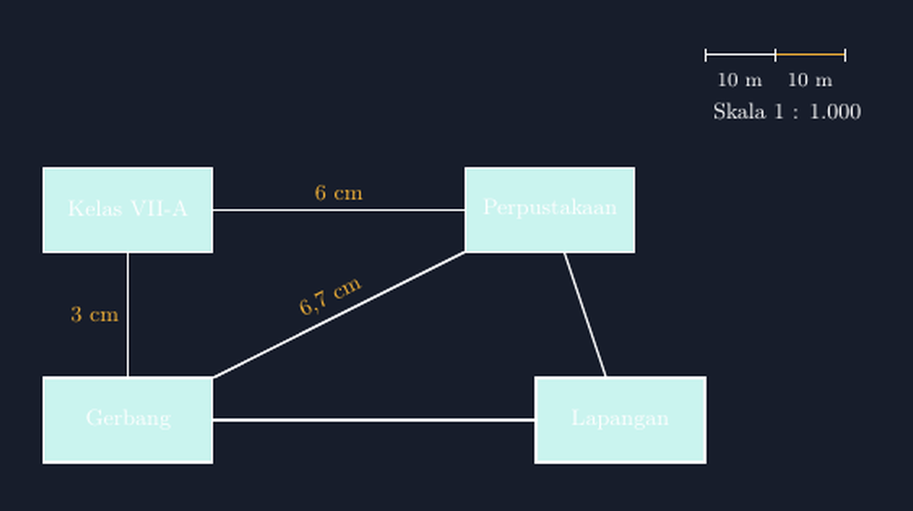

Kemarin sore, sebelum bel pulang, ada siswa saya yang bertanya pelan-pelan, "Pak, kalau skala peta bilang 1 banding 50.000, yang satu itu jaraknya mana? Yang di peta atau yang sungguhan?"

Pertanyaan sederhana. Tapi saya perhatikan semua soal skala yang sudah kita kerjakan sepanjang pekan itu hanyalah barisan hitungan: diketahui jarak pada peta 5 cm, skala 1 : 50.000, jarak sebenarnya berapa? Siswa hafal polanya, kalikan lalu tulis kilometer. Ujung-ujungnya mereka mendapat angka, bukan pemahaman. Yang sebenarnya ditanyakan siswa saya sore itu adalah makna dari tanda titik dua yang muncul di tengah angka-angka itu.

Malamnya saya duduk di depan layar, membuka jurnal digital saya, dan memutuskan bahwa pekan depan skala akan diajarkan lewat gambar yang bisa mereka ukur sendiri. Dan seperti biasa belakangan ini, saya mengandalkan TikZ untuk menggambar itu.

<!--more-->

## Skala adalah Perbandingan, Bukan Rumus

Kesalahan yang paling sering saya temui di kelas: siswa memperlakukan skala sebagai "rumus jarak sebenarnya". Padahal skala itu perbandingan dua jarak — jarak pada gambar terhadap jarak sebenarnya — dengan syarat keduanya ditulis dalam satuan yang sama.

$$\text{skala} = \frac{\text{jarak pada gambar}}{\text{jarak sebenarnya}}$$

Kunci yang ingin saya tekankan di kelas: sebelum ada konversi centimeter ke kilometer, sebelum ada "tambah lima nol" yang sering jadi trik hafalan, yang terjadi hanyalah pembagian dua besaran yang satuannya sama. 1 : 50.000 berarti 1 cm di gambar mewakili 50.000 cm di dunia nyata. Titik. Baru setelah itu kita yang memutuskan mau menuliskannya dalam bentuk apa — 50.000 cm memang sama dengan 500 meter.

Karena itu pula saya tidak suka langsung menyodorkan soal peta jalan. Saya lebih suka mulai dari denah yang dekat dengan hidup mereka: denah lingkungan sekolah.

## Denah yang Bisa Diukur Sendiri

Saya membuat gambar denah sederhana: gerbang sekolah, lapangan, perpustakaan, dan kelas, dengan garis yang menyatakan jalan setapak di antaranya. Skala yang saya pilih 1 : 1.000 — artinya 1 cm gambar mewakili 1.000 cm, atau sepuluh meter, jarak nyata.


*Denah sekolah dengan skala 1 : 1.000 — gambar hasil TikZ yang dipakai di kelas.*

Bagian yang paling saya sukai dari gambar ini: garis skala di pojok kanan atas. Siswa bisa menyentuh layarnya, atau jika saya cetak, menempelkan ujung pensil mereka dari 0 sampai angka tertentu, lalu memindahkan jangkauan itu ke garis denah. Mereka tidak menghitung skala — mereka *menggunakan* skala. Ketika jarak kelas ke perpustakaan pada gambar adalah 6 cm, dan mereka tahu tiap 1 cm adalah 10 meter, angka 60 meter datang dari mereka sendiri, bukan dari rumus yang saya diktulkan. (Saya juga menampilkan jarak miring gerbang ke perpustakaan, 6,7 cm — kesempatan baik untuk menyisipkan Pythagoras sebagai bonus diskusi.)

Potongan kode utamanya sesederhana ini:

```latex
\begin{tikzpicture}[scale=1]
  \node[rectangle, draw, fill=teal!30] (gate) at (0,0) {Gerbang};
  \node[rectangle, draw, fill=teal!30] (lib) at (6,3) {Perpustakaan};
  \draw[thick] (gate) -- (lib) node[midway, sloped, above] {6 cm};
  % garis skala
  \draw[thick] (7,5) -- (8,5) node[midway, below] {1 cm};
  \draw[thick] (8,5) -- (9,5) node[midway, below] {1 cm};
\end{tikzpicture}
```

Saya sengaja menuliskan "6 cm" pada gambar — padahal di TikZ jarak itu adalah 6 satuan — supaya siswa tidak mengira bahwa ukuran gambar di layar mereka selalu sama. Di proyektor, di cetakan, di ponsel, besar fisik gambar bisa berbeda, tetapi makna "6 cm pada gambar dengan skala 1 : 1.000" tetap sama: enam puluh meter. Ini pula alasannya soal-soal skala di buku selalu menyertakan keterangan jarak secara eksplisit, bukan menyuruh siswa mengukur gambar buku yang besar cetaknya tak terkendali.

## Titik Dua yang Membuat Bingung

Kembali ke pertanyaan siswa saya sore itu. "1 banding 50.000" — kebingungan dia lahir dari tanda titik dua yang dia baca sebagai pembagian angka pertama dengan angka kedua, padahal keduanya berdiri sebagai dua jarak yang disandingkan.

Di kelas, saya memberi analogi resep masakan. Kalau resep bilang "beras banding air 1 banding 2", tidak ada yang mengira berasnya dibagi air. Keduanya sama-sama takaran, disandingkan untuk menjelaskan hubungan. Skala juga demikian: cm gambar disandingkan dengan cm dunia nyata. Siswa yang tadinya bingung langsung mengangguk ketika analogi resep ini muncul — mungkin karena mereka lebih sering di dapur daripada di depan peta.

Satu jebakan lagi yang hampir selalu muncul: satuan. Siswa yang hitungannya benar, 5 cm × 50.000 = 250.000, lalu langsung menulis "250.000 meter". Di kelas saya sebut ini jebakan lima nol — hitungan benar, tafsiran salah. Jadi sejak awal saya minta mereka menulis satuannya di setiap langkah: 250.000 *cm*, baru menjadi 2,5 *km*. Menulis satuan bukan formalitas; itulah jaring pengaman.

## Kenapa Saya Repot Menggambar Sendiri

Sebenarnya saya bisa memfoto peta dari buku paket, atau mengambil gambar dari internet. Tapi menggambar sendiri di TikZ memberi tiga hal yang gambar jadi tidak beri.

Pertama, konsistensi. Setiap garis, setiap label, setiap angka skala persis seperti yang saya rancang. Kalau besok saya ingin mengganti skala dari 1 : 1.000 menjadi 1 : 2.000, saya cukup mengubah satu angka, dan seluruh keterangan mengikuti secara matematis — tidak ada gambar yang harus di-tweak manual sampai angkanya tidak jujur lagi.

Kedua, gambar ini hidup di file yang sama dengan catatan mengajar saya. Tahun depan, kalau saya ingin memperbaiki denah ini, saya tidak mencari-cari foto lama; saya buka file `.tex`-nya dan baca kembali niat saya tahun lalu.

Ketiga — dan ini yang paling sering saya lupakan sampai merasakannya — ketika saya menggambar sesuatu, saya dipaksa memahaminya lebih dalam. Untuk menarik garis skala yang benar, saya harus memastikan sendiri bahwa dua segmen 1 cm pada gambar memang mewakili dua segmen 10 meter di lapangan. Mengajar memang paling sering bermula dari menggambar.

## Penutup: Dari Menghitung ke Mengerti

Besok, ketika materi skala masuk kelas lagi, saya tidak akan memulai dari rumus. Saya akan menempelkan denah ini di layar, memberi mereka penggaris, dan menyuruh mereka mengukur sendiri. Hitungan pasti tetap ada — soal ujian menuntut itu. Tapi saya ingin hitungan itu berdiri di atas pemahaman, bukan menggantikannya.

Dan kalau Bapak/Ibu guru lain ingin mencoba, berkas `.tex` lengkapnya saya sertakan di bawah. Silakan ganti nama tempatnya, sesuaikan skalanya — gambar itu milik kelas Bapak/Ibu juga.

> 📎 **Berkas TikZ lengkap:** [tikz-skala-denah-sekolah.tex](tex/tikz-skala-denah-sekolah.tex) — siap kompilasi (butuh paket `tikz`).
