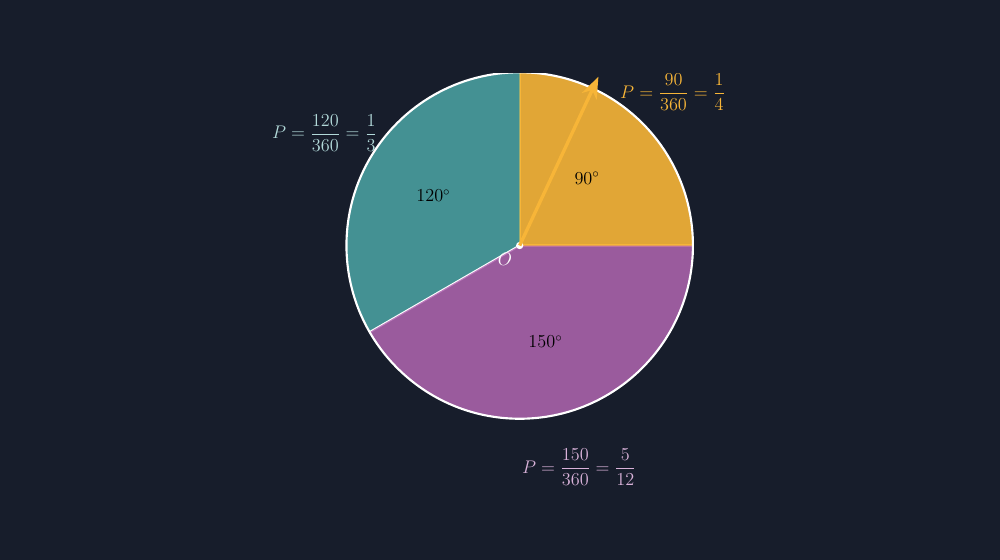

Materi peluang di kelas VIII hampir selalu dibuka dengan dadu dan koin. Dua benda itu memang klasik, tapi ada satu masalah kecil yang saya temui bertahun-tahun: siswa menganggap peluang hanya soal enam sisi dan dua muka. Begitu muncul kejadian yang peluangnya tidak "rapi" — sepertiga, lima per dua belas, atau bilangan yang penyebutnya bukan kelipatan yang mereka kenal — banyak yang langsung bingung. Karena itu tahun ini saya mencoba jalur lain: roda putar, atau spinner, seperti yang biasa mereka temui di papan permainan.

<!--more-->

## Roda dari kardus yang jujur

Rencananya sederhana. Saya buat roda putar besar dari kardus bekas, ditempel di papan, dengan jarum penunjuk dari paku dan potongan kertas. Rodanya saya bagi tiga sektor: satu sektor kuning, satu hijau, satu ungu. Sebelum kelas dimulai, saya sudah bertekad satu hal — sektor-sektor itu *harus* proporsional dengan peluangnya. Saya pernah melihat lembar aktivitas tempelan di internet yang roda peluangnya asal dibagi tiga sama besar, padahal pertanyaannya menanyakan peluang yang berbeda-beda. Roda seperti itu mengajarkan sesuatu yang salah, dan siswa tidak akan menyadarinya kecuali kita menunjukkannya.

Jadi saya hitung dulu sebelum menggunting. Roda saya buat dengan tiga sektor: $90^\circ$ untuk kuning, $120^\circ$ untuk hijau, dan sisanya, $150^\circ$, untuk ungu. Jumlahnya tetap $360^\circ$, dan peluang jarum berhenti di tiap warna tinggal dibagi:

$$P(\text{kuning}) = \frac{90}{360} = \frac{1}{4}, \qquad P(\text{hijau}) = \frac{120}{360} = \frac{1}{3}, \qquad P(\text{ungu}) = \frac{150}{360} = \frac{5}{12}$$

Di papan, roda itu terlihat jelas tidak simetris — dan justru itu tujuannya. Ketika saya bertanya, "Warna mana yang paling mungkin muncul?" hampir seluruh kelas menjawab ungu, dan mereka bisa menjelaskan kenapa: sektornya paling lebar. Perasaan intuitif itu sudah benar, dan tugas saya tinggal mengubah perasaan itu menjadi bilangan.

## Percobaan yang tidak langsung cocok

Yang membuat sesi itu hidup adalah percobaannya tidak langsung menuruti teori. Kami memutar roda lima puluh kali, mencatat hasilnya di papan, lalu membandingkan frekuensi relatif dengan peluang teoretis. Kelas VII-A dapat ungu dua puluh dua kali dari lima puluh putaran — frekuensi relatifnya $0{,}44$, cukup dekat dengan $\frac{5}{12} \approx 0{,}417$. Tapi kelas VII-B yang mencoba setelahnya mendapat ungu hanya tiga belas kali. Ada siswa yang langsung berseru, "Pak, roda ini curang!"

Momen itu emas. Saya tidak menjawab, saya balik bertanya: curang di bagian mana? Mereka berdiskusi sebentar, dan akhirnya sampai pada kesimpulan sendiri: lima puluh putaran itu masih sedikit, jadi hasilnya boleh menyimpang. Itu persis inti materi frekuensi relatif yang pernah saya tulis di artikel lain, dan kebetulan kali ini siswa yang menemukannya, bukan saya yang menjelaskan. Kalau roda saya tidak proporsional sejak awal, diskusi semacam itu mustahil terjadi — mereka akan menemukan ketidakcocokan yang tidak ada sebabnya, dan pelajaran yang salah justru menumpang di atasnya.

## Dari kardus ke TikZ

Setelah sesi kelas, roda kardus itu harus punya versi digital untuk lembar kerja dan soal ujian. Di sinilah TikZ masuk, dan di sinilah prinsip yang sama berlaku: gambar harus jujur pada derajatnya. Kalau saya menggambar roda peluang dengan sektor yang tidak sesuai perhitungan, siswa yang mengukur dengan busur derajat akan menemukan kontradiksi — dan itu jenis kontradiksi yang merusak kepercayaan, bukan membangun diskusi.

Ide dasarnya sederhana: roda peluang adalah lingkaran yang dibagi sektor-sktor dari pusat $O$, dan tiap sektor digambar dari satu sudut ke sudut berikutnya dengan perintah `arc`. Untuk roda kelas saya, sudut-sudutnya adalah $0^\circ$, $90^\circ$, $210^\circ$, dan kembali ke $360^\circ$. Bagian pertamanya seperti ini:

```latex
% Sektor kuning: 0--90 derajat, peluang 90/360 = 1/4
\fill[acc,opacity=0.9] (O) -- (A) arc (0:90:4) -- cycle;
\draw[acc] (O) -- (A);
\draw[acc] (O) -- (B);
% Sektor hijau: 90--210 derajat, peluang 120/360 = 1/3
\fill[teal!70!white,opacity=0.85] (O) -- (B) arc (90:210:4) -- cycle;
```

Satu hal yang perlu diperhatikan: dalam TikZ, sudut dihitung berlawanan arah jarum jam dari sumbu mendatar. Jadi kalau di lembar kerja roda digambar dengan sektor kuning di kanan atas, sektor hijau di kiri atas, dan ungu di bawah, koordinat sudutnya harus saya sesuaikan — bukan disalin dari sketsa kardus. Kebiasaan lama dari soal geometri lain tetap berguna di sini: saya selalu menuliskan sudut awal dan akhir tiap sektor sebagai komentar di kode, supaya siapa pun yang membaca ulang berkasnya bertahun-tahun kemudian bisa memeriksa tanpa harus menghitung ulang.

Label peluangnya saya letakkan di luar lingkaran, searah titik tengah tiap sektor, supaya tidak menutupi gambar:

```latex
\node[acc] at (45:5.0) {$P=\dfrac{90}{360}=\dfrac14$};
\node[teal!30!white] at (150:5.2) {$P=\dfrac{120}{360}=\dfrac13$};
\node[violet!30!white] at (285:5.3) {$P=\dfrac{150}{360}=\dfrac{5}{12}$};
```

Angka $45^\circ$, $150^\circ$, dan $285^\circ$ itu bukan angka asal — masing-masing adalah titik tengah sektornya: $\frac{0+90}{2}$, $\frac{90+210}{2}$, dan $\frac{210+360}{2}$. Kalau label diletakkan di sudut lain, jaraknya ke sektor tidak seimbang dan gambar terlihat "menggantung" di satu sisi. Detail sekecil ini yang membuat gambar TikZ terlihat rapi tanpa perlu menyetel manual berulang kali.



*Gambar: roda peluang tiga sektor — kuning $90^\circ$, hijau $120^\circ$, ungu $150^\circ$ — dengan jarum penunjuk dan label peluang di luar lingkaran. Berkas lengkapnya bisa diunduh di bagian akhir artikel ini.*

## Soal yang lahir dari roda yang sama

Roda yang sama saya pakai untuk tiga soal berbeda di lembar kerja, dengan tingkat kesulitan yang naik pelan. Soal pertama hanya meminta peluang tiap warna — pemanasan. Soal kedua membalik arah: peluang jarum berhenti di daerah yang *bukan* ungu, sehingga siswa harus memahami bahwa $\frac{5}{12}$ dan $\frac{7}{12}$ saling melengkapi. Soal ketiga yang paling menarik: berapa derajat sektor baru yang harus dibuat supaya peluang warna kuning berubah menjadi $\frac{1}{3}$?

Soal ketiga itu berbalik arah dari biasanya — dari peluang menuju sudut, bukan sebaliknya. Banyak siswa menghela napas dulu, tapi ada yang langsung menulis $\frac{1}{3} \times 360^\circ = 120^\circ$ di kertasnya. Siswa lain menyelesaikannya dengan cara berbeda: menghitung selisih sudut yang harus dipindahkan dari sektor lain. Kedua jalur itu sama benar, dan membandingkannya di papan menjadi diskusi penutup yang menghubungkan fraksi, sudut, dan derajat dalam satu tarikan napas.

## Yang saya simpan dari roda itu

Kalau saya merenungkan sesi itu, ada satu hal yang ingin saya bawa terus: gambar dan alat peraga peluang wajib proporsional, tanpa kompromi. Bukan karena kardus dan TikZ tidak bisa berbohong — keduanya bisa, dengan sangat mudah — tapi karena peluang adalah materi yang *seluruh maknanya* terletak pada perbandingan bagian terhadap keseluruhan. Roda yang sektornya asal dibagi mengajarkan perbandingan yang salah, dan siswa tidak akan protes karena gambar memang tampak biasa saja.

Untuk rekan guru yang ingin mencoba: mulailah dari hitungan derajat, bukan dari guntingan. Tentukan dulu peluang tiap daerah, kalikan $360^\circ$, tulis sudutnya di kertas, baru gunting atau gambar. Di TikZ, sudut-sudut itu tinggal berpindah dari kertas ke perintah `arc` — dan berkas .tex yang lengkap di bawah ini bisa langsung dipakai atau diubah sudutnya sesuai roda yang Bapak/Ibu butuhkan. Roda putar memang alat sederhana, tapi roda yang jujur bisa membawa kelas jauh: dari tebakan, ke frekuensi, ke peluang — dengan jarum yang berhenti di tempat yang bisa dipertanggungjawabkan.

> 📎 **Berkas TikZ lengkap:** [tikz-spinner-peluang.tex](tex/tikz-spinner-peluang.tex) — siap kompilasi (butuh paket `tikz` dan `amsmath`).
