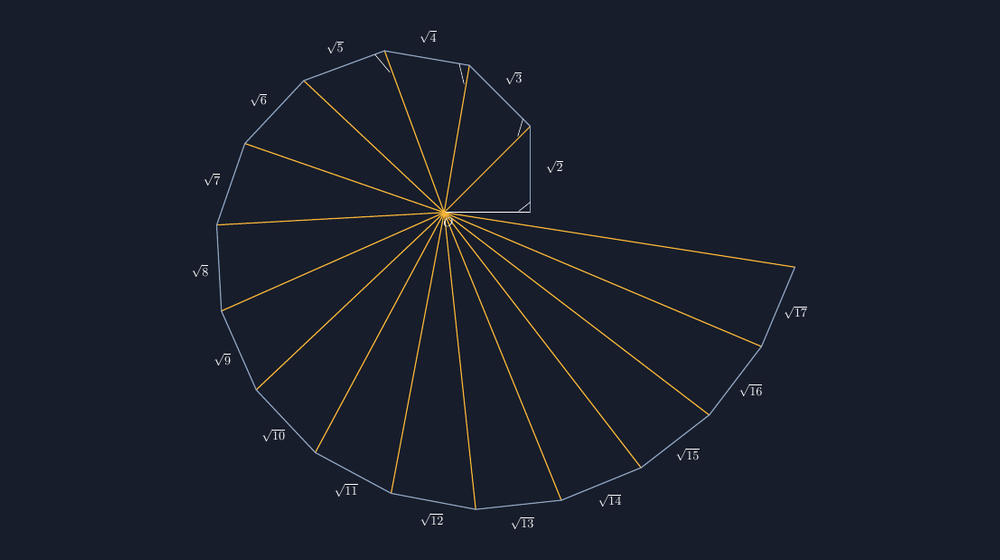
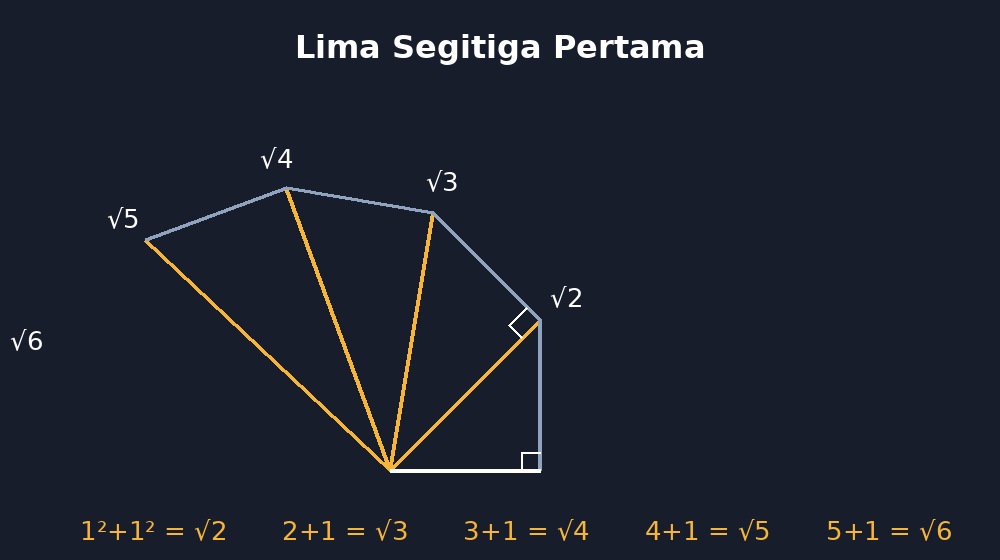

Ada satu momen di kelas VIII yang selalu saya tunggu-tunggu setiap tahun: detik ketika siswa menemukan bahwa suatu panjang bisa tidak berhenti di angka bulat. Biasanya terjadi di tengah latihan Pythagoras. Saya tulis di papan, segitiga siku-siku dengan dua kaki sama panjang satu satuan, lalu tanyakan panjang sisi miringnya. Jawaban yang paling cepat datang: "satu koma empat, Pak." Benar, tapi belum lengkap. Lalu ada yang bilang akar dua, dan di situ saya bertanya balik: "kalau digambar, akar dua itu sepanjang apa?"

Hening. Dan justru keheningan itulah yang saya cari, karena dari situ kita mulai menggambar.

<!--more-->

## Spiral yang Tumbuh dari Potongan Kaki

Theodorus dari Kirene, matematikawan Yunani abad kelima sebelum masehi, punya ide yang sederhana tapi menawan. Mulailah dari segitiga siku-siku dengan dua kaki sepanjang 1. Sisi miringnya $\sqrt{2}$. Lalu jadikan sisi miring itu kaki panjang segitiga baru, dengan kaki pendeknya tetap 1 dan tetap tegak lurus. Sisi miring berikutnya jadi $\sqrt{3}$. Lanjutkan, dan Anda akan mendapat $\sqrt{4}$, $\sqrt{5}$, dan seterusnya — satu barisan bilangan irasional yang tersusun menjadi spiral yang indah.



Gambar di atas saya buat dengan TikZ, dan sebelum bicara kodenya, saya ingin bicara dulu soal kenapa gambar ini berharga di kelas. Ketika siswa melihat $\sqrt{17}$ sebagai *jarak nyata antara dua titik* — dari titik pusat ke ujung luar spiral — bilangan yang tadinya hanya simbol aneh di kalkulator tiba-tiba punya panjang. Mereka bisa menunjuknya. Mereka bisa membandingkannya: $\sqrt{10}$ ternyata lebih pendek dari $\sqrt{13}$, dan keduanya tidak sedekat yang dibayangkan sebelumnya.

## Menuliskan Geometrinya dengan TikZ

Kode TikZ untuk spiral ini pada dasarnya hanya menerjemahkan definisi rekursifnya. Setiap segitiga dibangun dari titik pusat $O$, titik luar sebelumnya $P_{n-1}$, dan titik luar baru $P_n$. Jika $P_{n-1}$ berjarak $\sqrt{n}$ dari $O$ di sudut $\theta$, maka $P_n$ berjarak $\sqrt{n+1}$ dari $O$ di sudut $\theta + \arctan(1/\sqrt{n})$ — karena sudut di $P_{n-1}$ dalam segitiga itu adalah $\arctan(1/\sqrt{n})$.

Dalam TikZ saya cukup menyimpan sudut kumulatif dan membiarkan matematikanya bekerja:

```latex
\foreach \n in {1,...,16} {
  \pgfmathsetmacro{\ang}{sqrt(\n)}   % tanda sudut kumulatif, dihitung bertahap
  ...
}
```

Potongan lengkapnya — termasuk penghitungan sudut satu per satu, penggambaran busur derajat di setiap sudut siku, dan pemberian label $\sqrt{2}$ sampai $\sqrt{17}$ — ada di berkas yang saya sisipkan di akhir artikel. Yang ingin saya tekankan: koordinat dalam spiral ini *dihitung*, bukan ditaksir. Itu pelajaran yang sama yang selalu saya tekankan di artikel-artikel TikZ sebelumnya; gambar yang jujur harus tumbuh dari angka yang benar, dan spiral ini adalah contoh paling literal dari prinsip itu, karena bentuknya sendiri memang *dibangun* dari angka.

## Kapan Spiral Ini Masuk Kelas

Saya tidak mengajarkan spiral Theodorus sebagai materi wajib. Ia masuk di dua kesempatan. Pertama, sebagai penutup bab Pythagoras: lima belas menit terakhir, ketika latihan soal sudah cukup dan saya ingin siswa pulang dengan satu gambar yang membekas. Kedua, sebagai tugas proyek kecil: siswa menggambar lima segitiga pertama dengan penggaris dan jangka di kertas berpetak, menghitung sendiri panjang setiap sisi miring, lalu mencocokkan hasilnya dengan gambar TikZ yang saya tampilkan.



Gambar kedua di atas meniru apa yang biasanya muncul di kertas siswa: segitiga demi segitiga dengan perhitungan $1^2+1^2=2$, lalu $(\sqrt{2})^2+1^2=3$, dan seterusnya. Ada satu hal yang selalu membuat saya senang saat mengoreksi proyek ini: siswa yang tadinya menulis $\sqrt{5} \approx 2{,}2$ tanpa berpikir, mulai bertanya apakah garis mereka cukup panjang untuk menggambar angka itu. Pertanyaan itu tandanya mereka mulai merasakan *besarnya* bilangan irasional, bukan sekadar menghafal notasinya.

## Hal-Hal Kecil yang Saya Pelajari Saat Menggambarnya

Spiral ini terlihat sederhana, tapi ada beberapa jebakan yang saya temui sendiri saat pertama kali menggambarnya. Pertama, sudut yang dihitung bertahap harus diakumulasi dengan teliti; kalau setiap langkah dibulatkan terlalu dini, segitiga ke-sebelas ke atas mulai terlihat "lelah" — kakinya tidak lagi tegak lurus sebagaimana mestinya. Kedua, label $\sqrt{n}$ harus ditempatkan di tengah sisi miring masing-masing segitiga, sedikit digeser ke arah luar agar tidak bertumpuk dengan garis spiral. Ketiga, jumlah segitiga yang saya pilih, enam belas, bukan angka acak: di segitiga ke-seventeen, sudut kumulatif melewati $2\pi$ dan spiral mulai menabrak dirinya sendiri. Mengetahui *batas* ini juga bahan cerita menarik di kelas — bahkan Theodorus berhenti, dan sampai sekarang masih diperdebatkan alasannya.

Ada juga satu keputusan kecil yang saya ambil: saya tidak menandai semua sudut siku dengan kotak kecil seperti biasa, tapi hanya pada segitiga-segitiga awal. Kalau semua ditandai, gambar menjadi ramai dan justru sulit dibaca. Kegiatan menggambar memang selalu soal memilih apa yang ditampilkan dan apa yang dibiarkan, dan itu pelajaran yang tidak tertulis di sisi mana pun dari lembar kerja.

## Penutup: Bilangan yang Bisa Ditunjuk

Setiap tahun, setelah spiral ini selesai dibahas, selalu ada siswa yang bertanya, "Pak, terus kalau dilanjut terus, akar dari berapa yang terakhir?" Pertanyaan itu tidak punya jawaban, dan justru karena tidak punya jawaban, ia layak dibiarkan menggantung sampai pertemuan berikutnya. Spiral Theodorus mengajarkan Pythagoras bukan sebagai rumus di lembar soal, tapi sebagai mesin yang menghasilkan bilangan baru — bilangan yang bisa ditunjuk ujungnya di kertas, dengan jari, oleh tangan siswa sendiri.

Bagi saya, itu salah satu definisi paling sederhana tentang belajar matematika: dari simbol yang tadinya menakutkan, menjadi benda yang bisa dipegang mata.

> 📎 **Berkas TikZ lengkap:** [tex/tikz-spiral-theodorus.tex](tex/tikz-spiral-theodorus.tex) — siap kompilasi (butuh paket `tikz`).
