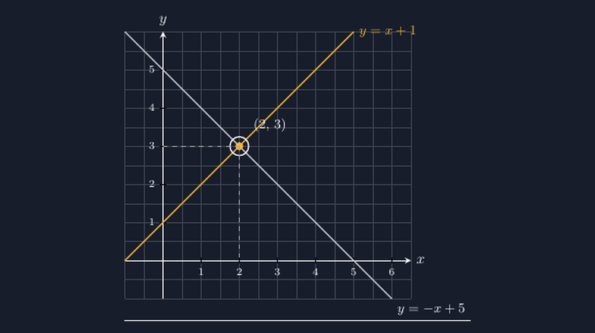

Ada satu momen yang saya tunggu-tunggu setiap kali mengajar sistem persamaan linear dua variabel. Bukan saat siswa berhasil memakai eliminasi dengan rapi, bukan juga saat mereka hafal langkah substitusi. Momen yang saya tunggu adalah detik ketika sebuah anak melihat gambar dua garis yang berpotongan, lalu berkata pelan, "Oh, jadi jawabannya itu ya titiknya?"

Anak yang mengatakan itu tahun lalu bernama Rani. Ia duduk di bangunan ketiga dari depan, tipe siswa yang rajin mencatat tapi sering bingung untuk apa semua langkah itu dilakukan. Ketika saya menggambar dua garis di papan dan menandai titik temu mereka dengan lingkaran, Rani mendongak dan wajahnya berubah. Dari hitungan yang "dikerjakan karena disuruh" menjadi sesuatu yang kelihatan.

<!--more-->

Masalahnya, papan tulis saya punya keterbatasan yang jujur saja sering mengkhianati pelajaran. Menggambar dua garis lurus yang berpotongan persis di titik bulat itu tidak mudah dengan tangan. Pernah sekali saya menggambar dua garis untuk sistem $y = x + 1$ dan $y = -x + 5$, dan karena tangan saya miring sedikit, titik temunya nyasar ke $(2{,}2)$ — padahal jawaban seharusnya $(2, 3)$. Siswa-siswa pun bingung: kenapa hasil hitungan kami tidak cocok dengan gambar Pak Gunanto? Saya akhirnya mengakui di depan kelas, "Ini tangan Bapak yang kurang jujur, bukan hitungan kalian yang salah."

## Solusi adalah sebuah titik

Inti konsep SPLDV sebenarnya sangat sederhana. Sebuah persamaan linear dua variabel menggambarkan sebuah garis. Dua persamaan berarti dua garis. Dan solusi sistem itu tidak lebih dari jawaban atas satu pertanyaan: di titik mana kedua garis itu bertemu? Titik itu adalah satu-satunya pasangan $(x, y)$ yang membuat kedua persamaan benar sekaligus.

Kalau konsepnya sederhana seperti itu, kenapa di ulangan banyak siswa tetap terjebak? Dari pengalaman saya, ada dua penyebab yang paling sering. Pertama, siswa memperlakukan eliminasi dan substitusi sebagai resep tanpa pernah melihat gambarnya. Mereka tahu cara menghitung, tapi tidak tahu bahwa yang mereka cari adalah sebuah letak di bidang koordinat. Kedua, ketika grafik akhirnya digambar, gambarnya sering tidak akurat — garis digores dengan penggaris yang bergeser, titik potong diperkirakan dengan mata — sehingga gambar justru menimbulkan keraguan baru, bukan keyakinan.

Di sinilah saya mulai serius dengan TikZ. Gambar yang dihasilkan komputer dari koordinat yang eksak itu jujur: garis $y = x + 1$ benar-benar melalui $(0,1)$ dan $(5,6)$, dan titik potongnya benar-benar di $(2,3)$, bukan di dekatnya.

## Kode yang menghasilkan gambar di atas

Berikut potongan kode TikZ untuk menggambar dua garis tersebut beserta titik temu yang ditandai:

```latex
\begin{tikzpicture}[scale=0.9]
  % sumbu dan grid
  \draw[->,thick] (-1,0) -- (6.5,0) node[right] {$x$};
  \draw[->,thick] (0,-1) -- (0,6) node[above] {$y$};
  % garis pertama: y = x + 1
  \draw[thick,aksen] (-1,0) -- (5,6)
        node[right] {$y=x+1$};
  % garis kedua: y = -x + 5
  \draw[thick,abu] (-1,6) -- (6,-1)
        node[below right] {$y=-x+5$};
  % titik potong (2,3) ditandai
  \fill[aksen] (2,3) circle (3pt);
  \draw[thick] (2,3) circle (7pt);
  \node[above right=6pt] at (2,3) {$(2,\,3)$};
  % garis bantu putus-putus ke sumbu
  \draw[dashed] (2,3) -- (2,0);
  \draw[dashed] (2,3) -- (0,3);
\end{tikzpicture}
```

Ada tiga hal di kode itu yang sengaja saya lakukan, dan ketiganya justru paling sering dilewatkan ketika siswa menggambar sendiri dengan tangan. Pertama, kedua garis saya tarik melampaui titik potongnya — garis tidak berhenti di tempat mereka bertemu, karena garis secara matematis memang tidak berhenti. Kedua, titik potong saya beri tanda ganda: titik kuning di dalam lingkaran putih, sehingga matanya langsung tertarik ke situ. Ketiga, saya taruh garis putus-putus dari titik itu ke kedua sumbu, karena pada siswa yang masih ragu, garis bantu itu yang membuat mereka percaya bahwa koordinatnya memang $(2, 3)$ — bukan karena Bapaknya bilang begitu.

## Dari gambar ke makna eliminasi

Yang paling saya sukai, gambar seperti ini juga membantu saya menjelaskan *kenapa* eliminasi itu bekerja. Ketika kita mengurangkan kedua persamaan dan mendapat $2x = 4$, yang sebenarnya terjadi di gambar adalah kita mencari letak di mana kedua garis itu punya nilai $y$ yang sama. Anak-anak yang sudah melihat gambar dua garis biasanya bisa menebak makna itu sendiri, dengan sedikit dips. "Berarti eliminasi itu kayak nyari di mana tinggi kedua garisnya sama, Pak?" Tanya satu siswa semester lalu. Saya hanya mengangguk sambil senyum — penjelasan yang lebih bagus dari yang pernah saya siapkan di rencana pelaksanaan pembelajaran.

Gambar juga menyelamatkan siswa dari salah satu miskonsepsi paling bandel: anggapan bahwa SPLDV selalu punya satu jawaban. Kalau dua garis itu sejajar, mereka tidak pernah bertemu, dan sistemnya tidak punya solusi. Kalau dua garis itu bertumpuk persis, mereka bertemu di mana-mana, dan solusinya tak hingga banyak. Dua kasus ini sulit diyakinkan lewat kata-kata, tapi langsung kelihatan kalau siswa memang pernah melihat dua garis sejajar pada gambar yang akurat.

## Jadi bahan ajar, bukan sekadar gambar

File gambar dari TikZ ini sekarang saya selipkan ke lembar kerja di kelas VIII, bersama soal yang meminta siswa menebak dulu di titik mana dua garis akan bertemu *sebelum* mereka menghitungnya. Tebak dulu, hitung kemudian, lalu cocokkan. Latihan kecil ini mengubah posisi gambar dari hiasan menjadi alat prediksi — siswa belajar membaca grafik sebagai sumber informasi, bukan sekadar ilustrasi di akhir penyelesaian.

Polanya sederhana tapi berhasil. Di lembar kerja itu saya taruh gambar dua garis tanpa label persamaannya, lalu siswa diminta mencari persamaan masing-masing garis dari dua titik yang dilaluinya. Baru setelah itu mereka mencari titik potongnya — dengan eliminasi atau substitusi, terserah mereka. Menariknya, hampir separuh kelas memilih menebak dulu dari gambar sebelum menghitung, dan sebagian malah benar sebelum satu hitungan pun ditulis. Satu anak berkomentar, "Ini kan kelihatan langsung, Pak, di angka dua sama angka tiga." Tepat pada sasaran: gambarnya memberi intuisi, hitungan memberi kepastian, dan keduanya saling menguatkan alih-alih saling menggantikan.

Bagi rekan guru yang masih menggambar SPLDV dengan tangan di papan, saya memahami betul rasanya — selama bertahun-tahun saya juga begitu, lengkap dengan garis yang miring dan titik potong yang nyasar. TikZ memang butuh waktu belajar di awal, dan jujur saja malam pertama saya memakainya lebih banyak dihabiskan untuk membaca manual daripada menggambar. Tapi begitu polanya tersimpan, menggambar ulang untuk sistem persamaan yang berbeda hanya mengubah dua baris koordinat. Waktu yang dulu habis untuk menggambar berkali-kali di papan, sekarang bisa dipakai untuk hal yang lebih penting: mendengarkan bagaimana murid-murid menalar.

Kalau Bapak/Ibu ingin mencoba, kode lengkap yang siap kompilasi ada di tautan di bawah. Yang perlu diingat hanya satu: karena koordinat titik potong ditulis manual di kode, pastikan angka di kode memang sesuai dengan sistem persamaan yang sedang dibahas. TikZ tidak akan menghitung titik potong untuk kita — ia hanya setia pada apa yang kita tulis. Tapi justru kesetiaan itulah yang selama ini dicari papan tulis saya.

---

> 📎 **Berkas TikZ lengkap:** [tikz-spldv-titik-potong-dua-garis.tex](tex/tikz-spldv-titik-potong-dua-garis.tex) — siap kompilasi (butuh paket `tikz`).


