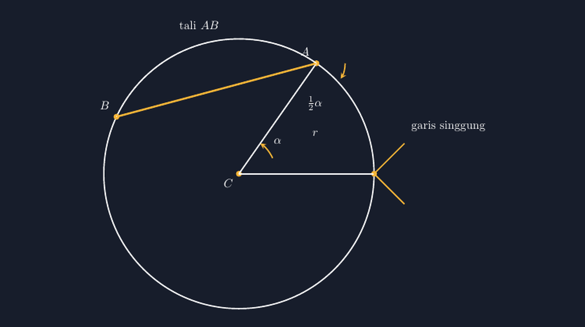

Ada satu momen di kelas VIII kemarin yang membuat saya berhenti sebentar sebelum melanjutkan papan tulis. Kami sedang membahas lingkaran: sudut pusat, sudut keliling, tali, dan garis singgung. Saya menulis di papan sebuah gambar lingkaran dengan tali $AB$ dan garis singgung yang menyentuh lingkaran di titik $A$, lalu berkata, "Sudut antara tali dan garis singgung ini, besarnya setengah sudut pusat yang menghadap busur yang sama."

Seorang anak di baris ketiga, sebut saja Raka, mengangkat tangan. "Bu, kok bisa yakin setengah? Kalau saya geser talinya, apakah tetap setengah?"

Pertanyaan itu bagus. Dan jujur saja, seperempat detik saya panik, karena jawaban yang biasa saya dengar dari buku paket adalah "ya, itu sifatnya" — seolah-olah geometri sekadar kumpulan klaim yang harus ditelan. Padahal kemampuan matematika yang paling saya ingin tumbuhkan di kelas itu justru kebiasaan untuk tidak percaya sebelum membuktikan. Artikel ini adalah cerita bagaimana kami membuktikannya bersama, dan bagaimana TikZ membantu saya menggambar bukti itu dengan jujur.

<!--more-->

## Dari mana klaim "setengah" itu berasal

Sebelum berdebat, kami sepakat dulu tentang apa yang sedang dibicarakan. Misalkan lingkaran berpusat di $C$ dengan jari-jari $r$. Tali $AB$ memotong lingkaran di dua titik. Garis singgung di titik $A$ menyentuh lingkaran tepat di satu titik. Sudut pusat $\angle ACB$ kita sebut $\alpha$.

Klaimnya begini: sudut antara tali $AB$ dan garis singgung di $A$ — sebut saja sudut $\beta$ — besarnya $\tfrac{1}{2}\alpha$.

$$\beta = \tfrac{1}{2}\alpha$$

Yang menarik, soal seperti ini sering muncul di buku latihan tanpa gambar yang meyakinkan. Anak-anak menghafal "sudut antara tali dan singgung = setengah sudut pusat" seperti menghafal jingle iklan. Ketika saya tanya ke kelas, "kalau talinya diperpendek, apakah hubungan ini tetap berlaku?", separuh kelas menjawab "iya" dengan lantang, separuhnya lagi diam. Tidak ada yang tahu kenapa.

## Bukti yang bisa diikuti kelas VIII

Untuk membuktikannya, kami hanya butuh satu fakta yang sudah mereka pegang dari pelajaran sebelumnya: jari-jari yang menghujam titik singgung itu tegak lurus garis singgung. Itu pun sesungguhnya definisi garis singgung — kalau tidak tegak lurus, garis itu akan menembus lingkaran di titik kedua dan berhenti jadi singgung.

Langkahnya ternyata pendek:

1. Segitiga $CAB$ sama kaki, karena $CA = CB = r$. Maka sudut $\angle CAB = \angle CBA$. Sebut sudut ini $\gamma$.
2. Jumlah sudut segitiga: $\alpha + 2\gamma = 180^\circ$, jadi $\gamma = 90^\circ - \tfrac{1}{2}\alpha$.
3. Jari-jari $CA$ tegak lurus garis singgung, jadi sudut antara singgung dan $CA$ adalah $90^\circ$.
4. Sudut $\beta$ yang kita cari adalah selisih $90^\circ - \gamma$:

$$\beta = 90^\circ - \left(90^\circ - \tfrac{1}{2}\alpha\right) = \tfrac{1}{2}\alpha$$

Selesai. Empat langkah, satu kesamaan segitiga kaki, satu jumlah sudut segitiga, satu definisi singgung. Ketika baris keempat itu muncul di papan, ada tepuk tangan kecil — bukan karena rumusnya hebat, tapi karena ternyata "setengah" itu bukan hukum alam yang diturunkan dari langit, melainkan konsekuensi dari tiga hal yang mereka sudah kenal.

Raka yang menimpali, "Jadi kalau talinya digeser, $\alpha$-nya yang berubah, tapi hubungan setengahnya tetap." Tepat sekali. Hubungan itu tidak peduli di mana talinya, karena buktinya tidak pernah memakai posisi khusus tali.

## TikZ supaya gambar buktinya jujur

Masalah klasik mengajar topik ini dengan gambar tangan: gambar saya di papan tidak pernah benar-benar akurat. Sudut yang saya maksud $55^\circ$ kadang terlihat seperti $70^\circ$, dan anak-anak yang kritis akan curiga apakah "setengah" itu cuma terlihat setengah di gambar saya yang asal.

Makanya untuk materi lingkaran saya mulai konsisten menggambar dengan TikZ. Gambar berikut saya buat dengan kode yang setiap koordinatnya dihitung, bukan ditaksir:


*Diagram yang kami pakai di kelas: tali $AB$ (garis kuning), jari-jari $CA$ dan $CB$, sudut pusat $\alpha$, dan garis singgung di $A$ dengan sudut $\tfrac{1}{2}\alpha$ di antara tali dan singgung.*

Inti kode TikZ-nya sebenarnya sederhana. Titik $A$ dan $B$ saya letakkan dengan koordinat polar terhadap pusat, jadi sudut pusat $\alpha$ benar-benar $55^\circ$ — bukan kira-kira:

```latex
\coordinate (C) at (0,0);
\coordinate (A) at (55:4);   % 55 derajat, jari-jari 4
\coordinate (B) at (155:4);  % selisih 90 derajat... eh, 100 derajat
\draw (A) -- (B);            % tali AB
\draw (C) -- (A) (C) -- (B); % jari-jari
```

Garis singgung di $A$ saya gambar dengan arah yang tegak lurus jari-jari $CA$. Karena $A$ berada pada sudut $55^\circ$ dari pusat, arah singgungnya otomatis $55^\circ + 90^\circ = 145^\circ$ — dan TikZ menghitungnya untuk saya, bukan saya yang menghitungnya lalu memaksa TikZ mengikuti.

Hasilnya di kelas langsung terasa. Ketika saya menanyakan "berapa kira-kira sudut $\beta$ di gambar ini?", anak-anak menaksir sekitar $50^\circ$, dan setelah dihitung $\tfrac{1}{2} \cdot 55^\circ = 27{,}5^\circ$, mereka kaget. Taksiran mereka salah bukan karena matematikanya salah, tapi karena mata manusia memang buruk menaksir sudut yang diapit dua garis miring. Justru di situlah pelajaran kedua muncul: gambar membantu intuisi, tapi bukti tetap yang berkuasa.

## Taksir dulu, hitung kemudian, bukti terakhir

Sebenarnya urutan ini adalah hal yang paling ingin saya tinggalkan di kelas VIII tahun ini. Bukan cuma untuk topik lingkaran, tapi sebagai kebiasaan:

- **Taksir dulu.** Sebelum menghitung apa pun, menebak dulu besar sudut itu melatih mata dan membuat anak peduli pada hasilnya. Kalau taksiran dan hitungan jauh, itu alarm, bukan aib.
- **Hitung dengan langkah yang bisa dipertanggungjawabkan.** Empat langkah bukti di atas semuanya dibangun dari hal yang sudah mereka miliki — tidak ada langkah ajaib "lalu dengan sifat tertentu maka...".
- **Bukti adalah yang menentukan.** Gambar, baik di papan maupun di TikZ, hanya membantu melihat. Klaim "setengah" baru berhenti jadi desas-desus setelah ada bukti.

Ada rasa lega sendiri ketika kelas sudah sampai di titik ini. Dulu saya sering merasa harus menutup semua celah — semua sifat harus saya jelaskan asal-usulnya, semua gambar harus saya buat sempurna. Sekarang saya sadar tugas saya lebih sederhana dan lebih berat sekaligus: membuat anak-anak merasa tidak pantas percaya pada klaim yang belum dibuktikan, dan memberi mereka alat untuk membuktikannya sendiri.

## TikZ di sisi guru: manfaat yang tidak terduga

Satu hal lagi yang tidak saya duga ketika mulai serius dengan TikZ untuk materi geometri: proses membuat gambarnya sendiri memaksa saya memahami materi lebih dalam. Untuk menggambar sudut antara tali dan garis singgung dengan benar, saya harus pikirkan dulu arah singgung di titik manapun pada lingkaran — dan baru saat itu saya sadar ada cara kedua membuktikan klaim tadi, lewat sudut antara dua tali yang berpotongan di titik pada lingkaran. Dua bukti untuk satu klaim, dan keduanya lahir dari kebiasaan menggambar dengan koordinat yang jujur.

Untuk rekan guru yang belum berani mencoba TikZ: tidak perlu langsung menggambar semuanya. Mulai dari satu topik yang paling sering digambar asal-asalan di papan — bagi saya lingkaran dan garis singgung adalah juaranya — lalu pelan-pelan kumpulkan filenya. Kumpulan kecil itu lama-lama jadi lemari gambar yang bisa dipakai ulang tiap tahun ajaran, dan tugas kita tinggal mengajar, bukan menggambar ulang dari nol setiap semester.

Kelas VIII kami sudah pindah ke bab berikutnya. Tapi kemarin, waktu lewat koridor, Raka manggil saya dari jauh, "Bu, kalau tali sama singgung ketemu di titik yang bukan ujung tali, gimana?" Saya hanya senyum. Pertanyaan itu akan kami bahas — dan tentu saja, dibuktikan dulu sebelum dipercaya.

> 📎 **Berkas TikZ lengkap:** [tikz-sudut-tali-singgung.tex](tex/tikz-sudut-tali-singgung.tex) — siap kompilasi (butuh paket `tikz`).
