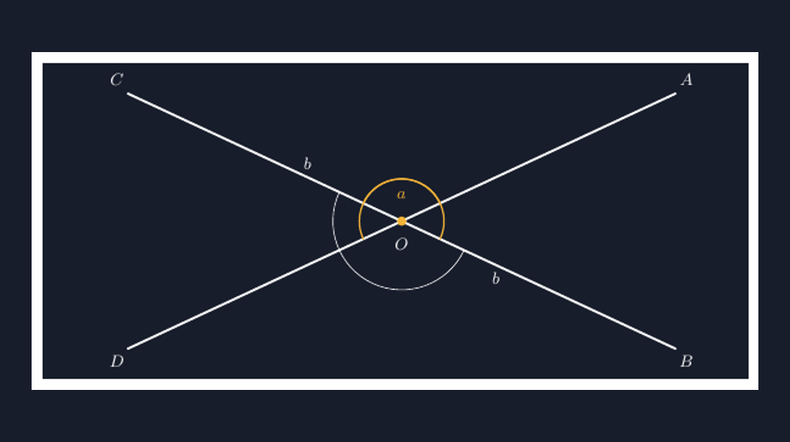

Minggu lalu, di kelas VIII.B, saya menulis dua garis berpotongan di papan tulis. Cuma dua garis silang, satu titik potong di tengah. Lalu saya tanya, "Kalau sudut di sini saya ukur 65 derajat, berapa sudut di seberangnya?" Saya tunjuk sudut kiri atas dan sudut kanan bawah. Hampir separuh kelas menjawab, "Tidak tahu, Bu, soalnya tidak ada angkanya." Ada juga yang berteriak, "Sama, Pak!" — tapi ketika saya tanya balik, "Kenapa sama?" jawabannya menjadi sunyi senyum. Jawaban "sama" itu benar, tetapi ia lahir dari hafalan, bukan dari penglihatan.

Di situ saya menyadari sesuatu yang sudah berulang berkali-kali di karier mengajar saya: siswa sering tahu *apa* jawabannya, tetapi tidak pernah diberi kesempatan melihat *kenapa*. Sudut bertolak belakang adalah contoh yang bagus. Ia terdengar seperti mantra: "sudut yang berhadapan itu sama". Mantra itu dihafalkan, dipakai di soal, dan dua tahun kemudian lenyap begitu siswa lulus SMP.

## Membuktikan dengan yang Sudah Ada

Saya tidak langsung memberi nama "sudut bertolak belakang". Saya mulai dari yang siswa sudah pegang: sudut berpelurus — dua sudut yang jumlahnya $180^\circ$ karena berdiri di atas satu garis lurus. Itu materi yang sudah lewat satu pekan sebelumnya, dan sebagian besar masih ingat.

Lalu kami menghitung bersama. Ada dua garis, $AB$ dan $CD$, berpotongan di titik $O$. Sudut $a$ di antara sinar ke $A$ dan ke $C$. Berapa sudut di antara sinar ke $C$ dan ke $B$? Karena $C$, $O$, $B$ berbaris di satu garis lurus, sudut itu adalah pelurus $a$: besarnya $180^\circ - a$. Lalu saya tanya lagi, sudut di antara sinar ke $A$ dan ke $D$? Sama juga: $180^\circ - a$.

Nah, di titik ini siswa biasanya diam sejenak. Dua sudut yang "berhadapan" itu sama-sama pelurus dari sudut yang sama. Kalau dua benda sama-sama $180^\circ - a$, mereka pasti sama satu sama lain. Tidak ada mantra. Hanya satu langkah logika yang berdiri di atas sesuatu yang sudah mereka yakini sebelumnya.


*Dua garis berpotongan di $O$. Sudut $a$ dan pasangannya (bertanda kuning) saling bertolak belakang; keduanya sama-sama pelurus dari sudut $b$, sehingga besarnya pasti sama.*

Saya suka momen itu — ketika siswa menemukan bahwa "sudut yang berhadapan sama" bukan aturan yang diturunkan dari langit, melainkan konsekuensi sederhana dari fakta bahwa satu garis lurus itu $180^\circ$. Dalam bahasa kelas saya: "Jadi kita tidak menghafal keajaiban, kita cuma meminjam yang sudah kita tahu."

## Menggambar di TikZ, Bukan Sekadar Menempel

Sekitar pekan yang sama saya sedang menyiapkan lembar kerja untuk kelas ini. Seperti biasa, saya menggambarnya dengan TikZ — kebiasaan yang sudah beberapa tahun saya jaga, dan yang rutin saya ceritakan di blog ini. Untuk sudut bertolak belakang, ada satu hal yang saya jaga ketat: arc kedua harus benar-benar di seberang, dengan jari-jari yang sama. Kalau arcnya tidak simetris, gambar itu diam-diam berbohong — siswa bisa menyangka sudut yang lebih "besar tampaknya" memang lebih besar.

Bagian inti dari gambar saya kira cukup sederhana. Titik potong $O$ jadi pusat, lalu arc digambar relatif terhadap sinar-sinar garis:

```latex
\coordinate (O) at (4.7,0);
\pic[draw=acc, thick, angle radius=8mm,
  "$a$"{acc, font=\small}] {angle=A--O--C};
\pic[draw=acc, thick, angle radius=8mm,
  "$a$"{acc, font=\small}] {angle=B--O--D};
```

Dua baris `\pic` dengan `angle radius` yang sama. Perintah `angle=A--O--C` dan `angle=B--O--D` otomatis menggambar busur dari sinar pertama ke sinar kedua mengelilingi $O$ — dan karena keduanya menghadap pasangan sinar yang berlawanan, busurnya otomatis saling bertolak belakang, persis seperti konsepnya. Ada kepuasan kecil di sini: kode yang jujur pada matematikanya. Kalau konsepnya bilang "sama", gambar yang dihasilkan kode juga sama.

Kebiasaan menggambar sendiri ini juga memaksa saya menguji diagram sebelum dibagikan ke siswa. Ada satu insiden kecil waktu menyusun lembar kerja kemarin: versi pertama gambar saya, busur kedua tidak muncul karena urutan titik pada perintah `angle` salah — TikZ diam saja dan menggambar setengah lingkaran yang salah arah. Untung saya cek hasil render dulu. Kalau itu langsung dicetak dan dibagikan, saya tidak mau membayangkan kebingungan tiga puluh anak yang mencari sudut $a$ yang tidak ada di gambar.

## Dari Gambar ke Soal, dan Ke Mana Siswa Pergi

Setelah pembuktian di papan dan gambar di lembar kerja, siswa mengerjakan soal pendek. Soal favorit saya untuk konsep ini bukan yang menanyakan "berapa sudut bertolak belakangnya" — itu terlalu langsung. Saya suka soal yang memaksa siswa memakai dua pengetahuan sekaligus: satu sudut diberikan, satu sudut lagi ditanya lewat jalur berpelurus-dulu-lalu-bertolak-belakang. Siswa yang hanya menghafal mantra akan macet; siswa yang paham strukturnya akan berpindah dari satu garis ke garis lain dengan tenang.

Ada satu hal lagi yang selalu saya perhatikan: beberapa siswa menyebut sudut bertolak belakang dan sudut berpelurus dengan terbalik. Dua istilah ini memang bersandar pada gambar yang sama — dua garis dan satu titik potong — sehingga wajar kalau tertukar. Karena itu saya biasa meminta siswa menunjuk dengan jarinya di gambar: "yang ini pelurus sama siapa? yang ini bertolak belakang sama siapa?" Menunjuk dengan tangan terasa kuno, tetapi justru di situ bahasa dan gambar bertemu, dan istilah itu menempel lebih lama daripada kalau saya cuma menuliskan definisinya di papan.

Ditambah satu soal refleksi di akhir sesi: "Kalau dua garis TIDAK berpotongan, apakah bisa ada sudut bertolak belakang?" Jawaban "tidak" itu sederhana, tetapi menyusun alasannya butuh siswa mengatakan sesuatu tentang titik potong — dan di situ saya tahu mereka benar-benar memahami konsepnya, bukan sekadar mengenal wajah gambarnya.

## Penutup: Dua Sudut, Satu Penjelasan

Sudut bertolak belakang adalah topik kecil. Lima menit di buku teks, sepuluh soal di drill, selesai. Tetapi justru karena kecilnya, ia jadi tempat yang bagus untuk melatih satu kebiasaan yang saya perjuangkan sepanjang tahun ajaran: bahwa setiap sifat geometri punya alasan yang bisa diucapkan, dan alasannya biasanya berdiri di atas sesuatu yang sudah diketahui sebelumnya.

Dua sudut yang selalu sama itu, kalau ditelusuri, sama bukan karena keajaiban — mereka sama karena sama-sama "menyisa" dari $180^\circ$ di kedua sisi yang serupa. Dan siswa yang pernah menemukan itu sendiri, saya curiga, akan membawa kebiasaan menanya-"kenapa"-nya ke konsep geometri berikutnya. Itu tujuan yang lebih penting daripada sekadar tahu bahwa sudut yang berhadapan itu sama.

> 📎 **Berkas TikZ lengkap:** [tikz-sudut-bertolak-belakang.tex](tex/tikz-sudut-bertolak-belakang.tex) — siap kompilasi (butuh paket `tikz`).
