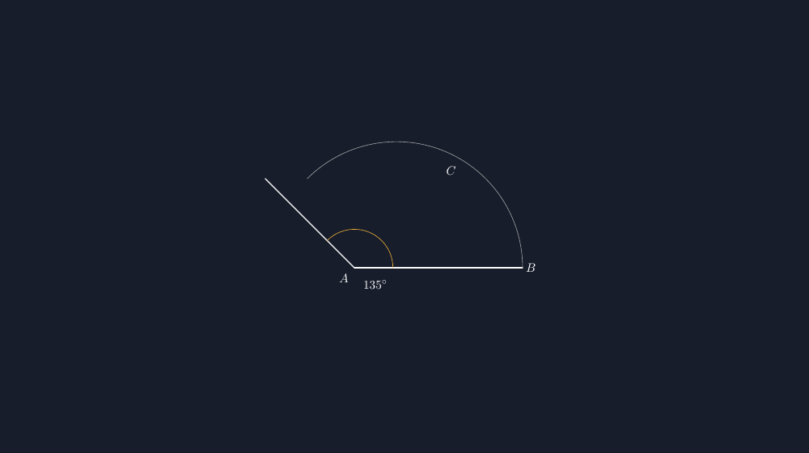

Materi sudut di kelas tujuh terlihat paling "aman" di antara semua materi. Tidak ada pecahan yang bikin servas, tidak ada variabel yang bikin bingung. Saya dulu juga begitu berpikir — sampai saya koreksi lembar kerja pengukuran sudut dan menemukan tiga puluh persen anak mengukur sudut $135^\circ$ sebagai $45^\circ$. Angkanya tidak asal; itu hasil membaca skala busur derajat dari sisi yang salah.

<!--more-->

## Busur yang Punya Dua Angka

Kalau Anda pernah memegang busur derajat, Anda tahu masalahnya: pada satu titik puncak ada dua skala yang membaca berlawanan arah. Yang satu dari kanan, yang satu dari kiri, dan keduanya bertemu di tempat yang sama. Bagi mata yang sudah terlatih, ini hal sepele. Bagi anak yang baru pertama kali memegang busur derajat pada tahun itu, dua angka pada posisi yang sama adalah jebakan yang sah — dan mereka melangkah masuk dengan percaya diri.

Tahun ini saya mencoba satu pendekatan yang berbeda. Alih-alih memulai dari busur derajat fisik, kami mulai dari sudut yang digambar, lengkap dengan busurnya sendiri. Sudut $135^\circ$ yang digambar dengan busur jelas — ditandai dari sisi mana pembacaannya dimulai — lalu dibandingkan dengan sudut $45^\circ$ di sampingnya. Dari situ anak bisa melihat bahwa sudut tumpul memang jauh lebih "terbuka" daripada lancip, buktinya ada pada busur yang panjang, bukan pada angka yang ditulis di sebelahnya.

Saya tidak berhenti di situ. Gambar-gambar itu lalu saya rapikan dengan TikZ supaya bisa dicetak di LKPD tanpa keraguan ukuran. Ini inti kode yang saya pakai:

```latex
\begin{tikzpicture}[scale=1.2]
  \coordinate (A) at (0,0);
  \coordinate (B) at (4,0);
  \coordinate (C) at (135:3);
  \draw[thick] (A) -- (B);
  \draw[thick] (A) -- (C);
  \draw[gray!70] (B) arc[start angle=0, end angle=135, radius=3];
  \pic[draw, orange, angle eccentricity=1.4, angle radius=1.1cm]
    {angle = B--A--C};
  \node at (0.5,-0.4) {$135^\circ$};
\end{tikzpicture}
```

Hasil rendernya seperti ini:



*Sudut $135^\circ$ dengan busur lengkap dan tanda arc kecil di dekat puncak — dua visual untuk satu makna.*

Dua hal yang saya jaga di kode ini. Pertama, titik $C$ diletakkan dengan koordinat kutub `(135:3)` — jarak 3 satuan pada arah $135^\circ$. Dengan begitu ukuran sudut dan posisi titik dijamin konsisten; saya tidak bisa "menggambar lancip tapi menulis tumpul" karena keduanya lahir dari angka yang sama. Kedua, saya menambahkan busur besar berwarna abu — busur yang memanjang dari satu kaki ke kaki satunya — supaya "kelebaran bukaan" sudut tumpul benar-benar terlihat, bukan hanya diklaim.

## Kapan Busur Kecil, Kapan Busur Besar

Setelah gambar-gambar pertama jadi, muncul pertanyaan yang tidak saya duga: siswa bertanya kenapa ada dua jenis tanda sudut — yang kecil di dekat puncak dan yang besar menyapu dari satu kaki ke kaki lain. Pertanyaan ini sebenarnya membuka diskusi bagus. Busur kecil dekat puncak (di kode saya pakai `\pic {angle = B--A--C}` dari library `angles`) menandai sudut itu sendiri — bagian rotasinya. Busur besar berguna untuk hal lain: membandingkan bukaan dua sudut, atau menandai rentang yang sedang kita ukur dengan busur derajat.

Saya jadi menyadari bahwa banyak LKPD sudut di pasaran hanya menuliskan angka "sudut $x = ...^\circ$" di dekat puncak, tanpa busur sama sekali. Anak menghadapi lembar soal dengan gambar sudut yang tanda-tandanya hilang — lalu kami heran kenapa mereka salah membaca busur derajat. Justru di lembar latihan pengukuran, busur harus hadir: itu tanda bahwa daerah antara dua kaki itu yang sedang diukur.

## Melatih Membaca Skala, Bukan Menghafal Angka

Ada satu variasi LKPD yang sejak itu saya pakai terus: gambar sudut yang sama dicetak dua kali, dengan busur derajat "mayu" (gambar busur derajat sederhana yang saya buat dengan TikZ juga, tanpa angka skala) di sampingnya. Tugas siswa bukan mengukur, tapi *memperkirakan* dulu — menuliskan taksiran mereka — sebelum mengukur sungguhan.

Hasilnya menarik. Banyak anak yang taksirannya jauh lebih akurat daripada hasil ukur pertama mereka. Ini memberi saya alasan untuk bicara soal kebiasaan: busur derajat dipasang dengan puncak sudut tepat di titik tengah, salah satu kaki menunjuk $0^\circ$, lalu dibaca skala yang bergerak menuju kaki satunya. Tiga langkah itu sering diabaikan karena terasa jelas — padahal justru langkah kedua yang menentukan skala mana yang boleh dibaca. Anak yang terbiasa menanyakan "dari $0$ mana?" sebelum membaca angka, jarang lagi tertukar $45$ dan $135$.

## Kejujuran Gambar

Satu hal lagi yang saya pelajari dari beralih ke TikZ: gambar soal matematika punya tanggung jawab yang sering diremehkan. Gambar sudut yang terlihat lancip tapi keterangan katanya tumpul akan mengacaukan intuisi anak — mereka jadi dilatih untuk tidak percaya pada gambar, padahal gambar justru salah satu pintu masuk intuisi terpenting di geometri. Dengan koordinat kutub, gambar dan angka lahir dari sumber yang sama. Gambar tidak bisa bohong terhadap keterangannya.

Rekan guru yang ingin mencoba: pustaka `angles` perlu dimuat dengan `\usetikzlibrary{angles, quotes}` di bagian pembuka dokumen. Tanpa itu, `\pic {angle = ...}` tidak dikenal dan kesalahannya sedikit samar di log — pernah membuat saya menggelembung dulu sebelum sadar pustakanya belum dimuat.

> 📎 **Berkas TikZ lengkap:** [tikz-sudut-busur-derajat.tex](tex/tikz-sudut-busur-derajat.tex) — siap kompilasi (butuh paket `tikz`).

## Penutup: Angka yang Bisa Dilihat

Sudut adalah salah satu materi pertama di mana anak diminta memercayai alat ukur lebih daripada mata mereka. Busur derajat itu sendiri bukan hal yang rumit — yang rumit adalah kebiasaan membacanya. Dengan menggambar sudut yang jujur, lengkap dengan busur dan tanda yang jelas dari sisi mana skala dimulai, saya memberi anak gambar yang bisa mereka percaya dulu, sebelum mereka dipaksa percaya pada alat di tangan mereka.

Dan seperti biasa di blog ini: gambar yang baik bukan hiasan. Ia adalah argumen. Sudut $135^\circ$ yang busurnya panjang dan terlihat "terbuka lebar" berbicara lebih lantang daripada kalimat penjelas apa pun yang bisa saya tulis di papan.
