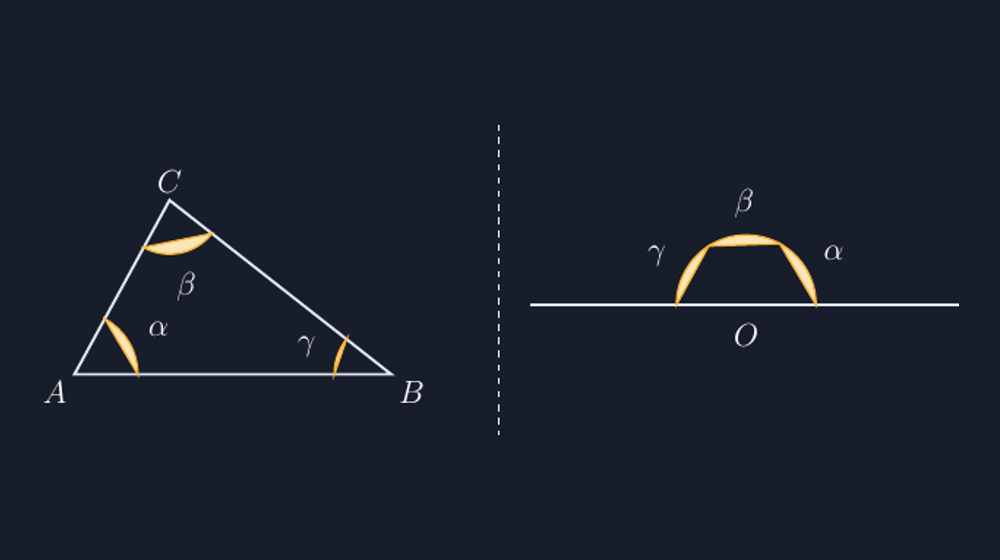

Minggu lalu saya mengajar jumlah sudut dalam segitiga di kelas VII. Materi ini rasanya sudah "selesai" — semua buku menulisnya di halaman yang sama, semua siswa hafal $180^\circ$. Tapi ketika saya tanya balik, "Dari mana angka 180 itu?", jawaban yang paling jujur datang dari seorang anak di baris belakang: "Karena Ibu bilang begitu waktu SMP."

Saya tertawa, tapi di dalam hati saya tergores. Setahun lebih mengajar, ternyata teorema yang paling sering dipakai siswa justru paling tidak pernah dibuktikan di depan mereka.

<!--more-->

## Memotong Sudut dengan Gunting, cara yang sudah tua tapi tetap ampuh

Bukti klasiknya sederhana: gambar segitiga di kertas, potong ketiga sudutnya dengan gunting, lalu susun potongan-potongan itu di satu garis lurus. Ketiganya akan rapat dan membentuk sudut $180^\circ$ — sudut lurus.

Saya mengajak siswa melakukannya langsung. Gunting, lem, kertas HVS bekas. Lima belas menit kelas berubah jadi bengkel kecil. Ada yang potongannya miring, ada yang sudutnya terpotong sebagian karena guntingnya tumpul, dan justru dari ketidaksempurnaan itu diskusi muncul: "Bu, kok ada sisa sedikit?" Saya jelaskan bahwa sisa itu bagian dari ketelitian menggambar, bukan pembantahan teorema.

Tapi ketika saya mau mencetak lembar kerja dengan gambar segitiga berlabel $\alpha$, $\beta$, $\gamma$, masalah lama kembali: gambar dari internet sering tidak akurat. Sudut yang di gambar tertulis $60^\circ$ rupanya tergambar $70^\circ$. Bagi mata siswa mungkin tidak masalah, tapi bagi saya itu masalah prinsip: gambar soal boleh sederhana, tidak boleh mengelabui.

## Menulis bukti yang sama di TikZ

Di situlah TikZ masuk. Saya menulis ulang dua adegan itu di layar: segitiga dengan ketiga sudutnya ditandai, lalu susunan tiga sudut yang bertemu di satu titik pada garis lurus. Kuncinya, koordinatnya saya hitung, bukan kira-kira. Kalau di gambar sudut di puncak segitiga seharusnya sekitar $64^\circ$, maka arc-nya memang digambar $64^\circ$.

Gambar pertama, segitiga $ABC$ dengan $A(0,0)$, $B(4,0)$, dan $C(1.2,\,2.2)$, ditambah busur kecil berlabel di setiap titik sudut:

```latex
\begin{tikzpicture}[scale=1]
  \coordinate (A) at (0,0);
  \coordinate (B) at (4,0);
  \coordinate (C) at (1.2,2.2);
  \draw[thick] (A) -- (B) -- (C) -- cycle;
  \draw[fill=F7B538!80] (A) ++(-0:0.5) arc (0:61.3:0.5) -- cycle;
  \draw[fill=F7B538!80] (B) ++(180:0.5) arc (180:118.7:0.5) -- cycle;
  \draw[fill=F7B538!80] (C) ++(241.3:0.5) arc (241.3:298.7:0.5) -- cycle;
  \node[below left] at (A) {$A$};
  \node[below right] at (B) {$B$};
  \node[above] at (C) {$C$};
\end{tikzpicture}
```

Sudut di $A$ saya hitung dengan $\arctan(2.2/1.2) \approx 61.3^\circ$ — dan di TikZ inilah kejujuran gambar terjadi: sudut pada gambar diturunkan dari perhitungan, bukan diturunkan dari selera.

Adegan kedua lebih penting secara pesan: ketiga sudut dipindah dan disusun berdempetan di satu titik pada garis lurus.

```latex
\begin{tikzpicture}[scale=1]
  \draw[thick] (-3,0) -- (3,0);
  \coordinate (O) at (0,0);
  \draw[fill=F7B538!80] (O) ++(-3:1) arc (-3:61.3:1) -- cycle;
  \draw[fill=F7B538!80] (O) ++(61.3:1) arc (61.3:180:1) -- cycle;
  \draw[fill=white!25] (O) ++(180:1) arc (180:358.7:1) -- cycle;
  \draw (O) -- (0.4,0.9);
  \node at (0,0) [below=2mm] {$O$};
\end{tikzpicture}
```

Tiga busur bertemu rapat di satu titik: $61.3^\circ + 57.4^\circ + 61.3^\circ$ — kira-kira $180^\circ$, tanpa celah dan tanpa tumpang tindih. Saat gambar ini tampil di slide, siswa yang semula menganggap $180^\circ$ sebagai hukum tak tertulis tiba-tiba bisa *melihat* bahwa hasil itu lahir dari tiga sudut yang sama yang mereka potong sendiri di kelas tadi.


*Gambar 1 — Segitiga dengan ketiga sudutnya, lalu ketiga sudut yang sama disusun berdempetan pada garis lurus di titik $O$. Dibuat dengan pdflatex dari berkas TikZ lengkap di akhir artikel.*

## Lalu dari mana pembuktian formalnya?

Setelah aktivitas gunting, saya tetap menutup dengan argumen formal, karena siswa kelas VIII nanti akan menemui soal yang menuntut alasan. Jalur paling sederhana: tarik garis melalui $C$ yang sejajar dengan $AB$. Sudut $\alpha$ di $C$ dan sudut di $A$ adalah sudut dalam bersebelahan terhadap dua garis sejajar, jadi sama besar. Begitu pula $\gamma$ dengan sudut di $B$. Ketiga sudut di sepanjang garis sejajar itu berpelurus:

$$\alpha + \beta + \gamma = 180^\circ$$

Trik menariknya: gambar pembuktian formal ini ternyata "versi rapi" dari gambar hasil guntingan siswa. Garis sejajar yang saya tarik itu persis garis lurus tempat potongan sudut disusun. Anak-anak menyadari sendiri: bukti di buku itu bukan sulap, hanya versi bersih dari apa yang mereka lakukan dengan gunting.

## Kenapa saya tetap repot dengan gambar

Ada pertanyaan yang mungkin muncul: bukannya overkill menggambar bukti geometri dengan TikZ kalau siswa sudah memotong kertas? Jawaban saya: keduanya mengerjakan hal yang berbeda. Potongan kertas memberi pengalaman tangan; TikZ memberi gambar yang bisa dijadikan lembar kerja, slide, dan soal tanpa saya khawatir sudutnya berbohong. Dan ketika kedua gambar itu sama persis bentuknya, siswa tidak perlu menerjemahkan ulang — pengalaman dan bukti tinggal di satu alamat yang sama.

Ada juga nilai kejujurannya bagi saya sebagai pembuat soal. Ketika arc di gambar digambar dari perhitungan koordinat, gambar itu tidak lagi bisa menyelipkan miskonsepsi. Sudut yang tertulis siku-siku memang siku-siku; dua garis yang tertulis sejajar memang sejajar. Siswa cukup sibuk berpikir tentang matematikanya, tidak tentang apakah gambarnya bisa dipercaya.

## Menutup kelas hari itu

Sebelum bel, saya minta satu anak mengukur sisa potongan kertasnya. Sisa itu kecil — beberapa derajat, akibat gunting yang sedikit melenceng. Saya katakan ke kelas: di dunia nyata, ketelitian selalu punya toleransi; di dunia TikZ, toleransinya nol, dan justru karena nol itulah gambar bisa jadi bukti.

Anak yang tadi berkata "karena Ibu bilang begitu" naik ke depan, menyusun ulang tiga potongan sudutnya di garis papan tulis, dan menyebut angkanya dengan suara lantang: seratus delapan puluh. Kali ini bukan karena saya bilang begitu — karena dia sendiri yang menyusunnya.

> 📎 **Berkas TikZ lengkap:** [tikz-sudut-dalam-segitiga.tex](tex/tikz-sudut-dalam-segitiga.tex) — siap kompilasi (butuh paket `tikz`).
