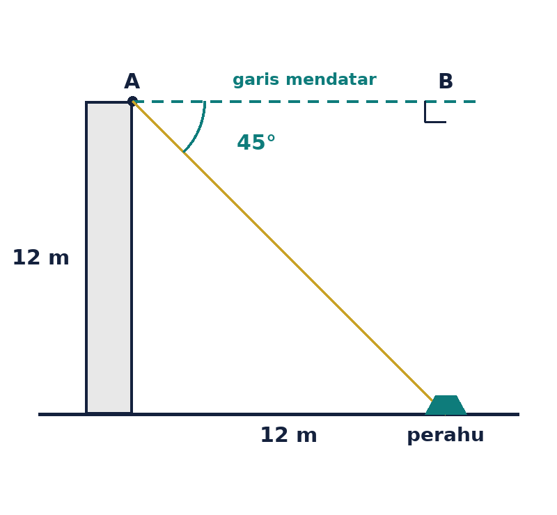
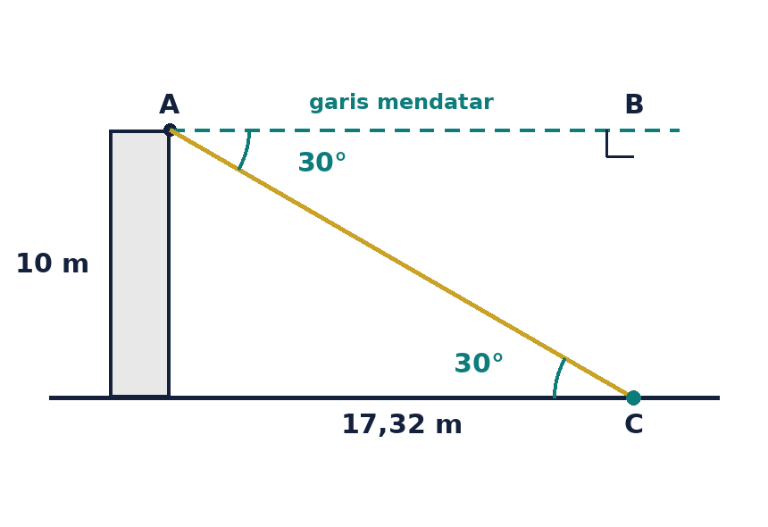

Beberapa minggu lalu saya berdiri di jendela lantai dua sekolah bersama murid kelas IX. Di bawah, seorang murid berjalan menuju gerbang. "Pak, kalau kita dari atas melihat ke bawah, itu ada sudutnya juga, ya?" tanya salah satu dari mereka. Saya tersenyum. Tanpa sadar, ia baru saja menemukan sudut depresi — sudut yang dibentuk garis mendatar dari mata pengamat dan garis pandang ke benda yang berada di bawahnya.

Di artikel sudut elevasi saya pernah menggambar orang yang mendongak ke puncak menara. Sudut depresi adalah kebalikannya: pengamatnya di atas, bendanya di bawah. Gambarnya pun mirip, hanya dibalik — dan justru di situlah murid sering keliru. Mereka tahu sudutnya ada, tetapi tidak tahu di titik mana ia diukur dan dari garis mana ia dimulai.


*Gambar 1. Sudut depresi $45^\circ$ dari puncak menara setinggi 12 m ke sebuah perahu — jarak menara ke perahu sama dengan tingginya, 12 m.*

<!--more-->

## Apa Itu Sudut Depresi

Sudut depresi diukur dari garis mendatar yang ditarik dari mata pengamat, lalu diputar ke bawah sampai bertemu garis pandang ke benda. Dua kata kuncinya: mendatar dan ke bawah. Garis mendatarnya harus benar-benar mendatar — sejajar dengan tanah — bukan garis yang ditarik sembarang dari mata pengamat. Dan arah putarnya ke bawah, karena bendanya memang berada di bawah pengamat.

Pada Gambar 1, saya berdiri di puncak menara setinggi 12 meter dan melihat sebuah perahu di permukaan air. Garis mendatar saya tarik dari puncak menara ke kanan, garis pandang saya tarik dari puncak menara ke perahu, dan sudut di antara keduanya adalah sudut depresinya: $45^\circ$.

Segitiga yang terbentuk adalah segitiga siku-siku: sudut siku-sikunya ada di titik B, tempat garis mendatar bertemu garis tegak di atas perahu. Dari situ jarak menara ke perahu bisa dihitung: $\tan 45^\circ = \frac{12}{x}$, dan karena $\tan 45^\circ = 1$, maka $x = 12$ meter. Jaraknya sama dengan tingginya — ciri khas sudut $45^\circ$ yang selalu enak dipakai sebagai contoh pertama.

## Menggambarnya dengan TikZ: Menara, Garis Putus-Putus, dan Satu Busur

Saya mulai dari tanah dan menaranya, lalu garis mendatarnya. Garis mendatar ini saya gambar putus-putus dan berwarna teal, supaya jelas bahwa garisnya khayalan: tidak ada garis sungguhan di udara dari puncak menara ke kanan, ia hanya acuan untuk mengukur sudut.

```latex
% Tanah dan menara 12 m (A di puncak, (0,3))
\draw[navy, very thick] (-0.9,0) -- (3.7,0);
\draw[fill=abu, draw=navy, very thick] (-0.45,0) rectangle (0,3);
\node[anchor=east, font=\small\bfseries, navy] at (-0.6,1.5) {12 m};
% Garis mendatar (khayalan) dari A ke B = (3,3)
\draw[teal, thick, dashed] (0,3) -- (3.3,3);
\node[anchor=south, font=\small, teal] at (1.65,3.12) {garis mendatar};
```

Lalu garis pandang dan busur sudutnya. Busur digambar dari sudut $-45^\circ$ sampai $0^\circ$ — sudut negatif karena arahnya ke bawah dari garis mendatar. Perahu saya gambar sebagai trapesium kecil di titik C, dan tanda siku-siku saya letakkan di B.

```latex
% Garis pandang dari A ke perahu C = (3,0)
\draw[emas, very thick] (0,3) -- (3,0);
% Busur sudut depresi di A: dari -45 derajat sampai 0 derajat
\draw[teal, very thick] (0,3) ++(-45:0.7) arc (-45:0);
\node[anchor=west, font=\small\bfseries, teal] at (1.0,2.6) {$45^\circ$};
% Tanda siku-siku di B
\draw[navy, thick] (2.8,3) -- (2.8,2.8) -- (3,2.8);
```

Satu hal yang saya tekankan ke murid: busur sudut depresi selalu menempel di titik pengamat, bukan di titik benda. Kalau busurnya pindah ke perahu, itu sudah bukan sudut depresi lagi.

## Sudut Depresi Sama dengan Sudut Elevasi

Gambar 2 menunjukkan hal yang membuat sudut depresi terasa seperti sulap: sudut depresi dari pengamat sama besar dengan sudut elevasi dari benda yang diamati. Alasannya sederhana dan bisa dilihat langsung dari gambarnya — kedua sudut itu membentuk pola huruf Z.


*Gambar 2. Menara 10 m, sudut depresi $30^\circ$, jarak $17{,}32$ m — sudut depresi di A sama besar dengan sudut elevasi di C, karena keduanya sudut dalam berseberangan.*

Garis mendatar dari mata pengamat sejajar dengan tanah. Garis pandang memotong kedua garis sejajar itu, sehingga sudut depresi di atas dan sudut elevasi di bawah menjadi sudut dalam berseberangan — dan sudut dalam berseberangan selalu sama besar. Itulah mengapa pada Gambar 2 kedua busurnya sama-sama bertuliskan $30^\circ$.

Hitungannya pun konsisten. Dengan tinggi 10 meter dan sudut $30^\circ$, jaraknya adalah $x = \frac{10}{\tan 30^\circ} = 10\sqrt{3} \approx 17{,}32$ meter. Kalau dihitung dari bawah, dari sudut elevasi yang sama, hasilnya tetap $17{,}32$ meter — karena segitiganya sama, hanya dilihat dari arah yang berlawanan.

## Tiga Kesalahan yang Sering Saya Lihat

Pertama, mengukur dari garis tegak. Murid menggambar busur antara garis pandang dan dinding menara, lalu menyebut itulah sudut depresinya. Pada Gambar 2, sudut antara garis pandang dan dinding menara adalah $60^\circ$ — komplemen dari $30^\circ$. Kalau ia memakai $60^\circ$ sebagai sudut depresi, jarak yang ia hitung menjadi $\frac{10}{\tan 60^\circ} \approx 5{,}77$ meter — hampir tiga kali lebih dekat dari jarak sebenarnya. Ingat: acuan sudut depresi selalu garis mendatar, bukan garis tegak.

Kedua, meletakkan sudut di titik yang salah. Sudut depresi selalu diukur di mata pengamat, di titik atas. Murid yang meletakkan busur di titik benda — di perahu — sebenarnya sedang menggambar sudut elevasi, bukan sudut depresi. Nilainya memang sama, seperti pada Gambar 2, tetapi namanya tertukar — dan pada soal yang menanyakan keduanya, jawaban yang tertukar tetap salah.

Ketiga, membalik rumus tangen. Jarak dihitung sebagai tinggi dikali tangen sudut, padahal yang benar adalah tinggi dibagi tangen sudut. Pada Gambar 2: $10 \times \tan 30^\circ \approx 5{,}77$ meter, padahal jarak sebenarnya $17{,}32$ meter. Cara cepat memeriksanya: tangen sudut kecil menghasilkan jarak yang besar — masuk akal, karena makin kecil sudutnya, makin jauh bendanya.

Soal untuk dicoba: sebuah mercusuar setinggi 20 meter. Dari puncaknya, sudut depresi ke sebuah perahu adalah $30^\circ$. Berapa jarak perahu ke kaki mercusuar? Jawabannya $20\sqrt{3} \approx 34{,}64$ meter. Dan kalau sudut depresinya $45^\circ$ dari jendela setinggi 15 meter, jaraknya tepat 15 meter — sama dengan tingginya.

Kalau Bapak dan Ibu mengajar trigonometri minggu ini, coba mulai dari jendela kelas, bukan dari rumus. Biarkan murid melihat ke bawah dulu, baru menggambar sudutnya.

> 📎 **Berkas TikZ lengkap:** [sudut-depresi.tex](tex/sudut-depresi.tex) — dokumen siap kompilasi (butuh paket `tikz`). Silakan ganti angka-angkanya untuk dokumen Anda sendiri.
