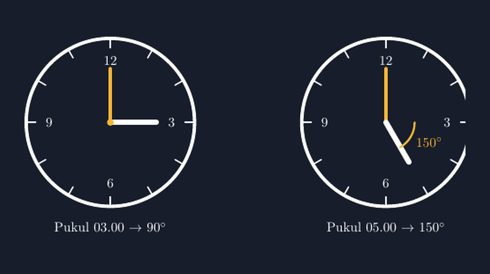

Ada satu benda di kelas saya yang sudah bertahun-tahun tergantung di depan, tepat di atas papan tulis, tapi baru musim ini saya "temukan" sebagai alat peraga: jam dinding analog. Jam biasa. Yang jarumnya berdetak dan kadang baterainya mati tanpa saya sadari.

Awalnya hanya karena kebetulan. Kami sedang membahas pengukuran sudut di kelas VII, dan seorang siswa — selanjutnya saya sebut Rafi — mengangkat tangan dan bertanya, "Pak, kalau sudutnya diukur dari jam, busur derajatnya mana?" Pertanyaan itu membuat saya terdiam sejenak. Iya juga. Kami sedang sibuk mengukur sudut di kertas bercorak, padahal di atas kepala kami ada sudut yang bergerak tiap detik.

Sejak hari itu, jam dinding kelas saya punya pekerjaan tambahan.

<!--more-->

## Berapa Derajat Jarum Jam Pukul Tiga?

Materinya sebenarnya sederhana. Jam analog dibagi dua belas bagian sama besar oleh angka-angkanya. Satu putaran penuh adalah $360^\circ$, jadi jarak antara dua angka berurutan adalah:

$$360^\circ : 12 = 30^\circ$$

Pukul 03.00 tepat, jarum jam menunjuk angka 3 dan jarum menit menunjuk angka 12. Sudut di antara keduanya adalah $3 \times 30^\circ = 90^\circ$. Siku-siku murni, dan siswa bisa melihatnya langsung tanpa alat apa pun.

Pertanyaan berikutnya yang biasa saya lempar: pukul 05.00 berapa derajat? Di sinilah biasanya kelas terbelah. Sebagian menjawab $150^\circ$ karena menghitung lima kali tiga puluh. Sebagian lagi ragu, karena mata mereka melihat sudut yang "kecil" di antara kedua jarum — yang sebenarnya adalah sudut refleks $210^\circ$ di sisi lain. Justru keraguan ini yang saya cari: momen ketika siswa menyadari bahwa satu pasangan jarum jam selalu membentuk dua sudut yang jumlahnya $360^\circ$.



Gambar di atas saya buat dengan TikZ, dan saya sengaja menampilkan dua jam berdampingan supaya kontras antara $90^\circ$ dan $150^\circ$ terlihat — perbedaan 60 derajat yang di papan tulis sering hanya jadi angka, tapi di gambar terasa sebagai "jarum yang miring lebih jauh".

## Kenapa Jam Jadi Bahan Soal yang Kaya

Setelah Rafi bertanya, saya mulai mencatat segala hal yang bisa digali dari jam analog, dan daftarnya panjang:

- Pukul berapakah kedua jarum membentuk sudut siku-siku? (Jawaban klasik: 03.00 dan 09.00 — lalu saya tantang, selain itu ada tidak? Ada, tapi tidak pukul bulat, dan itu cerita untuk pertemuan berikutnya.)
- Pukul 06.00 membentuk garis lurus $180^\circ$. Berapa banyak kali dalam sehari kejadian ini terjadi?
- Kalau pukul 05.00 sudutnya $150^\circ$, berapa derajatkah tiap menit yang dilalui jarum jam? Sebuah jam menempuh $30^\circ$ per jam, jadi $0{,}5^\circ$ per menit.

Poin terakhir inilah pintu masuk ke soal yang lebih menantang: sudut pada pukul yang menitnya tidak nol. Pukul 02.30 misalnya, jarum jam sudah tidak lagi tepat di angka 2, melainkan setengah jalan menuju angka 3. Siswa yang terbiasa menganggap "jarum jam menunjuk angka" akan mengalami gesekan konseptual pertamanya di sini. Dan gesekan seperti itu, bagi saya, tanda bahwa mereka mulai berpikir sungguh-sungguh.

Saya tidak berpikir semua ini kalau tidak karena satu pertanyaan spontan di kelas. Materi pengukuran sudut di buku biasanya berhenti pada busur derajat dan gambar segitiga. Padahal konteks yang hidup di ruangan itu sendiri jauh lebih mudah diingat siswa.

## Menggambar Jam dengan TikZ

Untuk bahan tayang, saya gambar jam tersebut dengan TikZ. Ide dasarnya: lingkaran untuk rangka, `foreach` untuk tanda-tanda menit dan angka, lalu dua garis untuk jarum. Yang penting di sini adalah konsistensi sudut — TikZ mengukur sudut dari sumbu horizontal positif berlawanan arah jarum jam, sedangkan jam analog kita "menghitung" searah jarum jam dari angka 12. Penerjemahannya: angka 12 berada pada $90^\circ$, angka 3 pada $0^\circ$, angka 6 pada $270^\circ$ (atau $-90^\circ$), dan seterusnya.

Potongan inti kode TikZ-nya begini:

```latex
% jarum menit di angka 12, jarum jam di angka 3 (pukul 03.00)
\draw[ak, line width=3pt] (0,0) -- (90:1.4);
\draw[white, line width=4pt] (0,0) -- (0:1.2);
```

Dan untuk jam kedua, jarum jam di angka 5:

```latex
\draw[white, line width=4pt] (0,0) -- (-60:1.2);   % angka 5 = -60 derajat
\draw[ak, line width=1.5pt] (0.75,0) arc[start angle=0, end angle=-60, radius=0.75];
```

Saya suka bagian busur (`arc`) ini. Busur kecil berwarna aksen itulah yang menandai sudut yang sedang dibicarakan — persis seperti busur yang siswa gambar di buku kerja, hanya di sini dia rapi dan selalu tepat di antara kedua jarum. Ketika saya tayangkan slide ini di kelas, ada siswa yang langsung menyamakan "busur kuning di layar" dengan "busur pensil di kertasnya". Koneksi seperti itu tidak bisa saya beli dengan soal cetak.

Satu hal yang saya pelajari dari menggambar jam: gambar media harus jujur pada materi. Kalau saya bermaksud membahas pukul 05.00, tapi jarum jam saya gambar asal miring ke arah "kira-kira lima", sudutnya tidak akan pas $150^\circ$ dan gambar justru mengajarkan hal yang salah. Dengan TikZ, koordinat $(0,0) -- (-60:1.2)$ adalah pernyataan matematis, bukan kira-kira. Angka 5 memang tepat $60^\circ$ di bawah sumbu horizontal, dan gambar tidak berbohong.

> 📎 **Berkas TikZ lengkap:** [tikz-sudut-jarum-jam.tex](tex/tikz-sudut-jarum-jam.tex) — siap kompilasi (butuh paket `tikz`).

## Di Kelas, Jam Itu Sendiri yang Bicara Duluan

Yang menarik, setelah rangkaian ini, jam dinding kelas saya tidak pernah "diam" lagi dalam arti matematis. Saya jadi punya rutinitas lima detik: sebelum pelajaran dimulai, lempar satu pertanyaan jam. "Pukul 07.20, kira-kira berapa derajat sudut kedua jarumnya?" Tidak ada nilai, tidak ada tekanan. Hanya siswa yang menoleh ke atas sambil menghitung dalam hati, dan kadang ada yang mengangkat tangan sambil senyum karena tahu jawabannya tidak bulat.

Kadang saya refleksikan: berapa banyak alat peraga yang sudah saya beli, padahal sudut $150^\circ$ sudah tergantung di dinding sejak tahun lalu? Bukan berarti media mahal itu tidak berguna — saya sendiri membangun aplikasi untuk kelas saya. Tapi ada kepuasan tersendiri ketika materi muncul dari benda yang setiap hari ada di depan mata siswa, dan teknologi (TikZ, slide, kuis interaktif) berperan sebagai penerjemah yang membuat benda itu bisa dibawa ke mana-mana dalam bentuk yang presisi.

Rafi, anak yang bertanya di awal cerita ini, sekarang hobi memberi saya teka-teki jam. Minggu lalu dia bertanya, "Pak, pukul berapa jarum jam dan jarum menit bertumpuk tepat?" Saya tidak menjawab langsung. Saya bilang, "Coba kamu pikirkan, kalau ketemu saya kasih tahu kok." Dia masih menyimpan pertanyaan itu sampai sekarang. Dan jujur saja, saya juga menghitung ulang di rumah — guru punya izin untuk tidak langsung tahu, kan?

Satu jam dinding, satu pertanyaan siswa, dan sekarang satu file TikZ di folder bahan ajar saya. Kelas memang selalu punya cara mengejutkan guru yang mau mendengarkan.
+++
