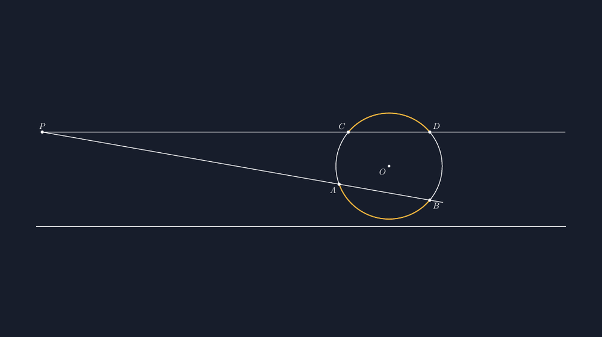

Ketika materi lingkaran tiba di kelas VIII, ada satu momen yang selalu saya tunggu: hari ketika siswa bertanya, "Pak, kalau puncak sudutnya bukan di dalam lingkaran, gimana?" Pertanyaan itu muncul setahun lalu dari seorang siswa yang sedang menggambar tali busur di bukunya — garisnya luput keluar lingkaran, lalu dia memperpanjang sampai dua garis itu bertemu di luar. Dia menatap gambarnya, mengangkat tangan, dan melontarkan pertanyaan yang sebenarnya sudah menunggu di ujung materi itu sejak awal.

<!--more-->

## Ketika rumus lama menemui batasnya

Sebelum hari itu, kami sudah cukup lama bermain dengan sudut keliling: sudut yang puncaknya berada *pada* lingkaran, besarnya setengah sudut pusat yang menghadap busur yang sama. Siswa kami juga sudah akrab dengan sudut pusat. Jadi ketika gambar si anak itu memperlihatkan dua garis yang berpotongan di luar lingkaran — masing-masing menembus lingkaran dua kali — kelas menjadi diam sesaat, karena puncak sudutnya kini berada di tempat yang tidak pernah kami bahas: *di luar* lingkaran.

Dua garis yang menembus lingkaran seperti itu disebut **sekanten**. Sudut yang terbentuk di titik potongnya di luar lingkaran — sebut saja titiknya $P$ — tidak lagi dihitung dengan setengah busur yang dihadapinya. Coba saja: kalau kita memaksa rumus sudut keliling ke gambar itu, hasilnya tidak cocok dengan pengukuran busur derajat di kertas. Saya sengaja membiarkan beberapa siswa mencoba dan gagal, karena kegagalan kecil di kertas itu justru membuat mereka siap menerima rumus yang baru.

Rumus yang benar terdengar hampir seperti lelucon: sudut antara dua sekanten sama dengan **setengah selisih** dua busur yang dipotong oleh kedua garis itu. Jika sekanten yang satu memotong lingkaran di $A$ dan $B$ (busur terdekat), dan sekanten yang lain di $C$ dan $D$ (busur terjauh), maka

$$\angle DPA = \tfrac{1}{2}\left(\widehat{CD} - \widehat{AB}\right)$$

Yang menarik, busur yang "dipilih" selalu dua busur yang *terkurung di antara* kedua sisi sudut: satu dekat dengan puncak, satu jauh di seberang. Selisih itulah yang dibagi dua.


*Puncak $P$ di luar lingkaran: $\angle DPA = \frac{1}{2}(\widehat{CD}-\widehat{AB})$ — setengah selisih busur dalam yang diapit kedua sisi sudut.*

## Kenapa "selisih", bukan "jumlah"?

Siswa yang teliti biasanya langsung curiga. "Kalau yang di dalam tadi jumlahnya dibagi dua, kenapa yang di luar malah selisihnya?" Pertanyaan bagus itu layak kami bedah bersama, dan cara paling sederhana yang saya pakai di kelas adalah dengan melihat sudut luar dan sudut dalam pada segitiga.

Ambil titik bantu $Q$ di lingkaran, pada busur dekat — misalnya di seberang $P$. Segitiga $PQC$ (dengan $Q$ di lingkaran dan garis $QC$ terbentang) memiliki sudut luar di $Q$. Sudut luar segitiga, seperti sudah kami pelajari di bab sebelumnya, sama dengan jumlah dua sudut dalam yang tidak berdekatan dengannya. Dua sudut dalam itu ternyata keduanya adalah sudut keliling: yang satu menghadap busur $CD$, yang lain menghadap busur $AB$. Maka:

$$\angle DPA = \angle QCD - \angle CQA = \tfrac{1}{2}\widehat{CD} - \tfrac{1}{2}\widehat{AB} = \tfrac{1}{2}\left(\widehat{CD} - \widehat{AB}\right)$$

Ketika garis penghubung itu kusemut di papan, ada yang berseru kecil, "Oh, jadi dia cuma sudut luar segitiga yang di-dressing." Dan memang begitu. Rumus yang tampak baru ternyata hanya sudut luar segitiga yang mengenakan jubah lingkaran. Momen seperti ini yang membuat saya percaya bahwa geometri sekolah tidak diberikan sebagai hafalan, melainkan sebagai cerita yang saling bersambung.

## Karena itu juga sebuah tantangan menggambar

Di titik inilah kebiasaan lama saya menohok lagi: tahun-tahun awal mengajar, saya menggambar situasi ini bebas di papan. Lingkarannya dulu, lalu dua garis yang entah bagaimana sudutnya — dan hampir selalu angka-angka yang saya tulis di busur tidak konsisten dengan gambar. Siswa yang mengukur busur derajatnya akan menemukan $\widehat{CD} = 120°$ di gambar saya padahal tulisannya $100°$, dan selisih-bagi-dua itu tidak cocok dengan sudut di $P$ yang kelihatan jelas tidak sama. Gambar yang berbohong adalah gambar yang merusak kepercayaan murid terhadap matematika itu sendiri.

Maka untuk lembar kerja dan slide, saya menggambar ulang situasinya dengan TikZ. Konsepnya sederhana: lingkaran berpusat $O$, empat titik potong diletakkan pada sudut polar yang saya pilih dengan sengaja — $C$ di $140°$, $D$ di $40°$, $A$ di $200°$, dan $B$ di $320°$ — sehingga busur $\widehat{CD} = 100°$ dan busur $\widehat{AB} = 120°$, dan sudut di puncak otomatis menjadi $\frac{1}{2}(120°-100°) = 10°$.

```latex
\coordinate (A) at (200:2);
\coordinate (B) at (320:2);
\coordinate (C) at (140:2);
\coordinate (D) at (40:2);
\coordinate (P) at (intersection of A--B and C--D);
\draw[very thick, goldenrod]
  (A) arc[start angle=200, end angle=320, radius=2];
\draw[very thick, goldenrod]
  (D) arc[start angle=40, end angle=140, radius=2];
```

Tiga hal yang saya pelajari dari gambar semacam ini:

Pertama, **puncak $P$ tidak perlu saya tentukan manual**. Perintah `intersection of A--B and C--D` di TikZ menghitung perpotongan kedua sekanten untuk saya, dan gambar langsung jujur: sejauh apa pun titik-titik lingkaran digeser, $P$ selalu tepat di titik potongnya. Kedua, dua busur yang diapit sudut saya sorot dengan warna kuning (aksen `goldenrod`), supaya siswa langsung melihat *busur mana dua itu* sebelum saya menyebut kata "selisih". Ketiga, angka-angkanya bisa saya pilih supaya hasilnya bulat dan mudah: $120°-100°=20°$, dibagi dua jadi $10°$. Gambar dan hitungan saling menopang, bukan saling membantah.

## Bandingkan dengan yang puncaknya di dalam

Sesi kelas itu baru terasa lengkap ketika kami menaruh dua gambar berdampingan: sudut yang puncaknya di luar lingkaran, dan sudut yang puncaknya di dalam (dua tali busur yang berpotongan). Keduanya punya puncak di tempat "aneh", tapi rumusnya berbeda arah:

$$\angle CQB = \tfrac{1}{2}\left(\widehat{AB} + \widehat{CD}\right) \qquad\text{(puncak di dalam: jumlah)}$$
$$\angle DPA = \tfrac{1}{2}\left(\widehat{CD} - \widehat{AB}\right) \qquad\text{(puncak di luar: selisih)}$$

Seorang siswa menemukan sendiri cara mengingatnya: "Kalau puncaknya di dalam, dia memegang dua busur sekaligus, jadi dijumlah. Kalau di luar, dia cuma 'mengintip' dari luar, busurnya saling mengurangi." Analogi itu mungkin tidak akademis, tapi dua minggu kemudian — di ulangan — lebih dari separuh kelas masih menulis rumusnya dengan benar. Cara mengingat milik mereka ternyata lebih awet daripada cara mengingat milik saya.

## Pelajaran untuk saya

Dari satu pertanyaan siswa tentang garis yang luput keluar lingkaran, kelas kami mendapat satu materi penuh yang sebenarnya sudah lama terselip di kurikulum namun sering saya lewatkan karena terburu-buru mengecek soal. Ada tiga hal yang saya simpan dari hari itu.

Pertanyaan "aneh" dari siswa hampir selalu menunjuk ke tepi-batas sebuah konsep — dan tepi-batas justru tempat pemahaman diuji. Gambar yang jujur bukan pelengkap, melainkan bagian dari argumen: dengan koordinat yang saya kontrol, TikZ membuat busur dan sudut saling setia. Dan rumus baru selalu lebih mudah diterima kalau bisa diturunkan dari yang lama — sudut luar segitiga sudah mereka miliki, tinggal menghubungkannya.

> 📎 **Berkas TikZ lengkap:** [tikz-sudut-keliling-sekanten.tex](tex/tikz-sudut-keliling-sekanten.tex) — siap kompilasi (butuh paket `tikz`).

Kalau Bapak/Ibu juga pernah mengajari sudut ini, saya penasaran: cara apa yang dipakai supaya siswa tidak tertukar antara "jumlah" dan "selisih"? Di kelas kami, butuh satu pertanyaan siswa dan satu gambar yang jujur untuk akhirnya menemukan jalanannya.
