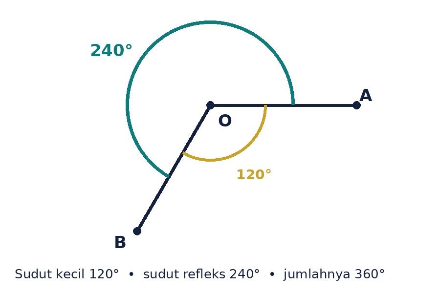
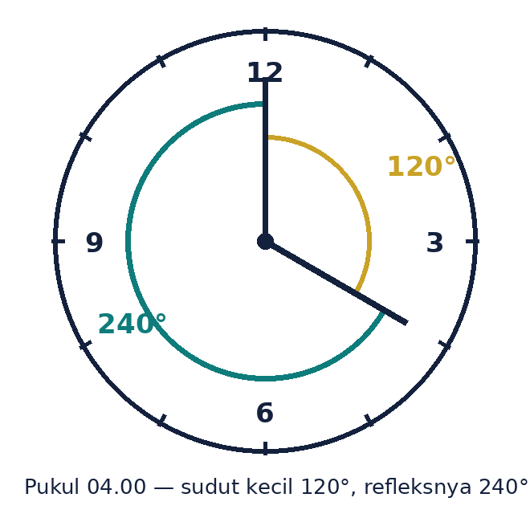

Pekan lalu, di tengah pelajaran jenis-jenis sudut, seorang murid mengangkat tangan sambil menunjuk pintu kelas yang terbuka lebar sampai mentok ke dinding. "Pak, sudut yang lebih dari setengah lingkaran itu ada, ya?" Saya mengangguk. Ia baru saja menemukan sudut refleks — sudut yang besarnya lebih dari $180^\circ$ tetapi kurang dari $360^\circ$. Selama ini murid hanya mengenal sudut lancip, siku-siku, dan tumpul. Begitu sudutnya melewati garis lurus, banyak yang mengira sudutnya sudah tidak ada lagi, padahal ia hanya berubah nama.

Pada Gambar 1, dua sinar berangkat dari titik yang sama, O. Sinar OA saya gambar mendatar ke kanan, sinar OB saya arahkan ke bawah-kiri, ke arah $240^\circ$. Di antara keduanya ada dua sudut: sudut kecil $120^\circ$ yang busurnya emas, dan sudut refleks $240^\circ$ yang busurnya teal dan memutar jauh melewati atas. Keduanya berbagi sinar yang sama — yang membedakan hanyalah jalan mana yang ditempuh busurnya.


*Gambar 1. Dua sinar yang sama membentuk dua sudut: sudut kecil $120^\circ$ (busur emas) dan sudut refleks $240^\circ$ (busur teal). Jumlah keduanya $360^\circ$.*

<!--more-->

## Apa Itu Sudut Refleks

Sudut refleks adalah sudut yang besarnya lebih dari $180^\circ$ dan kurang dari $360^\circ$. Batasnya penting: tepat $180^\circ$ namanya sudut lurus, bukan refleks; tepat $360^\circ$ namanya satu putaran penuh, juga bukan refleks. Jadi sudut refleks selalu "hampir" satu putaran, tetapi belum sampai.

Cara paling cepat menentukan besar sudut refleks adalah lewat pasangannya: sudut refleks dan sudut kecil yang berbagi dua sinar yang sama selalu berjumlah $360^\circ$. Kalau sudut kecilnya $120^\circ$, sudut refleksnya adalah $360^\circ - 120^\circ = 240^\circ$. Rumus sederhananya: sudut refleks $= 360^\circ -$ sudut kecil. Saya selalu menyuruh murid menghitung sudut kecilnya dulu, baru mengurangi dari $360^\circ$ — jauh lebih mudah daripada mengukur busur yang besar dengan busur derajat.

## Menggambarnya dengan TikZ: Satu Busur, Dua Arah

Kunci menggambar sudut refleks di TikZ ada pada satu sifat perintah `arc`: TikZ selalu menggambar busur berlawanan arah jarum jam, dari sudut awal ke sudut akhir. Karena itu busur refleks tidak perlu trik khusus — cukup tulis sudut akhirnya yang besar. Busur dari $0^\circ$ sampai $240^\circ$ langsung menyapu $240^\circ$ berlawanan arah jarum jam, melewati atas dan kiri, persis seperti busur teal pada Gambar 1.

```latex
% Sinar OA mendatar dan OB ke arah 240 derajat
\draw[navy, very thick] (0,0) -- (2.6,0);
\draw[navy, very thick] (0,0) -- (-1.3,-2.25);
% Busur refleks: dari 0 derajat sampai 240 derajat (berlawanan arah jarum jam)
\draw[teal, very thick] (0,0) ++(0:1.5) arc (0:240);
\node[anchor=east, font=\small\bfseries, teal] at (-1.7,0.95) {$240^\circ$};
```

Titik B saya letakkan di $(-1{,}3; -2{,}25)$. Angka itu bukan tebakan: $\cos 240^\circ = -\frac{1}{2}$ dan $\sin 240^\circ = -\frac{\sqrt{3}}{2} \approx -0{,}87$, sehingga untuk jari-jari $2{,}6$ diperoleh $x = 2{,}6 \times (-0{,}5) = -1{,}3$ dan $y = 2{,}6 \times (-0{,}87) \approx -2{,}25$. Kalau Bapak dan Ibu mengganti jari-jarinya, kalikan saja kedua nilai itu dengan jari-jari yang baru.

Sudut kecilnya saya gambar dengan busur kedua yang menyapu lewat bawah, dari $-120^\circ$ sampai $0^\circ$:

```latex
% Busur kecil: dari -120 derajat sampai 0 derajat (lewat bawah)
\draw[emas, very thick] (0,0) ++(-120:1.0) arc (-120:0);
\node[anchor=west, font=\small\bfseries, emas] at (0.75,-1.2) {$120^\circ$};
```

Perhatikan bahwa kedua busur memakai jari-jari yang berbeda: $1{,}5$ untuk busur refleks dan $1{,}0$ untuk busur kecil. Kalau jari-jarinya disamakan, kedua busur akan bertumpuk di dekat sinar OA dan gambarnya sulit dibaca. Memberi jari-jari lebih besar pada busur yang lebih panjang adalah kebiasaan kecil yang membuat gambar sudut refleks langsung terbaca.

## Sudut Refleks di Jam Dinding

Contoh yang paling mudah dibawa ke kelas adalah jam dinding. Gambar 2 menunjukkan pukul $04.00$: jarum pendek menunjuk angka 4, jarum panjang menunjuk angka 12. Setiap lompatan angka jam bernilai $30^\circ$, jadi dari angka 12 ke angka 4 ada $4 \times 30^\circ = 120^\circ$ — itulah sudut kecilnya. Sudut refleksnya adalah $360^\circ - 120^\circ = 240^\circ$, busur teal yang memutar lewat kiri dan bawah jam.


*Gambar 2. Pukul $04.00$: sudut kecil antara kedua jarum $120^\circ$, sudut refleksnya $240^\circ$.*

Di TikZ, jam ini saya gambar sebagai lingkaran dengan dua belas tanda jam dari `\foreach`, lalu dua busur: busur kecil `arc (-30:90)` yang menyapu $120^\circ$ lewat kanan, dan busur refleks `arc (90:330)` yang menyapu $240^\circ$ lewat kiri dan bawah. Jarum jam ke angka 4 berada pada sudut $-30^\circ$, sehingga ujungnya ada di $(1{,}47; -0{,}85)$ untuk panjang jarum $1{,}7$ — lagi-lagi dari $\cos(-30^\circ) \approx 0{,}87$ dan $\sin(-30^\circ) = -0{,}5$.

## Tiga Kesalahan yang Sering Saya Lihat

Pertama, mengukur sudut kecilnya saja. Soal meminta sudut refleks, murid menjawab $120^\circ$ — padahal itu sudut kecilnya. Saya selalu mengingatkan: kalau soal menyebut kata "refleks", jawabannya harus lebih dari $180^\circ$. Kalau jawabanmu kurang dari itu, kamu sedang mengukur sudut yang salah.

Kedua, menggambar busur di sisi yang salah. Busurnya digambar kecil di bawah, tetapi labelnya ditulis $240^\circ$. Gambar dan label harus cocok: busur refleks adalah busur yang panjang, yang memutar jauh. Cara memeriksanya mudah — busur refleks selalu melewati lebih dari setengah lingkaran.

Ketiga, salah hitung dengan menambah $180^\circ$. Ada murid yang menghitung $180^\circ + 120^\circ = 300^\circ$, seolah-olah sudut refleks adalah sudut lurus ditambah sudut kecil. Itu keliru. Yang benar adalah mengurangi dari satu putaran penuh: $360^\circ - 120^\circ = 240^\circ$. Satu putaran penuh, bukan setengah putaran, adalah patokan sudut refleks.

Soal untuk dicoba: dua sinar membentuk sudut kecil $135^\circ$ — berapa sudut refleksnya? Jawabannya $360^\circ - 135^\circ = 225^\circ$. Dan pada jam dinding, pukul $10.00$ membentuk sudut kecil $60^\circ$ sehingga sudut refleksnya $300^\circ$, sedangkan pukul $05.00$ membentuk sudut kecil $150^\circ$ sehingga sudut refleksnya $210^\circ$. Kalau Bapak dan Ibu mengajar jenis-jenis sudut minggu ini, coba mulai dari jam dinding di kelas, bukan dari definisi. Biarkan murid melihat dua busur itu dulu, baru menulis rumusnya.

> 📎 **Berkas TikZ lengkap:** [sudut-refleks.tex](tex/sudut-refleks.tex) — dokumen siap kompilasi (butuh paket `tikz`). Silakan ganti angka-angkanya untuk dokumen Anda sendiri.
