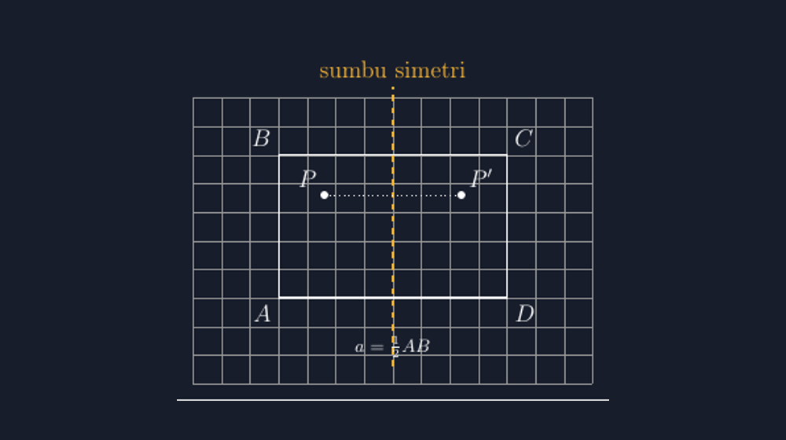

Minggu lalu saya mengajar simetri lipat di kelas VII. Seperti biasa, saya mulai dengan kertas. Saya minta siswa melipat selembar kertas, lalu saya tanya, "Kalau kertasnya kita sobek di lipatan tadi, lalu dibuka, bentuknya seperti apa?" Jawaban mereka beragam, tapi semua sampai pada satu kata: sama. Dua bagian yang persis sama, saling menghadap, seperti bayangan di cermin.

Lalu saya pindah ke papan tulis dan menggambar persegi panjang. Saya tarik garis putus-putus di tengahnya dan bilang, "Ini sumbu simetrinya." Seorang siswa — dia yang biasanya paling kritis — bertanya, "Pak, kok di tengah? Kalau geser dikit gimana?" Pertanyaan itu bagus, dan sejujurnya di papan tulis jawaban saya waktu itu lemah: "Ya kira-kira di tengah, nanti kalau dilipat tidak pas." *Kira-kira.* Dua kata yang seharusnya tidak boleh hidup di pelajaran simetri, karena simetri memang ilmu tentang *pas*.


*Persegi panjang dengan satu sumbu simetri: titik $P$ dan bayangannya $P'$ berjarak sama dari sumbu, tegak lurus terhadapnya.*

Di tulisan-tulisan sebelumnya saya sudah sering cerita bahwa TikZ menyelamatkan saya dari gambar yang "kira-kira" — dari bidang koordinat, bangun datar, sampai lingkaran dalam segitiga. Sumbu simetri adalah kasus yang paling murni, karena di sini ketelitian bukan sekadar memperbagus gambar; ketelitian *adalah* konsepnya. Kalau garis putus-putus yang saya gambar sedikit bergeser dari tempatnya yang sebenarnya, siswa tidak sedang melihat simetri. Mereka melihat kebohongan yang rapi.

## Simetri lipat itu janji, bukan hiasan

Mari kita sepakati dulu definisinya. Sebuah bangun datar disebut memiliki sumbu simetri jika ada garis yang membelahnya menjadi dua bagian yang saling mencerminkan secara persis. Katanya "persis", dan di sinilah letak tanggung jawab gambar. Kalau saya gambar persegi panjang di papan dengan tangan, lalu menarik garis putus-putus yang saya *rasa* ada di tengah, saya sedang meminta siswa percaya pada janji yang tidak bisa mereka periksa.

Dengan TikZ, janji itu bisa diperiksa. Persegi panjang $ABCD$ dengan lebar $AB = a$ punya satu sumbu simetri yang tegak lurus sisi $AB$ dan $CD$, tepat pada jarak $\tfrac{a}{2}$ dari masing-masing. Di TikZ, saya tidak menebak di mana "tengah" itu — saya membiarkan TikZ menghitungnya:

Baris paling penting lebih sederhana dari itu. Sumbu simetri persegi panjang ini adalah garis yang menghubungkan titik tengah sisi $AB$ dan titik tengah sisi $CD$:

```latex
\draw[acc, dashed] ($(A)!0.5!(B)$) -- ($(C)!0.5!(D)$);
```

Sintaks `($(A)!0.5!(B)$)` artinya: titik yang berada tepat di tengah perjalanan dari $A$ ke $B$. Bukan kira-kira. Kalau suatu hari saya mengubah ukuran persegi panjangnya, cukup mengganti koordinat sudutnya — sumbu simetrinya akan tetap terpasang di tempat yang benar, karena posisinya *dihitung*, bukan ditempel. Ini yang saya suka dari TikZ: gambar kita punya struktur, bukan sekadar bentuk.

Perhatikan juga titik $P$ dan $P'$ pada gambar di atas. Itu penjelasan lain tentang simetri yang sering luput: simetri bukan cuma soal bangun yang dilipat, tapi soal pasangan titik yang saling mencerminkan. $P'$ adalah bayangan $P$ oleh pencerminan terhadap sumbu itu, dan pada gambar TikZ hubungan itu terlihat jujur: jarak $P$ ke sumbu sama dengan jarak sumbu ke $P'$, dan garis $PP'$ tegak lurus sumbu. Kalau di papan tulis kedua sifat itu mudah rusak karena tangan kita tidak seteliti pikiran kita, di TikZ keduanya gratis — akurat karena sistem koordinatnya yang mengurus.

## Satu bangun, banyak sumbu — dan di sinilah miskonsepsi menunggu

Persegi panjang punya dua sumbu simetri: satu memotong sisi pendek di tengah, satu memotong sisi panjang di tengah. Persegi punya empat. Segitiga sama kaki satu, segitiga sama sisi tiga, dan lingkaran — lingkaran punya tak hingga sumbu simetri, yang selalu bikin kelas ribut setiap kali saya sebut.

Tapi miskonsepsi yang paling sering saya temui bukan soal *berapa*, melainkan soal *diagonal*. Berkali-kali saya mendapat jawaban bahwa persegi panjang punya empat sumbu simetri, "dua di tengah dan dua diagonalnya." Dan memang, kalau siswa hanya melihat gambar — apalagi gambar yang asal — klaim itu terdengar masuk akal. Diagonal memang membagi persegi panjang jadi dua bagian. Tapi dua bagian itu tidak saling mencerminkan; kalau dilipat, sudut-sudutnya tidak bertemu. Mereka kongruen, tapi tidak simetris — dan perbedaan halus itu justru materi pelajaran yang paling berharga.

Menguji klaim itu di kelas jadi mudah kalau gambarnya bisa dipercaya. Saya biasanya menggambar persegi panjang beserta kedua diagonal dan kedua sumbu simetri yang sebenarnya dalam satu gambar TikZ, lalu meminta siswa memutuskan garis mana yang layak disebut sumbu simetri. Karena gambar saya akurat, diskusinya murni soal konsep — tidak ada lagi murid yang keberatan, "Pak, di gambar Bapak sih kelihatannya sama." Betul, di gambar asal memang kelihatan sama. Itulah masalahnya.

## Contoh soal yang bisa langsung dipakai

Dengan skema yang sama, saya bisa membuat soal pilihan ganda yang mendiagnosis miskonsepsi diagonal itu:

> Perhatikan persegi panjang $ABCD$ dengan $AB = 6$ cm dan $BC = 4$ cm. Manakah pernyataan yang benar tentang sumbu simetrinya?
>
> A. Persegi panjang memiliki 4 sumbu simetri, termasuk kedua diagonalnya.
> B. Persegi panjang memiliki 2 sumbu simetri, masing-masing sejajar dengan sisi-sisinya dan membagi sisi yang diletakinya menjadi dua bagian sama panjang.
> C. Persegi panjang memiliki 1 sumbu simetri, yaitu garis yang melalui titik sudut $A$ dan $C$.
> D. Persegi panjang tidak memiliki sumbu simetri karena sisi-sisinya tidak sama panjang.

Kunci jawabannya B, dan setiap pengecoh mewakili satu jenis kebingungan yang nyata saya temui: opsi A mewakili miskonsepsi diagonal, opsi C mengacaukan sumbu simetri dengan diagonal sungguhan, opsi D keliru mengira simetri menuntut semua sisi sama. Satu soal, empat jalur diagnosis.

Kalau mau lebih menantang, saya biasa menambah soal lanjutan: berikan siswa separuh bangun dan satu sumbu simetri, lalu minta mereka melengkapi bangun penuhnya. Secara koordinat, itu latihan pencerminan: setiap titik $(x, y)$ pada bangun asal harus muncul pasangannya di posisi yang dicerminkan. Justru latihan seperti inilah yang nanti menghubungkan materi simetri dengan transformasi geometri — refleksi yang pernah saya tulis terpisah — karena pada dasarnya sumbu simetri adalah cermin, dan simetri lipat adalah pencerminan yang kembali ke dirinya sendiri.

## Lipat kertas dulu, gambar kemudian

Satu hal yang tidak mau saya lewatkan: TikZ tidak menggantikan kertas lipat. Urutannya tetap sama seperti yang saya lakukan minggu lalu — siswa melipat dulu, merasakan bahwa kedua bagian itu *memang* bertemu persis, baru kita pindah ke layar. Kertas memberi pengalaman pada tangan; TikZ memberi bukti pada mata. Yang satu membangun intuisi, yang lain membangun keyakinan. Pelajaran simetri yang baik butuh keduanya.

Justru karena pengalaman lipatan itu nyata, janji gambar jadi penting. Siswa yang sudah merasakan lipatan yang pas akan curiga pada gambar yang tidak pas. Dan gambar yang pas — persis di tengah, persis sama jarak — itulah yang membuat mereka percaya bahwa matematika bukan tentang kira-kira, tapi tentang tempat yang benar-benar bisa ditunjuk.

Kalau Bapak/Ibu ingin mencoba, berkas lengkapnya saya sertakan di bawah. Cukup kompilasi dengan pdflatex — semua koordinatnya sudah dihitung, bukan ditebak.

> 📎 **Berkas TikZ lengkap:** [tikz-sumbu-simetri-bangun-datar.tex](tex/tikz-sumbu-simetri-bangun-datar.tex) — siap kompilasi (butuh paket `tikz`).
