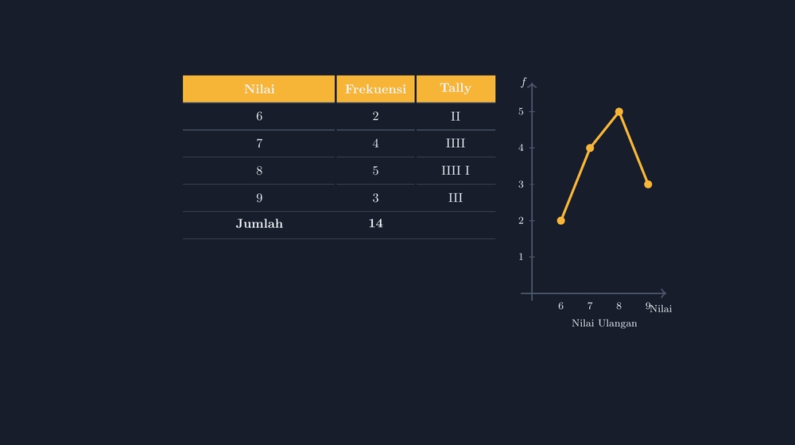

Di kelas VIII kemarin, saya memberikan ulangan pendek tentang materi bilangan berpangkat. Nilainya sederhana: 6, 7, 8, 9 — empat kemungkinan, empat belas anak. Saat saya meminta mereka menyusun tabel frekuensi di lembar jawaban, muncul satu masalah yang sebenarnya sudah lama saya biarkan: tally di kolom ketiga tidak cocok dengan angka di kolom kedua. Ada anak yang menulis frekuensi 5 tetapi tally-nya baru empat garis. Ada pula yang tally-nya betul, tetapi angkanya lupa diganti setelah menambah satu coretan.

Saya tidak langsung menyalahkan ketelitian. Bagi sebagian siswa, tabel frekuensi adalah tugas menyalin — mereka belum merasakan bahwa setiap kolom bercerita tentang data yang sama. Tahun ini saya mencoba memperbaiki itu lewat media: saya menggambar tabelnya dengan TikZ, menempel di lembar kerja, dan meminta siswa memeriksa sendiri apakah tally, angka frekuensi, dan diagram garis di sebelahnya benar-benar setia pada data. Artikel ini merekam cara saya menggambarnya.

<!--more-->

## Satu Data, Dua Wajah

Data ulangan tadi bisa dirangkum dalam tabel seperti ini:

| Nilai | Frekuensi | Tally |
|-------|-----------|-------|
| 6 | 2 | II |
| 7 | 4 | IIII |
| 8 | 5 | IIII I |
| 9 | 3 | III |
| **Jumlah** | **14** | |

Tabel frekuensi punya tiga kolom yang sering dianggap tiga pekerjaan terpisah, padahal satu. Kolom tally adalah data mentah yang dicatat sambil jalan — setiap satu nilai yang muncul, satu garis ditambahkan. Kolom frekuensi adalah hasil menghitung tally itu. Kalau keduanya tidak cocok, salah satunya pasti keliru, dan siswa perlu dilatih melihat ketidakcocokan itu sebagai alarm, bukan sebagai hal yang wajar.

Untuk menggambarnya di TikZ, saya membuat tabel dari persegi panjang dan garis. Tidak ada paket khusus tabel; cukup koordinat dan `\fill` untuk tajuk kolom:

```latex
\def\cl{1.0} \def\cf{5.2} \def\cc{7.4} \def\top{7.6} \def\rh{0.75}
\fill[ak] (\cl,\top) rectangle (\cl+4.2,\top-\rh);
\fill[ak] (\cf,\top) rectangle (\cf+2.2,\top-\rh);
\fill[ak] (\cc,\top) rectangle (\cc+2.2,\top-\rh);
\node[teks,font=\bfseries] at (\cl+2.1,\top-\rh/2) {Nilai};
\node[teks,font=\bfseries] at (\cf+1.1,\top-\rh/2) {Frekuensi};
\node[teks,font=\bfseries] at (\cc+1.1,\top-\rh/2) {Tally};
```

Saya memang sengaja mendefinisikan lebar kolom dan tinggi baris sebagai variabel. Ketika nanti saya ingin menambah satu baris data — misalnya muncul nilai 10 — saya cukup mengubah satu angka di `\foreach`, dan seluruh tabel ikut menyesuaikan. Ini kelebihan menggambar dengan kode yang tidak saya dapat dari menggambar tangan di papan tulis.

Isi barisnya saya tulis dengan satu `\foreach`:

```latex
\foreach \i/\n/\f/\t in {1/6/2/II, 2/7/4/IIII, 3/8/5/IIII I, 4/9/3/III}{
  \pgfmathsetmacro\y{\top-\rh*\i}
  \draw[line] (\cl,\y) -- (\cc+2.2,\y);
  \node[teks] at (\cl+2.1,\y-\rh/2) {\n};
  \node[teks] at (\cf+1.1,\y-\rh/2) {\f};
  \node[teks] at (\cc+1.1,\y-\rh/2) {\t};
}
```

Hasilnya begini:



*Gambar: tabel frekuensi (kiri) dan diagram garis (kanan) yang digambar dari data ulangan yang sama. Perhatikan tally nilai 8 yang ditulis "IIII I" — lima garis dengan garis kelima menyilang.*

## Diagram Garis: Ujian Kesetiaan

Diagram garis di sisi kanan gambar itu bukan hiasan. Ia adalah ujian bagi tabel: jika siswa bisa membaca diagram dan menemukan titik tertinggi di nilai 8, lalu mencocokkannya dengan tally "IIII I", mereka sedang mengalami sendiri bahwa tiga representasi itu adalah satu data.

Di TikZ, diagram garis ini saya gambar dengan titik-titik yang diletakkan tepat pada frekuensinya:

```latex
\draw[->,line,thick] (-0.3,0) -- (3.7,0);
\draw[->,line,thick] (0,-0.2) -- (0,5.8);
\draw[ak,very thick] (0.8,2) -- (1.6,4) -- (2.4,5) -- (3.2,3);
\foreach \x/\y in {0.8/2,1.6/4,2.4/5,3.2/3}{ \fill[ak] (\x,\y) circle (0.11); }
```

Di sinilah kejujuran gambar diuji. Kalau saya menggambar diagram garis ini dengan tangan di papan tulis sambil menjelaskan sambil jalan, hampir pasti salah satu titik akan mendarat sedikit di atas atau di bawah frekuensinya — dan siswa yang jeli malah bingung. Dengan TikZ, titik di $(2.4, 5)$ artinya benar-benar di frekuensi 5, dan garis skala di sumbu $f$ digambar dengan jarak yang sama antar angka. Yang di papan tulis saya coba jujur tapi sering kalah presisi, di sini menjadi otomatis jujur.

Ada satu detail kecil yang saya suka: penulisan tally untuk frekuensi 5. Saya sengaja menulisnya "IIII I" — empat garis lalu satu garis terpisah yang menyilang kepalanya — persis seperti kebiasaan mencatat yang dianjurkan di buku. Ketika siswa melihat tally itu di lembar kerja, mereka langsung mengenali pola hitung lima-lima yang biasa mereka pakai sendiri.

## Ketika Siswa Jadi Pemeriksa

Lembar kerja dengan gambar ini saya pakai dengan cara yang sedikit berbeda dari biasanya. Saya tidak meminta siswa mengisi tabel dari nol. Saya memberi mereka tabel yang sudah jadi — kadang saya tanam sengaja satu ketidakcocokan, misalnya tally lima garis tetapi frekuensi tertulis 4 — dan tugas mereka adalah menemukannya.

Efeknya menarik. Anak-anak yang biasanya pasif saat saya menjelaskan definisi frekuensi relatif atau modus, tiba-tiba sibuk menghitung garis tally satu per satu. Mencari kesalahan ternyata lebih menggerakkan daripada membenarkan hal yang dianggap sudah benar. Dari aktivitas pemeriksaan itu, konsep berikutnya mengalir lebih mudah: modus adalah nilai dengan tally terpanjang, median butuh data yang sudah terurut, dan seterusnya.

Saya jadi berpikir, mungkin masalah utama dalam mengajarkan penyajian data bukan soal rumit atau tidaknya materi, melainkan soal rasa. Siswa tidak merasa tabel frekuensi punya konsekuensi, karena di latihan buku, tabelnya selalu sudah benar dan tinggal dibaca. Dengan memberi mereka gambar yang kadang berbohong dan meminta kejujuran dikembalikan, tabel frekuensi berubah dari benda pasif menjadi sesuatu yang bisa diperiksa, diperdebatkan, dan diperbaiki.

## Penutup

Menggambar tabel frekuensi dengan TikZ tidak lebih cepat daripada membuatnya di pengolah kata, terutama pertama kali. Tapi kecepatan bukan taruhannya. Taruhannya adalah konsistensi yang bisa dipertanggungjawabkan: tally, frekuensi, dan titik diagram yang datang dari koordinat yang sama, dalam satu gambar yang bisa saya pakai ulang tiap tahun dengan data baru.

Kalau Bapak/Ibu ingin mencobanya, berkas TikZ lengkapnya saya sertakan di bawah — tinggal ganti angka di `\foreach`, dan tabel beserta diagramnya akan menyesuaikan data kelas Bapak/Ibu sendiri.

> 📎 **Berkas TikZ lengkap:** [tikz-tabel-frekuensi.tex](tex/tikz-tabel-frekuensi.tex) — siap kompilasi (butuh paket `tikz`).
