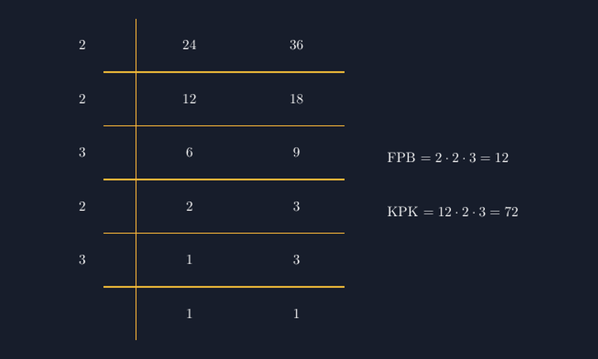

Ada satu momen yang saya ingat banget dari kelas VII tahun lalu. Kami sedang mencari FPB dan KPK dari 24 dan 36. Seorang siswa — sebut saja Rani — mengangkat tangan dan bilang, "Pak, saya sudah paham pohon faktornya. Tapi pas kata Bapak 'ambil yang sama, taruh kiri; ambil sisanya, taruh bawah', saya bingung mana yang kiri mana yang bawah."

Pertanyaan itu membuat saya diam sebentar. Karena sebenarnya Rani benar: di papan tulis, metode anak tangga — atau ada yang menyebutnya metode tangga, metode bersusun, atau "tangga" ala buku LKS — memang tampak mudah ketika saya yang menulisnya. Tetapi ketika siswa menyalinnya ke buku, tulisan tangan mereka sering miring: faktor persekutuan tidak sejajar, sisa faktor luntur ke kolom yang salah, dan akhirnya mereka mengalikan angka yang keliru. Jawaban salahnya bukan karena tidak paham konsep, melainkan karena *tulisannya berbohong*.

<!--more-->

## Masalahnya Bukan Konsepnya, Tapi Tata Letaknya

FPB dan KPK sebenarnya ide yang sederhana. Faktorisasi $24 = 2^3 \cdot 3$ dan $36 = 2^2 \cdot 3^2$. FPB diambil dari faktor yang muncul di keduanya dengan pangkat terkecil: $2^2 \cdot 3 = 12$. KPK diambil dari semua faktor dengan pangkat terbesar: $2^3 \cdot 3^2 = 72$.

Metode anak tangga adalah cara mengemas dua langkah itu sekaligus: sisi kiri tangga menampung faktor persekutuan, sisi kanan menampung faktor yang tidak sama. Masalahnya, pengemasan inilah yang paling rentan rusak di tulisan tangan. Garis pemisah vertikal yang miring membuat kolom "kiri" dan "kanan" kabur. Angka di anak tangga yang tidak rata membuat siswa tidak yakin mana yang boleh dikalikan. Saya pernah menemukan satu buku siswa di mana faktor $3$ yang seharusnya berhenti di kiri (karena hanya $24$ yang masih punya $3$, bukan keduanya) ikut naik ke kolom kiri — dan seluruh jawabannya runtuh.

Itu sebabnya saya mulai membawa versi TikZ-nya ke kelas. Bukan untuk mengganti tulisan tangan siswa — mereka tetap wajib menulis — tapi sebagai *referensi yang rapi*: satu gambar di lembar kerja yang menunjukkan seperti apa tangga yang benar-benar sejajar.

## Menggambar Tangganya dengan TikZ

Inti gambar ini sederhana: dua kolom angka, garis pemisah vertikal, dan anak tangga horizontal di bawah setiap baris. Yang membuatnya bisa dipercaya adalah konsistensi koordinatnya. Setiap baris berjarak tetap, garis vertikal benar-benar vertikal, dan faktor di kiri selalu di posisi $x$ yang sama.

```latex
\begin{tikzpicture}[scale=1.1]
  % baris 1: 24 dan 36
  \node at (0,0) {$2$};
  \node at (2,0) {$24$};
  \node at (4,0) {$36$};
  % baris 2
  \node at (0,-1) {$2$};
  \node at (2,-1) {$12$};
  \node at (4,-1) {$18$};
  % baris 3
  \node at (0,-2) {$3$};
  \node at (2,-2) {$6$};
  \node at (4,-2) {$9$};
  % baris 4
  \node at (0,-3) {$2$};
  \node at (2,-3) {$2$};
  \node at (4,-3) {$3$};
  % baris 5
  \node at (0,-4) {$3$};
  \node at (2,-4) {$1$};
  \node at (4,-4) {$3$};
  % baris terakhir
  \node at (2,-5) {$1$};
  \node at (4,-5) {$1$};
  % garis pemisah vertikal: benar-benar lurus
  \draw[thick] (1,0.5) -- (1,-5.5);
  % anak tangga
  \foreach \y in {0,-1,-2,-3,-4} {
    \draw[thick] (0.4,\y-0.5) -- (5,\y-0.5);
  }
\end{tikzpicture}
```

Perhatikan baris demi barisnya: $2$ membagi $24$ dan $36$ sekaligus, dua kali, sampai tersisa $6$ dan $9$. Nah, di sinilah momen pentingnya: $6$ habis dibagi $3$, dan $9$ juga — jadi baris ketiga memakai $3$. Tapi setelah itu tersisa $2$ dan $3$, dua bilangan yang sudah tidak punya faktor sama selain satu. Inilah pertanyaan yang paling sering muncul di kelas saya: "Pak, kalau tangganya tidak selesai bersamaan, gimana?" Jawabannya justru inti metode ini: faktor yang hanya membagi salah satu bilangan *tidak boleh naik ke kolom kiri*. Ia tetap menurunkan bilangan yang bisa dibagi, sementara yang tidak bisa turun begitu saja di kolom kanan. Pada baris keempat, $2$ membagi $2$ tapi tidak membagi $3$ — maka $3$ turun tanpa diubah, dan tangga melanjutkan yang satu lagi. Garis vertikal TikZ yang benar-benar lurus membuat konsekuensi ini terlihat tanpa perlu berdebat: angka tidak bisa "kabur" ke kolom yang diinginkan, karena letaknya sudah ditentukan koordinat.


*Tangga FPB dan KPK untuk 24 dan 36: faktor persekutuan di kiri garis, sisa faktor di kanan. Di baris keempat, 2 hanya membagi 2 — sehingga 3 turun apa adanya dan tangga melanjutkan kolom kirinya sendiri.*

## Membaca Hasilnya

Setelah tangga selesai, pembacaannya jadi jelas — dan inilah bagian yang saya minta siswa melantunkan dengan pola yang selalu sama:

$$\text{FPB} = \text{kali semua angka di kolom kiri} = 2 \cdot 2 \cdot 3 \cdot 2 \cdot 3 = 72$$

Tunggu — itu KPK, bukan FPB, dan sengaja saya tulis di sini. Karena keliru paling sering justru terjadi saat membaca hasilnya, bukan saat menyusun tangganya. FPB diambil dari kolom kiri saja:

$$\text{FPB} = 2 \cdot 2 \cdot 3 = 12$$

Sedangkan KPK dikalikan "menyilang": satu faktor persekutuan dengan semua sisa di kolom kanan (atau, kalau mau, seluruh isi tangga). Cara yang paling aman diajarkan: KPK $=$ FPB $\times$ semua angka kolom kanan $= 12 \cdot 2 \cdot 3 = 72$. Ketika siswa menelusuri tangganya, $12$ dan $72$ memang bisa ditelusuri dari gambar tanpa menebak — dan cek silangnya sederhana: $24 \cdot 36 = 864$, dan $12 \cdot 72 = 864$ juga. FPB dikali KPK selalu sama dengan hasil kali kedua bilangannya. Fakta kecil ini saya simpan sebagai "jimat cek" di kelas: kalau hasil kali FPB dan KPK tidak cocok, ada angka yang salah tempat.

Kesalahan-kesalahan kecil seperti ini sebenarnya teman baik di kelas. Saya sengaja menuliskannya di artikel ini karena itulah yang terjadi di kelas saya: gambar yang rapi justru membuat kesalahan lebih cepat *kelihatan*, dan itu lebih baik daripada kesalahan yang tersembunyi di tulisan tangan yang miring.

## Dari Tangga ke Soal Cerita

Yang membuat metode ini layak bertahan di kelas adalah penerapannya di soal cerita. Dua kondensor berbunyi tiap 24 menit dan 36 menit; kapan mereka berbunyi bersama lagi? Itu KPK. Pita 24 cm dan 36 cm dipotong sama panjang tanpa sisa; berapa panjang terpanjangnya? Itu FPB. Siswa yang punya gambar tangga yang jelas tinggal mengarahkan jarinya: "yang ini pakai kolom kiri, yang ini pakai seluruh tangga."

Saya pernah mencoba mengecek pemahaman dengan satu pertanyaan balik: "Kalau garis vertikalnya kita geser satu kolom ke kanan, FPB-nya jadi apa?" Jawaban mereka yang beragam — dan diskusinya yang singkat itu lebih berharga daripada sepuluh soal latihan, karena mereka akhirnya berbicara tentang *letak* faktor, bukan sekadar menghafal "FPB ambil yang sama."

## Penutup

TikZ untuk tangga FPB-KPK bukan gambar yang rumit — hanya node-node yang sejajar dan garis yang lurus. Tetapi justru kesederhanaan itulah yang membuatnya efektif: tidak ada yang bisa berbohong di gambar dengan koordinat yang jujur. Sisipan seperti ini saya taruh di lembar kerja, dan siswa menyalinnya ke buku dengan tulisan tangan mereka masing-masing. Yang rapi dari mesin, yang usaha dari tangan mereka — dan setidaknya sekarang, kalau jawabannya salah, saya tahu kesalahannya ada di pemahaman, bukan di garis yang miring.

> 📎 **Berkas TikZ lengkap:** [tangga-fpb-kpk.tex](tex/tangga-fpb-kpk.tex) — siap kompilasi (butuh paket `tikz`).
