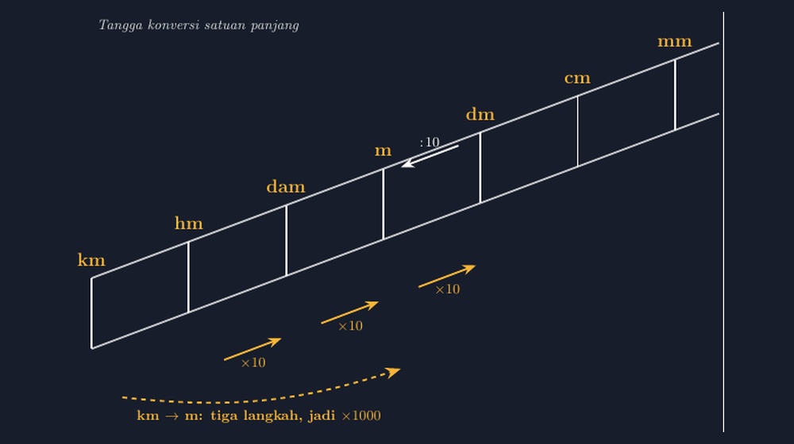

Ada satu gambar yang hampir pasti muncul setiap tahun ajaran baru di kelas saya: tangga konversi satuan. Tangga dengan anak tangga km–hm–dam–m–dm–cm–mm, lengkap dengan panah ke bawah "kali" dan panah ke atas "bagi". Gambar itu saya warisi dari guru saya dulu, dan mungkin Bapak/Ibu juga mengenalnya sejak SD.

Masalahnya, tahun lalu saya menyadari sesuatu yang memalukan. Ketika saya menggambar tangga itu langsung di papan tulis dengan tangan, proporsinya berantakan. Anak tangga "km" ke "hm" terlihat sama panjangnya dengan anak tangga "m" ke "dm". Padahal jarak km ke m itu seribu kali, sedangkan m ke dm hanya sepuluh kali. Saya juga pernah melihat soal di lembar kerja yang menggambar segmen garis untuk 2 km dan 50 m dengan panjang yang hampir sama. Belum lagi label yang meleset: ada gambar tangga di buku fotokopian yang urutannya hm–km–dam karena hasil scan miring.

<!--more-->

Mata siswa memang jeli pada hal yang tidak kita sadari. Ada siswa yang bertanya, "Pak, kok langkahnya semuanya sama? Padahal bilangnya kali seribu?" Pertanyaan itu bagus, dan jujur saja saya tidak punya jawaban selain "itu hanya cara mengingat, ya, ukurannya tidak mengikuti gambar." Tapi kalau kita bisa menggambar dengan benar, kenapa tidak?

## Kenapa Tangga Konversi Layak Dibuat Serius

Tangga konversi pada dasarnya adalah model visual dari sistem metrik desimal. Setiap anak tangga turun berarti dikalikan 10. Dari km ke m ada tiga anak tangga, jadi faktor konversinya $10 \times 10 \times 10 = 1000$. Itulah kekuatan model ini: siswa tidak menghafal tabel, siswa menghitung langkah.

Persis seperti yang pernah saya tulis tentang diagram garis yang tidak mengarang frekuensi, model visual apa pun punya tanggung jawab: dia boleh menyederhanakan, tapi tidak boleh berbohong. Tangga yang proporsinya berantakan mengajarkan hal yang salah secara diam-diam — bahwa semua langkah "sama saja". Padahal justru di situlah inti pemahamannya.

Yang membuat saya akhirnya pindah ke TikZ adalah kebutuhan akan konsistensi. Saya ingin satu gambar tangga yang bisa dipakai untuk lembar kerja kelas 5 (untuk adik kelas yang saya damping di program pendampingan), soal kelas 7, sampai slide presentasi, dengan hasil yang identik dan rapi.

## Merancang Tangga yang Jujur

Rancangan saya sederhana: tujuh anak tangga sama lebar secara *struktural* — karena tangga memang model abstrak, bukan peta skala — tapi setiap anak tangga dilengkapi label faktor yang eksplisit: $\times 10$ di tiap turun, dan panah tiga-langkah dari km langsung ke m yang diberi anotasi $\times 1000$. Dengan begitu siswa melihat dua informasi sekaligus: pola langkah per satu, dan akumulasi langkah.

Berikut potongan kodenya:

```latex
\begin{tikzpicture}[scale=0.9]
  % dua garis tangga miring
  \draw[thick] (0,0) -- (12,4.5);
  \draw[thick] (0,1.5) -- (12,6);
  % anak tangga dan label satuan
  \foreach \i/\sat in {0/km,1/hm,2/dam,3/m,4/dm,5/cm,6/mm} {
    \draw[thick] (\i*2, 0.75 + \i*0.75) -- ++(0.6,0.225);
    \node[above] at (\i*2+0.2, 0.85+\i*0.75) {\sat};
  }
\end{tikzpicture}
```

Foreach membuat kode pendek, dan yang penting: posisi label dihitung dari koordinat yang sama dengan garisnya. Tidak ada label yang bisa "keturunan" dari garis seperti saat saya menggambar manual.

Gambar pendukung di artikel ini saya buat dari kompilasi kode tersebut, dengan tambahan panah konversi dan anotasi faktor:



*Gambar 1. Tangga konversi satuan panjang. Panah ke bawah berarti dikalikan 10 per anak tangga; dari km ke m berarti tiga langkah, jadi $\times 1000$.*

## Bagian yang Sering Tertukar: Arah Panah

Kalau ada satu sumber kebingungan yang paling sering saya dengar, ini dia: arah panah. "Turun berarti kali" — tapi banyak siswa menulis kebalikannya karena mereka mengasosiasikan "turun" dengan "mengecil" (angka satuan yang lebih kecil: mm terlihat lebih kecil dari km). Padahal 1 km = 1.000.000 mm; memindah ke satuan kecil justru membuat angkanya membesar.

Di kelas, saya melawan miskonsepsi ini dengan satu pertanyaan pengunci: "Kalau jarak rumahmu ke sekolah 2 km, berapa cm? Lebih besar atau lebih kecil angkanya?" Siswa yang menjawab 0,0002 cm akan tersentak sendiri ketika membayangkan 0,0002 cm itu kurang dari tebal seutas rambut.

Untuk itu di TikZ saya beri warna berbeda pada dua arah panah — kuning untuk turun (kali), putih untuk naik (bagi) — supaya asosiasi warnanya konsisten di semua lembar kerja saya:

```latex
\draw[-{Stealth}, yellow!80!orange, thick]
  (2.6,0.4) -- node[below, text=white] {$\times 10$} (3.6,0.775);
\draw[-{Stealth}, white, thick]
  (3.6,1.475) -- node[above, text=white] {$:\!10$} (2.6,1.1);
```

Detail kecil seperti konsistensi warna ini terdengar berlebihan, tapi saya pernah membuktikan sebaliknya ketika merancang pengecoh soal pilihan ganda: siswa menjawab salah bukan karena tidak paham konsep, tapi karena membaca tanda panah yang malah mirip tanda kurang dari.

## Dari Panjang ke Massa dan Volume

Keindahan sistem metrik: tangga yang sama berlaku untuk gram dan liter. Hanya prefix-nya yang berpindah. Jadi saya tidak perlu menggambar tiga tangga berbeda — cukup satu tangga induk dengan label prefix, lalu tiga judul berbeda di tiga lembar kerja.

Tapi ada pengecualian yang jujur harus saya katakan ke siswa: konversi are dan hektare tidak naik-turun sepuluh, tapi seratus. Demi kejujuran gambar, saya buat versi tangga kedua yang lebih lebar — anak tangganya "melompat" dua tingkat — supaya siswa melihat bahwa luas memang beda aturan mainnya. Ini sejalan dengan pelajaran dari artikel kesebangunan dulu: kalau aturannya berbeda, gambarnya harus berbeda, jangan dipaksakan seragam.

## Satu Jam yang Mengubah Lembar Kerja Saya

Total waktu saya membuat tangga pertama ini sekitar satu jam, termasuk dua kali salah koordinat dan satu kali lupa memuat paket `arrows.meta` sehingga panah Stealth-nya menolak muncul (error klasik: `I do not know the key '/tikz/Stealth'`). Sejak itu satu jam itu sudah "lunas" berkali-kali: setiap tahun ajaran, setiap lembar kerja, setiap soal pengukuran, tinggal salin dan ubah label.

Yang paling saya hargai bukan kecepatannya, tapi rasa tenangnya. Ketika saya membagikan lembar kerja dan ada orang tua yang memotret soalnya untuk anaknya yang sakit, saya tahu gambar yang sampai ke ponsel itu sama rapi dan sama benar dengan yang ada di kelas. Tidak ada lagi "kok di ponsel saya labelnya kepotong, Pak?"

Buat Bapak/Ibu yang masih menggambar tangga konversi dengan tangan di Word — saya memahami betul, saya juga begitu bertahun-tahun. TikZ terasa menakutkan dari luar, tapi tangga konversi sebenarnya salah satu titik masuk yang ramah: koordinatnya lurus, polanya berulang, dan foreach-nya langsung terasa manfaatnya. Mulailah dari gambar yang paling sering Bapak/Ibu pakai ulang. Di situlah TikZ membayar dirinya sendiri dengan cepat.

📎 **Berkas TikZ lengkap:** [tangga-konversi-satuan.tex](tex/tangga-konversi-satuan.tex) — siap kompilasi (butuh paket `tikz`).
