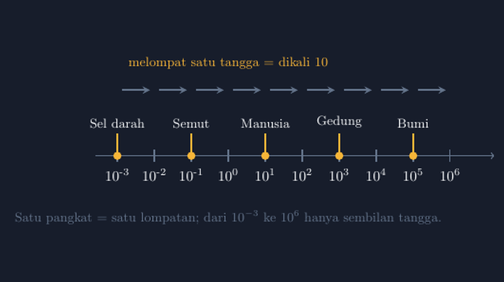

Kelas delapan kemarin saya buka dengan satu pertanyaan sederhana: "Berapa jarak rumah kalian ke sekolah?" Ada yang menjawab dua kilometer, ada yang tiga. Lalu saya tanyakan lagi, "Kalau disebut dalam milimeter, berapa?" Hening sebentar, kemudian ada yang menghitung dengan serba salah di kertas. Dua kilometer ternyata dua juta milimeter. Angka itu terasa jauh lebih "besar" padahal jaraknya sama persis. Dari situlah kami masuk ke notasi ilmiah — dan saya sadar, pelajaran ini paling jujur kalau digambar, bukan hanya dihitung.

<!--more-->

## Dua juta itu besar, tapi tidak semua angka besar itu panjang

Miskonsepsi yang paling sering saya temui soal notasi ilmiah bukan soal pangkatnya. Miskonsepsinya ada di rasa: murid merasa $2.000.000$ "lebih banyak" dari $2 \times 10^6$ karena tulisannya lebih panjang. Bagi mereka, pangkat sepuluh itu semacam singkatan yang memangkas angka, bukan cara pandang yang berbeda.

Karena itu saya berhenti mengajarkannya sebagai "aturan pindah koma". Aturan itu memang cepat, tapi murid yang hafal aturan tanpa melihat maknanya akan tiba-tiba bingung ketika bertemu $3{,}2 \times 10^{-5}$ pada materi virus atau ukuran sel. Koma pindah ke mana? Kenapa pangkatnya malah minus?

## Tangga yang saya gambar di papan

Di kelas, saya gambar satu garis panjang di papan, lalu saya bagi dengan jarak yang sama. Setiap tanda saya beri label $10^{-3}$, $10^{-2}$, $10^{-1}$, $10^{0}$, $10^{1}$, dan seterusnya. Lalu saya taruh penanda di titik-titik yang bisa dibayangkan murid: sel darah di sekitar $10^{-3}$ milimeter, semut di sekitar $10^{-1}$, manusia di sekitar $10^{1}$, gedung bertingkat di sekitar $10^{3}$, dan diameter Bumi di sekitar $10^{5}$ kilometer.

Yang menarik, murid langsung melihat sesuatu yang tidak mereka lihat di buku: **satu langkah ke kanan artinya dikali sepuluh, satu langkah ke kiri artinya dibagi sepuluh.** Tidak ada koma yang "dipindah" secara misterius. Ada tangga, dan setiap anak tangga naiknya sama tinggi.


*Tangga pangkat sepuluh: satu tangga sama dengan satu kali dikali 10*

Dari $10^{-3}$ ke $10^{6}$ hanya sembilan tangga. Sembilan lompatan, dan kita sudah melompat dari ukuran sel darah ke jutaan. Ketika murid melihat bahwa $10^6$ artinya enam tangga di atas satu, mereka tidak lagi menghafal "enam nol setelah satu" sebagai keajaiban, tapi sebagai konsekuensi.

## Memindahkan gambar ke TikZ

Gambar papan itu saya pindahkan ke TikZ supaya bisa dipakai ulang di lembar kerja. Saya mulai dari porosnya saja:

```latex
\begin{tikzpicture}[x=0.9cm]
  \draw[thick,->] (-3.6,0) -- (7.2,0);
  \foreach \i in {-3,...,6} {
    \draw[thick] (\i,-0.15) -- (\i,0.15);
  }
\end{tikzpicture}
```

Bagian yang paling saya senangi dari TikZ di sini adalah `\foreach`. Saya tidak mengetik sepuluh tanda secara manual; saya minta TikZ menggambar tanda di setiap bilangan bulat dari $-3$ sampai $6$, dan jarak antartanda dijamin sama persis. Ini poin yang selalu saya tekankan ke diri sendiri: kalau gambar mengklaim "satu tangga naiknya sama tinggi", gambar itu sendiri harus membuktikan klaimnya. Garis papan tulis yang saya gambar tangan kemarin jaraknya tidak seragam, dan satu murid memang mengomentari itu — "Bu, tangga yang ini pendek." Dia benar, dan TikZ menyelesaikan kejujuran itu.

Label pangkatnya saya taruh di bawah setiap tanda:

```latex
\foreach \i/\lab in {-3/{10^{-3}},-2/{10^{-2}},...,3/{10^{3}}} {
  \node[below=6pt] at (\i,0) {\lab};
}
```

Satu hal kecil yang bikin saya tersenyum saat menyusunnya: di TikZ, penulisan `10^{-3}` di dalam node sudah otomatis dijadikan pangkat oleh mode matematika, jadi saya tidak perlu menulis `^{}` secara manual per label. Tapi perhatikan tanda kurung kurawal ganda — `\i/\lab` berpasangan, dan label dengan tanda kurung harus dibungkus dengan benar atau `\foreach` akan salah membaca pemisahnya. Saya pernah menghabiskan sepuluh menit untuk error yang penyebabnya cuma kurung yang kurang satu.

## Menyisipkan konteks: penanda ukuran nyata

Bagian yang membuat gambar ini hidup justru bukan tangganya, tapi penandanya. Di atas garis, saya taruh lingkaran kuning kecil di posisi tertentu dengan label objek:

```latex
\foreach \i/\obj in {-3/{Sel darah},-1/{Semut},1/{Manusia},3/{Gedung},5/{Bumi}} {
  \node[circle, fill=yellow!80!orange, inner sep=2pt] at (\i,0) {};
  \node[above] at (\i,0.55) {\obj};
}
```

Kalau mau lebih rapi, angkanya bisa ikut ditulis: sel darah sekitar $8 \times 10^{-3}$ milimeter, semut sekitar $2 \times 10^{-1}$ milimeter? Hmm, sebenarnya ukuran semut itu lebih kecil dari itu — dan justru di sinilah diskusi kelas jadi seru. Saya sengaja menaruh penanda yang tidak sepenuhnya tepat, lalu meminta murid mencari mana yang posisinya keliru. Aktivitas "koreksi gambar guru" ternyata jauh lebih hidup daripada "hitung pangkat berikut". Murid yang bisa mengoreksi posisi Bumi di tangga berarti dia sudah paham pangkat, bukan cuma hafal rumus.

## Dari tangga ke soal

Setelah gambar ini matang, soal latihannya jadi mudah dirancang tanpa mengganti konsep:

> Sebuah virus punya diameter sekitar $1{,}2 \times 10^{-4}$ milimeter. Di tangga pangkat sepuluh, antara tangga manakah posisi virus itu berada? Berapa kali lebih besar virus dibanding sel darah yang diameternya $8 \times 10^{-3}$ milimeter?

Murid bisa menjawabnya dengan menghitung pembagian biasa:

$$
\frac{8 \times 10^{-3}}{1{,}2 \times 10^{-4}} = \frac{8}{1{,}2} \times 10^{-3-(-4)} \approx 6{,}7 \times 10^{1}
$$

Tapi cara paling cepat untuk cek jawaban itu justru lewat tangga: sel darah ada di tangga $-3$, virus di tangga kira-kira $-4$. Jadi sel darah lebih besar sekitar satu tangga, kali sepuluh kali. Murid yang merasa ragu pada hasil pembagian pangkatnya bisa kembali ke tangga untuk memastikan. Gambar ini berfungsi sebagai alat cek mandiri, dan itu nilai yang tidak diberikan rumus.

## Catatan kecil untuk rekan guru

Kalau Bapak/Ibu mau meniru gambar ini, ada dua hal yang saya pelajari dengan cara yang tidak menyenangkan. Pertama, jarak antartanda di TikZ sebaiknya diatur lewat opsi `x=0.9cm` di awal, bukan dengan menggandakan koordinat. Kalau koordinatnya diubah manual, satu tangga bisa tidak sengaja lebih lebar dari yang lain, dan gambar yang seharusnya menguatkan konsep malah merusaknya. Kedua, label di atas dan di bawah garis sebaiknya diberi jarak dengan opsi `above=...` dan `below=...` yang eksplisit. Label yang terlalu rapat ke garis akan terlihat seperti nempel, dan mata murid membacanya sebagai satu kesatuan yang membingungkan.

Yang lebih penting dari gambar itu sendiri adalah urutan mengajarnya. Saya tidak lagi memulai notasi ilmiah dengan "pindahkan koma sampai tinggal satu angka di depan". Saya mulai dari pertanyaan jarak rumah ke sekolah dalam milimeter, biarkan murid merasa betapa canggungnya angka yang panjang itu, lalu taruh tangga di papan. Koma yang "berpindah" itu sebenarnya cuma jejak dari tangga yang dinaiki — dan murid yang sudah melihat tangganya tidak akan pernah lagi menganggap pindah koma sebagai trik sulap.

> 📎 **Berkas TikZ lengkap:** [tikz-tangga-pangkat-sepuluh-notasi-ilmiah.tex](tex/tikz-tangga-pangkat-sepuluh-notasi-ilmiah.tex) — siap kompilasi (butuh paket `tikz`).
