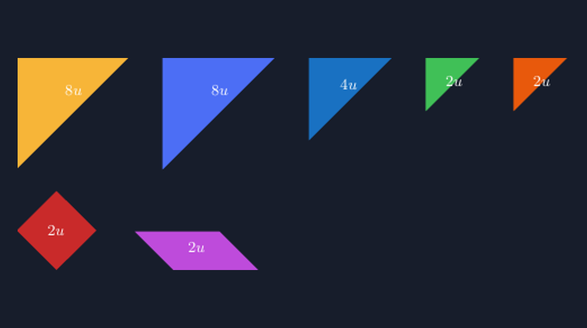
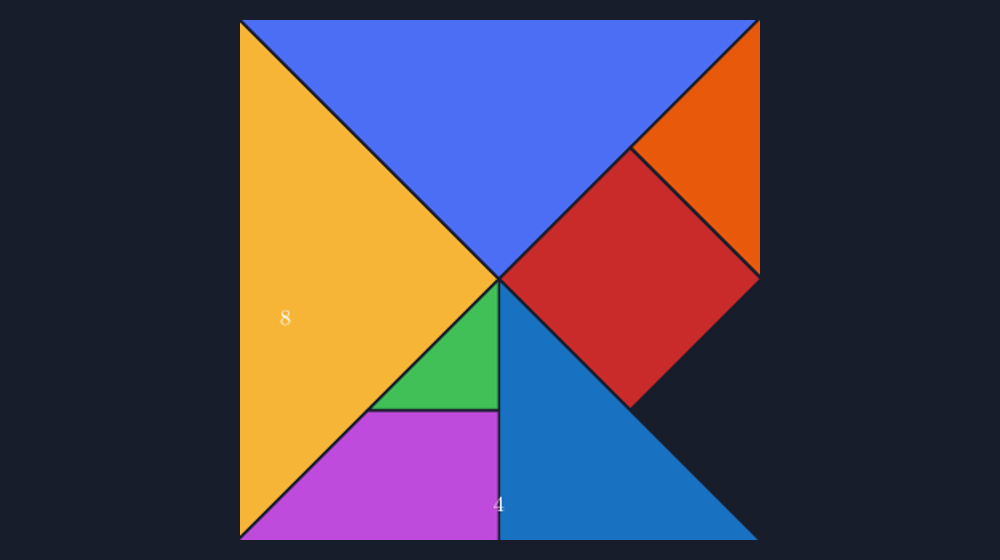

Ada satu kotak kayu tua di lemari kelas yang hampir tidak pernah saya buka selama bertahun-tahun: kotak tangram. Tujuh potongan kayu berwarna — dua segitiga besar, satu segitiga sedang, dua segitiga kecil, satu persegi, dan satu jajar genjang — yang kalau disusun dengan benar kembali menjadi sebuah persegi utuh. Kotak itu warisan guru sebelum saya, dan jujur saja, saya pernah menganggapnya mainan anak SD. Selama bertahun-tahun ia tidur di lemari, hanya sesekali keluar saat ada jam pelajaran yang menganggur.

Sampai satu hari, saat mengajari kesebangunan di kelas IX, saya kehabisan ide membuat soal yang tidak mengarang-ngarang bentuknya. Saya buka kotak itu, susun potongan-potongannya di meja, dan baru sadar: tangram adalah kumpulan kesebangunan yang paling jujur yang pernah saya pegang. Tujuh potongan itu semuanya sebangun secara bertingkat — segitiga kecil, sedang, dan besarnya punya perbandingan yang konsisten — dan semuanya lahir dari satu persegi yang dipotong dengan garis-garis sederhana.

<!--more-->

## Persegi yang Dicacah menjadi Enam Belas

Cara paling rapi memahami tangram, menurut saya, adalah dengan menghitung "unit" terkecilnya. Bayangkan persegi besar kita bagi menjadi 16 segitiga siku-siku sama kaki yang kecil-kecil dan sama besar. Semua potongan tangram tidak lain adalah gabungan dari segitiga-segitiga unit ini:

- dua segitiga besar, masing-masing 4 unit,
- satu segitiga sedang, 2 unit,
- satu persegi, 2 unit,
- satu jajar genjang, 2 unit,
- dua segitiga kecil, masing-masing 1 unit.

Totalnya $4 + 4 + 2 + 2 + 2 + 1 + 1 = 16$ unit. Angka ini yang membuat tangram begitu enak dipakai di kelas: luas setiap potongan bisa dihitung tanpa rumus yang baru, cukup dengan mencacah.



Saat saya menunjukkan susunan ini di kelas, pertanyaan yang muncul bukan "rumusnya apa", melainkan "kalau segitiga kecil luasnya satu, segitiga sedang yang menutupi dua kecil itu sisi sisinya berapa?" Persis pertanyaan yang ingin saya dengar. Dari situ, tanpa saya paksa, kelas mendarat sendiri di perbandingan sisi: kalau kaki segitiga kecil adalah $2\sqrt{2}$ satuan (dalam persegi bersisi 8), maka sisi persegi kecil juga $2\sqrt{2}$, kaki segitiga sedang $4$, dan kaki segitiga besar $4\sqrt{2}$. Semua bilangannya irasional kecuali yang muncul lewat garis horizontal dan vertikal — dan itu justru bahan diskusi bagus tentang mengapa muncul akar dua di mana-mana.

## Koordinat yang Bisa Dipertanggungjawabkan

Seperti biasa di blog ini, saya tidak mau menggambar tangram dengan mengira-ira posisi potongannya. Untungnya koordinat tangram klasik itu rapi kalau kita letakkan persegi besarnya di $(0,0)$ sampai $(8,8)$ dan pilih satuan segitiga kecil sebagai dasarnya. Titik-titik kuncinya:

- pusat persegi: $(4,4)$;
- titik tengah sisi: $(4,0)$, $(0,4)$, $(8,4)$, $(4,8)$;
- titik-titik $45^\circ$ di dalam: $(2,2)$, $(6,2)$, $(6,6)$, $(2,6)$.

Dengan titik-titik itu, ketujuh potongan tinggal dinyatakan sebagai daftar poligon:

```latex
\filldraw[fill=warnaKuning, draw=garis]  (0,0) -- (0,8) -- (4,4) -- cycle; % segitiga besar 1
\filldraw[fill=warnaBiru, draw=garis]    (0,8) -- (8,8) -- (4,4) -- cycle; % segitiga besar 2
\filldraw[fill=warnaHijau, draw=garis]   (2,2) -- (6,2) -- (4,4) -- cycle; % segitiga kecil 1
\filldraw[fill=warnaOranye, draw=garis]  (8,4) -- (8,8) -- (6,6) -- cycle; % segitiga kecil 2
\filldraw[fill=warnaMerah, draw=garis]   (4,4) -- (6,2) -- (8,4) -- (6,6) -- cycle; % persegi
\filldraw[fill=warnaUngu, draw=garis]    (0,0) -- (4,0) -- (6,2) -- (2,2) -- cycle; % jajar genjang
\filldraw[fill=warnaNavy, draw=garis]    (4,0) -- (8,0) -- (4,4) -- cycle; % segitiga sedang
```

Hasilnya begini — dan kali ini saya sudah memeriksa satu per satu titik ujungnya, karena percobaan pertama saya kemarin malam justru menghasilkan gambar yang terlihat seperti tangram tetapi tidak bisa dipecah jadi 16 unit dengan benar:



Ada satu kebiasaan kecil yang sejak artikel-artikel sebelumnya jadi pegangan saya: setiap kali saya menuliskan koordinat di TikZ, saya uji balik dengan menghitung luas satu-dua potongannya. Persegi miring itu, misalnya, tinggal dicek: sisinya $2\sqrt{2}$, jadi luasnya 8 — dua kali luas segitiga kecil yang kaki-jari $2\sqrt{2}$ dan luasnya 4. Kalau angkanya tidak cocok, berarti koordinatnya yang salah, bukan hitungan saya yang boleh dipaksakan. Gambar boleh "kelihatan benar", tetapi hanya luas yang bisa menjadi jujur.

## Yang Muncul di Kelas

Minggu lalu saya coba bawa versi digitalnya ke kelas VIII. Saya proyeksikan gambar persegi yang sudah diwarnai tujuh potongan, lalu tantang siswa: potongan mana yang sebangun dengan potongan mana? Jawabannya tidak selalu seperti yang saya duga. Banyak yang langsung menjawab "persegi dan jajar genjang sebangun karena luasnya sama" — kesempatan bagus untuk membedakan sebangun (bentuk sama) dan luas sama (bentuk boleh beda). Dua potongan berluas 2 unit itu, kalau ditaruh berdampingan, jelas tidak sebangun: sudut-sudutnya berbeda.

Pertanyaan lanjutan yang paling berkesan datang dari siswa yang biasanya paling pendiam. Ia menunjuk dua segitiga kecil dan bertanya, "Pak, kalau dua segitiga kecil ini digabung, bisa jadi apa saja?" Kami mencobanya di papan: gabung kaki-jarinya, jadi persegi kecil; gabung sisi miringnya, jadi segitiga sedang; gabung sisanya, jadi jajar genjang ketiga. Tiga bentuk berbeda dari dua potongan yang sama — dan tiga bentuk itu, entah bagaimana, persis tiga potongan berluas 2 unit dalam tangram. Anak itu tersenyum begitu melihat polanya, dan saya juga.

> 📎 **Berkas TikZ lengkap:** [tikz-tangram.tex](tex/tikz-tangram.tex) — siap kompilasi (butuh paket `tikz`).

## Penutup: Kotak yang Kembali Terbuka

Kotak kayu itu sekarang tidak lagi tidur di lemari. Saya pakai minggu ini juga untuk latihan kesebangunan di kelas IX, dan minggu depan rencananya untuk luas bangun datar di kelas VII. Yang paling saya syukuri bukan nilainya yang naik atau tidak — itu cerita lain waktu — tetapi melihat anak-anak memperlakukan gambar geometri bukan sebagai hiasan soal, melainkan sebagai sesuatu yang bisa dicurigai, dihitung, dan dibuktikan.

Itu juga alasan saya menulis artikel ini sekaligus menaruh berkas `.tex`-nya di sini. Kalau Bapak/Ibu ingin mencoba, tinggal salin berkasnya, ganti warna potongan sesuai selera, atau — lebih menantang lagi — hapus warnanya, sisakan garis tepi persegi, dan minta siswa menemukan sendiri di mana tujuh potongan itu harus dipotong. Dari tangram yang tidur di lemari, ternyata bisa lahir begitu banyak percakapan matematika yang jujur.
