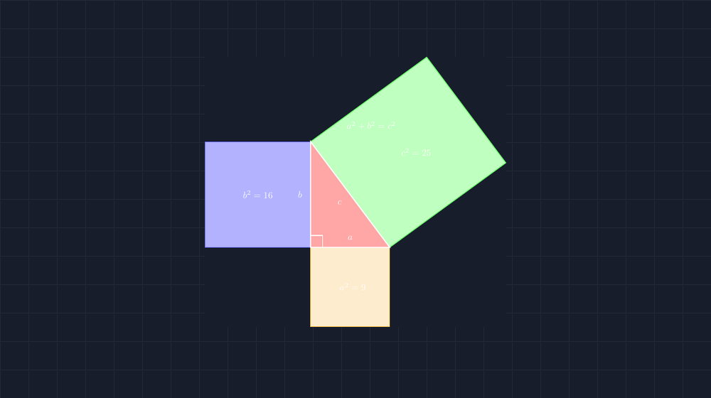

Ada satu momen yang saya ingat sangat jelas dari masa saya jadi siswa: guru saya menulis teorema Pythagoras di papan, memberi garis bawah tebal, lalu berkata, "Ini rumus penting. Hafalkan." Dan saya hafalkan. Saya hafalkan begitu baik sampai bisa mengerjakan puluhan soal tanpa pernah sekali pun paham mengapa jumlah dua kuadrat itu harus sama dengan kuadrat yang ketiga. Rumus itu datang ke hidup saya seperti aturan sekolah: tidak perlu alasan, yang penting dijalankan.

<!--more-->

Tahun-tahun pertama mengajar, saya hampir mengulang hal yang sama pada murid-murid saya. Berbeda sedikit saja — saya menambahkan satu contoh segitiga sisi 3, 4, 5 di papan tulis, menghitung $3^2 + 4^2 = 5^2$, bilang "lihat, cocok", lalu lanjut ke latihan soal. Sisanya saya serahkan pada hafalan dan kebiasaan. Dan murid-murid saya memang bisa. Nilai mereka di soal Pythagoras tidak buruk. Tapi setiap kali saya mengubah soalnya sedikit — misalnya meminta mereka mencari sisi miring dari segitiga yang bukan bilangan bulat cantik — saya bisa merasakan bahwa yang mereka pegang cuma prosedur, bukan pemahaman.

Tahun ini saya mencoba jalan yang berbeda. Dan jalan itu ternyata bukan tentang latihan lebih banyak, tapi tentang menunda rumus lebih lama.

## Mulai dari Persegi, Bukan dari Rumus

Kelas VIII-C tahun ini saya mulai dari pertanyaan yang kelihatannya jauh dari Pythagoras: "Kalau saya punya segitiga siku-siku dengan sisi 3 cm dan 4 cm, lalu saya pasang persegi di setiap sisinya, bagaimana hubungan luas ketiga persegi itu?"

Saya membagikan kertas berpetak, dan murid-murid menggambar sendiri. Persegi di sisi 3 luasnya 9 petak. Persegi di sisi 4 luasnya 16 petak. Persegi di sisi miring — ini bagian yang menarik — tidak bisa dihitung dengan mudah karena miring, jadi mereka harus menghitung petak utuh dan petak yang terpotong satu per satu. Ada yang berhitung sampai berkali-kali karena takut salah. Ketika seorang murid bernama Raka akhirnya seru, "Pak, dua puluh lima! Sembilan tambah enam belas!" — suasana kelas berubah. Bukan karena mereka menemukan rumus, tapi karena mereka baru saja *melihat* sesuatu yang tidak saya beritahu duluan.



Gambar di atas persis seperti yang kami bangun bersama di kelas, hanya versi rapi yang saya buat di rumah dengan TikZ. Segitiga siku-sikunya sisi $a = 3$, $b = 4$, sisi miring $c = 5$. Persegi kuning di bawah luasnya $a^2 = 9$, persegi biru di kiri $b^2 = 16$, dan persegi hijau miring di atas sisi miring $c^2 = 25$. Angka $9 + 16 = 25$ bukan lagi kebetulan yang dicocok-cocokkan — ia terlihat, bisa dihitung ulang, bisa diuji dengan penggaris.

## Dari Satu Segitiga ke Keyakinan

Tentu satu contoh tidak membuat teorema. Ini poin yang juga saya tegaskan ke murid: dari segitiga 3-4-5 kita baru punya *dugaan*. Maka minggu berikutnya kami coba segitiga lain — 6-8-10, lalu 5-12-13, lalu segitiga dengan sisi yang tidak bulat. Setiap kali dugaan itu selamat dari uji baru, keyakinan mereka menguat. Di titik ini saya ceritakan bahwa matematikawan tidak berhenti di "cocok terus"; mereka mencari alasan yang berlaku untuk *semua* segitiga siku-siku, dan bukti lengkapnya (yang salah satunya lewat penataan empat segitiga di dalam persegi besar) bisa mereka pelajari nanti. Untuk kelas VIII, melihat dan menguji itu sudah sebuah pencapaian yang jujur.

Ada satu momen lain yang ingin saya catat. Seorang murid, Salsa, bertanya: "Pak, kalau segitiganya bukan siku-siku, berlaku tidak?" Pertanyaan bagus — dan jawabannya tidak. Kami mencoba segitiga dengan sisi 3, 4, dan 6: $9 + 16 = 25$, tapi $6^2 = 36$. Tidak sama. Dari kegagalan kecil itu justru muncul pemahaman bahwa sudut siku-siku bukan hiasan; ia syarat dari teorema. Murid yang menemukan sendiri batas berlakunya sebuah teorema akan mengingat batas itu jauh lebih lama daripada murid yang membacanya di buku.

## Menggambar dengan TikZ: Supaya Jujur pada Geometrinya

Nah, sekarang bagian kedua dari cerita ini. Gambar-gambar itu, untuk bahan ajar yang dibagikan ke kelas, saya buat ulang dengan TikZ. Bukan sekadar biar cantik — tapi karena menggambar Pythagoras di aplikasi gambar biasa itu jebakan. Sangat mudah tidak sengaja menggambar persegi yang sisi-sisinya tidak benar-benar sama panjang, atau segitiga yang katanya siku-siku tapi sudutnya 93 derajat. Murid yang jeli akan melihat ketidakjujuran itu, dan dugaan yang sedang kami bangun bersama langsung goyah.

Di TikZ, saya menentukan titik-titiknya secara matematis:

```latex
\coordinate (C) at (0,0);
\coordinate (A) at (0,4);
\coordinate (B) at (3,0);
% persegi di sisi a (bawah), sisi b (kiri), dan sisi miring c
```

Segitiganya sisi 3 dan 4, jadi sisi miringnya $\sqrt{9+16} = 5$. Persegi di sisi miring saya bangun dengan menggeser titik-titik tegak lurus terhadap sisi miring — arah gesernya saya hitung, bukan saya kira-kira. Hasilnya: setiap persegi benar-benar persegi, sudut siku benar-benar siku, dan label $a^2 + b^2 = c^2$ berdiri di tempat yang seharusnya. Kalau ingin mengubah segitiganya jadi 5-12-13, saya cukup ganti koordinatnya dan TikZ menata ulang semuanya secara konsisten.

Yang paling saya hargai dari proses ini justru hal yang tidak terlihat murid: waktu berpikir saya sendiri. Untuk membuat gambar yang jujur, saya terpaksa menghitung ulang geometrinya — memastikan vektor tegak lurusnya benar, memastikan label tidak menimpa garis. Menggambar ulang bahan ajar ternyata menjadi salah satu cara saya menguji ulang pemahaman saya sendiri.

> 📎 **Berkas TikZ lengkap:** [tikz-teorema-pythagoras-bukti-visual.tex](tex/tikz-teorema-pythagoras-bukti-visual.tex) — siap kompilasi (butuh paket `tikz`).

## Apa yang Berubah di Kelas

Bedanya dengan tahun-tahun sebelumnya? Kalau dulu murid datang ke Pythagoras sebagai penerima rumus, tahun ini mereka datang sebagai saksi. Mereka menghitung luasnya sendiri, menguji dugaannya sendiri, dan menemukan sendiri batas berlakunya. Ketika akhirnya saya tuliskan $a^2 + b^2 = c^2$ di papan, tidak ada lagi kesan "rumus turun dari langit" — ada kesan "oh, ini nama resmi untuk hal yang kemarin kita lihat".

Apakah semua murid langsung paham? Tidak. Ada yang masih bingung membedakan sisi miring dengan kaki segitiga, dan itu pekerjaan pekan-pekan berikutnya. Tapi perbedaannya terasa di pertanyaan yang muncul. Dulu pertanyaannya "Pak, rumusnya mana?" Sekarang pertanyaannya "Pak, ini berlaku juga kalau segitiganya dicerminkan?" — dan menurut saya, jenis pertanyaan kedua adalah tanda bahwa matematika sudah mulai hidup di kepala mereka, bukan cuma tersimpan di hafalan.

Kalau Bapak/Ibu ingin mencoba hal serupa, saran saya sederhana: tunda rumusnya. Beri murid kertas berpetak, satu segitiga siku-siku, dan satu pertanyaan tentang luas. Biarkan mereka menghitung, salah, menghitung ulang, lalu menemukan polanya sendiri. Rumus Pythagoras sudah lebih dari dua ribu tahun bertahan; ia tidak akan kemana-mana. Yang perlu kita lakukan hanyalah memastikan murid tidak berpapasan dengannya tanpa pernah benar-benar melihatnya.
