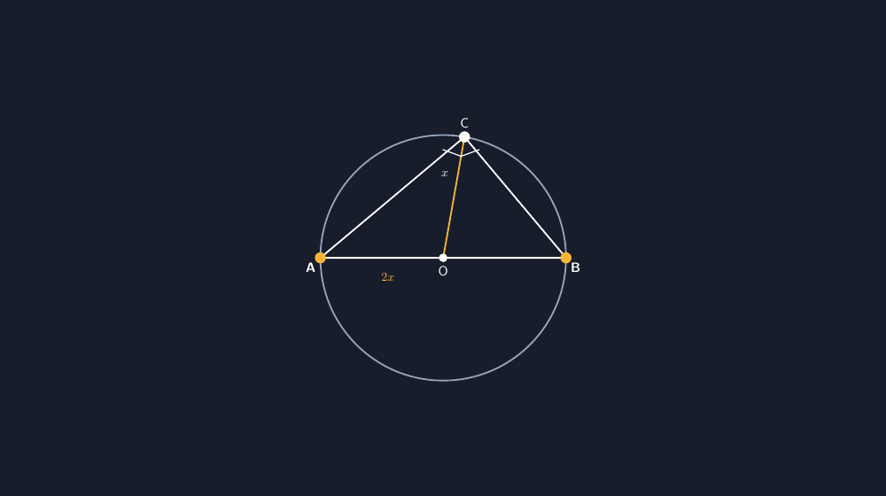
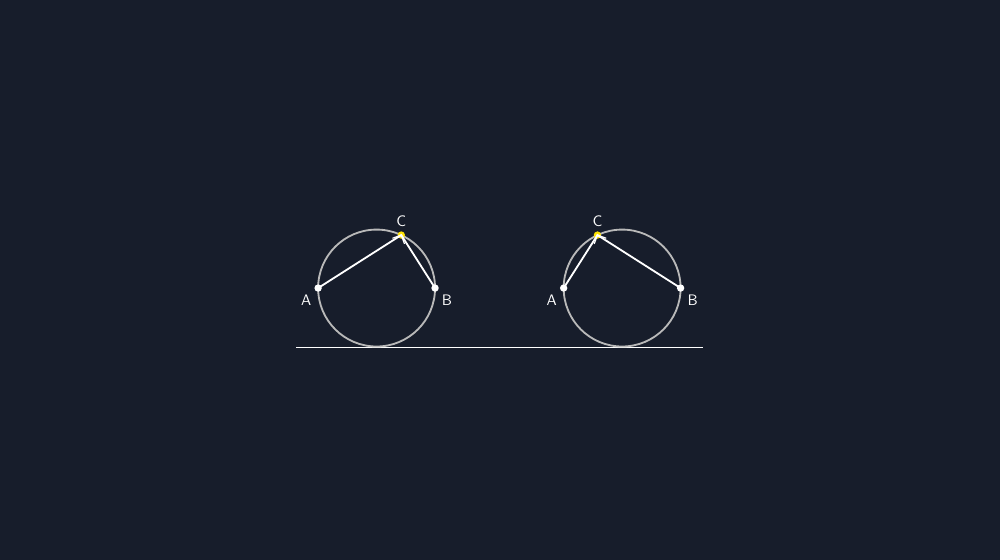

Ada satu momen yang setiap tahun selalu saya tunggu di kelas VIII, persisnya saat bab lingkaran. Bukan saat menghitung keliling, bukan juga saat mencari luas juring. Momen yang saya tunggu adalah saat siswa menyadari bahwa setengah lingkaran menyembunyikan sebuah teorema yang terasa seperti sulap: *sudut keliling yang menghadap diameter selalu 90°*. Teorema Thales. Nama yang terdengar kuno, Yunani sekian ribu tahun lalu, tetapi penemuan tetap membuat mata kelas berbinar kalau disajikan dengan cara yang tepat.

Tahun ini penyajian itu saya upayakan lewat gambar. Dan seperti sudah jadi kebiasaan, gambar itu saya buat dengan TikZ.

<!--more-->

## Mulai dari Lingkaran, Bukan dari Rumus

Saya tidak membuka pelajaran dengan menulis teorema di papan. Saya buka dengan gambar sederhana: satu lingkaran, satu diameter, dan satu titik yang boleh "berjalan" di sepanjang lingkaran — tentu saja titiknya tidak benar-benar berjalan di papan tulis, tapi saya menggambar tiga posisi titik itu satu per satu, dan di setiap posisi saya tarik dua tali dari titik itu ke kedua ujung diameter.

Lalu saya bertanya, "Coba kira-kira, berapa sudut di titik C di posisi yang ini?"

Kelas menebak. Ada yang bilang 80°, ada yang bilang 100°, ada yang pasang telinga karena mengira ini pertanyaan jebakan seperti biasa. Kemudian saya minta mereka mengukur dengan busur derajat. Tiga puluh busur berdengung di kelas, dan ketika hasil pengukuran mulai diumumkan satu per satu — semua keluar di sekitar 90° — suasana kelas berubah. Ada kejutan kecil yang jujur, bukan yang dipaksakan.

"Kalau titik C saya pindah ke sini, masih 90° tidak?" Saya gambar posisi kedua. Mereka mengukur lagi. Tetap 90°.



*Gambar 1 — Jari-jari yang membentuk sudut pusat diberi warna berbeda dari tali sudut keliling.*

Di sinilah teorema tidak lagi terasa seperti barang datang dari langit. Siswa yang menemukan sendiri polanya — lewat tangan mereka sendiri yang memegang busur derajat — akan mengingatnya jauh lebih lama daripada siswa yang membaca pernyataan teorema yang dibold di buku paket.

## Kenapa Teorema Itu Benar: Sudut Pusat yang Dua Kalinya

Tapi mengukur bukan membuktikan. Momen kedua yang saya incar adalah menjawab pertanyaan "kenapa". Dan di sinilah jari-jari beraksi.

Ambil lingkaran dengan pusat $O$, diameter $AB$, dan titik $C$ di lingkaran. Tarik $OC$. Karena $OA$, $OB$, dan $OC$ semuanya jari-jari, maka segitiga $AOC$ dan segitiga $BOC$ sama kaki. Misalkan $\angle ACO = x$. Maka $\angle CAO = x$ juga, dan sudut pusat $\angle AOC = 180° - 2x$. Di segitiga satunya, $\angle BCO = y$ dengan $\angle CBO = y$, sehingga $\angle BOC = 180° - 2y$.

Ketiga sudut di pusat itu menyusun garis lurus $AB$, jadi:

$$ (180° - 2x) + (180° - 2y) = 180° $$

yang memberi $2x + 2y = 180°$, atau

$$ x + y = 90° $$

Dan $x + y$ persis adalah $\angle ACB$ — sudut yang tadi siswa ukur dengan busur derajat. Bukan kebetulan, bukan sulap: konsekuensi dari fakta sederhana bahwa semua jari-jari sama panjang.

Dalam notasi sudut pusat yang biasa kita pakai, kalau sudut pusat $\angle AOB = 2x$, maka sudut keliling yang menghadap busur sama, $\angle ACB = x$. Karena diameter menghadap sudut pusat $180°$, sudut kelilingnya selalu setengahnya: $90°$.

## Menggambar yang Jujur dengan TikZ

Gambar untuk materi ini harus memenuhi dua syarat sekaligus: posisi titik harus benar (C benar-benar di lingkaran, O benar-benar di tengah), dan sudut siku-siku di C harus tampak sebagai tanda siku-siku, bukan sekadar diklaim lewat teks. Salah satu pelajaran lama saya: gambar yang tidak jujur justru mengajarkan miskonsepsi. Kalau tanda siku-siku digambar miring karena koordinat asal-asalan, siswa yang teliti akan bingung, dan siswa yang tidak teliti akan meniru kelalaian itu.

Kode TikZ untuk gambar utamanya intinya seperti ini:

```latex
\begin{tikzpicture}[scale=3.2]
  \draw[line, very thick] (0,0) circle (1);
  \coordinate (A) at (-1,0);
  \coordinate (B) at (1,0);
  \coordinate (C) at (80:1);
  \coordinate (O) at (0,0);
  \draw[acc, very thick] (A) -- (O) -- (B);
  \draw[acc, very thick] (O) -- (C);
  \draw[white, very thick] (A) -- (C) -- (B) -- (A);
  \draw[white, thick] ([shift={(-40:0.16)}]C) -- ++(200:0.16) -- ++(160:0.16);
\end{tikzpicture}
```

Ada tiga keputusan kecil di kode ini yang menurut saya penting.

Pertama, titik $C$ ditulis sebagai `(80:1)` — koordinat polar, jarak 1 dari pusat. Artinya $C$ *dijamin* berada di lingkaran berjari-jari 1, bukan ditebak dengan pasangan koordinat kartesius lalu "kira-kira dekatlah". Ini inti dari filosofi TikZ yang saya suka: geometri dijadwalkan oleh angka, bukan oleh mata.

Kedua, sudut pusat dan segitiga sengaja saya bedakan warnanya. Jari-jari $OA$, $OB$, $OC$ yang membentuk sudut pusat saya gambar dengan warna aksen, sedangkan tali $AC$ dan $CB$ putih. Siswa yang melihat gambar ini langsung memisahkan dua benda yang dibicarakan teorema: sudut pusat $2x$ dan sudut keliling $x$. Kalau semua garis satu warna, dua konsep itu menempel menjadi satu dan penjelasan "setengahnya" jadi kabur.

Ketiga, tanda siku-siku di $C$ dibangun dari perintah `shift` dan `++` — dua segmen kecil yang benar-benar mengikuti arah kedua tali di titik $C$, bukan kotak yang ditaruh asal tegak-lurus layar. Untuk sudut 90° yang digambar di lingkaran, detail ini yang membuat tanda itu duduk manis di sudut yang benar.



*Gambar 2 — Pindah posisi C pun, sudut di C tidak pindah dari 90°.*

Gambar keduanya menunjukkan dua posisi $C$ yang berbeda — satu condong kiri, satu condong kanan — dan keduanya tetap siku-siku. Gambar semacam ini saya pakai saat menegaskan bahwa teorema tidak berlaku untuk satu posisi istimewa, tapi untuk semua posisi $C$ di lingkaran (kecuali tentu saja di $A$ dan $B$ sendiri, di mana sudutnya deformasi jadi garis).

## Dari Gambar ke Lembar Latihan

Gambar TikZ ini tidak berhenti di slide. Potongan kodenya saya jadikan template untuk lembar latihan: ganti sudut posisi $C$, dan sudah jadi soal baru. "Pada gambar berikut, $AB$ adalah diameter. Tentukan $\angle ACB$." Terdengar monoton? Justru di kesederhanaan itulah nilainya: siswa berlatih mengenali struktur *diameter → sudut siku-siku* di berbagai wajah gambar, sampai pengenalan itu otomatis.

Soal lanjutannya biasanya saya bumbui sedikit: siswa diberi $\angle CAB = 35°$ diminta mencari sudut yang lain. Di sini teorema Thales bekerja sama dengan segitiga sama kaki yang tadi kita buktikan. Siswa yang hanya menghafal "sudut keliling menghadap diameter = 90°" akan berhenti di situ dan bingung; siswa yang memahami struktur jari-jari sama kaki akan mengalir dari satu sudut ke sudut lain. Perbedaan dua tipe pemahaman ini terlihat jelas di lembar jawaban mereka.

## Menutup Kelas dengan Pertanyaan Terbalik

Kalau ada waktu tersisa, saya suka menutup dengan pertanyaan terbalik: "Kalau saya punya segitiga siku-siku, apa yang bisa kalian katakan tentang lingkaran yang melewati ketiga titik sudutnya?"

Diam sebentar. Lalu ada yang menjawab pelan, "Sisi miringnya... diameter?"

Betul. Itu kebalikan Thales: hipotenusa segitiga siku-siku adalah diameter lingkaran luarnya. Tahun lalu saat kebalikan ini muncul dari mulut siswa — bukan dari saya — saya merasa pelajaran itu selesai dengan cara yang paling saya inginkan: teorema tidak lagi milik Thales, tidak lagi milik buku, tapi milik kelas itu.

Dan gambar-gambar TikZ yang jujur? Mereka hanya perantara. Tapi perantara yang tidak berbohong itu yang membuat sulapnya bisa dipercaya.

> 📎 **Berkas TikZ lengkap:** [tikz-teorema-thales.tex](tex/tikz-teorema-thales.tex) — siap kompilasi (butuh paket `tikz`).
